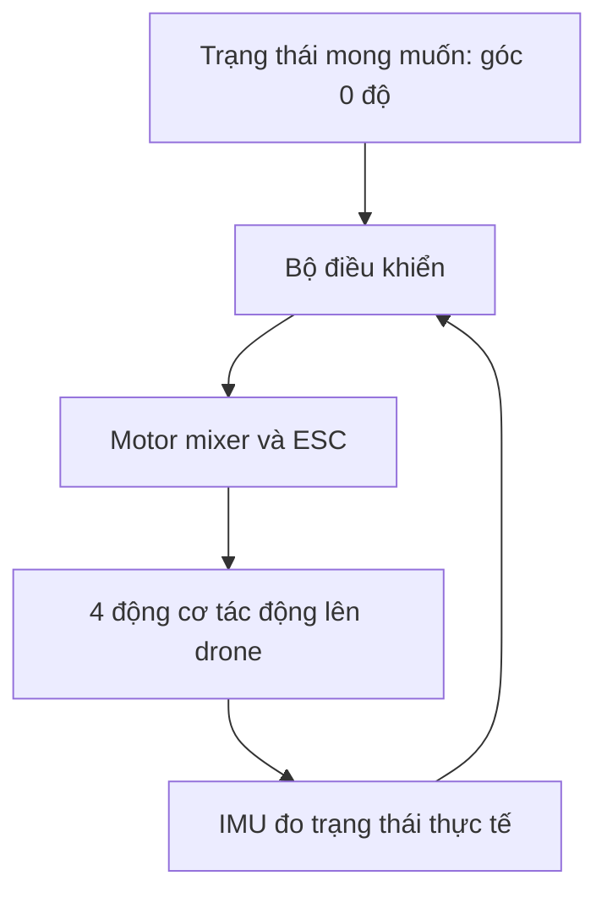
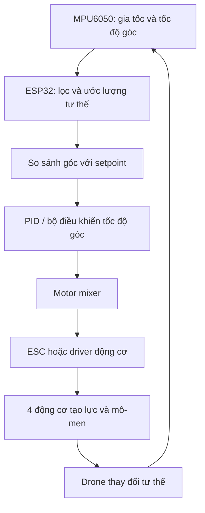

# Drone Simulation and Control – Part 1: Giải thích chi tiết, dễ hiểu

> Tài liệu học tập dựa trên nội dung video *Drone Simulation and Control – Part 1* và phần giải thích về nguyên lý điều khiển drone. Có liên hệ thực hành với ESP32, MPU6050, ESC và bốn động cơ. Các công thức phối trộn là ví dụ theo quy ước được nêu, không phải lệnh đưa thẳng vào phần cứng.

## 1. Mục tiêu của bài toán điều khiển drone

Giả sử muốn một drone bốn cánh quạt (quadcopter) cất cánh, giữ thân nằm ngang và bay lơ lửng ổn định. Chỉ cấp cùng một mức công suất cho bốn động cơ **không đủ để bảo đảm ổn định ngoài thực tế**, do động cơ không hoàn toàn giống nhau, trọng tâm có thể lệch, có gió hoặc rung động.

Do đó cần một **hệ thống điều khiển phản hồi (feedback control)**. Trong mỗi chu kỳ, hệ thống:

1. Đọc cảm biến để biết trạng thái hiện tại.
2. So sánh với trạng thái mong muốn (setpoint).
3. Tính mức hiệu chỉnh.
4. Phối trộn thành lệnh cho các động cơ.
5. Đo lại và lặp liên tục.



Ví dụ drone nghiêng Roll +15°, mục tiêu Roll 0°, thì bộ điều khiển cần yêu cầu mô-men theo chiều giảm góc nghiêng.

## 2. Sáu bậc tự do (6 DOF)

Một vật thể trong không gian ba chiều có **sáu bậc tự do**:

| Nhóm | Bậc tự do | Ý nghĩa |
|---|---|---|
| Tịnh tiến | Lên/xuống | Đổi độ cao |
| Tịnh tiến | Trái/phải | Đổi vị trí ngang |
| Tịnh tiến | Tiến/lùi | Đổi vị trí dọc |
| Quay | Roll | Nghiêng trái/phải |
| Quay | Pitch | Chúi đầu/ngẩng đầu |
| Quay | Yaw | Xoay đổi hướng quanh trục thẳng đứng |

**Tư thế (attitude) khác vị trí (position):** Drone có thể nghiêng 20° mà vị trí gần như chưa đổi, hoặc giữ góc 0° nhưng vẫn đang trôi ngang.

## 3. Tại sao bốn động cơ điều khiển được drone có sáu bậc tự do?

Quadcopter là một **hệ thống thiếu cơ cấu chấp hành (underactuated system)**: có bốn lệnh lực đẩy động cơ nhưng sáu bậc tự do. Các đại lượng nó có thể tác động trực tiếp theo mô hình cơ bản là:

- Tổng lực đẩy (**Thrust**).
- Mô-men **Roll**.
- Mô-men **Pitch**.
- Mô-men **Yaw**.

Các chuyển động ngang không có động cơ đẩy ngang độc lập. Muốn bay sang phải, drone phải nghiêng sang phải, làm cho tổng lực đẩy có thành phần nằm ngang.

Khi tổng lực đẩy là $T$, góc nghiêng so với phương thẳng đứng là $\theta$ (xét đơn giản một mặt phẳng):

$$
F_{\text{ngang}}=T\sin\theta,\qquad F_{\text{đứng}}=T\cos\theta.
$$

Ví dụ drone nặng 1 kg, lấy $g=9{,}81\,\mathrm{m/s^2}$, trọng lượng khoảng 9,81 N. Khi drone nghiêng 20° và giữ tổng lực đẩy 9,81 N:

$$
F_{\text{đứng}}=9{,}81\cos20^\circ\approx9{,}22\,\mathrm{N}.
$$

Vì 9,22 N nhỏ hơn trọng lượng nên drone có xu hướng gia tốc xuống dưới. Để giữ độ cao khi nghiêng 20° trong mô hình lý tưởng:

$$
T=\frac{9{,}81}{\cos20^\circ}\approx10{,}44\,\mathrm{N}.
$$

**Ý nghĩa:** Bay ngang và giữ độ cao liên quan đến nhau; nghiêng thân mà không bù lực đẩy có thể làm drone mất độ cao.

## 4. Lực đẩy và mô-men phản lực của cánh quạt

Cánh quạt đẩy không khí xuống tạo lực nâng hướng lên. Tuy nhiên, khi động cơ quay cánh quạt, động cơ cũng tác dụng lên thân một **mô-men phản lực ngược chiều quay của cánh quạt**.

Nếu cả bốn cánh quạt cùng chiều, mô-men phản lực cộng lại khiến thân có xu hướng tự xoay Yaw. Vì vậy, quadcopter thường bố trí:

- Hai động cơ quay theo chiều kim đồng hồ (**CW**).
- Hai động cơ quay ngược chiều kim đồng hồ (**CCW**).
- Hai động cơ nằm đối diện nhau quay cùng chiều.

Ví dụ nhìn từ trên xuống (chỉ minh họa quy ước):

```text
             PHÍA TRƯỚC

       M1 (CW)       M2 (CCW)
           \          /
            \        /
              [THÂN]
            /        \
           /          \
       M3 (CCW)      M4 (CW)

              PHÍA SAU
```

Trong mô hình lý tưởng, khi hai cặp CW/CCW có mô-men phản lực cân bằng, tổng mô-men Yaw gần bằng 0.

## 5. Điều khiển Thrust, Roll, Pitch và Yaw

### 5.1. Bay lên và xuống (Thrust)

- Tăng lực đẩy của cả bốn động cơ → tổng lực đẩy tăng.
- Khi tổng lực đẩy lớn hơn trọng lượng → drone gia tốc lên.
- Khi tổng lực đẩy bằng trọng lượng, nếu vận tốc đứng bằng 0 → drone có thể bay lơ lửng.
- Khi tổng lực đẩy nhỏ hơn trọng lượng → drone gia tốc xuống.

### 5.2. Roll

Tạo chênh lệch lực đẩy giữa phía trái và phải → có mô-men làm thân nghiêng quanh trục Roll.

### 5.3. Pitch

Tạo chênh lệch lực đẩy giữa phía trước và sau → có mô-men làm đầu drone chúi hoặc ngẩng.

### 5.4. Yaw

Tăng lực đẩy/mô-men của cặp động cơ quay một chiều và giảm cặp còn lại **theo tỷ lệ phù hợp** để thay đổi tổng mô-men phản lực; có thể duy trì gần như cùng tổng lực đẩy trong mô hình lý tưởng.

> Lưu ý: Lực đẩy và mô-men theo tốc độ quay thường có quan hệ gần dạng bình phương. Vì vậy tăng/giảm cùng một số RPM không nhất thiết giữ nguyên tổng lực đẩy.

### 5.5. Minh họa mức lệnh động cơ

Giả sử mỗi động cơ đang ở mức lệnh cân bằng giả định 50%, các con số sau chỉ biểu diễn ý tưởng thay đổi tương đối (không phải mức ga thực để bay):

| Trạng thái | M1 | M2 | M3 | M4 |
|---|---:|---:|---:|---:|
| Cân bằng | 50 | 50 | 50 | 50 |
| Tăng lực đẩy | 65 | 65 | 65 | 65 |
| Tạo mô-men Roll | 60 | 40 | 60 | 40 |
| Tạo mô-men Pitch | 60 | 60 | 40 | 40 |
| Tạo mô-men Yaw | 60 | 40 | 40 | 60 |

Chiều chuyển động tạo ra phụ thuộc cách đánh số động cơ, chiều quay, vị trí và quy ước trục.

## 6. Motor Mixing – Phối trộn động cơ

Ta không nhất thiết thiết kế một bộ điều khiển tư thế riêng cho từng động cơ. Bộ điều khiển tính bốn **yêu cầu tổng quát**:

$$
U=[T,R,P,Y]
$$

Trong đó:

- $T$: thành phần tổng lực đẩy.
- $R$: thành phần mô-men Roll.
- $P$: thành phần mô-men Pitch.
- $Y$: thành phần mô-men Yaw.

**Motor mixer** ánh xạ chúng thành bốn lệnh động cơ. Một ví dụ phối trộn đại số đơn giản:

$$
\begin{aligned}
M_1 &= T+R+P+Y\\
M_2 &= T-R+P-Y\\
M_3 &= T+R-P-Y\\
M_4 &= T-R-P+Y
\end{aligned}
$$

Đây là **ví dụ minh họa**, không phải ma trận mixer đã được kiểm chứng cho mọi kiểu khung drone. Dấu, hệ số đòn bẩy và chuẩn hóa phải khớp với phần cứng thực tế; còn phải giới hạn lệnh, xử lý bão hòa, và đổi ra tín hiệu mà ESC/mạch điều khiển chấp nhận.

## 7. MPU6050 cho biết drone đang nghiêng ra sao?

MPU6050 là một IMU có:

- **Accelerometer 3 trục:** Đo gia tốc riêng; khi ít chuyển động, có thể sử dụng hướng của trọng lực để ước lượng Roll/Pitch.
- **Gyroscope 3 trục:** Đo **tốc độ góc**, ví dụ 30°/s quanh trục Roll.

Hai nguồn đo có điểm mạnh/yếu:

| Cảm biến | Điểm mạnh | Giới hạn |
|---|---|---|
| Gyroscope | Theo dõi thay đổi góc nhanh | Tích phân lâu dài bị trôi do sai lệch bias |
| Accelerometer | Có tham chiếu hướng trọng lực khi gần tĩnh | Nhiễu bởi rung và gia tốc chuyển động |

Vì vậy thường dùng **Complementary Filter** hoặc **Kalman Filter** để kết hợp dữ liệu, ước lượng Roll/Pitch ổn định hơn.

MPU6050 **không tự cung cấp tham chiếu Yaw tuyệt đối bền vững** chỉ dựa trên trọng lực. Muốn biết hướng tuyệt đối trong thời gian dài, có thể cần thêm nguồn đo như từ kế hoặc hệ thống định vị/hướng khác.

## 8. PID giữ drone về góc Roll = 0°

Ví dụ mục tiêu Roll là 0°, nhưng góc đo hiện tại +15°:

$$
e(t)=\theta_{\text{đặt}}-\theta_{\text{đo}}=0-15=-15^\circ.
$$

Phương trình PID:

$$
u(t) = K_p\,e(t) + K_i\int e(t)\,dt + K_d\frac{de(t)}{dt}.
$$

### P – Proportional

Phản ứng với **sai số hiện tại**. Góc lệch càng lớn → yêu cầu hiệu chỉnh càng mạnh.

Ví dụ đơn vị minh họa: nếu $K_p=2$, thành phần P là $-30$. Đây **không phải -30 RPM hay -30% ga**, chỉ là đơn vị lệnh theo quy ước.

P quá lớn có thể làm dao động mạnh hoặc mất ổn định.

### I – Integral

Tích lũy sai số kéo dài để bù các nguyên nhân như trọng tâm lệch. I quá lớn gây tích lũy quá mức (**integral windup**) và quá điều chỉnh; cần giới hạn tích phân, nhất là khi lệnh động cơ chạm ngưỡng.

### D – Derivative

Phản ứng với tốc độ thay đổi sai số, có tác dụng **giảm chấn** để drone không lao quá nhanh qua góc đích.

Trong bộ điều khiển drone thực tế, thường dùng số đo tốc độ góc gyro cho vòng điều khiển tốc độ góc; có thể tổ chức điều khiển **cascade**: vòng góc ngoài → vòng tốc độ góc trong.

## 9. Hệ thống ESP32 + MPU6050 + ESC hoạt động theo trình tự nào?



Ví dụ khi drone nghiêng 10° sang phải:

1. MPU6050 cung cấp gia tốc và tốc độ góc.
2. ESP32 ước lượng góc Roll khoảng +10°.
3. Bộ điều khiển so với mục tiêu 0° và tính mô-men cần thiết để giảm sai số.
4. Mixer phân bổ mức hiệu chỉnh vào các động cơ tương ứng.
5. Drone có xu hướng quay về gần vị trí nằm ngang.
6. ESP32 đo lại; lệnh được cập nhật qua mỗi chu kỳ.

**ESC** là mạch điều khiển động cơ không chổi than. Nếu dùng động cơ chổi than nhỏ, có thể cần mạch driver khác thay vì ESC BLDC.

## 10. Giữ thăng bằng không đồng nghĩa giữ vị trí

Cần phân biệt:

- **Attitude stabilization:** Giữ Roll/Pitch (và Yaw theo mục tiêu) ổn định.
- **Altitude hold:** Giữ độ cao.
- **Position hold:** Giữ tọa độ ngang.

Drone có góc Roll = Pitch = 0° vẫn có thể tiếp tục trôi ngang do vận tốc sẵn có hay gió. Một mình MPU6050 không cung cấp ước lượng vị trí đáng tin cậy lâu dài.

Trong video, Parrot Minidrone dùng nhiều cảm biến:

- **Siêu âm:** Ước lượng khoảng cách xuống mặt đất, trong tầm hoạt động của cảm biến.
- **Camera Optical Flow:** Ước lượng chuyển động theo phương ngang.
- **Áp suất:** Ước lượng thay đổi độ cao.
- **IMU:** Ước lượng tư thế và tốc độ góc.

Điều này giải thích vì sao một hệ thống chỉ có ESP32 + MPU6050 có thể dùng để học **ổn định tư thế**, nhưng không đủ để bảo đảm drone tự đứng yên tại một vị trí và độ cao xác định.

## 11. Lộ trình học và thử nghiệm

Một trình tự hợp lý:

1. Đọc dữ liệu MPU6050 và hiệu chuẩn sai lệch gyro.
2. Dùng bộ lọc để có Roll/Pitch ổn định khi đứng yên.
3. Thử **một trục Roll** trên giá cố định chắc chắn, kiểm tra chiều dấu cảm biến và chiều hiệu chỉnh.
4. Tinh chỉnh bộ điều khiển, quan sát rung/dao động, thêm giới hạn lệnh và cơ chế ngắt an toàn.
5. Mở rộng sang Roll + Pitch và kiểm tra motor mixing.
6. Sau đó mới cân nhắc thử bay có kiểm soát, khi đã có nguồn cấp, khung, cánh quạt và hệ thống an toàn phù hợp.

**An toàn:** Không thử tự cân bằng với cánh quạt đang quay ở gần tay/mặt. Nên kiểm tra logic điều khiển **không gắn cánh quạt trước**, bảo đảm có khả năng ngắt động cơ khẩn cấp, và chỉ thử trên giá được che chắn phù hợp.

## 12. Tổng kết nhanh

1. Drone có **6 bậc tự do**, nhưng bốn động cơ chỉ tạo được bốn đại lượng điều khiển trực tiếp: tổng lực đẩy, mô-men Roll, Pitch và Yaw.
2. Drone bay ngang bằng cách **nghiêng thân**, nên điều khiển tư thế và độ cao có tương tác.
3. Động cơ quay ngược chiều để **cân bằng mô-men phản lực**; điều chỉnh chênh lệch mô-men sẽ tạo Yaw.
4. **IMU** giúp ước lượng tư thế và tốc độ góc; **PID** hoặc các bộ điều khiển khác tính lệnh hiệu chỉnh.
5. **Motor mixer** phân bổ lệnh Roll/Pitch/Yaw/Thrust cho từng động cơ.
6. Giữ **góc 0°** không đồng nghĩa giữ **tọa độ hoặc độ cao**.

> **Ý chính:** Drone không “biết tự đứng thẳng” chỉ nhờ bốn động cơ. Hệ thống phải liên tục **đo → so sánh → điều khiển → đo lại** để chống lại sai lệch và nhiễu.
