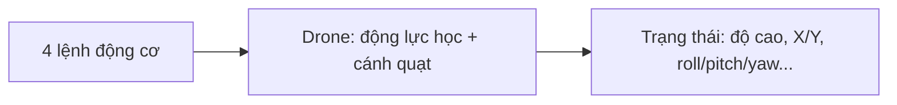
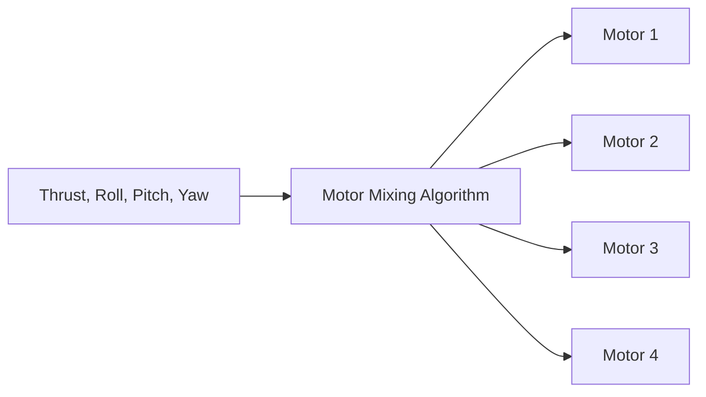
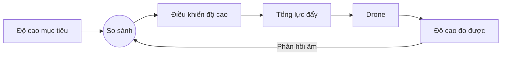
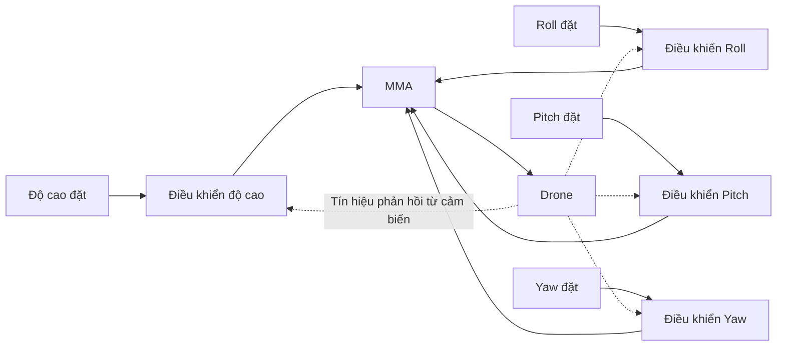
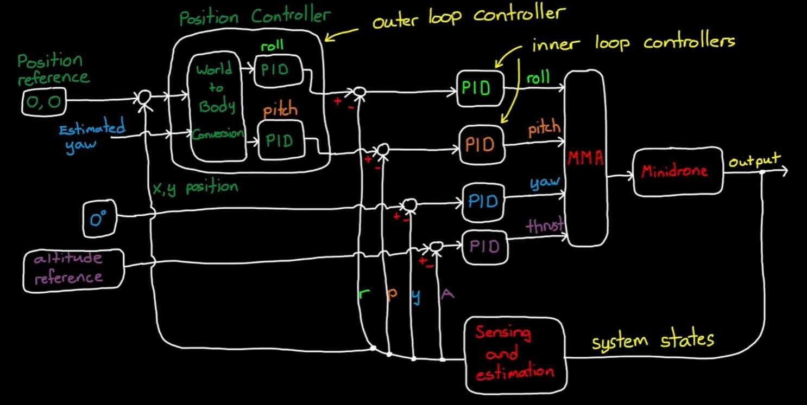
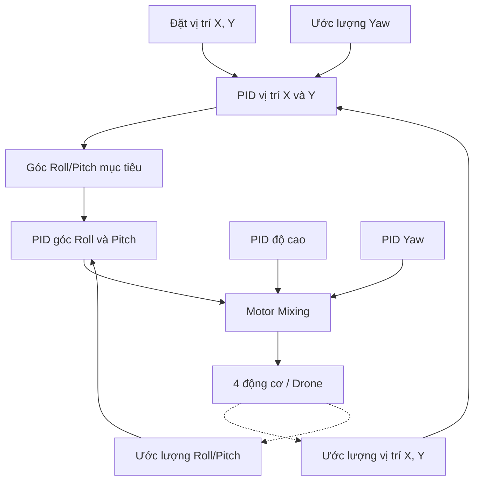
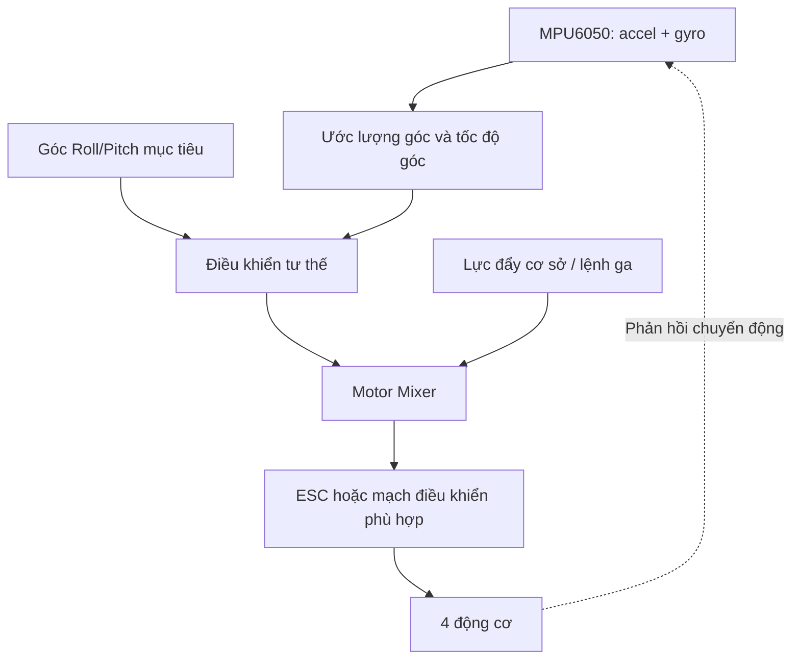
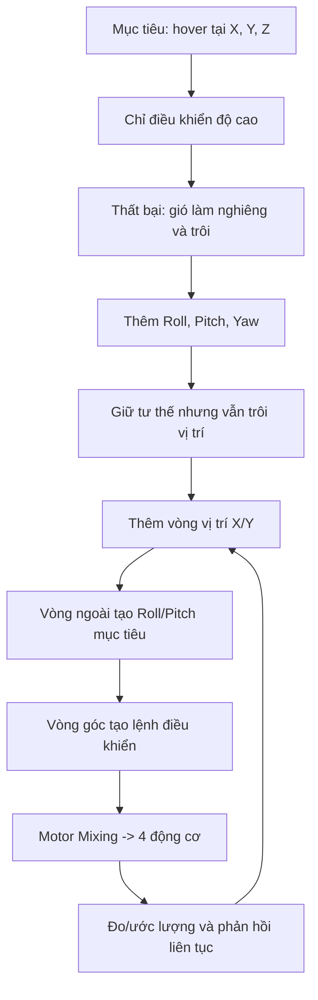

# Drone Simulation and Control – Phần 2: Giải thích chi tiết kiến trúc điều khiển

> **Chủ đề:** Designing the Control System Architecture – Thiết kế kiến trúc hệ thống điều khiển drone bốn cánh quạt (quadcopter).  
> **Đối tượng:** Người mới học hệ thống điều khiển, PID, ESP32 và MPU6050.  
> **Cách đọc:** Các mục **“Theo video”** bám sát nội dung bài giảng của Brian (MATLAB Tech Talk). Các mục **“Giải thích thêm”** là phần diễn giải, ví dụ hoặc gợi ý thực hành bổ sung, không phải phát biểu trực tiếp trong video.

## 1. Phần 2 giải quyết câu hỏi gì?

**Theo video:** Phần 1 đã giải thích cách thay đổi tốc độ bốn động cơ để tạo ra lực đẩy (thrust), chuyển động nghiêng ngang (roll), nghiêng trước–sau (pitch) và xoay hướng (yaw). Phần 2 tiến thêm một bước: **cần những bộ điều khiển nào, chúng nhận tín hiệu nào và kết nối với nhau ra sao** để drone tự giữ độ cao **và** vị trí.

Đừng đánh đồng ba nhiệm vụ:

| Nhiệm vụ | Mục tiêu | Vì sao chưa đủ để “đứng yên”? |
|---|---|---|
| Giữ độ cao | Độ cao gần giá trị đặt | Drone vẫn có thể nghiêng và trôi ngang |
| Giữ tư thế | Roll/Pitch gần góc đặt, Yaw gần hướng đặt | Drone vẫn có thể trôi khỏi vị trí ban đầu |
| Giữ vị trí (hover/position hold) | X, Y và độ cao gần giá trị đặt, đồng thời ổn định tư thế | Đây là mục tiêu hoàn chỉnh hơn của phần 2 |

**Ý chính:** Giữ drone *nằm ngang* không giống với giữ drone *đứng yên tại một chỗ*.

## 2. Bốn động cơ là đầu vào; trạng thái drone là đầu ra

**Theo video:** “Đối tượng điều khiển” (plant) là drone. Đầu vào là bốn tốc độ động cơ; động cơ và cánh quạt tạo ra lực, mô-men, từ đó làm thay đổi chuyển động của drone.



Một **bộ điều khiển phản hồi** không thể chỉ phát lệnh rồi hy vọng drone nghe theo. Nó cần biết drone **đang ở đâu và đang như thế nào**.

- **Giá trị đặt (setpoint/reference):** trạng thái muốn đạt, ví dụ độ cao 1 m.
- **Trạng thái đo/ước lượng:** độ cao thực tế, ví dụ 0,7 m.
- **Sai số:** `e = giá trị đặt − giá trị thực tế`, ví dụ `1 − 0,7 = 0,3 m`.
- **Lệnh điều khiển:** tăng/giảm lực đẩy hoặc mô-men để giảm sai số.

> **Giải thích thêm:** Đây là cấu trúc vòng kín (closed loop). Vòng hở (open loop) chỉ phát công suất cố định mà không tự sửa sai lệch theo kết quả đo.

## 3. Tại sao không điều khiển trực tiếp từng động cơ?

**Theo video:** Brian tưởng tượng một bộ điều khiển thủ công cho phép người lái điều chỉnh riêng tốc độ bốn động cơ. Về nguyên tắc, người điều khiển có thể quan sát drone và liên tục sửa lệnh; tuy nhiên, phải tự tính tổ hợp tốc độ cho mọi chuyển động là rất khó.

**Motor Mixing Algorithm (MMA)** giải quyết việc đó. Thay vì nghĩ bằng “động cơ 1/2/3/4 phải quay bao nhiêu”, người điều khiển hoặc phần mềm đưa ra bốn yêu cầu dễ hiểu:

1. **Thrust:** tăng/giảm tổng lực đẩy.
2. **Roll:** nghiêng trái/phải.
3. **Pitch:** ngẩng/chúi đầu.
4. **Yaw:** xoay hướng quanh trục đứng.

MMA phân bổ bốn yêu cầu này đến bốn động cơ.



**Giải thích thêm:** Một công thức phối trộn minh họa, với quy ước động cơ đã chọn, có dạng:

```text
M1 = T + R + P + Y
M2 = T - R + P - Y
M3 = T + R - P - Y
M4 = T - R - P + Y
```

Ở đây `T` là thành phần lực đẩy chung; `R`, `P`, `Y` là các thành phần hiệu chỉnh. **Đây không phải bảng dấu áp dụng ngay cho mọi drone:** cách đánh số động cơ, cấu hình X/+, hướng trục và chiều quay quyết định dấu và hệ số thực tế. Giá trị còn phải được giới hạn và quy đổi đúng theo ESC/động cơ.

## 4. Bước đầu tiên: bộ điều khiển độ cao

**Theo video:** Khi drone gần như nằm ngang, thay đổi tổng lực đẩy chủ yếu làm thay đổi chuyển động lên/xuống. Brian *giả định Roll và Pitch nhỏ* để đơn giản hóa thiết kế hover. Với drone đua nghiêng lớn, giả định này không còn phù hợp.



Ví dụ:

- Đặt mục tiêu `z_ref = 1,0 m`.
- Cảm biến ước lượng drone ở `z = 0,7 m`.
- Sai số `e_z = 1,0 − 0,7 = +0,3 m`.
- Bộ điều khiển tăng lệnh lực đẩy; drone có xu hướng bay lên.
- Nếu `z = 1,2 m`, sai số âm; bộ điều khiển giảm lực đẩy để drone hạ xuống.

**Giải thích thêm về vật lý:** Trong một mô hình lý tưởng gần nằm ngang:

$$
m\ddot z \approx T - mg
$$

`m` là khối lượng, `g` là gia tốc trọng trường, `T` là tổng lực đẩy thẳng đứng. Khi `T = mg`, gia tốc thẳng đứng gần bằng 0; **điều đó không tự động có nghĩa drone đang đứng yên**, vì nó có thể đang có vận tốc lên/xuống từ trước.

Khi nghiêng góc `θ` trong mô hình đơn giản:

$$
T_{\mathrm{vertical}} = T\cos\theta
$$

Vì vậy, cùng một tổng lực đẩy nhưng nghiêng đi sẽ làm thành phần chống trọng lực giảm. Đây là lý do video nhấn mạnh giả định góc nhỏ.

## 5. Vì sao chỉ giữ độ cao vẫn thất bại?

**Theo video:** Một cơn gió làm drone nghiêng nhẹ. Ngay lúc đó, vectơ lực đẩy bị nghiêng, sinh ra thành phần lực ngang. Drone bắt đầu trôi dù độ cao vẫn được điều khiển.

Hình dung:

```text
Ban đầu:                   Sau khi bị gió tác động:
      ↑ Thrust                       ↗ Thrust
      │                              / 
   [DRONE]                         [DRONE]  → trôi ngang
      ↓ Gravity                      ↓ Gravity
```

**Kết luận:** Một bộ điều khiển độ cao không thể tự bảo đảm drone không bay vào tường. Cần điều khiển **tư thế**.

## 6. Bước thứ hai: bổ sung điều khiển Roll, Pitch và Yaw

**Theo video:** Brian bổ sung ba bộ điều khiển phản hồi, với góc tham chiếu ban đầu bằng 0°:

- Bộ Roll: đưa góc nghiêng ngang về mức mong muốn.
- Bộ Pitch: đưa góc nghiêng trước/sau về mức mong muốn.
- Bộ Yaw: giữ hướng quay mong muốn.
- Bộ độ cao: điều chỉnh tổng lực đẩy.

Các bộ điều khiển dùng tín hiệu đo hoặc ước lượng và gửi lệnh đến MMA.



**Giải thích thêm:** Bốn bộ này không “hoàn toàn độc lập” trong drone thật: lực đẩy, góc nghiêng và động lực học vẫn tương tác. Video dùng cách tách kênh điều khiển trong mô hình đơn giản để giải thích kiến trúc.

## 7. Vì sao giữ Roll = Pitch = 0° vẫn chưa giữ được vị trí?

Đây là **bước ngoặt quan trọng nhất** của phần 2.

**Theo video:** Cơn gió đầu tiên làm drone nghiêng, bộ Roll sửa về nằm ngang — nhưng trong thời gian nghiêng, drone đã dịch chuyển một chút. Cơn gió kế tiếp lặp lại điều đó. Sau nhiều lần, drone từ từ trôi xa. Không có bộ điều khiển nào trong hệ thống đang kiểm tra “drone còn ở tọa độ ban đầu hay không”.

**Giải thích thêm:** Còn một nguyên nhân nữa: ngay cả khi Roll/Pitch quay về 0°, vận tốc ngang đã sinh ra trước đó cũng không tự biến mất ngay. Drone có thể vẫn tiếp tục trôi do quán tính.

Do đó phải đo/ước lượng **tọa độ X, Y** hoặc thông tin chuyển động đủ để điều khiển vị trí.

## 8. Tại sao để đứng yên trong gió, drone đôi khi phải nghiêng?

**Theo video:** Nếu có gió đều đẩy drone sang trái, để chống trôi drone phải hơi nghiêng sang phải. Khi đó lực đẩy có một thành phần ngang chống lại lực gió.

Nếu ép Roll/Pitch luôn 0° trong mọi tình huống, ta đang đặt mục tiêu **nằm ngang**, không hẳn là **đứng yên theo mặt đất**.

**Tư duy đúng:** Đặt mục tiêu vị trí `X_ref, Y_ref`. Hệ thống sẽ tự quyết định Roll/Pitch cần thiết tại mỗi thời điểm để giữ vị trí đó.

## 9. Bước thứ ba: thêm vòng điều khiển vị trí X/Y

**Theo video:** Bộ điều khiển vị trí đo/ước lượng X, Y rồi so sánh với `X_ref, Y_ref`. Thay vì điều khiển trực tiếp từng động cơ, **đầu ra của bộ vị trí là góc Roll/Pitch mục tiêu**.

- Vòng **ngoài (outer loop):** X/Y → tính góc Roll/Pitch mong muốn.
- Vòng **trong (inner loop):** Roll/Pitch → tạo lệnh mô-men → MMA → động cơ.

Hai tầng lồng nhau được gọi là **Cascaded Control Loops – Điều khiển vòng lồng nhau**.



*Sơ đồ gốc do người dùng cung cấp. Outer trong hình là vòng vị trí; inner là các vòng điều khiển Roll/Pitch. Hình chưa thể hiện cấu trúc nội bộ của các khối PID góc.*



**Tại sao phải tách thành hai tầng?**

- Bộ vị trí biết *cần đi về đâu* nhưng không trực tiếp giải quyết cách ổn định thân máy.
- Bộ góc biết *cần nghiêng đến góc nào* và cố thực hiện thật nhanh, ổn định.
- Kết hợp lại: vị trí yêu cầu tư thế, tư thế yêu cầu mô-men, MMA phân bổ động cơ.

**Giải thích thêm:** Trên các hệ thống thực tế, người ta còn thường dùng vòng **tốc độ góc** nằm trong vòng **góc**, hoặc vòng **vận tốc** trong vòng vị trí. Video này trình bày kiến trúc khái niệm gồm sáu PID, chưa đi vào cấu trúc firmware tối ưu hay mọi biến thể có thể triển khai.

## 10. Vì sao bộ điều khiển vị trí còn cần góc Yaw?

**Theo video:** Tọa độ X/Y vị trí thường được xác định trong **hệ tọa độ thế giới** (world frame). Roll/Pitch lại liên quan đến trục gắn với **thân drone** (body frame). Khi drone xoay Yaw, “phía trước drone” không còn trùng với “phía trước căn phòng”.

Ví dụ:

- Drone hướng Bắc: chúi đầu có thể tạo gia tốc về Bắc.
- Drone quay Yaw 90°: cùng lệnh chúi đầu có thể tạo gia tốc về Đông.
- Muốn drone đi đến một tọa độ phòng cố định, bộ vị trí phải tính đến hướng Yaw để chọn tỷ lệ Roll/Pitch đúng.

**Giải thích thêm:** Với quy ước trục phẳng thích hợp, phép đổi tọa độ thường dùng một ma trận quay:

$$
\begin{bmatrix}x_b\\y_b\end{bmatrix}
=
\begin{bmatrix}
\cos\psi & \sin\psi\\
-\sin\psi & \cos\psi
\end{bmatrix}
\begin{bmatrix}x_w\\y_w\end{bmatrix}
$$

Trong đó `ψ` là Yaw; chỉ số `w` chỉ world, `b` chỉ body. Dấu và hướng trục phụ thuộc quy ước; công thức chỉ minh họa phép đổi hệ tọa độ.

## 11. Ví dụ theo video: Drone lệch sang trái so với điểm cất cánh

Giả sử:

- Drone đang giữ đúng độ cao.
- Drone vẫn nằm ngang (`Roll ≈ 0°`).
- Tọa độ vị trí lệch một chút sang trái so với mục tiêu.

**Quá trình điều khiển theo video, từng bước:**

1. **Đo vị trí:** hệ thống biết drone đang lệch trái.
2. **Vòng vị trí:** từ sai số X/Y, tính lệnh Roll nghiêng sang phải.
3. **Vòng Roll:** phát hiện Roll thực tế vẫn bằng 0° trong khi Roll mục tiêu khác 0°, nên phát lệnh tạo mô-men.
4. **Motor Mixing:** phân phối lệnh đến động cơ hai bên để drone nghiêng phải.
5. **Drone di chuyển:** lực đẩy xuất hiện thành phần ngang sang phải.
6. **Độ cao hơi giảm:** khi thân nghiêng, thành phần lực đẩy đứng giảm.
7. **Vòng độ cao sửa sai:** tăng tổng lực đẩy để bù phần mất đi.
8. **Drone tiến gần vị trí mong muốn:** sai số vị trí giảm, vòng ngoài giảm yêu cầu nghiêng.
9. **Hãm lại:** nếu drone đang trôi phải nhanh, thành phần D giúp giảm lệnh nghiêng sớm hơn, thậm chí yêu cầu nghiêng ngược lại để phanh chuyển động.
10. **Tiến tới điểm đích:** hệ thống cố giảm cả sai số vị trí lẫn xu hướng trôi vượt qua vị trí mục tiêu.

```text
Vị trí ban đầu          Vị trí mục tiêu
     Drone                      X
       |------------------------|
      lệch trái → nghiêng phải → có gia tốc sang phải
                 → gần đích → giảm nghiêng / nghiêng để hãm
```

## 12. Vai trò của P và D trong điều khiển vị trí

**Theo video:** Phần tỷ lệ **P** phản ứng với sai số vị trí; khi drone tiến gần mục tiêu, yêu cầu nghiêng từ P giảm. Phần vi phân **D** hữu ích vì nó tính đến việc drone đang tiến gần mục tiêu *nhanh đến đâu*, từ đó có thể hãm sớm.

**Giải thích thêm bằng ví dụ số (chỉ minh họa, không phải tham số thật):**

Giả sử muốn giữ `x_ref = 0 m`, drone đang ở `x = -1 m`:

$$
e_x=x_{ref}-x=0-(-1)=+1\ \mathrm{m}
$$

Nếu chỉ có P, bộ điều khiển ra lệnh tăng chuyển động theo chiều dương vì sai số là +1 m. Nhưng khi drone gần mục tiêu, ví dụ ở `x = -0,1 m`, nó vẫn có thể đang lao tới với vận tốc lớn. Chỉ nhìn sai số vị trí +0,1 m là không đủ để quyết định hãm phù hợp.

Với mục tiêu đứng yên, đạo hàm của sai số (khi setpoint cố định) liên quan đến vận tốc:

$$
\dot e_x=-\dot x
$$

Một bộ điều khiển PD lý tưởng có thể tạo yêu cầu gia tốc ngang dạng:

$$
a_{x,cmd}=K_p(x_{ref}-x)-K_d\dot x
$$

Lệnh gia tốc ngang sau đó được chuyển thành góc nghiêng mục tiêu phù hợp. Với cách này, thành phần D hoạt động giống **phanh theo vận tốc**.

> **Chú ý:** Đừng lấy công thức PD vị trí này nạp thẳng vào lệnh ESC. Nó chỉ là một lớp trong hệ thống nhiều vòng, còn cần xử lý giới hạn, dấu trục, đơn vị, ước lượng trạng thái và khả năng chấp hành thực tế.

## 13. Tại sao video nói cần sáu bộ PID?

**Theo video:** Kiến trúc mà Brian vừa xây dựng có **sáu bộ điều khiển PID** tương tác với nhau:

| Bộ điều khiển | Giá trị muốn đạt | Đầu ra dùng để làm gì? |
|---|---|---|
| X Position | Tọa độ X đặt | Góp phần xác định Roll/Pitch mục tiêu |
| Y Position | Tọa độ Y đặt | Góp phần xác định Roll/Pitch mục tiêu |
| Altitude | Độ cao đặt | Tạo yêu cầu tổng lực đẩy |
| Roll | Góc Roll mục tiêu từ vòng vị trí | Tạo yêu cầu mô-men Roll |
| Pitch | Góc Pitch mục tiêu từ vòng vị trí | Tạo yêu cầu mô-men Pitch |
| Yaw | Hướng Yaw đặt | Tạo yêu cầu mô-men Yaw |

Hai PID vị trí và hai PID góc Roll/Pitch tham gia trực tiếp vào các vòng lồng nhau. PID Yaw và độ cao phối hợp qua MMA với các lệnh còn lại.

**Giải thích thêm:** Một bộ PID tổng quát có dạng:

$$
u(t) = K_p\,e(t) + K_i\int_0^t e(\tau)\,d\tau + K_d\frac{de(t)}{dt}
$$

- `P`: phản ứng với sai số hiện tại.
- `I`: tích lũy sai số theo thời gian để bù lệch kéo dài.
- `D`: phản ứng với xu hướng thay đổi sai số, có thể tăng tính giảm chấn.

Không nhất thiết mọi vòng trong ứng dụng thực tế đều sử dụng đủ ba thành phần P, I, D hoặc dùng chung bộ hệ số. Mỗi vòng cần thiết kế theo động lực học, tần suất đo, nhiễu và giới hạn của nó.

## 14. Hai thách thức lớn khi triển khai

### 14.1. Phải ước lượng được trạng thái

**Theo video:** Cần ước lượng Roll, Pitch, Yaw, độ cao, X và Y. Brian đề cập việc kết hợp bốn cảm biến trên Parrot Minidrone, đôi khi dùng mô hình và bộ lọc Kalman.

Liên hệ với các cảm biến từ phần 1:

| Cảm biến | Vai trò có thể hỗ trợ |
|---|---|
| IMU | Gia tốc, tốc độ góc; hỗ trợ ước lượng tư thế |
| Siêu âm | Độ cao tương đối so với bề mặt trong phạm vi phù hợp |
| Áp suất | Ước lượng thay đổi độ cao |
| Camera + optical flow | Ước lượng chuyển động ngang từ thay đổi hình ảnh |

**Giải thích thêm cho ESP32 + MPU6050:** MPU6050 hữu ích để ước lượng Roll/Pitch và đo tốc độ góc, nhưng **không tự cho bạn vị trí X/Y ổn định lâu dài hoặc độ cao chính xác chỉ bằng cách tích phân gia tốc**. Yaw cũng sẽ trôi khi chỉ dựa vào gyro mà không có tham chiếu hướng bên ngoài. Đây là lý do các cảm biến bổ sung rất quan trọng nếu muốn *position hold*.

### 14.2. Phải tinh chỉnh các vòng PID tương tác

**Theo video:** Việc tinh chỉnh sáu PID, đặc biệt các vòng lồng nhau, rất khó nếu không có mô hình hệ thống. Brian định dùng **Model-Based Design**, MATLAB và Simulink để mô phỏng, kiểm tra và chỉnh các bộ điều khiển.

**Giải thích thêm:** Một nguyên tắc triển khai phổ biến là làm ổn định vòng trong trước, rồi mới thêm vòng ngoài. Vòng trong thường cần phản ứng nhanh hơn vòng ngoài. Đây là hướng dẫn kỹ thuật bổ sung, không phải quy trình tune PID chi tiết được trình bày trong phần 2.

## 15. Liên hệ thực tế: ESP32 + MPU6050 + ESC

**Đây là phần mở rộng áp dụng, không phải lời thoại của video.**

Nếu bạn dùng ESP32 và MPU6050, hãy phân biệt ba cấp độ thử nghiệm:

| Cấp độ | Dữ liệu tối thiểu | Điều bạn có thể kiểm chứng |
|---|---|---|
| Giá thử một trục Roll | MPU6050, điều khiển lực/mô-men Roll | Drone có xu hướng trả về góc Roll mục tiêu không? |
| Giữ tư thế Roll/Pitch | IMU, bốn động cơ và bộ phối trộn phù hợp | Khả năng cân bằng tư thế |
| Giữ vị trí X/Y và độ cao | Bổ sung đo/ước lượng độ cao và vị trí hoặc vận tốc ngang | Khả năng bay tại một vị trí |

### 15.1. Firmware điều khiển tư thế có thể tổ chức theo luồng nào?



Bộ điều khiển cần chạy theo chu kỳ xác định, đọc và lọc dữ liệu IMU, tính sai số, sinh lệnh, giới hạn đầu ra và cập nhật mạch điều khiển động cơ.

### 15.2. Nếu chỉ có MPU6050 thì làm được gì?

Bạn có thể thực hành **giữ góc**. Ví dụ, nếu Roll mục tiêu là `0°` nhưng Roll ước lượng là `+12°`, bộ điều khiển tính mô-men sửa ngược chiều nghiêng. Sau khi thân quay trở về, tín hiệu điều khiển giảm và có thể phải hãm tốc độ góc để tránh vượt qua mục tiêu.

Nhưng MPU6050 **không thể tự biết drone đã trôi sang trái 0,5 m** với độ tin cậy cần thiết cho bài toán vị trí lâu dài. Vì vậy không thể triển khai đầy đủ hai vòng X/Y trong phần 2 chỉ với một MPU6050.

### 15.3. Lưu ý an toàn cho thử nghiệm

- Thử bộ lọc IMU và dấu Roll/Pitch **khi chưa lắp cánh quạt**.
- Xác minh thứ tự, chiều quay động cơ và dấu hiệu chỉnh Motor Mixing trước khi cấp lực đẩy đáng kể.
- Dùng giá thử cố định có chắn cánh quạt, nguồn cấp phù hợp và cơ chế ngắt động cơ khẩn cấp khi thử vòng điều khiển.
- Không thử cất cánh tự do nếu chỉ mới xác minh được một trục hoặc chưa biết hệ thống có ổn định không.

## 16. Những nhầm lẫn phổ biến

**Nhầm lẫn 1: “Roll = Pitch = 0° tức là drone đứng yên.”** Sai: drone có thể vẫn mang vận tốc ngang và trôi do gió.

**Nhầm lẫn 2: “Chỉ cần PID độ cao là hover được.”** Sai: drone có thể giữ độ cao trong khi bay khỏi vị trí.

**Nhầm lẫn 3: “PID vị trí xuất thẳng PWM cho bốn motor.”** Không phải trong kiến trúc video: bộ vị trí xuất góc Roll/Pitch mục tiêu; bộ góc mới tạo tín hiệu mô-men để MMA phân bổ.

**Nhầm lẫn 4: “Roll/Pitch phải luôn bằng 0° khi giữ vị trí.”** Sai: trong gió, drone có thể phải nghiêng để tạo lực chống gió.

**Nhầm lẫn 5: “MPU6050 đo luôn tọa độ X/Y.”** Sai: IMU không trực tiếp đo tọa độ ngang.

**Nhầm lẫn 6: “Sáu PID đều chạy độc lập, không ảnh hưởng nhau.”** Sai: các vòng trao đổi setpoint, cùng tác động lên một drone và bị giới hạn bởi cùng bốn động cơ.

## 17. Bản đồ tư duy toàn bộ phần 2



## 18. Tự kiểm tra kiến thức

1. Tại sao bộ điều khiển độ cao không đủ giúp drone đứng yên một chỗ?
2. Nếu drone đã trở về Roll 0°, vì sao nó vẫn có thể trôi sang phải?
3. Trong hệ điều khiển vòng lồng nhau, bộ vị trí X/Y xuất ra đại lượng gì?
4. Tại sao drone phải nghiêng để chống gió ngang?
5. Vì sao cần góc Yaw khi chuyển sai số vị trí trong phòng thành lệnh Roll/Pitch?
6. Sáu PID trong video tương ứng với những trạng thái nào?
7. Với ESP32 + MPU6050, bạn đo/ước lượng được gì và còn thiếu gì để giữ X/Y?

### Đáp án ngắn

1. Vì gió có thể khiến drone nghiêng, tạo lực và chuyển động ngang.
2. Vì drone có thể đã có vận tốc ngang; đưa góc về 0° không tự triệt tiêu vận tốc.
3. Góc Roll/Pitch **tham chiếu** cho vòng điều khiển tư thế.
4. Để có thành phần lực đẩy ngang cân bằng lực gió.
5. Vì trục gắn với thân drone xoay theo Yaw, khác với trục cố định của căn phòng.
6. X, Y, độ cao, Roll, Pitch, Yaw.
7. Ước lượng Roll/Pitch và tốc độ góc; còn thiếu đo/ước lượng vị trí, chuyển động ngang đáng tin cậy, và thường cần thêm tham chiếu độ cao/hướng.

## 19. Kết luận cần ghi nhớ

**Phần 2 không chỉ là “thêm nhiều PID”, mà là cách chia một mục tiêu lớn thành các vòng điều khiển có trách nhiệm rõ ràng:**

> **Muốn giữ vị trí** → bộ vị trí tính **cần nghiêng bao nhiêu** → bộ tư thế tính **cần tạo mô-men thế nào** → Motor Mixing tính **bốn động cơ cần nhận lệnh gì** → cảm biến đo lại để tiếp tục sửa sai.

Vòng độ cao duy trì phương thẳng đứng; vòng Yaw duy trì hướng; các vòng vị trí và tư thế phối hợp để giữ X/Y. Khi triển khai hệ thống thật, yếu tố khó không chỉ là viết PID mà còn là **ước lượng trạng thái đúng, hiểu các hệ tọa độ, phối trộn đúng và tinh chỉnh các vòng lồng nhau**.

---

*Tài liệu được biên soạn từ transcript “Drone Simulation and Control – Part 2: Designing the Control System Architecture” mà người dùng cung cấp, kèm các phần giải thích bổ sung được ghi nhãn rõ ràng.*

## 20. Ví dụ đầy đủ: cả sáu PID phối hợp đưa drone về điểm cần giữ

> **Ví dụ giải thích bổ sung:** các con số dưới đây minh họa luồng trong sơ đồ tác giả, không phải gain hoặc kết quả mô phỏng của tác giả, cũng không phải bộ thông số để nạp vào Drone. Ta dùng một thang lệnh motor giả định để dễ theo dõi phép tính.

### 20.1. Tình huống: drone bị lệch khỏi vị trí cần giữ

Bạn muốn drone đứng ngay trên điểm cất cánh, cao 1 m và giữ hướng đầu ban đầu:

| Trạng thái | Mong muốn | Hiện tại |
|---|---:|---|
| Vị trí trước/sau X | 0 m | −0,4 m: ở phía sau |
| Vị trí trái/phải Y | 0 m | −0,6 m: ở bên trái |
| Độ cao | 1 m | 0,8 m |
| Roll | Do vòng vị trí quyết định | 0° |
| Pitch | Do vòng vị trí quyết định | 0° |
| Yaw | 0° | +10° |

Trong ví dụ, X world hướng về trước phòng, Y world hướng sang phải phòng; X body hướng về trước thân, Y body hướng sang phải thân. Yaw dương quay hướng đầu từ X world về Y world. Góc Roll dương nghĩa là nghiêng phải, Pitch dương nghĩa là chúi về trước. Đây là quy ước minh họa, không phải bảng dấu áp dụng cho firmware Drone.

Giả sử tại thời điểm đang xét, drone gần như không có vận tốc ngang, vận tốc đứng hoặc tốc độ quay.

**Nhiệm vụ của hệ thống:** di chuyển về phía trước và sang phải, nâng lên một chút, đồng thời quay đầu về hướng 0°.

### 20.2. Tính sai lệch vị trí và đổi sang hệ thân drone

Sai lệch theo căn phòng:

```text
Sai lệch X = 0 − (−0,4) = +0,4 m
Sai lệch Y = 0 − (−0,6) = +0,6 m
```

Đầu drone đang quay lệch 10°, nên “phía trước/phải của phòng” hơi khác “phía trước/phải của drone”. Khối World to Body Conversion dùng Yaw để đổi hai thành phần trên.

Với quy ước đã chọn:

```text
Sai lệch phía trước thân = cos(10°) × 0,4 + sin(10°) × 0,6
                        ≈ 0,498 m

Sai lệch bên phải thân   = −sin(10°) × 0,4 + cos(10°) × 0,6
                        ≈ 0,521 m
```

Bạn chưa cần nhớ công thức. Ý nghĩa là: **với hướng đầu hiện tại, phải phối hợp chuyển động theo thân như thế nào để về đúng điểm trong phòng?**

Hai sai lệch sau đổi tọa độ đi vào hai PID vị trí. Khi Yaw thay đổi, phép đổi này cũng phải cập nhật.

### 20.3. PID thứ nhất: vị trí ngang → góc Roll mong muốn

PID phụ trách chuyển động sang phải thấy còn thiếu khoảng 0,521 m theo hướng phải của thân.

Giả sử Kp vị trí là 5 độ/mét, phần I đang tích lũy được +0,10° và phần D tại thời điểm này bằng 0:

```text
P = 5 × 0,521 ≈ +2,61°
I = +0,10°
D = 0°

Roll target ≈ +2,71°
```

Làm tròn cho các bước tiếp theo: **nghiêng phải 2,7°**.

- P thấy còn lệch trái nên yêu cầu nghiêng phải.
- I bổ sung mức bù từ sai lệch đã tồn tại trước đó.
- D sẽ phản ứng với chuyển động ngang để giúp hãm khi drone bắt đầu chạy về đích.

**Đầu ra PID này là góc, chưa phải lệnh motor.**

Giá trị I cần lịch sử sai lệch theo thời gian. Không thể suy ra I chỉ từ một số đo vị trí hiện tại; ví dụ giả sử lịch sử trước đó đã tạo mức I nêu trên.

### 20.4. PID thứ hai: vị trí dọc → góc Pitch mong muốn

PID phụ trách chuyển động về trước thấy còn thiếu khoảng 0,498 m theo hướng trước thân.

Giả sử cùng Kp vị trí là 5 độ/mét:

```text
P = 5 × 0,498 ≈ +2,49°
I = +0,10°
D = 0°

Pitch target ≈ +2,59°
```

Làm tròn: **chúi về trước 2,6°**.

Sau hai PID vị trí:

```text
Roll target  = +2,7°
Pitch target = +2,6°
```

**Đây là điểm tương ứng với hai ô nhập góc mục tiêu trên app của bạn.** Trong sơ đồ tác giả, hệ thống tự tính các góc này từ vị trí, chuyển động và hướng đầu. Trong Drone hiện tại, bạn nhập góc trên app.

### 20.5. PID thứ ba: góc Roll → lệnh sửa Roll

Drone hiện vẫn nằm ngang:

```text
Roll target   = +2,7°
Roll measured = 0°
Sai lệch góc  = +2,7°
```

Giả sử Kp góc là 2 đơn vị lệnh/độ. Các thành phần tại thời điểm đang xét:

```text
P = 2 × 2,7 = +5,4
I = +0,2
D = 0 vì chưa có chuyển động quay

Roll command = +5,6 đơn vị lệnh
```

Lệnh +5,6 yêu cầu tạo tác động nghiêng phải. **Nó không phải góc 5,6° hoặc tốc độ 5,6°/s.** MMA sẽ dùng nó để tăng lực đẩy tương đối bên trái và giảm bên phải.

Về ý nghĩa vật lý, script mô tả lệnh sửa tạo mô-men. Script chưa xác định thang đo cụ thể; ví dụ giả sử đã quy đổi lệnh sang thang tương thích với MMA. Nếu dùng mô-men N·m thì cần bước phân bổ/quy đổi phù hợp, không cộng trực tiếp N·m với duty.

### 20.6. PID thứ tư: góc Pitch → lệnh sửa Pitch

```text
Pitch target   = +2,6°
Pitch measured = 0°
Sai lệch góc   = +2,6°
```

Giả sử Kp góc cũng bằng 2 đơn vị lệnh/độ:

```text
P = 2 × 2,6 = +5,2
I = +0,1
D = 0

Pitch command = +5,3 đơn vị lệnh
```

Lệnh này yêu cầu chúi về trước: tăng lực đẩy tương đối phía sau và giảm phía trước.

### 20.7. PID thứ năm: Yaw → lệnh sửa hướng đầu

```text
Yaw target   = 0°
Yaw measured = +10°
Sai lệch Yaw = −10°
```

Giả sử Kp Yaw bằng 0,3 đơn vị lệnh/độ:

```text
P = 0,3 × (−10) = −3
I = −0,1
D = 0

Yaw command = −3,1 đơn vị lệnh
```

Output âm yêu cầu tạo mô-men quay theo chiều giảm Yaw để đưa đầu drone về 0°.

MMA thực hiện bằng cách thay đổi lệnh giữa các nhóm motor có chiều quay khác nhau. **Không phải yêu cầu motor quay ngược lại.** Bảng dấu cụ thể phải phù hợp thứ tự motor và chiều quay cánh quạt.

### 20.8. PID thứ sáu: độ cao → lệnh lực nâng chung

```text
Độ cao target   = 1 m
Độ cao measured = 0,8 m
Sai lệch độ cao = +0,2 m
```

Giả sử Kp độ cao bằng 20 đơn vị lệnh/mét:

```text
P = 20 × 0,2 = +4
I = +1
D = 0 vì chưa có chuyển động đứng

Phần tăng lực nâng = +5
```

Để minh họa lực nâng duy trì, giả sử có mức lệnh nền 100:

```text
Thrust command = 100 + 5 = 105
```

Mức nền 100 là giả định của ví dụ; script chưa chốt cách bố trí phần bù lực nâng duy trì. Không nên hiểu rằng output PID độ cao bằng 0 thì tổng lực nâng bắt buộc bằng 0.

PID độ cao đang điều chỉnh phần lực nâng chung. Nó không trực tiếp quyết định chênh lệch trái/phải hoặc trước/sau.

### 20.9. Motor Mixing cộng tất cả yêu cầu

MMA nhận bốn thành phần đã quy đổi về cùng thang lệnh:

| Thành phần | Ký hiệu | Giá trị |
|---|---|---:|
| Thrust | T | 105 |
| Roll | R | +5,6 |
| Pitch | P | +5,3 |
| Yaw | Y | −3,1 |

Với quy ước của ví dụ, chọn hai motor trước trái/sau phải có cùng chiều quay, hai motor còn lại quay chiều đối diện, và nhóm dấu Y dương tạo chiều Yaw dương:

```text
Trước trái = T + R − P + Y
Trước phải = T − R − P − Y
Sau trái   = T + R + P − Y
Sau phải   = T − R + P + Y
```

Thay số:

| Motor | Phép tính | Lệnh cuối |
|---|---|---:|
| Trước trái | 105 + 5,6 − 5,3 − 3,1 | 102,2 |
| Trước phải | 105 − 5,6 − 5,3 + 3,1 | 97,2 |
| Sau trái | 105 + 5,6 + 5,3 + 3,1 | 119,0 |
| Sau phải | 105 − 5,6 + 5,3 − 3,1 | 101,6 |

Mỗi motor nhận **một lệnh cuối**, đã kết hợp cả bốn tác động:

- Phần chung nâng drone lên.
- Chênh lệch trái/phải tạo Roll.
- Chênh lệch trước/sau tạo Pitch.
- Chênh lệch theo nhóm chiều quay tạo Yaw.

Các số này là lệnh, không phải RPM đo được hay lực đẩy thực tế. Trong triển khai còn cần quy đổi, giới hạn và xuất lệnh phù hợp phần cứng. Tổng lệnh vẫn bằng `4 × 105 = 420` trong phép trộn tuyến tính chưa cắt này; điều đó không chứng minh tổng lực đẩy thực tế giữ nguyên vì quan hệ lệnh–lực đẩy có thể phi tuyến.

**Không thay bảng dấu mixer của Drone bằng bảng này:** firmware có quy ước trục và bước đổi dấu motor riêng; ví dụ đang giải thích sơ đồ tác giả.

### 20.10. Drone chuyển động rồi hệ thống làm gì tiếp?

Hệ thống đo lại và tính lại toàn bộ. Các output trên chỉ là kết quả ở một thời điểm, không được giữ cố định cho đến khi tới đích.

1. PID góc Roll/Pitch giảm hoặc đảo tác động để thân đạt góc mục tiêu mà không tiếp tục xoay quá.
2. PID Yaw điều chỉnh để về hướng 0° rồi hãm chuyển động quay.
3. PID độ cao điều chỉnh để đạt 1 m và hạn chế vượt độ cao. Khi thân nghiêng, nó còn phải xử lý ảnh hưởng giảm thành phần lực đẩy đứng.
4. Hai PID vị trí cập nhật góc mục tiêu khi drone tiến gần điểm cần giữ.
5. Khối đổi tọa độ cập nhật theo Yaw mới.

Ví dụ drone gần đích nhưng vẫn chạy sang phải nhanh:

```text
PID vị trí:
“Cần nghiêng trái một chút để hãm chuyển động sang phải.”

PID góc:
“Cần tạo mô-men để thân đạt góc nghiêng trái vừa được yêu cầu.”

Motor Mixing:
“Phân phối các yêu cầu mới cho từng motor.”
```

Có hai việc hãm khác nhau:

| Bộ điều khiển | Đang hãm chuyển động nào? |
|---|---|
| PID vị trí | Di chuyển ngang của cả drone |
| PID góc | Xoay/nghiêng thân drone |

Khi mục tiêu cố định, D của vòng vị trí có thể phản ứng theo vận tốc ngang; D của vòng góc có thể phản ứng theo tốc độ quay. Chúng không phải cùng một đại lượng. Các D bằng 0 trong bảng tính ban đầu vì ví dụ giả sử chưa có chuyển động và không xét cú đổi mục tiêu đột ngột; không có nghĩa các gain Kd bắt buộc bằng 0.

Khi đạt mục tiêu, output sửa Roll/Pitch/Yaw có thể gần 0 trong điều kiện lý tưởng không có mô-men gây lệch, nhưng motor vẫn cần lực nâng chung. Nếu có tác động kéo dài, I có thể giữ một mức bù khác 0; trong gió đều, góc cần giữ cũng có thể khác 0°.

### 20.11. Gom toàn bộ luồng vào một hình

```text
Vị trí X/Y mục tiêu − Vị trí X/Y đo được
                       │
                       ▼
             Đổi world → body theo Yaw
                       │
        ┌──────────────┴──────────────┐
        ▼                             ▼
 PID vị trí ngang              PID vị trí dọc
        │                             │
        ▼                             ▼
  Roll target                   Pitch target
        │                             │
        ▼                             ▼
 PID góc Roll                  PID góc Pitch
        │                             │
        R                             P
        └──────────────┬──────────────┘
                       │
Yaw target − Yaw đo → PID Yaw ─────── Y ──┐
                       │                 │
Độ cao đặt − Độ cao đo → PID độ cao ─ T ──┤
                       │                 │
                       └─────────────────┤
                                         ▼
                                    Motor Mixing
                                         │
                                         ▼
                                      4 motor
                                         │
                                         ▼
                                 Drone chuyển động
                                         │
                                         ▼
                                 Cảm biến/ước lượng
                                         │
                            Phản hồi về từng vòng tương ứng
```

Hai PID góc trong hình cũng nhận góc đo để so sánh với góc mục tiêu, dù sơ đồ chữ rút gọn không vẽ riêng các nhánh đó. Các PID đều được cập nhật phản hồi liên tục.

**Phân công của cả sáu PID:** hai PID vị trí chọn góc cần nghiêng; hai PID góc thực hiện việc nghiêng; PID Yaw giữ hướng; PID độ cao giữ độ cao. MMA kết hợp yêu cầu thành bốn lệnh motor.

Trong code Drone hiện tại, phần sau góc mục tiêu còn được tách thành **Angle PID → Rate PID → MMA**. Ví dụ mục 20 đang bám kiến trúc sáu PID được trình bày trong script; nó không bổ sung một vòng rate chưa được tác giả mô tả.
