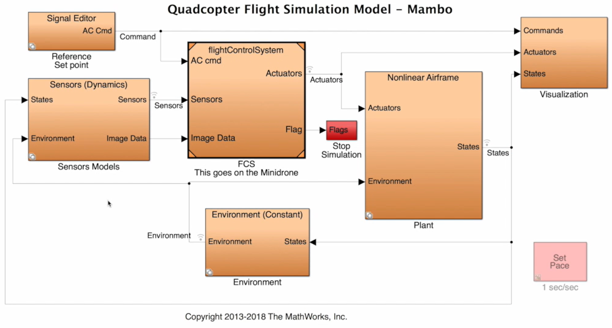
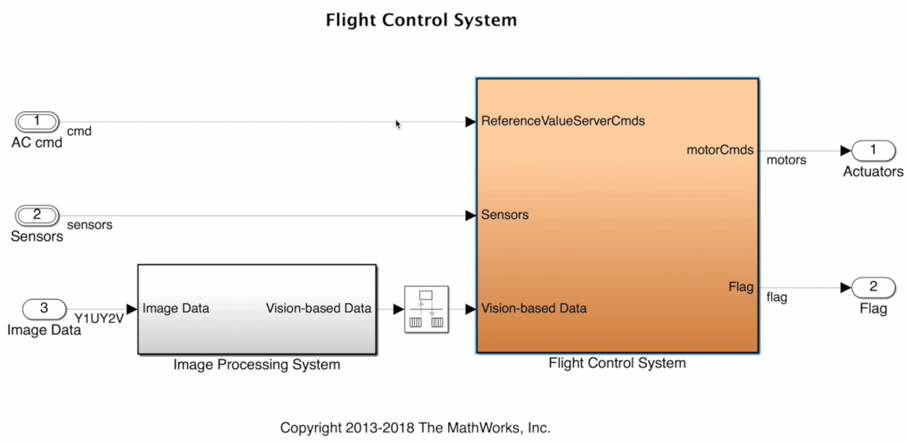
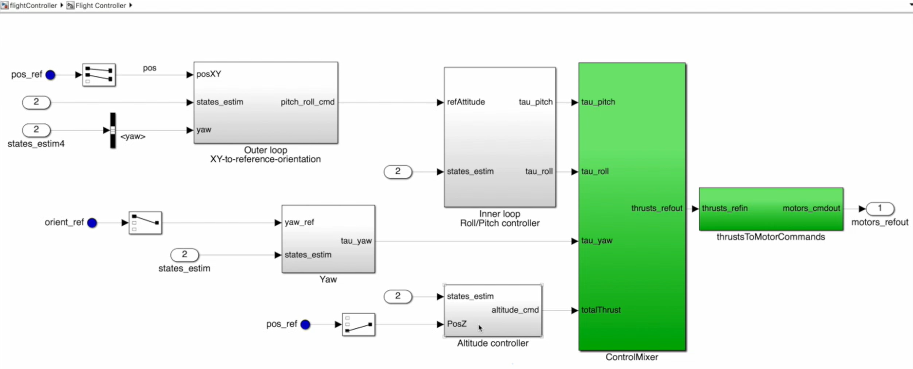
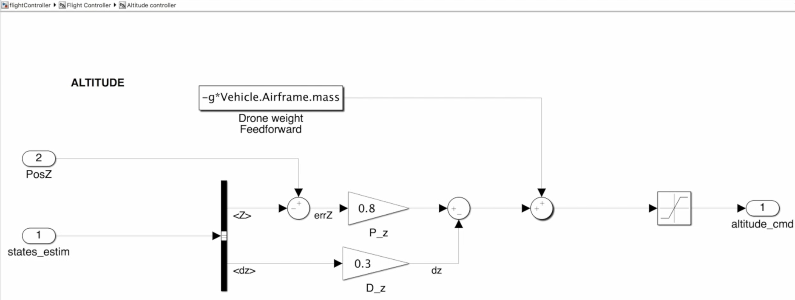
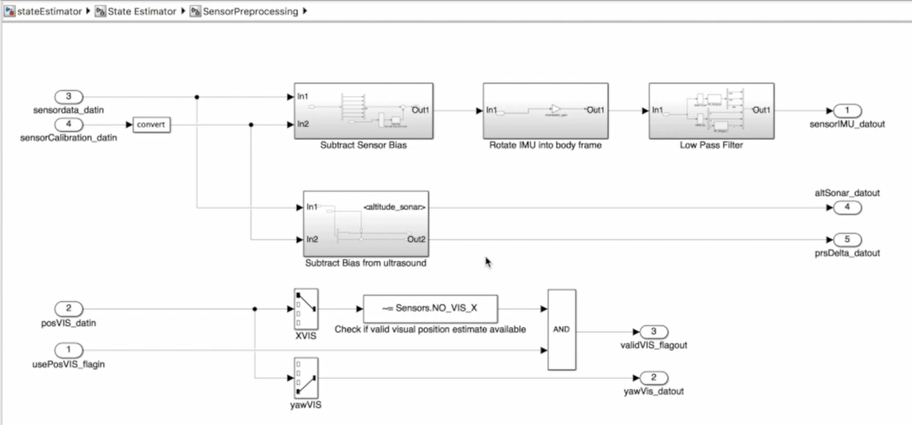
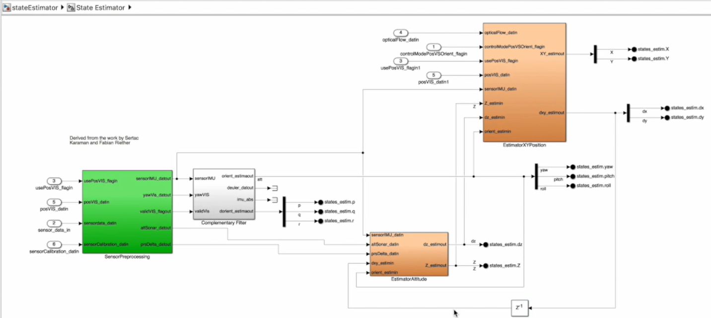
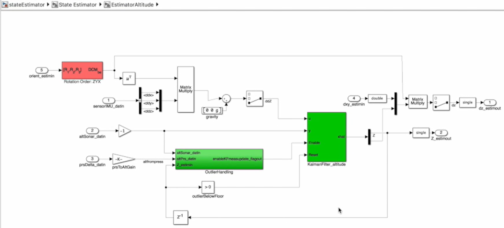
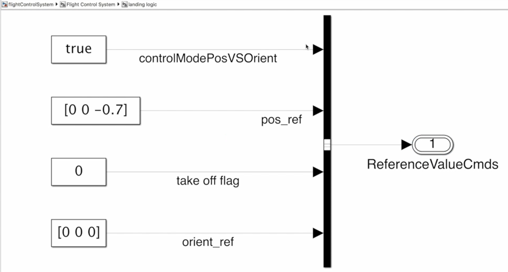
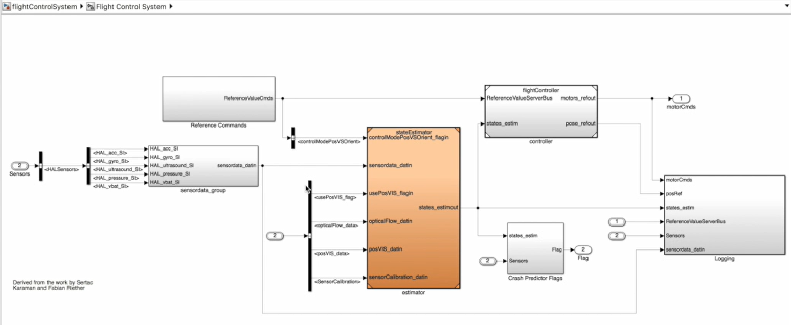

# Drone Simulation and Control – Phần 3: Từ sơ đồ điều khiển đến phần mềm bay

Tài liệu này diễn giải script phần 3 do người dùng cung cấp. Bài viết đi theo câu chuyện của tác giả: đã có kiến trúc điều khiển, vậy phải bổ sung những gì để biến nó thành phần mềm chạy được trên drone?

Các ảnh được dùng tại những đoạn cần quan sát luồng hoặc phép tính cụ thể. Ví dụ số và phần liên hệ Drone là giải thích bổ sung, không phải bộ tham số do tác giả đề xuất cho phần cứng của bạn. Script và ảnh thuộc mô hình Parrot trong video; những bước cài đặt hoặc build được nhắc đến ở đây mô tả bối cảnh đó.

## 1. Đã có sơ đồ PID, vì sao chưa thể đưa drone lên bay ngay?

Ở [phần 2](drone_control_part2.md), tác giả đã giải thích cách phối hợp các vòng để giữ vị trí, độ cao và hướng. Hai vòng vị trí tạo góc Roll/Pitch mong muốn; các bộ điều khiển góc tạo yêu cầu quay; bộ độ cao tạo lực nâng; Motor Mixing phân phối chúng đến bốn motor.

Đến đây, ta mới biết **hệ thống nên suy nghĩ theo luồng nào**. Chưa có nghĩa nó đã có đủ thông tin để tính toán trên phần cứng.

Hãy lấy bộ điều khiển độ cao. Trên giấy, ta viết:

```text
Độ cao mong muốn − Độ cao đo được → Bộ điều khiển → Lệnh lực nâng
```

Nhưng cảm biến áp suất không trả về “drone cao 0,7 m”; nó trả về một số đo áp suất. Gia tốc kế không trả về “drone đang nghiêng 5°”; nó trả về các thành phần gia tốc theo trục cảm biến. Camera cũng không trực tiếp trả về một tọa độ đáng tin cậy nếu chưa xử lý ảnh.

Vì vậy, giữa cảm biến và PID phải có phần mềm biến các số đo đó thành những đại lượng mà bộ điều khiển cần.

Ngoài ra, nếu số đo bất thường làm drone quay mạnh, phần mềm phải biết khi nào cần dừng. Nếu thử xong mà không ghi dữ liệu, ta khó biết nguyên nhân nằm ở cảm biến, bộ ước lượng hay điều khiển.

Đó là lý do phần 3 mở rộng từ “các PID nối với nhau” sang **flight code**: phần mềm nhận lệnh, hiểu số đo, tính điều khiển, kiểm tra lỗi và ghi dữ liệu phục vụ chuyến bay.

### Controller là một phần của flight code

Trong cách gọi của tác giả, **controller** là phần tính lệnh điều khiển từ mục tiêu và trạng thái. **Flight code** có phạm vi rộng hơn. Firmware Parrot còn có phần giao tiếp cảm biến, quản lý motor, pin, Bluetooth, LED và các chức năng vận hành khác.

Tác giả không viết lại tất cả những phần đó. Ông dùng Simulink Support Package cho Parrot để giữ các chức năng firmware cần thiết và thay phần điều khiển qua giao diện đã định.

Có thể hình dung như thay bộ phận ra quyết định trong một hệ thống đã có sẵn đường đọc cảm biến và đường điều khiển motor. Muốn thay đúng, code mới phải giữ đúng giao diện vào/ra mà firmware mong đợi.

## 2. Tại sao tác giả mô tả phần mềm bằng Simulink?

Tác giả nêu cách viết C bằng tay là một lựa chọn hợp lý: viết code, biên dịch rồi đưa lên drone. Nhưng khi phát triển điều khiển phản hồi, cách đó có thể khó quan sát toàn bộ kiến trúc và khó thử tác động của một thay đổi nếu chưa có công cụ mô phỏng riêng.

Ông chọn mô tả phép tính bằng các khối Simulink, rồi sinh mã C từ các khối đó:

```text
Thiết kế logic bằng khối Simulink
                  ↓
Thử với mô hình drone và môi trường trên máy tính
                  ↓
Sinh mã C cho phần cần chạy trên drone
                  ↓
Biên dịch và triển khai lên phần cứng
```

Một khối Gain có thể tương ứng phép nhân; khối Sum tương ứng cộng/trừ; khối Switch chọn nhánh theo điều kiện. Đây là các phép tính được thực thi, không chỉ là hình vẽ thuyết minh.

Lợi ích tác giả muốn có là dùng cùng cách mô tả để hiểu cấu trúc, kiểm tra phản ứng và hiệu chỉnh tham số bằng mô hình. Đó là ý tưởng **Model-Based Design** trong video.

### Hai loại phần mềm cần phân biệt

Để mô phỏng một chuyến bay, máy tính phải chạy cả phần điều khiển lẫn phần giả lập thế giới mà nó tác động đến:

| Phần mềm | Công việc |
|---|---|
| Flight code | Đọc dữ liệu đầu vào, ước lượng, tính lệnh và xử lý điều kiện vận hành |
| Model code | Giả lập thân drone, cảm biến và môi trường để thử flight code |

Khi bay thật, ta cần flight code. Drone vật lý và môi trường thật sẽ đảm nhiệm những gì model code từng giả lập.

## 3. Hiểu vòng kín trong mô hình trước khi mở từng subsystem

Giả sử phần mềm vừa yêu cầu tăng lệnh motor. Trong mô phỏng, phải có thứ gì đó tính xem yêu cầu này khiến drone đi lên, nghiêng hay quay thế nào. Khối Airframe làm việc đó. Tiếp theo phải tính cảm biến sẽ đo được gì từ chuyển động mới, rồi gửi số đo về phần điều khiển.

Vì vậy, dù mô hình có nhiều khối, luồng cốt lõi vẫn là:

```text
Mục tiêu → Flight Control System → Lệnh motor → Drone mô phỏng
                    ↑                                │
                    └──────── Số đo cảm biến ←────────┘
```

Ảnh tổng thể giúp xác định ranh giới giữa phần mềm điều khiển và thế giới đang được giả lập:



*FCS là phần tác giả tập trung xây dựng để triển khai. Những khối xung quanh tạo môi trường thử nghiệm trên máy tính.*

**Reference Set point** tạo mục tiêu cho bài mô phỏng. **FCS** nhận mục tiêu và số đo, rồi xuất lệnh motor cùng cờ lỗi. **Nonlinear Airframe** mô phỏng đáp ứng của thân drone. **Environment** cung cấp các điều kiện như trọng lực và áp suất. **Sensors Models** tạo số đo có đặc tính của cảm biến, kể cả nhiễu và động học được mô hình hóa.

**Visualization** lấy tín hiệu ra để vẽ hoặc hiển thị 3D. Nó nằm ngoài đường ra quyết định điều khiển. Khối **Set Pace** điều tiết tốc độ chạy mô phỏng so với thời gian ngoài đời; nó không phải một vòng PID.

### Vì sao phải mô phỏng cảm biến nếu mô hình đã biết drone đang ở đâu?

Plant biết trạng thái đang mô phỏng, chẳng hạn tọa độ và góc chính xác của drone trong mô hình. Nhưng controller trên phần cứng thật không có quyền đọc một “tọa độ chính xác từ thế giới”. Nó phải suy ra trạng thái từ số đo.

Nếu muốn kiểm tra chuỗi xử lý giống thực tế, ta phải đi qua:

```text
Trạng thái của drone mô phỏng
             ↓
Mô hình cảm biến tạo số đo
             ↓
Bộ ước lượng tính trạng thái mà phần mềm tin là đúng
             ↓
Controller dùng trạng thái ước lượng để tính lệnh
```

**Trạng thái của Plant và trạng thái ước lượng không phải cùng một thứ.** So sánh chúng giúp biết bộ ước lượng có đang theo đúng chuyển động hay không.

### Khi đưa lên drone, những gì được thay thế?

Trong ví dụ, FCS là ranh giới phần được sinh mã để chạy trên drone. Mô hình thân, mô hình cảm biến và môi trường không cần được đưa lên để giả lập chính chiếc drone đang bay.

Trên phần cứng, số đo thật đi vào FCS và lệnh từ FCS tác động đến motor thật. Các giao diện phải phù hợp với firmware và Support Package.

Chi tiết này còn có một hệ quả quan trọng: **khối tạo mục tiêu nằm ngoài FCS không tự được mang theo khi triển khai FCS**. Cuối video, tác giả phải giải quyết chính vấn đề đó.

## 4. Flight code phải nhận gì và trả về gì?

Tác giả đặt yêu cầu cơ bản: nhận lệnh bên ngoài cùng số đo cảm biến, rồi xuất lệnh motor và một cờ dừng. Hãy xem FCS như một hàm có đầu vào/đầu ra:

```text
Đầu vào: mục tiêu + số đo
                ↓
       Phần mềm điều khiển bay
                ↓
Đầu ra: lệnh motor + cờ yêu cầu dừng
```

Mô hình gốc còn có đầu vào ảnh camera phục vụ xử lý hình ảnh và hạ cánh chính xác:



*Image Processing System biến dữ liệu ảnh thành thông tin vision trước khi đưa vào phần xử lý tiếp theo.*

Tác giả tạm bỏ chức năng hạ cánh chính xác vì muốn tập trung vào hover. Tuy nhiên, bỏ logic precision landing không có nghĩa tự động bỏ mọi nguồn optical flow hoặc vision của bộ ước lượng. Các nguồn này có đường dữ liệu và cờ sử dụng riêng.

### Vì sao không chỉ cần controller?

Để đi từ “số đo” đến “lệnh motor”, tác giả chia công việc thành bốn phần chính:

| Phần | Câu hỏi phải giải quyết |
|---|---|
| State estimator | Drone đang ở đâu, nghiêng thế nào và chuyển động ra sao? |
| Controller | Với trạng thái đó, cần tác động gì để đạt mục tiêu? |
| Fault protection | Khi nào trạng thái đã vượt điều kiện chấp nhận được và cần dừng? |
| Logging | Cần lưu gì để phân tích hệ thống sau khi chạy? |

Đây là sự phân công theo nhiệm vụ. Bộ ước lượng cung cấp thông tin, controller ra quyết định điều khiển, bảo vệ đánh giá điều kiện lỗi, logging lưu lại những tín hiệu được cấu hình.

Script mở controller trước, sau đó quay lại giải thích vì sao nó cần state estimator. Ta cũng đi theo thứ tự đó để hiểu phần tính lệnh trước rồi mới tìm hiểu nguồn của các số đo phản hồi.

## 5. Controller biến mục tiêu thành lệnh cho bốn motor như thế nào?

Mở khối controller, tác giả thấy mô hình có nhiều nhánh hơn sơ đồ phần 2. Nguyên nhân là mô hình phục vụ cả các hành vi cất cánh và lựa chọn điều khiển tư thế trực tiếp cho những mục đích khác.

Ví dụ, góc Roll/Pitch mục tiêu có thể đến từ vòng giữ vị trí, hoặc được yêu cầu trực tiếp. Khối Switch chọn nguồn phù hợp theo chế độ. Một số đường như vậy không cần cho bài hover đơn giản, nên tác giả bỏ bớt và sắp xếp lại cho dễ nhìn.

Sau khi đơn giản hóa, cấu trúc quen thuộc xuất hiện:



### 5.1. Vị trí quyết định góc cần nghiêng

Vòng vị trí nhận `pos_ref`, trạng thái ước lượng và Yaw. Nếu drone lệch sang trái, nó tính góc cần nghiêng để đưa drone về điểm muốn giữ. Yaw giúp xác định hướng di chuyển trong hệ thân, vì trái/phải của căn phòng có thể khác trái/phải của drone.

Đầu ra `pitch_roll_cmd` là **góc mong muốn**, chưa phải tốc độ motor. Trong cách gọi của video, đây là đầu ra **outer loop** đi vào **inner loop Roll/Pitch**.

Vòng Roll/Pitch so sánh góc yêu cầu với trạng thái hiện tại và tạo `tau_roll`, `tau_pitch`: yêu cầu mô-men để thay đổi tư thế.

### 5.2. Yaw và độ cao tạo các yêu cầu còn lại

Vòng Yaw so sánh hướng yêu cầu với hướng ước lượng, rồi tạo `tau_yaw`. Vòng độ cao xử lý mục tiêu Z và trạng thái chuyển động đứng để tạo lệnh lực nâng tổng.

Như vậy, controller tạo bốn yêu cầu kết hợp tại bộ trộn:

```text
Mô-men Roll  ─┐
Mô-men Pitch ─┤
Mô-men Yaw   ─┼→ ControlMixer → Lực đẩy yêu cầu từng motor
Lực nâng tổng┘
```

Tác giả gọi tổng thể là sáu bộ PID: hai vị trí, hai góc Roll/Pitch, một Yaw và một độ cao. Đây là cách gọi nhóm bộ điều khiển; không bắt buộc mọi bộ đều dùng đủ cả P, I và D. Bộ độ cao được mở ngay sau đó thực tế là PD.

### 5.3. Tại sao sau mixer còn có bước đổi lệnh?

Script phần này nói rõ output các bộ điều khiển là **lực và mô-men**. `ControlMixer` phân bổ chúng thành lực đẩy từng motor. Sau đó `thrustsToMotorCommands` mới đổi lực đẩy yêu cầu thành lệnh tốc độ motor.

Ví dụ, yêu cầu một motor tạo lực đẩy lớn hơn không trực tiếp nói motor phải nhận duty bao nhiêu. Cần quan hệ giữa lệnh phần cứng, tốc độ quay và lực đẩy. Trong mô hình lý tưởng thường dùng quan hệ lực đẩy với bình phương tốc độ, nhưng ảnh không mở phép đổi bên trong khối nên chưa xác nhận được công thức hoặc hệ số cụ thể.

Ba loại tín hiệu phải được phân biệt:

| Tín hiệu | Ý nghĩa |
|---|---|
| Lực/mô-men tổng | Cần tác động lên toàn thân như thế nào? |
| Lực đẩy từng motor | Mỗi motor cần đóng góp bao nhiêu? |
| Lệnh motor | Gửi yêu cầu nào xuống đường điều khiển cơ cấu chấp hành? |

### 5.4. Có thêm Rate PID bên trong không?

Từ luồng đã mở, ta thấy khối Roll/Pitch nhận góc mục tiêu và xuất mô-men. Nhưng ảnh chưa mở cấu trúc bên trong khối đó. Vì vậy, phần này chưa đủ để kết luận chắc chắn nó có hoặc không có vòng rate nội bộ.

Điều đã xác nhận từ cách trình bày là: outer của tác giả nói về **vị trí**, inner nói về **Roll/Pitch**. Cặp outer/inner trong code Drone hiện tại lại là **góc → tốc độ quay**. Không đồng nhất hai cách gọi chỉ vì dùng cùng từ.

## 6. Hiểu kỹ ví dụ độ cao: PD kết hợp với bù trọng lực

Đây là chỗ tác giả dừng lại để giải thích cách triển khai PID có thể khác hình thức quen thuộc.

Thông thường, khi mới học, ta tưởng tượng cùng một sai lệch đi vào cả ba nhánh P, I và D. Nhưng trong bộ độ cao này, P dùng sai lệch Z, còn nhánh D sử dụng vận tốc đứng đã có từ bộ ước lượng.

### 6.1. Vì sao dùng vận tốc đứng cho nhánh D?

Giả sử độ cao đo được hơi nhấp nhô vì nhiễu. Nếu lấy chênh lệch giữa hai mẫu rồi chia cho thời gian rất nhỏ để tính vận tốc, nhiễu có thể tăng mạnh. Trong khi đó, bộ ước lượng đã kết hợp nhiều nguồn để tính chuyển động đứng. Controller có thể dùng giá trị này thay vì tự vi phân lại số đo độ cao.

Với mục tiêu cố định, đạo hàm sai lệch độ cao bằng âm vận tốc đo. Do đó, phản hồi vận tốc đứng có thể đóng vai trò nhánh D để hãm chuyển động.

### 6.2. Vì sao cần một phần lực nâng ngay cả khi không có sai lệch?

Drone đúng độ cao và không bay lên/xuống vẫn cần lực nâng chống trọng lượng. Nếu P và D đều bằng 0 mà lệnh lực tổng cũng bằng 0 thì drone sẽ rơi.

Tác giả giải quyết bằng **bù trọng lực**, còn gọi là feedforward: đưa vào một mức lực được tính trước từ khối lượng và trọng lực. PD chỉ bổ sung phần sửa quanh mức đó.

```text
Lệnh lực nâng = Phần bù trọng lực + Phần sửa theo sai lệch/chuyển động
```

Sơ đồ dưới đây minh họa đúng ba thành phần đó:



*Các gain hiển thị trong mô hình là P_z = 0,8 và D_z = 0,3. Nhánh phía trên tạo phần bù −g × mass.*

### 6.3. Đọc dấu âm theo quy ước Z hướng xuống

Trong ví dụ của tác giả, Z hướng xuống. Do đó:

```text
Cao lên 0,7 m so với mốc → Z = −0,7 m
Đang bay lên            → dz < 0
Đang bay xuống          → dz > 0
Lực theo chiều lên      → mang dấu âm trong biểu diễn này
```

Đọc theo các dấu cộng/trừ trong sơ đồ:

$$
e_Z = Z_{ref} - \hat Z
$$

$$
u_{Z,raw} = -mg + 0.8\,e_Z - 0.3\,\hat{\dot Z}
$$

Sau đó, lệnh đi qua khối giới hạn. Ảnh chưa cho biết cận giới hạn cụ thể.

Dấu mũ biểu thị số ước lượng. Dấu âm của lực không có nghĩa motor quay ngược; đó là cách biểu diễn hướng tác động trong mô hình.

### 6.4. Ví dụ tính để hiểu tác dụng từng thành phần

Giả sử minh họa khối lượng 0,06 kg và g = 9,81 m/s². Muốn cao 0,7 m, hiện cao 0,5 m và đang bay lên 0,1 m/s:

```text
Z_ref = −0,7 m
Z     = −0,5 m
dz    = −0,1 m/s

Sai lệch Z  = −0,7 − (−0,5) = −0,2 m
Phần P     = 0,8 × (−0,2)   = −0,16 N
Phần D     = −0,3 × (−0,1)  = +0,03 N
Bù trọng lực = −0,06 × 9,81 = −0,5886 N

Lệnh lực thô = −0,5886 − 0,16 + 0,03 = −0,7186 N
```

P tăng tác động hướng lên vì drone còn thấp. D bớt tác động hướng lên vì drone đã đang bay lên, giúp hạn chế vượt đích. Phần bù trọng lực duy trì lực nâng cơ bản.

Khi đạt đúng Z và dz = 0, P và D bằng 0 nhưng lệnh vẫn còn −mg. Đây là lý do đạt mục tiêu không làm motor tự tắt.

Các số trên giả định đơn vị SI phù hợp mô hình lực, không xác nhận khối lượng drone trong video. Gain này không được chuyển thẳng sang gain duty của Drone ESP32.

### 6.5. Một câu trong script cần được hiểu cẩn thận

Script nói về tốc độ đứng “từ gyro”. Tuy nhiên, **gyro đo tốc độ quay, không trực tiếp đo vận tốc lên/xuống**.

Đường vào controller trong ảnh là `dz` thuộc `states_estim`. Bộ ước lượng độ cao ở phần sau kết hợp IMU, tư thế và các nguồn đo độ cao để tính chuyển động đứng.

Vì vậy, cách hiểu phù hợp với sơ đồ là: nhánh D dùng **vận tốc đứng đã ước lượng**, không phải đọc một trục gyro rồi coi là m/s. Tương tự, Z đi vào controller là trạng thái ước lượng, dù script giải thích nhánh P theo nguồn siêu âm.

Nếu mục tiêu thay đổi đột ngột, D theo số đo cũng khác D theo sai lệch: nó không vi phân trực tiếp bước nhảy mục tiêu. Script chưa đi sâu ưu/nhược điểm hiệu chỉnh của lựa chọn này.

## 7. Controller cần trạng thái; bộ ước lượng tạo trạng thái từ đâu?

Đến đây, ta đã thấy controller cần Z, dz, vị trí, góc và tốc độ quay. Nhưng cảm biến chỉ cung cấp những phép đo riêng lẻ. Đây là nhiệm vụ của **State Estimator**.

Tác giả chia quá trình thành hai bước:

```text
Số đo thô → Tiền xử lý → Kết hợp bằng bộ lọc/mô hình → Trạng thái ước lượng
```

Ví dụ, áp suất cần được chuyển thành thông tin độ cao; gyro cần hiệu chỉnh trước khi dùng để suy ra tư thế; dữ liệu ảnh phải được kiểm tra tính hợp lệ trước khi dùng để sửa vị trí.

### 7.1. Làm sạch và chuẩn hóa số đo trước khi kết hợp

Trước hết, phần mềm trừ **bias** đã được xác định. Bias có thể hiểu là độ lệch nền: thân đứng yên nhưng gyro vẫn báo +0,5°/s. Nếu cứ tích phân giá trị đó, góc sẽ trôi dù thân không quay.

```text
Số đo đã hiệu chỉnh = Số đo thô − Bias
```

Với gia tốc kế, cần phân biệt thêm: cảm biến đặt yên trên bàn vẫn thường đo độ lớn khoảng 1 g của specific force. Hiệu chỉnh bias không có nghĩa mọi trục gia tốc đều phải về 0 khi đặt yên. Muốn suy ra gia tốc chuyển động còn phải xét trọng lực và tư thế.

Sau đó, số đo IMU được đổi từ hệ trục cảm biến sang hệ trục thân. Nếu chip lắp xoay, một chuyển động Roll của thân có thể xuất hiện trên trục khác của chip. Bộ điều khiển phải nhận số đo theo cùng quy ước mà nó dùng để tính lệnh.

Cuối cùng là lọc thấp để giảm nhiễu tần số cao, chẳng hạn rung từ motor. Lọc có thể gây trễ nên mức lọc phải phù hợp; không phải lọc càng mạnh càng tốt.

Các bước này được nối thành một chuỗi trong mô hình:



*Nhánh IMU nằm phía trên; các nhánh khác xử lý siêu âm và điều kiện sử dụng dữ liệu vision.*

Khối đổi **sensor → body** ở đây khác khối đổi **world → body** của vòng vị trí. Một khối chuẩn hóa cách hiểu số đo cảm biến; khối kia đổi hướng sai lệch vị trí theo hướng đầu drone.

Siêu âm cũng có hiệu chỉnh riêng. Với dữ liệu vision, tác giả mô tả điều kiện: dữ liệu phải hợp lệ và việc dùng nguồn đó phải được bật. Có tín hiệu trên một đường nối chưa chứng minh nó đang được tin dùng trong mọi chế độ.

### 7.2. Vì sao cần kết hợp nhiều nguồn thay vì chọn một cảm biến?

Mỗi nguồn có ưu điểm và hạn chế. Gyro theo chuyển động nhanh nhưng tích phân có thể trôi. Gia tốc kế hỗ trợ tham chiếu trọng lực cho Roll/Pitch khi điều kiện phù hợp nhưng bị ảnh hưởng bởi rung và gia tốc chuyển động. Siêu âm có thể cung cấp thông tin khoảng cách nhưng có lúc xuất hiện số đo bất thường.

Bộ lọc kết hợp các nguồn để giảm hạn chế của từng nguồn. Trong mô hình tác giả:

| Nhóm trạng thái | Phương pháp được giới thiệu |
|---|---|
| Tư thế Roll/Pitch/Yaw | Complementary Filter – bộ lọc bổ sung |
| Độ cao và chuyển động đứng | Kalman Filter trong khối độ cao |
| Vị trí/chuyển động ngang | Kalman Filter trong khối X/Y |

Ảnh tổng thể bộ ước lượng giúp thấy các kết quả này được phân phối cho nhau và đi ra controller như thế nào:



*Các đầu ra gồm tư thế, tốc độ quay và các thành phần vị trí/vận tốc. Những đường nối cho thấy các nhóm ước lượng có sử dụng thông tin của nhau.*

### 7.3. Hiểu bộ lọc bổ sung bằng một tình huống đơn giản

Khi drone vừa nghiêng, gyro phản ánh tốc độ quay và giúp cập nhật góc nhanh. Về lâu hơn, thông tin hướng trọng lực từ gia tốc kế có thể hỗ trợ sửa trôi Roll/Pitch. Bộ lọc phối hợp chúng thay vì chỉ tin hoàn toàn một nguồn.

Ví dụ Roll/Pitch này không có nghĩa gia tốc kế tạo được tham chiếu Yaw tuyệt đối. Trong ảnh còn có các đầu vào yaw từ vision và cờ hợp lệ; khả năng giữ hướng phụ thuộc những nguồn thực sự được sử dụng.

Các đầu ra `p/q/r` là tốc độ quay theo trục thân. Chúng không đồng nhất với đạo hàm ba góc Euler trong mọi tư thế, dù ở góc nhỏ có thể dùng những xấp xỉ thích hợp.

### 7.4. Hiểu Kalman như dự đoán rồi sửa dự đoán

Hãy tưởng tượng lần trước drone ở một độ cao và đang đi lên với vận tốc đã ước lượng. Dựa trên thời gian và thông tin chuyển động mới, bộ lọc dự đoán độ cao tiếp theo. Khi nhận được phép đo độ cao, nó so sánh phép đo với dự đoán rồi hiệu chỉnh.

```text
Trạng thái trước + mô hình + thông tin chuyển động
                         ↓
                       Dự đoán
                         ↓
             Đối chiếu với phép đo hiện tại
                         ↓
               Hiệu chỉnh trạng thái
```

Nó không đơn giản là lấy trung bình các cảm biến. Mức tin cậy phụ thuộc mô hình và giả định nhiễu. Từ “tối ưu” trong script cần hiểu trong phạm vi các giả định đó, không phải bảo đảm mọi ước lượng đều đúng trong mọi tình huống.

### 7.5. Bộ độ cao phải tách chuyển động khỏi ảnh hưởng trọng lực

Gia tốc kế đo theo hệ cảm biến/thân, còn bài toán độ cao liên quan hướng đứng. Vì vậy, bộ ước lượng dùng tư thế để đổi hướng dữ liệu và xét vectơ trọng lực trước khi lấy thông tin chuyển động đứng.

Thông tin này hỗ trợ dự đoán; siêu âm và áp suất cung cấp thông tin để hiệu chỉnh. Mô hình còn kiểm tra ngoại lệ trước khi dùng số đo:



*Các nhánh cho thấy Z/dz là kết quả ước lượng, không phải đầu ra trực tiếp của một trục gyro.*

Ví dụ siêu âm đột ngột báo khoảng cách thay đổi lớn dù drone chưa thể di chuyển như vậy. Nếu tin hoàn toàn mẫu đó, Z ước lượng có thể nhảy, kéo theo lệnh motor mạnh không cần thiết. `OutlierHandling` xử lý tình huống số đo bất thường trước khi hiệu chỉnh. Ảnh chưa mở nội dung khối nên không biết ngưỡng và quy tắc đầy đủ.

Những khối `z⁻¹` trong sơ đồ lưu giá trị ở bước trước. Đây là trễ một bước lấy mẫu, không mặc định là trễ một giây. Chúng giúp thực hiện các phép cập nhật rời rạc theo thời gian.

## 8. Tính được lệnh chưa đủ: phải biết khi nào dừng và lưu lại điều gì

Sau controller và estimator, tác giả chuyển sang hai phần ít nổi bật nhưng có vai trò thực tế rõ ràng: bảo vệ lỗi và logging.

### 8.1. Bảo vệ kiểm tra trạng thái rồi phát cờ dừng

Nếu drone quay quá nhanh hoặc vị trí/độ cao vượt biên được chấp nhận, phần mềm có thể bật cờ dừng. Trong mô phỏng cờ nối đến Stop Simulation; trên phần cứng nó kết nối cơ chế xử lý của firmware.

```text
Số đo/trạng thái → Kiểm tra điều kiện → Flag → Cơ chế dừng
```

Tên `Crash Predictor Flags` không tự chứng minh có một thuật toán dự đoán va chạm phức tạp. Tác giả mô tả các kiểm tra ngoại lệ/biên và nói có thể bổ sung điều kiện. Vì chưa mở nội dung khối, không thể suy ra ngưỡng hoặc thời gian phản ứng cụ thể.

Phần này chạy cùng quá trình điều khiển, không chờ hết chuyến bay rồi mới kiểm tra.

### 8.2. Logging giúp phân biệt “yêu cầu gì”, “đo được gì” và “đã tác động gì”

Theo script, các tín hiệu được cấu hình có thể lưu thành `.mat` trên drone để tải về MATLAB sau chuyến bay.

Giả sử drone không về đúng điểm, chỉ nhìn hoạt cảnh khó biết nguyên nhân. Nếu có log, ta có thể xem:

- Mục tiêu có được truyền đúng không?
- Vị trí/góc ước lượng có bất thường không?
- Controller có tạo lệnh sửa không?
- Motor có bị giới hạn không?
- Chế độ hoặc cờ lỗi có thay đổi không?

Logging không thay thế bộ điều khiển, nhưng tạo bằng chứng để đánh giá và hiệu chỉnh nó. Một biến mới không tự được lưu nếu chưa được đưa vào cấu hình ghi dữ liệu.

Khối `sensordata_group` còn có nhiệm vụ gom/tách các trường từ bus cảm biến để những phần này sử dụng. Có thể hiểu bus như một gói gồm nhiều trường: một đường nối có thể mang nhiều giá trị.

## 9. Chuẩn bị mục tiêu cho phần mềm chạy thật: vì sao phải sửa landing logic?

Mô hình gốc có logic ghi đè lệnh ngoài bằng lệnh hạ cánh khi một điều kiện được thỏa mãn. Điều này hợp lý cho bài toán precision landing, nhưng làm bài hover hiện tại phức tạp hơn.

Phần logic đó đang chọn **nguồn mục tiêu**, không trực tiếp tính bốn lệnh motor:

```text
Có yêu cầu hạ cánh hợp lệ và được bật?
       ├─ Có: chuyển sang nhóm mục tiêu hạ cánh
       └─ Không: dùng nhóm mục tiêu gửi từ ngoài
```

Trong ảnh gốc, điều kiện gồm `landingFlag == 211` kết hợp `enableLanding`. Số 211 là mã của ví dụ này, không phải mã chung cho mọi drone. Các trường như `pos_ref`, `orient_ref`, `takeoff_flag` và `live_time_ticks` được gom thành nhóm lệnh; ý nghĩa timeout đầy đủ không được mở trong video.

Tác giả bỏ phần lựa chọn hạ cánh vì bài demo chỉ cần hover. Nhưng ngay sau đó còn một vấn đề khác: **mục tiêu ở Signal Editor cấp ngoài sẽ không được sinh mã cùng FCS**.

### 9.1. Nếu không mang nguồn mục tiêu theo thì điều gì xảy ra?

Khi mô phỏng, Signal Editor ở máy tính cấp mục tiêu cho FCS. Khi triển khai riêng FCS, không thể mặc nhiên nghĩ khối đó vẫn đang chạy trên drone để cấp mục tiêu.

Để có bài hover độc lập, tác giả đưa các giá trị cố định vào bên trong phần code triển khai:



*`pos_ref = [0, 0, −0.7]` yêu cầu giữ tọa độ ngang tại mốc và cao lên 0,7 m theo quy ước Z hướng xuống.*

Các giá trị xuất hiện trong hình:

```text
controlModePosVSOrient = true
pos_ref               = [0, 0, −0,7]
takeoff_flag          = 0
orient_ref            = [0, 0, 0]
```

Trong chế độ vị trí, vòng X/Y vẫn quyết định góc Roll/Pitch cần thiết. Vì vậy, `orient_ref` toàn 0 không có nghĩa drone bị buộc luôn nằm ngang ngay cả khi phải nghiêng để chống trôi.

Tương tự, `takeoff_flag = 0` không tự có nghĩa tắt motor; đó là cờ phục vụ hành vi cụ thể của mô hình, không phải lệnh lực nâng.

Đặt mục tiêu cố định là lựa chọn cho bài demo. Một hệ thống khác có thể nhận mục tiêu từ tay điều khiển hoặc ứng dụng, miễn đường nhận mục tiêu tồn tại và hoạt động đúng trong phần mềm chạy thật.

### 9.2. Sau khi sửa, toàn bộ flight code kết nối ra sao?

Nguồn mục tiêu đã nằm bên trong; chuỗi đọc cảm biến, ước lượng, điều khiển, kiểm tra và logging vẫn được giữ:



*Reference Commands cấp mục tiêu; estimator cung cấp trạng thái; controller phát lệnh; các nhánh còn lại theo dõi và ghi dữ liệu.*

Những đường vision còn thấy trong sơ đồ phải được hiểu theo dữ liệu và cờ sử dụng thực tế; việc bỏ precision landing không đủ để kết luận mọi nhánh vision đã bị tắt.

## 10. Theo một chu kỳ từ đầu đến cuối

Giả sử mục tiêu là giữ cao 0,7 m. Drone đang hơi thấp và bị gió đẩy lệch sang trái.

**Đầu tiên, phần mềm nhận số đo.** Gyro, gia tốc, siêu âm, áp suất và nguồn hình ảnh/chuyển động được sử dụng gửi dữ liệu về. Tiền xử lý hiệu chỉnh, đổi trục, lọc và kiểm tra tính hợp lệ.

**Tiếp theo, bộ ước lượng dựng lại trạng thái.** Nó xác định drone đang nghiêng thế nào, ở đâu và chuyển động ra sao từ dữ liệu có được. Đây là điều phần mềm tin là đúng, nên chất lượng ước lượng ảnh hưởng trực tiếp đến lệnh điều khiển.

**Nguồn mục tiêu cung cấp vị trí cần giữ.** Với bài demo, X/Y bằng 0 và Z bằng −0,7. Hai vòng vị trí nhận thấy lệch ngang, xét Yaw rồi yêu cầu một góc nghiêng để quay về.

**Các bộ điều khiển tạo tác động.** Roll/Pitch tạo mô-men để đạt góc; Yaw tạo mô-men giữ hướng; bộ độ cao dùng sai lệch Z, vận tốc đứng và bù trọng lực để tạo lực nâng tổng.

**Bộ trộn phân bổ tác động đến motor.** Lực tổng và ba mô-men được đổi thành lực đẩy từng motor, rồi thành lệnh motor. Chuyển động mới tạo ra số đo mới, và chu kỳ lặp lại.

Song song, logging lưu các tín hiệu đã cấu hình, còn bảo vệ kiểm tra điều kiện lỗi để có thể bật Flag.

Khi gần tới đích, vòng vị trí có thể yêu cầu nghiêng ngược để hãm di chuyển ngang. Vòng góc lại phải tạo và hãm chuyển động xoay để đạt góc mới đó. **Hãm trôi ngang và hãm xoay thân là hai việc khác nhau**, dù phối hợp qua cùng bốn motor.

## 11. Từ mô hình sang chương trình chạy trên Parrot

Cuối video, tác giả không còn chỉ mô phỏng. Ông sinh mã từ FCS, biên dịch rồi chuyển chương trình lên drone qua kết nối trong demo:

```text
Mô hình FCS có giao diện phù hợp
                 ↓
             Sinh mã C
                 ↓
        Biên dịch thành chương trình
                 ↓
      Triển khai qua Support Package
                 ↓
       Chạy trên drone bằng Start/Stop
```

Tác giả dùng Bluetooth cho Parrot và nói về khả năng xem mã C theo bộ công cụ đang có. Đây là quy trình trong bối cảnh video, không phải hướng dẫn cài đặt hoặc giấy phép cho mọi phiên bản hiện tại.

Điều cần rút ra từ bước này là: logic được mô tả bằng khối đã trở thành phần mềm chạy thật, còn giao diện firmware giúp nó nhận số đo và gửi lệnh motor.

Sinh mã không tự bảo đảm hệ thống đúng. Kết quả còn phụ thuộc giao diện, đơn vị, mô hình, gain, dữ liệu cảm biến và cơ chế vận hành. Tác giả dùng gain mặc định đã hoạt động tốt trên Parrot của demo, rồi để việc mô hình hóa sâu và hiệu chỉnh cho các phần tiếp theo.

## 12. Liên hệ với Drone của bạn để tránh nhầm kiến trúc

Phần này là đối chiếu bổ sung theo vai trò phần mềm. Không phải mọi chức năng trên Parrot đã tồn tại trong Drone.

| Trong bài giảng | Vai trò tương ứng trong Drone |
|---|---|
| Nguồn reference | Góc mục tiêu và lệnh được gửi từ app |
| Xử lý/ước lượng | Đọc IMU, hiệu chỉnh và ước lượng tư thế trong firmware |
| Controller | Angle PID → Rate PID trong FlightController.h |
| Phân phối lệnh | Trộn base và phần sửa Roll/Pitch thành bốn duty |
| Logging | Telemetry và CSV trên app WPF |
| Fault protection | Các điều kiện kiểm tra và dừng trong firmware |

Những khác biệt ảnh hưởng trực tiếp cách hiểu thông số:

- **Đầu ra điều khiển:** video mô tả lực/mô-men và phép đổi sang lệnh tốc độ motor; Drone hiện dùng phần sửa duty trong bộ trộn.
- **Lực nâng nền:** bù trọng lực `mg` là lực trong mô hình; `base` của Drone là duty nền. Chúng có vai trò hỗ trợ lực nâng nhưng không cùng đơn vị hay tự quy đổi trực tiếp cho nhau.
- **Phạm vi điều khiển:** Drone chưa có vòng giữ X/Y, PID độ cao hoặc PID Yaw như bài giảng. Giữ Roll/Pitch bằng 0° chưa đủ để tự hover tại chỗ.
- **Bộ lọc:** firmware dùng Madgwick cho tư thế, không tự dùng complementary/Kalman chỉ vì video dùng chúng.
- **Phần cứng:** tên thư mục `DroneMotionMpu6050` là tên trong dự án; đường đọc hiện tại dùng SPI MPU6500/MPU9250.

Xem [sơ đồ theo code Drone](so-do-luong-code-drone.md) và [giải thích FlightController.h](../vi/giai-thich-flight-controller.md) khi cần đối chiếu triển khai cụ thể.

## 13. Tự kiểm tra xem đã hiểu mạch bài chưa

1. **Vì sao cảm biến không nối thẳng vào mọi PID?** Vì phép đo như áp suất/gia tốc chưa phải đại lượng cần điều khiển như độ cao/góc; phải xử lý và ước lượng.
2. **Vì sao phải có model code ngoài flight code?** Để giả lập thế giới mà phần điều khiển tác động đến khi thử trên máy tính.
3. **Tại sao đang đúng độ cao mà motor vẫn chạy?** Vì vẫn cần lực nâng chống trọng lượng; nhánh bù trọng lực không biến mất khi P/D bằng 0.
4. **Dùng gyro có đo được trực tiếp tốc độ bay lên không?** Không; gyro đo tốc độ quay, còn dz ở đây là trạng thái ước lượng.
5. **Tại sao tác giả đặt reference vào trong FCS?** Vì nguồn reference bên ngoài trong bài mô phỏng không tự đi theo phần code được triển khai.
6. **Cả sáu PID có bắt buộc đủ P/I/D không?** Không; bộ độ cao được mở là PD cộng feedforward.
7. **Bỏ precision landing có nghĩa mọi vision bị bỏ không?** Không; phải xem riêng đường dữ liệu và cờ sử dụng.
8. **Có thể lấy gain mặc định Parrot nạp sang Drone không?** Không suy ra như vậy; hai hệ thống khác phần cứng, thang lệnh và cấu trúc điều khiển.

---

Nguồn đối chiếu là [script gốc](assets/part3/script-goc.txt) và các ảnh người dùng cung cấp. Các ảnh được giữ nguyên trong [assets/part3](assets/part3/); bài viết chọn những ảnh cần để minh họa nội dung, các ảnh còn lại vẫn được lưu. Ảnh hiển thị thông tin bản quyền MathWorks. Ví dụ số và lưu ý kỹ thuật trong bài là phần diễn giải bổ sung.
