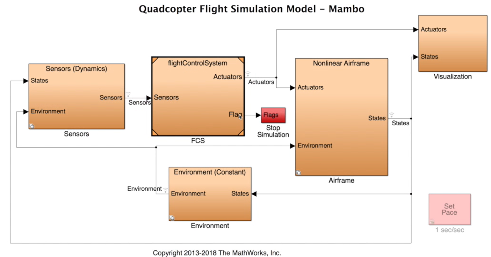
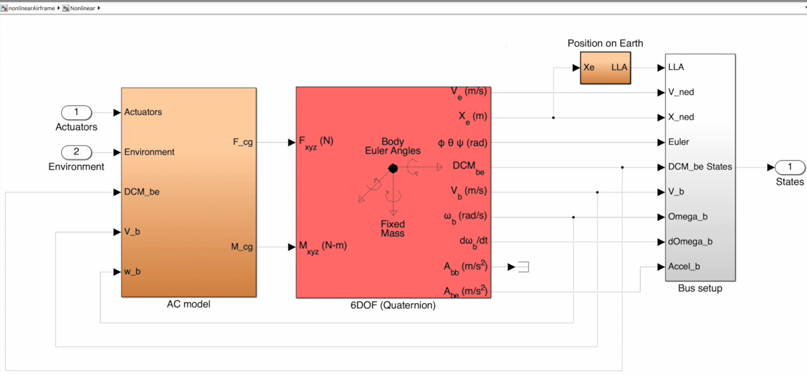
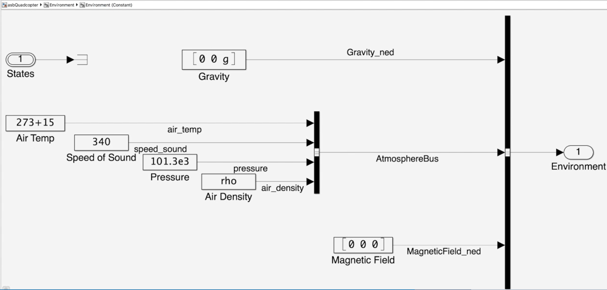
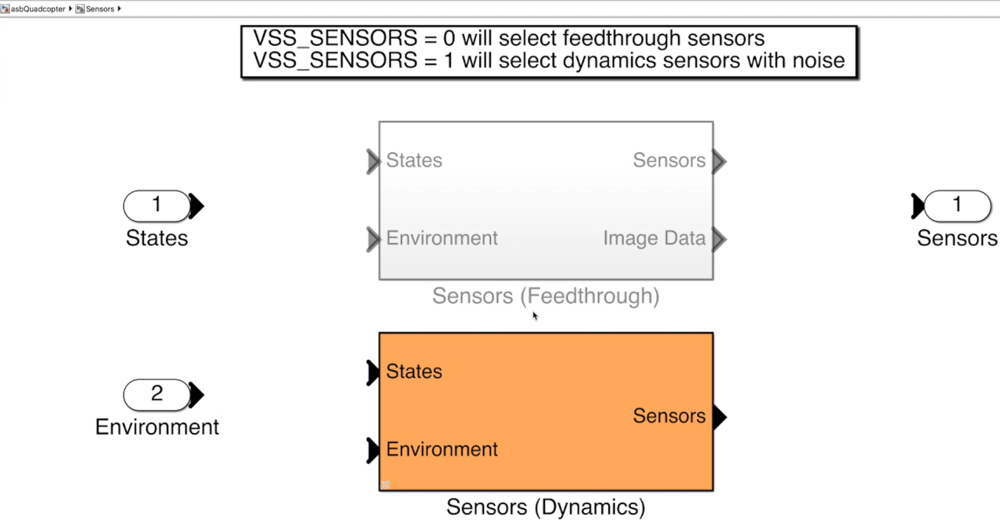
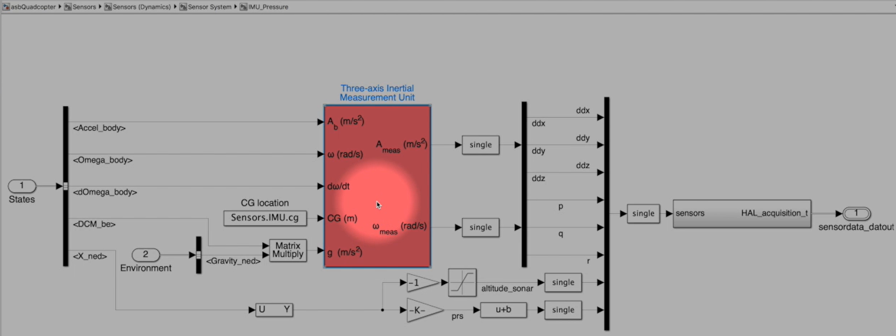
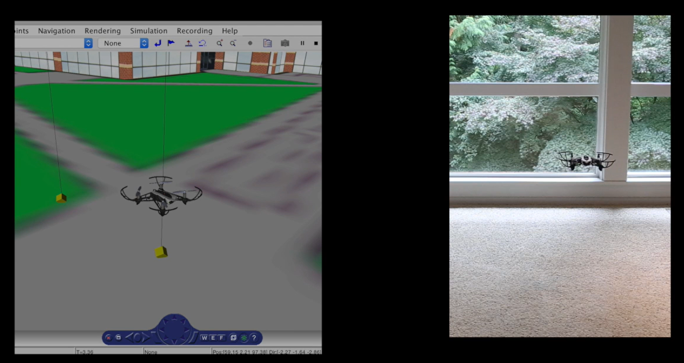
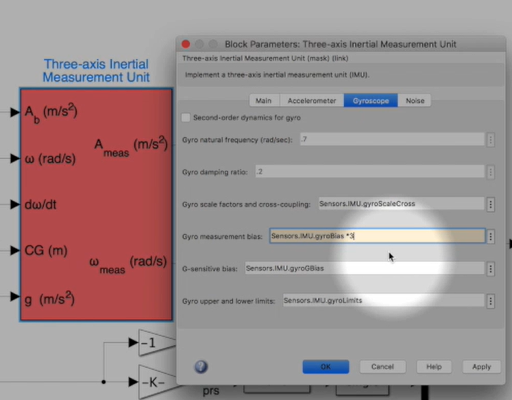
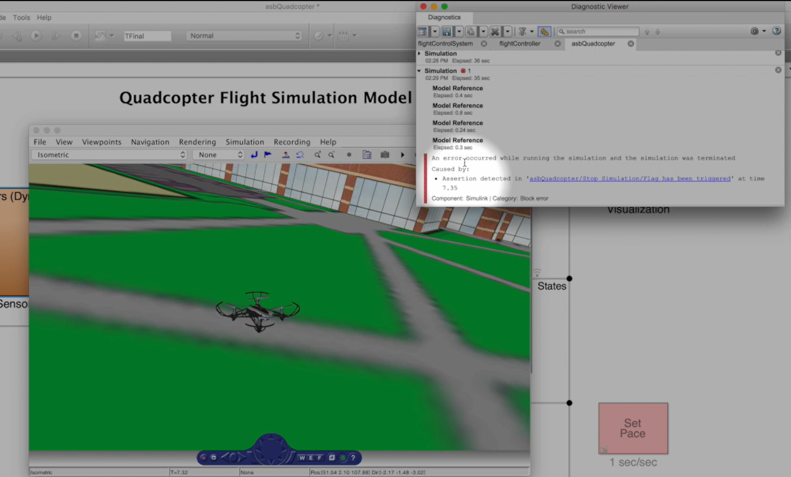

# Phần 4 – Mô hình hóa và mô phỏng drone: từ bài toán thật đến cách kiểm chứng PID

Bạn không cần xem video hoặc đọc script để học bài này. Ta bắt đầu bằng một vấn đề thực tế: **drone chưa cân bằng tốt, nhưng mỗi lần sửa PID rồi chạy motor là một lần thử trên phần cứng. Có cách nào hiểu và kiểm tra hệ thống trước khi thử thật không?**

Bài viết giải thích mô hình là gì, máy tính tính chuyển động drone ra sao, vì sao cần mô hình cảm biến và cách dùng kết quả mô phỏng để hỗ trợ thiết kế. Các hình từ mô hình Parrot của MathWorks chỉ được dùng để minh họa cho những khái niệm đang học.

> Các ví dụ số là giả định để dễ hiểu, không phải tham số đo được của Parrot hoặc Drone. Tài liệu không cung cấp bộ PID để sao chép vào phần cứng.

## 1. Vấn đề ban đầu: đổi PID rồi thử thật chưa cho ta biết đủ nguyên nhân

Giả sử bạn đặt góc Roll mục tiêu là 0°. Khi motor tắt, thân gần ngang. Khi chạy điều khiển, thân nghiêng rồi rung qua lại.

Nhìn hiện tượng đó, ta có thể nghĩ ngay “Kp chưa đúng”. Nhưng cùng một biểu hiện có thể liên quan đến nhiều phần:

- Lệnh motor không tạo đúng chiều lực sửa.
- Hai bên có lực đẩy khác nhau dù cùng duty.
- Motor cần thời gian mới đạt lực đẩy được yêu cầu.
- Dây hoặc giá thử cản thân xoay về.
- Rung hoặc bias làm số đo chuyển động sai.
- Góc/tốc độ ước lượng không theo đúng chuyển động thật.
- Gain làm phản hồi quá mạnh hoặc quá chậm.

Nếu chỉ đổi nhiều thông số rồi nhìn drone, ta khó biết thay đổi nào có tác dụng và vì sao. Ngoài ra, một số lỗi không phù hợp để cố tình tạo trên phần cứng, chẳng hạn làm gyro sai lệch lớn trong lúc bay.

**Mô phỏng giúp tạo một nơi thử có kiểm soát:** biết mình đã thay yếu tố nào, theo dõi từng tín hiệu và có thể lặp lại bài thử.

Tuy vậy, máy tính chỉ mô phỏng được những gì ta đã mô tả cho nó. Muốn kết quả hữu ích, trước hết phải hiểu chuỗi nguyên nhân tạo chuyển động của drone.

## 2. Từ lệnh motor đến chuyển động: những khái niệm cần biết trước

### 2.1. Lệnh motor không phải góc và cũng không phải lực đo được

Trong một hệ điều khiển PWM, duty là mức lệnh điện. Motor và cánh quạt biến mức lệnh đó thành chuyển động quay và lực đẩy.

```text
Lệnh duty/điện cho motor
           ↓
Tốc độ quay motor và cánh quạt
           ↓
Lực đẩy của từng cánh
           ↓
Tổng lực và mô-men tác động lên thân
           ↓
Thân thay đổi vận tốc, góc và vị trí
```

Một mô hình khác có thể nhận thẳng lệnh tốc độ motor thay vì duty. Điều quan trọng là xác định rõ đầu vào của mô hình đang dùng, không coi mọi lệnh là cùng đơn vị.

### 2.2. Lực và mô-men khác nhau thế nào?

**Lực** là tác động làm thay đổi chuyển động tịnh tiến, ví dụ đẩy drone đi lên. **Mô-men** là tác động làm thay đổi chuyển động quay, ví dụ khiến thân nghiêng Roll.

Nếu hai bên tạo lực đẩy bằng nhau và cân đối, chúng có thể nâng thân mà không tạo mô-men Roll. Nếu bên trái đẩy mạnh hơn bên phải, chênh lệch đó tạo xu hướng quay thân.

Khối lượng ảnh hưởng việc thay đổi chuyển động tịnh tiến. **Quán tính quay** ảnh hưởng việc thay đổi tốc độ xoay và còn phụ thuộc khối lượng được phân bố xa hay gần trục quay.

Ví dụ hai khung cùng nặng 100 g nhưng pin nằm xa tâm khác nhau có thể phản ứng Roll khác nhau. Chỉ biết tổng khối lượng chưa đủ để dự đoán tốc độ quay.

### 2.3. Gia tốc, vận tốc và vị trí/góc là ba tầng khác nhau

Lực không làm vị trí nhảy ngay sang một giá trị mới. Nó làm thay đổi vận tốc; vận tốc làm vị trí thay đổi theo thời gian.

Tương tự với quay:

```text
Mô-men → Gia tốc góc → Tốc độ quay → Góc
```

Đây là lý do controller phải đo và sửa liên tục. Khi thân đã tới góc mục tiêu nhưng vẫn đang quay, nó có thể vượt qua mục tiêu nếu chưa được hãm.

### 2.4. Hệ tọa độ: trước/phải của thân khác trước/phải của căn phòng

**Body frame** là các trục gắn với drone; chúng quay theo thân. **World/Earth frame** là các trục tham chiếu vị trí trong môi trường.

Motor tạo lực theo hướng gắn với thân. Nhưng muốn biết drone đi lên hay đi ngang trong phòng, phải xét thân đang nghiêng và quay hướng nào. Vì thế mô hình cần các phép đổi hệ tọa độ.

Trong các hình Parrot ở bài này có quy ước NED: Bắc–Đông–Xuống, tức Z dương hướng xuống. Vì vậy, Z = −0,7 m nghĩa là cao lên 0,7 m so với mốc. Dấu này là quy ước biểu diễn, không phải motor quay ngược.

## 3. Mô hình là gì và nó giúp kiểm tra điều khiển ra sao?

### 3.1. Mô hình là phép dự đoán có tham số

Ở đây, “mô hình drone” là một tập phép tính trả lời:

> Với trạng thái hiện tại và lệnh motor này, sau một khoảng thời gian drone sẽ chuyển động thế nào, rồi cảm biến sẽ đo được gì?

Ví dụ một phần mô hình có thể dùng khối lượng và tổng lực để tính gia tốc đứng. Phần khác dùng mô-men và quán tính để tính gia tốc góc. Mô hình cảm biến biến trạng thái mới thành số đo có nhiễu hoặc sai lệch.

**Hình drone 3D không tự làm những phép tính đó.** Nó có thể chỉ hiển thị kết quả do một hệ khác tính hoặc nhận từ board thật.

### 3.2. Mô phỏng là cho mô hình chạy qua nhiều bước thời gian

Một mô hình cho biết các quy luật. Mô phỏng là dùng các quy luật đó để cập nhật trạng thái liên tục theo thời gian.

Khi đưa controller vào, ta có một vòng kín hoàn chỉnh:

```text
Mục tiêu + số đo → Phần mềm điều khiển → Lệnh motor
       ↑                                      │
       │                                      ▼
Số đo mô phỏng ← Mô hình cảm biến ← Mô hình chuyển động
```

**Phần mềm điều khiển** nhận mục tiêu/số đo rồi quyết định lệnh. **Mô hình phần vật lý** nhận lệnh rồi dự đoán kết quả. Đây là hai nhiệm vụ khác nhau.

Trong ví dụ Parrot dưới đây, FCS là phần mềm điều khiển. Airframe, Sensors và Environment tạo môi trường thử cho nó:



*Visualization chỉ hiển thị tín hiệu và hoạt cảnh. Nó không phải bộ phận tính lệnh PID. Flag đi tới cơ chế dừng mô phỏng khi điều kiện lỗi được kích hoạt.*

Nếu mục tiêu được đặt bên trong FCS thì không cần một đường reference riêng ở ngoài. Nếu hệ thống nhận lệnh từ ngoài thì phải có nguồn mục tiêu tương ứng khi mô phỏng và khi chạy thật.

### 3.3. “Trạng thái thật trong mô phỏng” khác “trạng thái mà controller tin là đúng”

Để kiểm tra cảm biến và bộ ước lượng, cần phân biệt:

| Loại dữ liệu | Ví dụ khi drone thực sự không quay |
|---|---|
| Trạng thái do mô hình vật lý tính | Tốc độ quay bằng 0°/s |
| Số đo do mô hình cảm biến tạo | Gyro báo +0,5°/s vì có bias |
| Trạng thái do estimator tính | Góc/tốc độ được suy ra sau xử lý số đo, có thể còn sai lệch |

Controller phải dùng dữ liệu mà nó thực sự có trên phần cứng. Nếu thay số đo bằng trạng thái hoàn hảo, ta đã bỏ qua bài toán sai số cảm biến và không còn kiểm chứng đầy đủ estimator.


## 4. Vì sao cần cả mô hình tuyến tính và phi tuyến?

**Ta dùng một bản đơn giản để dễ thiết kế PID, rồi dùng một bản giữ nhiều đặc tính thực tế hơn để kiểm tra lại thiết kế đó.** Hai bản mô tả cùng một drone, nhưng phục vụ hai công việc khác nhau.

Trước khi phân biệt hai loại, hãy nhớ “mô hình” ở đây là các phép tính mô phỏng phản ứng của drone, không chỉ là hình drone 3D:

```text
Thay đổi lệnh motor
        ↓
Mô hình tính lực đẩy, mô-men và chuyển động
        ↓
Dự đoán drone sẽ nghiêng, quay và di chuyển như thế nào
```

### 4.1. “Tuyến tính” nghĩa là gì? Hãy bắt đầu bằng một phép tính đơn giản

Giả sử có một quan hệ:

```text
Đầu ra = 2 × đầu vào
```

Khi đầu vào tăng 1 đơn vị, đầu ra tăng 2 đơn vị. Khi đầu vào tăng 2 đơn vị, đầu ra tăng 4 đơn vị. Mức tác động giữ cùng một tỷ lệ, nên ta dễ dự đoán kết quả khi thay đổi đầu vào.

Một mô hình động lực học tuyến tính có thể phức tạp hơn nhiều và vẫn chứa độ trễ, tích phân, dao động. **Tuyến tính không có nghĩa là phản ứng tức thời hoặc không dao động.** Ý chính là các tác động được mô tả bằng quan hệ tuyến tính, cho phép dùng các công cụ phân tích có quy tắc rõ ràng.

Với drone, ta thường không nói toàn bộ lực nâng hoặc tốc độ motor bắt đầu từ 0. Ta chọn một trạng thái đang làm việc rồi xét **những thay đổi nhỏ quanh trạng thái đó**.

Ví dụ:

```text
Trạng thái đang xét: drone nằm ngang và có đủ lực nâng để hover.
Thay đổi nhỏ: tăng một chút lực bên trái, giảm một chút bên phải.
Câu hỏi: tốc độ quay Roll và góc Roll sẽ thay đổi như thế nào?
```

### 4.2. “Phi tuyến” nghĩa là gì? Cùng một thay đổi chưa chắc tạo cùng mức tác động

Drone thực tế có nhiều quan hệ không giữ nguyên tỷ lệ ở mọi trạng thái. Một ví dụ là quan hệ giữa tốc độ quay motor và lực đẩy cánh quạt.

Giả sử dùng quan hệ lý tưởng minh họa **lực đẩy tỷ lệ với bình phương tốc độ quay**. Chọn hệ số giả định sao cho 10.000 vòng/phút tạo 1 N:

| Tốc độ motor giả định | Lực đẩy theo quan hệ minh họa |
|---|---:|
| 10.000 vòng/phút | 1,00 N |
| 11.000 vòng/phút | 1,21 N |
| 20.000 vòng/phút | 4,00 N |
| 21.000 vòng/phút | 4,41 N |

So sánh hai lần cùng tăng 1.000 vòng/phút:

```text
Từ 10.000 lên 11.000 → lực đẩy tăng 0,21 N.
Từ 20.000 lên 21.000 → lực đẩy tăng 0,41 N.
```

**Cùng tăng tốc độ một lượng như nhau, nhưng mức tăng lực đẩy khác nhau tùy đang làm việc ở đâu.** Đây là một ví dụ phi tuyến.

Các số trên chỉ để giải thích phép bình phương, không phải số đo của motor Parrot hoặc Drone. Chúng cũng không nói rằng tăng duty 10 sẽ tăng đúng 1.000 vòng/phút: duty, tốc độ motor và lực đẩy là ba đại lượng khác nhau.

### 4.3. Vậy mô hình tuyến tính có phải cố tình tính sai không?

Nó là **một xấp xỉ trong phạm vi đã chọn**. Hãy tưởng tượng một đoạn rất ngắn của đường cong: nếu nhìn gần đoạn đó, ta có thể dùng một đoạn thẳng để mô tả gần đúng.

Với quan hệ lực đẩy trong ví dụ, quanh 10.000 vòng/phút có thể lấy độ dốc tại đó để ước lượng:

```text
Tăng 100 vòng/phút → lực tăng gần 0,02 N.
Tăng 200 vòng/phút → lực tăng gần 0,04 N.
```

Tính bằng quan hệ bình phương thì hai mức tăng là 0,0201 N và 0,0404 N, khá gần các giá trị trên. Nhưng nếu tăng đến 20.000 vòng/phút, vẫn dùng cùng độ dốc ban đầu sẽ dự đoán sai đáng kể.

Đó là ý nghĩa của **điểm làm việc**: trạng thái mà ta lấy làm mốc để xấp xỉ. Trong bài này, điểm làm việc quan tâm là gần hover.

Một mô hình tuyến tính có thể rất hữu ích quanh điểm đó, nhưng chưa chắc dùng được cho thay đổi lớn hoặc một mức lực nâng khác.

### 4.4. Ví dụ ngay trên thân drone: nghiêng càng nhiều, lực nâng đứng càng thay đổi

Khi drone nằm ngang, lực đẩy gần hướng thẳng lên. Khi nghiêng, một phần lực đẩy dùng để đẩy ngang, nên phần nâng đứng giảm.

Trong ví dụ chỉ nghiêng một mặt phẳng:

$$
F_{ngang} = T\sin\theta, \qquad F_{dung} = T\cos\theta
$$

T là lực đẩy tổng, θ là góc nghiêng. Nếu T được giữ ở 1 N:

| Góc nghiêng | Lực ngang | Lực đứng |
|---|---:|---:|
| 0° | 0 N | 1,000 N |
| 5° | 0,087 N | 0,996 N |
| 10° | 0,174 N | 0,985 N |
| 30° | 0,500 N | 0,866 N |

Gần 0°, có thể xấp xỉ lực ngang tăng theo góc và lực đứng gần như không đổi. Nhờ vậy, thiết kế điều khiển quanh hover được đơn giản hóa.

Nhưng ở 30°, phần lực nâng đứng đã giảm rõ rệt. Nếu mô hình vẫn coi lực đứng không đổi, nó có thể bỏ sót ảnh hưởng mất độ cao khi nghiêng.

**Đó là lý do không nên chỉ dựa vào bản tuyến tính để đánh giá mọi hành vi.** Bản phi tuyến có thể giữ các quan hệ sin/cos và những tương tác đã được mô hình hóa để kiểm tra lại.

Nếu muốn đọc phép xấp xỉ toán học: ở góc nhỏ, `sin(θ) ≈ θ` và `cos(θ) ≈ 1`, với θ tính bằng **radian**. Không thay trực tiếp số 10 của 10° vào công thức `sin(θ) ≈ θ`.

### 4.5. Vì sao bản đơn giản lại giúp chỉnh PID dễ hơn?

Khi chỉnh PID, ta muốn biết những điều như:

- Tăng Kp thì phản ứng nhanh hơn đến mức nào, có dễ dao động không?
- Có độ trễ nào khiến bộ điều khiển sửa quá muộn?
- Cần tác động hãm ra sao để giảm vượt mục tiêu?
- Bộ điều khiển còn ổn định trong phạm vi phân tích hay không?

Mô hình tuyến tính cho phép dùng các công cụ phân tích và thiết kế tuyến tính để đánh giá những câu hỏi này một cách có hệ thống, thay vì thử mọi tổ hợp gain trên phần cứng.

**Bản tuyến tính không tự tính ra một bộ PID hoàn hảo.** Nó cung cấp cơ sở phân tích quanh điểm làm việc đã chọn. Kết quả còn phụ thuộc tham số và giả định của mô hình.

### 4.6. Đã chỉnh được trên bản tuyến tính thì cần bản phi tuyến làm gì nữa?

Vì hệ thực có thể gặp những ảnh hưởng mà bản đơn giản đã bỏ qua hoặc chỉ xấp xỉ:

- Góc nghiêng lớn hơn vùng quanh hover.
- Lệnh motor chạm giới hạn.
- Lực đẩy đổi theo tốc độ theo quan hệ phi tuyến.
- Có tác động giữa lực nâng, chuyển động ngang và tư thế.
- Có đặc tính cảm biến/cơ cấu chấp hành cần đưa vào bài thử.

Ví dụ, bản tuyến tính cho thấy PID hoạt động tốt với những thay đổi nhỏ. Nhưng khi chạy một tình huống lệch nhiều hơn trên bản phi tuyến, motor có thể chạm giới hạn. Lệnh yêu cầu không được thực hiện đầy đủ, nên đáp ứng thực tế khác kết quả phân tích ban đầu.

Mỗi đặc tính chỉ được kiểm tra nếu bản phi tuyến thực sự có mô hình cho nó. Một mô hình không chứa rung khung sẽ không tự dự đoán được rung khung chỉ vì mang tên “phi tuyến”.

Trong ví dụ Parrot, các phần Airframe, Sensors và Environment có lựa chọn riêng. Bản thân chữ “phi tuyến” của Airframe không mặc nhiên bật mọi mô hình nhiễu, lỗi hoặc môi trường phức tạp.

### 4.7. Một ví dụ xuyên suốt: dùng hai bản để thiết kế bộ giữ Roll

Giả sử cần thiết kế bộ giữ Roll quanh 0°:

**Bước 1 – Dùng bản tuyến tính:** lấy mô hình gần hover, thiết kế gain để góc quay về mục tiêu với tốc độ và mức dao động phù hợp. Lúc này đang giải bài toán đơn giản hơn trong một phạm vi nhất định.

**Bước 2 – Mang cùng bộ điều khiển sang bản phi tuyến:** thử điều kiện ban đầu lệch hơn, tác động bên ngoài hoặc sai lệch cảm biến được mô hình hóa. Kiểm tra xem gain vừa chọn có còn đạt yêu cầu khi các ảnh hưởng đó xuất hiện không.

**Bước 3 – Nếu kết quả chưa đạt:** tìm nguyên nhân. Có thể phải đổi gain, xử lý giới hạn, sửa bộ ước lượng hoặc cải thiện mô hình; không phải mọi lỗi đều được giải bằng tăng Kp.

**Bước 4 – Xác nhận trên drone thật:** so kết quả với mô phỏng. Nếu khác nhiều, quay lại kiểm tra tham số và những ảnh hưởng mô hình chưa phản ánh.

```text
Mô hình tuyến tính
“Giúp chọn và phân tích bộ điều khiển quanh hover.”
                      ↓
Bộ điều khiển ứng viên
                      ↓
Mô hình phi tuyến với các điều kiện cần thử
“Kiểm tra lại khi giữ nhiều ảnh hưởng hơn.”
                      ↓
Thử phần cứng và đối chiếu dữ liệu
“Xác nhận mô hình và thiết kế có phù hợp hệ thật không.”
```

Điều cần nắm ở đây là vai trò của từng bản: một bản hỗ trợ chọn bộ điều khiển, bản còn lại giúp thử lại các ảnh hưởng mà phép xấp xỉ chưa phản ánh đầy đủ.

### 4.8. Cách ghi nhớ hai loại mô hình

| | Mô hình tuyến tính | Mô hình phi tuyến |
|---|---|---|
| Vai trò chính trong bài | Giúp thiết kế và phân tích điều khiển | Giúp kiểm chứng hành vi trong các tình huống mô phỏng |
| Cách mô tả | Đơn giản hóa quanh điểm làm việc | Giữ các quan hệ phi tuyến được mô hình hóa |
| Phạm vi cần chú ý | Thay đổi nhỏ/vùng mà xấp xỉ còn phù hợp | Những tình huống mà mô hình đã mô tả đủ |
| Điều chưa được bảo đảm | Tốt ở mọi góc, mức ga và giới hạn | Chính xác ngoài đời chỉ vì chi tiết hơn |

**Kết hợp cả hai giúp vừa dễ thiết kế, vừa có bước kiểm tra lại trước phần cứng.** Không phải mọi dự án bắt buộc có hai file mô hình; đó là hai vai trò trong quy trình thiết kế. Dù dùng cách nào, mức tin cậy cuối cùng vẫn phải dựa trên việc đối chiếu mô hình với hệ thật.

## 5. Nên mô hình những gì để kết quả có ích?

Không cần bắt đầu bằng một bản sao đầy đủ của mọi chi tiết trên drone. Cần bắt đầu bằng **câu hỏi muốn kiểm tra**.

Nếu muốn đánh giá phản ứng Roll trên đế, những yếu tố như quán tính quanh trục Roll, lực đẩy hai bên, độ trễ motor, giới hạn lệnh và ảnh hưởng đế có thể quan trọng. Màu LED thường không giúp trả lời câu hỏi đó.

Nếu muốn nghiên cứu rung làm nhiễu IMU, một mô hình thân cứng không rung có thể chưa đủ, dù nó đã dự đoán được chuyển động chậm khá tốt.

### 5.1. Fidelity là mức độ phản ánh những đặc tính cần quan tâm

Một mô hình **fidelity thấp hơn** có thể bỏ bớt ảnh hưởng để dễ tính. Mô hình **fidelity cao hơn** giữ nhiều đặc tính cần thiết hơn cho bài thử.

Ví dụ với motor:

| Cách mô tả | Giúp kiểm tra được gì? | Có thể bỏ sót gì? |
|---|---|---|
| Lệnh đổi thì lực đổi ngay | Tác động lực cơ bản lên thân | Thời gian motor tăng/giảm tốc |
| Thêm động học motor | Ảnh hưởng đáp ứng chậm lên vòng điều khiển | Giới hạn nguồn nếu chưa mô hình hóa |
| Thêm mô hình nguồn và giới hạn | Một số ảnh hưởng khi pin/nguồn không đáp ứng | Các ảnh hưởng cơ khí khác chưa được đưa vào |

Đây là ví dụ cách phát triển mô hình, không khẳng định mô hình trong ảnh đã có đầy đủ mọi mức trên.

Chi tiết hơn không tự động chính xác hơn: thêm một phần nhưng dùng tham số sai có thể làm dự đoán kém đi. Mỗi phần cần được kiểm chứng bằng dữ liệu phù hợp.

### 5.2. Chia mô hình theo nhiệm vụ để dễ kiểm tra nguyên nhân

Một cấu trúc dễ hiểu là:

```text
Lệnh → Mô hình motor/cánh → Lực và mô-men → Mô hình thân → Trạng thái
                                                     │
                      Môi trường ────────────────────┤
                                                     ▼
                                              Mô hình cảm biến
```

Mỗi phần có thể phát triển riêng, miễn thống nhất ý nghĩa tín hiệu, hệ trục, thời gian và đơn vị. Nếu kết quả sai, có thể lần theo từng phần thay vì chỉ nhìn hoạt cảnh cuối.

## 6. Xây phần vật lý: từ lực và mô-men đến chuyển động thân drone

### 6.1. Trước hết phải tính motor và môi trường đang tác động gì

Phần tạo lực nhận lệnh motor và trạng thái hiện tại để tính lực đẩy, mô-men cùng các tác động môi trường được đưa vào mô hình.

Lực có thể phụ thuộc tốc độ motor; các lực cản có thể phụ thuộc vận tốc. Hướng lực trọng trường trong hệ thân còn phụ thuộc tư thế. Vì vậy có những đường phản hồi trạng thái ngay bên trong mô hình vật lý, độc lập với vòng PID.

Trong ví dụ Parrot, nhiệm vụ tính các tác động này được gom vào `AC model`, sau đó chuyển lực và mô-men sang khối tính chuyển động:



*AC model trả về lực/mô-men quy về tâm khối lượng. Khối 6DOF cập nhật chuyển động, rồi các trạng thái cần thiết được hồi về để tính tác động ở bước tiếp theo.*

### 6.2. 6DOF là gì?

**DOF** nghĩa là bậc tự do. Một thân drone có thể chuyển động theo ba phương và quay theo ba trục, nên gọi là **6DOF**:

| Nhóm | Thành phần |
|---|---|
| Tịnh tiến | Trước/sau, trái/phải, lên/xuống |
| Quay | Roll, Pitch, Yaw |

Khối 6DOF không phải một PID. Nó đóng vai phần vật lý: tính thân phản ứng thế nào với lực/mô-men đang chịu.

### 6.3. Ví dụ chuyển động đứng: thêm lực nâng thì không lập tức nhảy độ cao

Giả sử minh họa drone nặng 0,06 kg, chọn hướng lên dương cho phép tính này. Trọng lượng xấp xỉ:

```text
Trọng lượng = 0,06 × 9,81 = 0,5886 N
```

Khi nằm ngang và tổng lực đẩy bằng 0,5886 N, tổng lực đứng gần 0. Nếu lực đẩy tăng lên 0,6000 N:

```text
Lực dư hướng lên = 0,6000 − 0,5886 = 0,0114 N
Gia tốc hướng lên = 0,0114 / 0,06 = 0,19 m/s²
```

Nếu ban đầu đứng yên và gia tốc đó được giữ trong 0,1 s:

```text
Vận tốc tăng lên = 0,19 × 0,1 = 0,019 m/s
Quãng đường đi lên = 0,5 × 0,19 × 0,1² = 0,00095 m
```

Ví dụ cho thấy máy tính phải tích lũy chuyển động theo thời gian. Một mức lệnh motor không tương ứng duy nhất với một độ cao.

Hướng lên dương ở ví dụ này giúp đọc phép tính thuận tiện. Trong mô hình NED của Parrot, Z dương hướng xuống nên dấu được biểu diễn khác, còn ý nghĩa vật lý không thay đổi.

### 6.4. Với chuyển động quay, cần cả quán tính và trạng thái đang quay

Nếu chỉ xét một trục quay trong ví dụ đơn giản:

```text
Gia tốc góc ≈ Mô-men / Quán tính quanh trục
```

Cùng mô-men, quán tính lớn hơn thì tăng tốc quay chậm hơn. Tốc độ quay hiện tại cũng quan trọng: ngay khi mô-men về 0, thân vẫn có thể tiếp tục quay nếu chưa có mô-men hãm hoặc tác động khác.

Trong chuyển động ba chiều đầy đủ, các trục có thể tương tác. Khối vật rắn tính cả các quan hệ đó theo giả định và cấu hình của nó; không nên coi ba trục luôn hoàn toàn độc lập.

### 6.5. Mô hình thân cứng, quaternion và tham số

Giả định **thân cứng** coi cấu trúc không biến dạng khi chuyển động. Nó có thể phù hợp cho chuyển động toàn thân, nhưng chưa tự mô phỏng rung mềm của tay đòn hoặc gá IMU.

**Quaternion** là cách biểu diễn phép quay 3D. Khối 6DOF dùng nó để cập nhật tư thế rồi có thể xuất góc Euler hoặc ma trận đổi hệ trục. Quaternion không phải bộ lọc Madgwick hay Kalman.

Dùng khối động lực học có sẵn giúp tránh tự viết toàn bộ phương trình, nhưng vẫn cần đúng khối lượng, quán tính, vị trí tác dụng lực và điều kiện ban đầu. Không biết tham số thì khối có sẵn cũng không tự biết drone của bạn.

Trong ảnh, góc là radian và tốc độ quay là rad/s; khi hiển thị độ hoặc °/s phải đổi đúng. Nhánh chuyển vị trí sang LLA là phép biểu diễn tọa độ trong mô hình, không chứng minh drone có GPS.

## 7. Môi trường tác động vào mô hình như thế nào?

Drone không chuyển động trong khoảng trống hoàn toàn. Trọng lực kéo xuống; không khí ảnh hưởng lực đẩy và lực cản; tính chất môi trường còn ảnh hưởng số đo cảm biến.

Không phải bài thử nào cũng cần môi trường thay đổi phức tạp. Nếu chỉ hover thấp trong phòng, có thể giữ nhiều tham số ở một giá trị gần đúng. Nếu nghiên cứu bay lên cao, cần xét những thay đổi liên quan theo độ cao.



*Ví dụ môi trường hằng trong mô hình Parrot. Các giá trị này là cấu hình của mô hình, không phải cảm biến đang đo trực tiếp.*

### 7.1. Vì sao cần các tham số này?

| Tham số | Nó có thể ảnh hưởng gì? |
|---|---|
| Trọng lực | Lực cần để chống rơi, cách mô phỏng số đo IMU |
| Mật độ không khí | Quan hệ tạo lực khí động/lực đẩy theo mô hình |
| Áp suất tham chiếu | Cách tạo/chuyển đổi thông tin cảm biến áp suất |
| Nhiệt độ, vận tốc âm thanh | Các tính toán môi trường/cảm biến tương ứng |
| Từ trường | Mô hình cảm biến từ nếu hệ có và sử dụng nguồn đó |

Vectơ `[0, 0, g]` trong hình theo NED có Z hướng xuống. Giá trị từ trường `[0, 0, 0]` là cấu hình ví dụ, không phải kết luận ngoài đời không có từ trường.

### 7.2. “Môi trường hằng” không có nghĩa số đo cảm biến hằng

Giữ các tham số môi trường/tham chiếu cố định không đóng băng chuyển động của drone. Gyro vẫn thay đổi khi thân quay. Nhánh cảm biến độ cao vẫn có thể tạo phép đo theo vị trí thông qua các quan hệ được mô hình hóa.

Vì vậy phải xem cả mô hình cảm biến, không chỉ nhìn một khối áp suất tham chiếu hằng rồi kết luận barometer không thay đổi theo độ cao.

Khi mô phỏng cao hơn nhiều, giảm mật độ không khí có thể làm thay đổi khả năng tạo lực đẩy và tiếp tục leo cao. Nhưng dự đoán giới hạn bay thực tế còn cần đúng mô hình motor, cánh, nguồn và các giới hạn khác.

## 8. Mô hình cảm biến: để controller không được “biết trước đáp án”

Giả sử Plant biết chính xác Roll = 5°. Nếu đưa thẳng góc đó vào controller, bộ điều khiển nhận được thông tin hoàn hảo. Nhưng trên drone thật, phần mềm phải suy ra góc từ gia tốc kế/gyro có sai số.

Muốn kiểm tra chuỗi xử lý như thật, mô hình phải tạo số đo tương ứng, rồi để estimator trong flight code tự xử lý nó:

```text
Chuyển động do Plant tính
           ↓
Mô hình cảm biến tạo phép đo
           ↓
Hiệu chỉnh/lọc/ước lượng trong flight code
           ↓
Trạng thái mà controller sử dụng
```

### 8.1. Cảm biến có thể sai theo những cách nào?

| Đặc tính | Ví dụ dễ hiểu |
|---|---|
| Bias | Thân không quay nhưng gyro báo lệch nền +0,5°/s |
| Nhiễu | Số đo dao động quanh giá trị do các thành phần ngẫu nhiên |
| Scale factor | Quay thật 10°/s nhưng cảm biến báo mức khác theo tỷ lệ |
| Trễ/động học | Chuyển động đã đổi nhưng số đo chưa phản ánh ngay |
| Giới hạn đo | Giá trị vượt dải nên đầu ra bị chặn |
| Lệch trục/vị trí lắp | Một chuyển động được biểu diễn khác vì cảm biến đặt hoặc xoay khác |

Chỉ nên đưa vào bài thử những đặc tính đã được mô hình hóa có cơ sở. Không phải mở lựa chọn “nhiễu” là tự có mọi lỗi thực tế.

### 8.2. Vì sao có cảm biến lý tưởng hóa và cảm biến có động học/nhiễu?

Ở giai đoạn nghiên cứu phản ứng cơ bản, có thể muốn bỏ ảnh hưởng đo để nhìn rõ phần điều khiển. Sau đó cần đưa ảnh hưởng đo trở lại để kiểm chứng toàn chuỗi.



*Feedthrough là lựa chọn lý tưởng hóa theo giao diện mô hình; Dynamics giữ các đặc tính cảm biến được cấu hình.*

Đây là lựa chọn trong simulator, không phải yêu cầu tắt bộ lọc trên Arduino. Một bài thử có mục tiêu kiểm tra estimator thì cần dữ liệu đầu vào và đặc tính đo phù hợp; bỏ chúng đi sẽ thay đổi điều đang được đánh giá.

### 8.3. Vì sao mô hình IMU còn cần tư thế và trọng lực?

Gyro đo tốc độ quay. Gia tốc kế đo specific force, không đơn giản luôn bằng gia tốc tịnh tiến của tâm drone. Hướng trọng lực, tư thế và vị trí lắp có liên quan đến cách tạo số đo.

Ví dụ cảm biến gia tốc đặt yên thường có độ lớn số đo gần 1 g. Hiệu chỉnh bias không có nghĩa đặt yên thì cả ba trục đều phải báo 0. Nếu cảm biến đặt xa tâm quay, số đo còn có thể chứa thành phần gia tốc do quay.



*Các đầu ra được gom đúng định dạng để flight code sử dụng. Cổng vị trí cảm biến và gia tốc góc cho thấy mô hình đo có thể cần nhiều thông tin hơn riêng tốc độ quay.*

Mô hình camera/optical flow, siêu âm và áp suất cũng có phép chuyển đổi riêng. Các cờ vision hoặc giá trị dummy cần được đọc đúng: một cổng tên “position vision” chưa chứng minh có nguồn vị trí hợp lệ đang được dùng.

## 9. Bộ lọc và mô hình cảm biến khác nhau ở đâu?

Hai khối này nằm ở hai phía khác nhau của bài thử:

```text
Mô hình vật lý → Mô hình IMU → Bộ lọc/ước lượng trong flight code → PID
```

**Mô hình IMU** tạo số đo để mô phỏng điều cảm biến báo. **Bộ lọc/ước lượng** nhận số đo đó để suy ra trạng thái mà controller cần.

Ví dụ mô hình gyro thêm bias; phần mềm hiệu chỉnh trừ bias theo giá trị đã biết. Nếu hai giá trị khớp thì phần lệch đó có thể được bù. Nếu không khớp, sai lệch còn lại có thể ảnh hưởng góc ước lượng.

Tùy hệ, estimator có thể dùng complementary, Madgwick, Kalman hoặc phương pháp khác. Tên bộ lọc không tự bảo đảm mọi nguồn sai số đều được giải quyết. Ví dụ với gyro và gia tốc kế, trọng lực hỗ trợ tham chiếu độ nghiêng nhưng không cung cấp một hướng Yaw tuyệt đối.

## 10. Máy tính chạy mô phỏng từng bước thời gian như thế nào?

Để hình dung, xét một bước cập nhật với khoảng thời gian Δt:

1. Controller nhận mục tiêu và phản hồi đang có, tính lệnh motor.
2. Mô hình cơ cấu chấp hành tính lực/mô-men tương ứng theo trạng thái của nó.
3. Mô hình thân tính chuyển động mới qua khoảng thời gian đang xét.
4. Mô hình cảm biến tạo dữ liệu đo theo lịch cập nhật được cấu hình.
5. Estimator và các vòng điều khiển dùng số đo khi đến lượt cập nhật tiếp theo.

Đây là cách hình dung luồng, không bắt buộc mọi khối có cùng chu kỳ hoặc solver luôn tính đúng thứ tự đơn giản này. Mô phỏng có thể dùng solver và nhiều tốc độ cập nhật khác nhau.

### Vì sao thời gian và độ trễ quan trọng?

Nếu giả định controller được cập nhật tức thời nhưng phần cứng tính trễ, kết quả có thể khác. Nếu giả định sensor gửi mẫu liên tục nhưng thực tế có khoảng mất mẫu, ước lượng cũng có thể khác.

Một mô hình hỗ trợ thiết kế cần xem xét các chu kỳ và độ trễ có ảnh hưởng đáng kể đến câu hỏi đang kiểm tra. Chỉ cho hoạt cảnh chạy “1 giây trên màn hình bằng 1 giây ngoài đời” chưa chứng minh chu kỳ PID bên trong đã được mô tả đúng.

## 11. Làm sao biết mô hình đã đủ đáng tin để dùng?

Không thể đánh giá chỉ bằng việc nó chạy được hoặc hình 3D trông hợp lý. Cần so với dữ liệu thực tế trong cùng điều kiện đủ tương đương.

Một bài kiểm tra có thể đặt cùng mục tiêu và điều kiện ban đầu, sau đó so:

| Tín hiệu | Điều muốn biết |
|---|---|
| Góc và tốc độ quay | Phản ứng có nhanh/chậm và dao động tương tự không? |
| Độ cao/vị trí | Có cùng xu hướng, mức vượt và sai lệch không? |
| Lệnh motor | Mức tác động và thời điểm giới hạn có phù hợp không? |
| Số đo và trạng thái ước lượng | Nhiễu, trôi hoặc độ trễ có được phản ánh hợp lý không? |

Trước khi so, phải thống nhất mốc thời gian, cấu hình, mức nguồn và điều kiện cơ khí liên quan. Đế giữ Roll, dây treo và bay tự do không mặc định là cùng một hệ vật lý.

Ví dụ mô phỏng Parrot dưới đây đặt hoạt cảnh cạnh chuyến bay thật để đối chiếu trực quan:



*Sự tương đồng trong một lượt hover tạo cơ sở ban đầu, nhưng chưa chứng minh mô hình đúng ở mọi trạng thái hoặc mọi loại lỗi.*

Nếu mô phỏng không có rung còn phần cứng rung mạnh, cần tìm nguyên nhân: thiếu mô hình cơ khí, sai cơ cấu chấp hành, sai thời gian, sai phép đo hoặc yếu tố khác. Không nhất thiết giải bằng cách đổi PID để “làm cho hai đồ thị giống nhau”.

**Mức tin cậy luôn gắn với phạm vi đã kiểm tra.** Mô hình hợp lý cho góc nhỏ quanh hover có thể chưa đủ cho nghiêng lớn hoặc một bài thử lỗi mới.

## 12. Thử lỗi có kiểm soát: gyro lệch hơn mức phần mềm đã hiệu chỉnh

Sau khi bài cơ sở đã phù hợp tương đối, ta có thể giữ mọi yếu tố khác và thay đúng một tham số. Đây là cách tìm quan hệ nguyên nhân–kết quả rõ hơn.

### 12.1. Tình huống giả định

Giả sử gyro có bias dự kiến +0,5°/s và phần mềm trừ mức đó. Nhưng thực tế bias tăng lên +1,5°/s:

```text
Thân không quay:        tốc độ thật = 0°/s
Gyro có bias mới:       số đo nền   = +1,5°/s
Phần mềm vẫn trừ:                    +0,5°/s
Phần còn dư:                        +1,0°/s
```

Nếu tích phân gyro thuần và không có hiệu chỉnh khác, sau 5 giây phần dư 1°/s có thể tích thành sai lệch góc khoảng 5°. Với estimator đầy đủ, kết quả còn phụ thuộc các nguồn hiệu chỉnh và động lực học của nó; không dùng phép tính đơn giản này để dự đoán chính xác toàn hệ.

Ở đây bias thật gấp ba giá trị dự kiến, nhưng phần dư sau trừ là hai lần bias dự kiến. Không suy ra mọi output motor hoặc góc lệch sẽ tăng đúng ba lần.

### 12.2. Tại sao lỗi đo có thể làm drone nghiêng thật?

Controller không quan sát trực tiếp “góc thật” ngoài đời. Nó ra lệnh theo trạng thái do phần mềm ước lượng. Nếu trạng thái bị lệch, lệnh sửa cũng có thể không phù hợp với thân thật:

```text
Số đo lệch → Trạng thái ước lượng sai
                        ↓
           Controller tạo lệnh sửa không phù hợp
                        ↓
                 Motor tác động lên thân
                        ↓
              Thân xuất hiện chuyển động thật
```

Vì vậy, xác nhận thân nghiêng thật không tự loại trừ lỗi đo là một nguyên nhân. Cần xem cả số đo, trạng thái ước lượng và lệnh đã phát.

Trong ví dụ Parrot, tham số bias gyro được tăng để thử ảnh hưởng này:



*Đây là chèn lỗi vào mô hình cảm biến; không phải thao tác cố tình làm hỏng gyro thật.*

### 12.3. Quan sát những gì trong lượt thử lỗi?

Nên theo dõi đồng thời:

- Trạng thái “thật” do Plant tính.
- Số đo mô phỏng và trạng thái estimator tính.
- Lệnh motor và các giới hạn.
- Cờ lỗi, thời điểm nhận ra vấn đề và kết thúc bài thử.

Nhờ đó có thể thấy sự khác nhau xuất hiện ở đâu trước. Nếu chỉ xem hình drone nghiêng, thông tin chưa đủ để kết luận lỗi nằm ở PID hay đường đo.

### 12.4. Bảo vệ cũng cần được kiểm chứng

Mục tiêu không chỉ là biết controller phản ứng xấu. Cần xem hệ thống có nhận ra lỗi và xử lý trước khi vượt điều kiện mong muốn không.

Trong bài thử lỗi Parrot, diễn biến được mô tả là cất lên gần như bình thường rồi lệch Roll và trôi đi. Cửa sổ mô phỏng sau đó cho thấy cờ dừng được kích hoạt:



*Ảnh không mở toàn bộ điều kiện dừng, nên không suy ra một ngưỡng góc hoặc luật bảo vệ cụ thể từ cửa sổ này.*

Kết quả có thể gợi ý cần cải thiện hiệu chỉnh cảm biến, estimator hoặc phát hiện lỗi. Không phải cứ thấy mất ổn định là lập tức tăng Kp.

Mô phỏng không gây hỏng drone vật lý trong lượt thử, nhưng một kết quả mô phỏng tốt chưa đủ bảo đảm phần cứng an toàn. Độ tin cậy còn phụ thuộc việc kịch bản và các giới hạn đã được mô tả đúng đến đâu.

## 13. Ghép lại thành một quy trình thiết kế dễ thực hiện

### Bước 1 – Chọn một câu hỏi cụ thể

Ví dụ: “Bộ giữ Roll quanh 0° có bị dao động khi motor đáp ứng chậm hơn dự kiến không?” Câu hỏi cụ thể giúp chọn đúng những phần cần mô hình hóa và tín hiệu cần ghi.

### Bước 2 – Tạo mô hình cơ sở và đối chiếu

Mô tả lực đẩy, chuyển động thân, cảm biến và những điều kiện thử liên quan. So kết quả với dữ liệu thật để xem mô hình cơ sở có phản ánh bài toán không.

### Bước 3 – Tạo xấp xỉ tuyến tính để thiết kế

Chọn điểm làm việc phù hợp, chẳng hạn gần hover. Dùng bản tuyến tính và các công cụ phân tích để tìm một bộ điều khiển ứng viên.

### Bước 4 – Kiểm tra lại trên mô hình phi tuyến

Giữ bộ điều khiển ứng viên, thử các biến thiên hoặc lỗi có cơ sở. Quan sát cả bám mục tiêu, dao động, giới hạn và cơ chế dừng.

### Bước 5 – Xác nhận trên phần cứng rồi cập nhật mô hình

Thử thật trong điều kiện phù hợp với phạm vi đã kiểm tra. Nếu kết quả khác nhiều, xem lại giả định và tham số thay vì chỉ tiếp tục đổi gain.

```text
Đặt vấn đề → Mô hình → Đối chiếu dữ liệu
                              ↓
                    Thiết kế bằng xấp xỉ phù hợp
                              ↓
                    Kiểm chứng bằng mô phỏng
                              ↓
                    Xác nhận trên phần cứng
                              ↓
             Cập nhật mô hình/thiết kế khi có bằng chứng mới
```

Đây là quy trình lặp. Không bắt buộc mọi dự án phải dùng đúng một phần mềm, nhưng cần giữ nguyên tắc phân biệt giả định, dự đoán và bằng chứng thực nghiệm.

## 14. Cách đọc các lựa chọn trong mô hình Parrot sau khi đã hiểu nguyên lý

Các ảnh trong bài xuất phát từ mô hình có những **variant subsystem**: các phiên bản thay thế được chọn trước khi chạy.

| Cấu hình trong ví dụ | Giá trị 0 | Giá trị 1 |
|---|---|---|
| `VSS_VEHICLE` | Airframe tuyến tính | Airframe phi tuyến |
| `VSS_ENVIRONMENT` | Môi trường hằng | Môi trường phụ thuộc vị trí |
| `VSS_SENSORS` | Cảm biến feedthrough | Cảm biến dynamics có nhiễu |

Các lựa chọn độc lập phục vụ câu hỏi khác nhau. Chọn Airframe phi tuyến không tự đồng nghĩa đã bật mọi lỗi cảm biến hoặc mọi mô hình môi trường.

Các tên biến và giá trị này thuộc project minh họa, không phải quy tắc đặt tên bắt buộc. Khi xây mô hình riêng, điều cần giữ là ý nghĩa và ranh giới của từng phần.

## 15. Liên hệ với dự án Drone và ứng dụng IMU riêng

### 15.1. Viewer 3D không phải simulator để hiệu chỉnh motor

Ứng dụng xem IMU nhận dữ liệu từ board rồi quay vật thể:

```text
Board thật → Số đo → Tính tư thế → Vật thể 3D
```

Nó không tính lực đẩy motor và phản ứng thân khi đổi PID. Simulator phải có thêm chuỗi lệnh → lực/mô-men → chuyển động → số đo.

### 15.2. Madgwick nằm trong phần ước lượng, không thay mô hình vật lý

Madgwick trong Drone kết hợp dữ liệu cảm biến để ước lượng tư thế. Nếu xây simulator cho firmware đó, mô hình IMU sẽ cung cấp dữ liệu cho Madgwick, rồi các vòng Angle → Rate mới tính phần sửa motor.

```text
Plant → Mô hình IMU → Madgwick → Angle PID → Rate PID → Lệnh
```

App gyro thuần không dùng nguồn sửa trôi sẽ thể hiện ảnh hưởng bias rõ hơn, nhưng mức trôi đó không được coi là phản ứng giống hệt Madgwick hoặc bộ lọc của Parrot.

### 15.3. Muốn mô phỏng Drone cần dữ liệu của chính hệ thống đó

Mô hình Parrot giúp học cách tổ chức bài toán, nhưng không tự có đúng khối lượng, quán tính, lực đẩy, phản ứng duty hoặc gá IMU của Drone. Đặc biệt, code Drone hiện trộn phần sửa theo duty, còn mô hình minh họa dùng các yêu cầu lực/mô-men và chuyển đổi sang lệnh motor.

Nếu thử trên dây/đế, cần xét ảnh hưởng cơ khí đó. Một mô hình bay tự do chưa thể được đối chiếu trực tiếp như cùng một hệ với thân bị phần kê giữ.

### 15.4. Với log đã có, nên rút ra điều gì?

Log trước cho thấy lệch góc khi motor chạy; bạn đã xác nhận thân nghiêng thật. Bài học mô hình hóa ở đây là cần theo dõi các mắt xích: đo/ước lượng, lệnh sửa, lực thực và dây/kê.

Kịch bản gyro bias của Parrot minh họa một khả năng, không chứng minh Drone của bạn bị đúng lỗi đó. Cần lượt thử và dữ liệu bổ sung để tách nguyên nhân.

Xem [sơ đồ theo code Drone](so-do-luong-code-drone.md) để đối chiếu các phần mềm hiện có. Nội dung bài này chưa tạo một simulator mới cho Drone và chưa xác định bộ gain tối ưu từ mô phỏng.

## 16. Tự kiểm tra bằng một bài toán nhỏ

**Đề bài:** mô phỏng giữ Roll cho kết quả rất đẹp, nhưng trên drone thật góc dao động khi bật motor.

Trước khi đổi gain, hãy tự hỏi:

1. **Mô hình có cho motor tạo lực tức thời không?** Nếu có, nó có thể bỏ sót độ trễ thực.
2. **Controller đang nhận góc hoàn hảo hay số đo qua estimator?** Nếu nhận góc hoàn hảo, chưa kiểm tra ảnh hưởng đo/ước lượng.
3. **Thân và điều kiện thử có giống nhau không?** Bay tự do, dây treo và đế có thể tạo đáp ứng khác.
4. **Khối lượng/quán tính/lực đẩy đã được đối chiếu chưa?** Đúng cấu trúc nhưng sai tham số vẫn dự đoán sai.
5. **Có giới hạn, rung hoặc bias mà bài mô phỏng chưa chứa không?** Chỉ kiểm chứng được các ảnh hưởng đã đưa vào đúng phạm vi.
6. **Có đang xem đồng thời mục tiêu, trạng thái và lệnh không?** Một hoạt cảnh 3D chưa đủ bằng chứng.

Trả lời được các câu này giúp xác định đang cần cải thiện mô hình, phép đo, cơ khí hay bộ điều khiển, thay vì coi mọi hiện tượng là một lỗi PID.

---

**Tài liệu tham khảo và phạm vi:** bài học sử dụng [script Part 4](assets/part4/script-goc.txt) và 12 ảnh mô hình Parrot do người dùng cung cấp; ảnh gốc nằm trong [assets/part4](assets/part4/). Phần trình bày, ví dụ số và liên hệ Drone được bổ sung để người đọc có thể học độc lập. Các ảnh có thông tin nguồn MathWorks. Các biểu thức/ví dụ vật lý đơn giản là minh họa có giả định, không phải chép lại toàn bộ cấu hình mô hình hoặc kết quả thử nghiệm mới.
