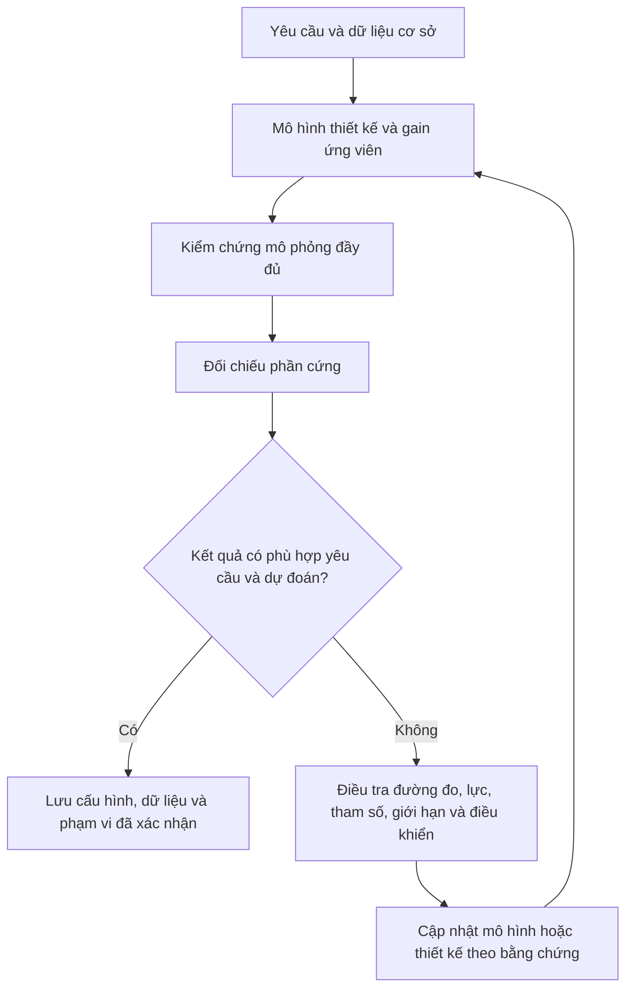

# Phần 5 – Hiệu chỉnh PID bằng mô hình: từ yêu cầu đáp ứng đến kiểm chứng trên drone thật

Bài học này bắt đầu từ một vấn đề thực tế: **ta có một hệ điều khiển drone, nhưng chưa biết nên chọn gain thế nào để phản ứng đủ nhanh, ít dao động và hoạt động được trên phần cứng**.

Bạn không cần xem video để đọc bài. Nội dung giải thích các khái niệm cần thiết, đi qua một quy trình hiệu chỉnh vòng độ cao, rồi phân tích trường hợp mô phỏng tốt nhưng thử thật thất bại. Trường hợp minh họa và các giá trị được lấy từ script Part 5 do người dùng cung cấp; những ví dụ tính toán khác được ghi rõ là bổ sung.

> Các gain trong bài thuộc mô hình Parrot và thang lệnh lực của nó, không phải bộ gain cho Drone ESP32. Bài không cung cấp một cấu hình bay đã được kiểm chứng cho phần cứng của bạn.

## 1. Vấn đề cần giải quyết: “giữ được” chưa chắc đã là đáp ứng mong muốn

Giả sử bạn yêu cầu drone lên độ cao 0,7 m. Một hệ điều khiển có thể đưa nó tới đó theo nhiều cách:

- Đi lên nhanh nhưng vượt quá mục tiêu rồi dao động.
- Đi lên chậm, ít vượt nhưng mất nhiều thời gian.
- Đạt gần mục tiêu nhưng còn sai lệch kéo dài.
- Mô phỏng làm được nhưng phần cứng không nhấc lên.

Do đó, chọn gain không chỉ là tìm một con số làm motor quay. Ta cần xác định **muốn đáp ứng như thế nào**, hiểu các giới hạn của hệ và kiểm tra kết quả.

### 1.1. Những đại lượng thường dùng để mô tả đáp ứng

| Khái niệm | Hiểu đơn giản với mục tiêu cao 0,7 m |
|---|---|
| Thời gian lên | Mất bao lâu để đi từ gần mức ban đầu tới gần mục tiêu |
| Vượt mục tiêu – overshoot | Có lên quá 0,7 m không, và quá bao nhiêu |
| Thời gian xác lập | Mất bao lâu để ở lại trong một vùng chấp nhận được quanh mục tiêu |
| Sai lệch xác lập | Sau khi chuyển động đã lắng xuống, còn lệch bao nhiêu |
| Dao động | Có liên tục đi qua lại quanh mục tiêu không |

Ví dụ lên tới 0,8 m rồi giảm về 0,7 m là có vượt mục tiêu 0,1 m. Nếu lấy độ thay đổi mục tiêu ban đầu từ 0 lên 0,7 m, mức vượt đó khoảng 14,3%. Nhưng chỉ nhìn vượt ít chưa đủ: đáp ứng có thể quá chậm hoặc cần lệnh motor vượt khả năng thực tế.

### 1.2. Vì sao không tăng Kp cho tới khi thấy nhanh?

Kp tăng thường làm phản ứng với sai lệch mạnh hơn, nhưng kết quả phụ thuộc cả cơ cấu chấp hành, độ trễ, nhiễu, D, I và các vòng khác. Motor có giới hạn nên lệnh lớn hơn chưa chắc tạo được tác động lớn hơn.

Muốn lựa chọn có cơ sở, ta dùng một mô hình của hệ để phân tích trước, rồi kiểm chứng lại. Nếu chưa rõ mô hình tuyến tính/phi tuyến, có thể đọc [phần 4](drone_control_part4.md); bài này sẽ nhắc lại các ý cần thiết khi dùng chúng.

## 2. Gain phải được chọn cho cả hệ, không phải cho riêng công thức PID

Một vòng điều khiển đơn giản gồm:

```text
Mục tiêu − Phản hồi → Controller → Cơ cấu chấp hành và thân drone
               ↑                                │
               └──────── Cảm biến/ước lượng ─────┘
```

Controller là phần tính lệnh. **Plant** là đối tượng chịu tác động: tùy ranh giới đang xét, nó có thể gồm motor, cánh, thân và các khâu liên quan giữa lệnh với đại lượng phản hồi.

Cùng một PID, nếu motor đáp ứng chậm hơn hoặc thân có quán tính khác, đáp ứng sẽ khác. Nếu phép đo bị trễ hoặc sai lệch, controller cũng sẽ hành động khác.

Vì vậy, câu hỏi đúng là:

> Với plant, cảm biến, độ trễ và giới hạn này, gain nào đáp ứng được yêu cầu trong phạm vi làm việc cần thiết?

Không có một bộ gain chung chỉ vì hai thiết bị đều là quadcopter.

## 3. Cần một mô hình để thiết kế và một mô hình để kiểm chứng

### 3.1. Vì sao không đưa nguyên flight code vào công cụ tune?

Flight code chạy thật không chỉ có PID. Nó còn chứa điều kiện lỗi, chuyển chế độ, logic khởi động, cất/hạ cánh, giới hạn lệnh, logging và nhiều nhánh lựa chọn.

Những khối này cần thiết khi vận hành, nhưng không phải tất cả đều thuận tiện để tạo một mô hình tuyến tính cho phân tích. Một Switch có thể giữ nguyên một nhánh khi xét cục bộ, nhưng khi điều kiện đổi thì hệ chuyển sang hành vi khác. Các logic rời rạc hoặc một số khối không hỗ trợ cũng có thể làm bài toán tuyến tính hóa khó hơn.

**Không phải mọi câu lệnh if đều tuyệt đối không thể tuyến tính hóa.** Vấn đề là mô hình phù hợp để sinh mã và vận hành đầy đủ có thể không phải mô hình thuận tiện nhất cho nhiệm vụ thiết kế điều khiển.

### 3.2. Tách thành hai bản và giữ vai trò rõ ràng

| Bản | Công việc |
|---|---|
| Mô hình thiết kế | Giữ những khâu cần cho vòng đang tune, tạo điều kiện phân tích/tuyến tính hóa |
| Mô hình mô phỏng đầy đủ | Giữ flight code và các ảnh hưởng được mô hình hóa để kiểm chứng bộ gain vừa chọn |

Không nên xóa logic lỗi hoặc cảm biến khỏi bản vận hành chỉ vì chúng làm việc tune khó hơn. Tạo bản sao để nghiên cứu, sau đó chuyển các tham số được chọn trở lại bản đầy đủ.


Việc đơn giản hóa là đặt giả định cho bài thiết kế, không phải chứng minh những khâu đã bỏ đi không bao giờ quan trọng.

## 4. Có nhiều PID, nên chỉnh vòng nào trước?

Trong kiến trúc Parrot được dùng làm ví dụ:

```text
Hai vòng vị trí X/Y → Góc Roll/Pitch mục tiêu → Hai vòng Roll/Pitch

Vòng Yaw ────────────────────────────────────→ Yêu cầu mô-men Yaw
Vòng độ cao ─────────────────────────────────→ Yêu cầu lực nâng
```

Tổng cộng có sáu bộ điều khiển được gọi chung là PID. Không bắt buộc tất cả dùng đủ P, I và D; vòng độ cao được tune trong bài là **PD**.

### 4.1. Vì sao không chỉnh mọi vòng cùng lúc?

Nếu cùng đổi gain độ cao, Roll và vị trí, một đáp ứng tốt hoặc xấu hơn rất khó quy cho một thay đổi cụ thể. Các vòng còn tương tác qua thân drone và giới hạn motor.

Ta nên tách một bài thiết kế rõ ràng, giữ những điều kiện khác phù hợp, rồi ghép lại kiểm tra. Điều này không có nghĩa các kênh luôn độc lập trong mọi tư thế.

### 4.2. Ví dụ bắt đầu bằng vòng độ cao

Gần hover, thân gần ngang, không có tốc độ quay ban đầu và không có mô-men/nhiễu làm nghiêng, có thể nghiên cứu chuyển động lên/xuống tương đối riêng biệt.

Trong bản thiết kế của ví dụ, các lệnh mô-men Roll/Pitch/Yaw được đặt bằng 0 để tập trung vào độ cao. **Đặt lệnh mô-men bằng 0 không tự khóa được tư thế** nếu thân vốn đang nghiêng, đang quay hoặc có nhiễu tác động. Việc tách bài toán còn dựa trên điều kiện đầu và giả định không có những tác động đó.

Ở trạng thái nghiêng nhiều, thay đổi lực nâng còn tạo chuyển động ngang; giả định tách riêng độ cao sẽ kém phù hợp hơn.

### 4.3. Nguyên tắc đối với các vòng lồng nhau

Vòng ngoài tạo mục tiêu cho vòng trong. Nếu vòng trong chưa thực hiện được yêu cầu, chỉnh vòng ngoài trên giả định vòng trong hoạt động tốt có thể cho kết quả không đúng.

Trong ví dụ, sau độ cao, tác giả đề xuất nghiên cứu Yaw, Roll, Pitch rồi mới vòng vị trí với các vòng tư thế đang hoạt động. Video chỉ thực hiện chi tiết **vòng độ cao**, không trình bày kết quả tune cả sáu vòng.

Với code Drone hiện tại, cặp lồng nhau đã xác nhận là **Angle → Rate**. Do đó, khi bàn về chất lượng điều khiển góc, cần kiểm chứng khả năng bám rate trước; không máy móc dùng thứ tự tên vòng của một kiến trúc khác.

## 5. Trước khi tune, phải ghi lại đáp ứng hiện tại

Giả sử hệ đang dùng gain mặc định. Ta cho chạy bài mục tiêu độ cao và lưu lại phản ứng để làm mốc so sánh:

- Điều kiện đầu là gì?
- Mục tiêu thay đổi thế nào?
- Có vượt mục tiêu hoặc dao động không?
- Khi đã lắng xuống, sai lệch còn bao nhiêu?
- Lệnh có chạm giới hạn hoặc cờ lỗi có kích hoạt không?

Nếu không có lượt cơ sở, sau khi đổi gain ta chỉ có thể nói “trông khác”, khó nói có đáp ứng yêu cầu tốt hơn không.

Trong ví dụ của script, gain độ cao ban đầu là Kp = 0,8, Kd = 0,3, Ki = 0. Đáp ứng mô phỏng đi tới 0,7 m với một phần vượt mục tiêu rồi ổn định.

Mô hình dùng Z dương hướng xuống nên giá trị mục tiêu là **Z = −0,7 m**. Trên đồ thị Z, lên cao hơn 0,7 m nghĩa là số Z âm hơn −0,7; đừng nhầm chiều đồ thị với chiều lên/xuống vật lý.

## 6. Làm bản thiết kế đơn giản cho riêng vòng độ cao

### 6.1. Những phần nào được giữ?

Chuỗi cần kiểm tra là:

```text
Mục tiêu Z − Z phản hồi → PD → Cộng bù trọng lực
                                      ↓
                                   Bộ trộn
                                      ↓
                            Đổi thành lệnh motor
                                      ↓
                              Mô hình Airframe
                                      ↓
                                  Z phản hồi
```

Giữ bộ trộn và khối đổi lệnh giúp đường tác động từ output controller đến chuyển động có thang đo đúng với bản đang nghiên cứu. Không nên nối tắt một đại lượng lực vào cổng đang mong lệnh tốc độ motor.

### 6.2. Những phần nào được bỏ hoặc thay tạm thời?

Trong bản thiết kế của ví dụ:

- Visualization và các phần ghi/hiển thị không cần cho vòng đang xét được bỏ.
- Các vòng tư thế/vị trí không tham gia bài độ cao được tách ra.
- Logic vận hành/phân nhánh khó cho tuyến tính hóa được đơn giản hóa.
- Mô hình cảm biến và estimator được thay bằng phản hồi trạng thái lý tưởng từ Plant.

Việc cuối nghĩa là controller được giả định biết độ cao chính xác, không nhiễu và không có trễ đo/ước lượng cần xét ở bước này.

### 6.3. Tại sao chấp nhận phản hồi lý tưởng?

Đó là giả định để bắt đầu với bài dễ hơn: **ảnh hưởng của cảm biến và estimator chưa làm thay đổi đáng kể thiết kế gain đang tìm**.

Giả định phải được kiểm tra khi quay lại mô hình đầy đủ. Nếu phản ứng xấu đi vì trễ hoặc nhiễu, cần bổ sung các khâu quan trọng vào mô hình thiết kế và làm lại.

Không được suy ra rằng “đã tune bằng số đo hoàn hảo thì không cần cảm biến tốt trên phần cứng”. Chính việc bỏ một khâu có ảnh hưởng đáng kể có thể khiến gain chọn ra không dùng được.

## 7. Hiểu PD độ cao và phần bù trọng lực trước khi mở công cụ tune

### 7.1. Vì sao cần một lực nâng dù sai lệch bằng 0?

Để giữ độ cao, drone vẫn phải chống trọng lượng. Nếu đang đúng mục tiêu và không chuyển động đứng, PD cho phần sửa gần 0, nhưng lực nâng tổng không thể bằng 0.

Ta tách thành:

```text
Lực nâng yêu cầu = Lực nâng nền dự kiến + Phần sửa phản hồi
```

**Feedforward** là phần dự tính trước dựa trên mô hình, chẳng hạn lực cần để bù trọng lực. **Feedback** là phần sửa dựa trên sai lệch và chuyển động đo/ước lượng được.

Feedforward không chờ drone tụt rồi mới phản ứng; feedback xử lý phần chưa đúng và các nhiễu trong khả năng của nó.

### 7.2. Công thức trong hai quy ước dấu

Nếu dùng độ cao h hướng lên dương cho dễ hình dung:

$$
T_{cmd} = T_{ff} + K_p(h_{ref}-h) - K_d\dot h
$$

T_ff là lực nâng nền dự kiến, thường gắn với mg trong mô hình đơn giản. P sửa theo sai lệch độ cao; D phản ứng với vận tốc đứng để hãm.

Trong mô hình Parrot dùng Z hướng xuống, dạng tương ứng quanh trạng thái gần ngang là:

$$
u_Z = -mg + K_p(Z_{ref}-\hat Z) - K_d\hat{\dot Z}
$$

Các công thức trên diễn giải trước các giới hạn lệnh và trong điều kiện đơn giản đã nêu. Dấu khác nhau vì hướng trục khác, không phải thuật toán yêu cầu motor quay ngược.

Nếu output sửa là lực N, đơn vị Kp là N/m, Kd là N·s/m. Những gain này khác gain Rate PID có output duty trong Drone.

### 7.3. Vì sao D ở bản đầy đủ dùng vận tốc ước lượng?

Nếu lấy đạo hàm trực tiếp số đo độ cao có nhiễu, phép chia theo khoảng thời gian nhỏ có thể làm nhiễu nổi lên mạnh. Bản đầy đủ sử dụng vận tốc đứng do estimator cung cấp cho nhánh D.

Với mục tiêu không đổi:

$$
\frac{d}{dt}(h_{ref}-h) = -\dot h
$$

Do đó, phản hồi vận tốc có thể thực hiện vai trò đạo hàm để hãm. Vận tốc đứng là m/s, không phải tốc độ quay °/s của gyro.

## 8. Vì sao thay khối PD đang có bằng PID Controller block trong bản thiết kế?

Công cụ PID Tuner làm việc thuận tiện với khối controller chuẩn. Vì vậy, ví dụ gom các nhánh P/D riêng thành một khối **PID Controller**, cấu hình chế độ **PD** và điền gain ban đầu tương ứng.

Không phải có chữ “PID Controller” thì bắt buộc phải bật I. Nó là khối có thể cấu hình nhiều dạng controller.

### 8.1. Đạo hàm được tạo ở đâu trong bản đơn giản?

Bản thiết kế đang phản hồi độ cao lý tưởng, và đường vận tốc từ estimator đã được bỏ. Ví dụ để khối chuẩn tự thực hiện nhánh đạo hàm từ tín hiệu đầu vào, có thể dùng lọc đạo hàm theo cấu hình.

Đây là một lựa chọn triển khai. **Không phải Plant không thể cung cấp vận tốc thật**; hoàn toàn có thể xây một bản thiết kế phản hồi cả độ cao và vận tốc nếu cấu trúc/công cụ được thiết lập tương ứng.

### 8.2. Cùng Kp/Kd chưa chắc hai cách triển khai giống hệt

Khi mục tiêu cố định, đạo hàm sai lệch và âm đạo hàm số đo có quan hệ đơn giản. Nhưng khi mục tiêu nhảy bậc:

- D theo sai lệch phản ứng cả với biến động mục tiêu, tùy cấu hình khối và bộ lọc.
- D theo số đo không trực tiếp vi phân bước nhảy mục tiêu đó.

Ngoài ra, dạng PD, bộ lọc D, chu kỳ mẫu, đơn vị và các giới hạn cũng cần đối chiếu. Khi chuyển gain về bản đầy đủ, phải kiểm chứng kết quả chứ không chỉ nhìn hai ô Kp/Kd bằng nhau.

## 9. Tuyến tính hóa để làm gì và “quanh điểm làm việc” nghĩa là gì?

Một hệ thực có quan hệ phi tuyến, chẳng hạn lực đẩy phụ thuộc tốc độ motor và hướng lực đổi theo góc nghiêng. Tuyến tính hóa tạo một mô tả gần đúng cho **những thay đổi nhỏ quanh một trạng thái được chọn**.

Với bài hover, trạng thái quan tâm thường là thân gần ngang, vận tốc gần 0 và lực nâng đủ cân bằng trọng lượng. Từ đó, mô hình xem một thay đổi nhỏ của lệnh dẫn đến thay đổi chuyển động ra sao.

### 9.1. Không nên nhầm hover với motor đang tắt trên mặt đất

Động lực học tiếp xúc sàn, mức lực đẩy bằng 0 và trạng thái đang hover không phải cùng một điểm làm việc. Một xấp xỉ phù hợp quanh hover chưa tự phản ánh toàn bộ quá trình cất cánh.

Khi dùng công cụ tự động, cần hiểu trạng thái/điểm làm việc mà nó đang tuyến tính hóa và đường vào/ra đang xét. Nút Tune không tự biết mọi trạng thái bạn muốn kiểm chứng.

### 9.2. Công cụ đang cung cấp điều gì?

Theo ví dụ, PID Tuner tạo mô hình tuyến tính của đường tác động được cấu hình quanh controller, rồi hiển thị đáp ứng vòng kín khi ghép controller với plant tuyến tính đó.

Ta có thể dùng mô hình tuyến tính để phân tích riêng hoặc để công cụ hỗ trợ lựa chọn gain. Điều kiện là mô hình và ranh giới tuyến tính hóa thực sự phù hợp với bài toán.

Đáp ứng đẹp trên cửa sổ tune có nghĩa **thiết kế phù hợp với mô hình tuyến tính đang dùng**, chưa phải bằng chứng phần cứng sẽ có cùng đáp ứng.

## 10. Dùng PID Tuner: điều chỉnh theo yêu cầu, không chỉ theo hình đẹp

Công cụ cho phép thay đổi mục tiêu về tốc độ đáp ứng và đặc tính quá độ. Khi thay mục tiêu, nó đề xuất gain và vẽ phản ứng dự đoán để so với thiết kế hiện tại.

Ví dụ bạn muốn giảm vượt độ cao có thể chấp nhận một phản ứng chậm hơn. Nhưng điều đó phải được đánh giá cùng các yêu cầu khác, như khả năng chống nhiễu và giới hạn motor.

### 10.1. Băng thông là gì?

Băng thông mô tả vùng tần số liên quan khả năng phản ứng/theo tín hiệu của hệ theo định nghĩa đang xét. Có thể hình dung: với biến động chậm, hệ có thể theo tương đối dễ; khi tín hiệu thay đổi nhanh, đáp ứng có thể suy giảm và trễ.

Tăng mức tốc độ/băng thông mục tiêu thường yêu cầu hệ phản ứng nhanh hơn, nhưng có thể tăng tác động điều khiển hoặc nhạy với những động học/nhiễu chưa được mô tả tốt.

Trong ví dụ, tác giả chọn giá trị băng thông **5 rad/s**:

```text
5 rad/s ÷ (2π) ≈ 0,80 Hz
```

Đây là đơn vị tần số trong phân tích hệ thống, **không phải tốc độ Yaw/Roll 5 rad/s của thân**, không phải tốc độ motor và không phải chu kỳ PID 0,8 Hz. Cũng không thể suy ra chính xác thời gian lên hoặc xác lập chỉ bằng một phép lấy nghịch đảo băng thông.

### 10.2. Dự trữ pha là gì?

Trong vòng phản hồi âm, độ trễ làm phản ứng đến muộn. Nếu muộn quá nhiều ở một vùng tần số có độ khuếch đại phù hợp, tác động sửa có thể làm dao động mạnh hơn thay vì hãm nó.

**Dự trữ pha – phase margin** là thước đo của mô hình vòng hở tuyến tính tại tần số độ lớn vòng hở bằng 1 (0 dB), cho biết còn cách điều kiện pha tới hạn một lượng bao nhiêu theo phân tích đó.

Nói dễ hiểu, nó là một chỉ dấu về khoảng dự phòng liên quan đến pha/độ trễ trong thiết kế tuyến tính. Nó không phải bảo đảm chống mọi sai số hoặc mọi dạng phi tuyến.

Ví dụ chọn **60° dự trữ pha** không có nghĩa drone được phép nghiêng 60°. Góc pha của tín hiệu điều khiển và góc nghiêng của thân là hai khái niệm khác nhau.

Băng thông và tần số giao cắt vòng hở cũng không mặc nhiên bằng nhau. Không dùng trực tiếp 5 rad/s và 60° để kết luận hệ chịu được một độ trễ chính xác bao nhiêu nếu chưa biết mô hình và các định nghĩa công cụ đang sử dụng.

### 10.3. Những con số trong ví dụ Parrot

Với mô hình và thiết lập được tác giả dùng:

| Tham số | Ban đầu | Sau lựa chọn mục tiêu tune |
|---|---:|---:|
| Kp độ cao | 0,8 | Khoảng 0,32 |
| Ki độ cao | 0 | 0 |
| Kd độ cao | 0,3 | Khoảng 0,3 |

Đây là kết quả cho mô hình ví dụ, không phải quy tắc “muốn ít vượt thì luôn giảm Kp còn 40%”. Không dùng các giá trị này cho PID góc/rate hoặc hardware khác mà không có phân tích tương ứng.

## 11. Đưa gain mới về mô hình đầy đủ để kiểm chứng

Sau khi chọn gain, ta quay lại bản mô phỏng giữ đầy đủ những khâu đã bỏ khi thiết kế: cảm biến, estimator, logic vận hành và các ảnh hưởng được mô hình hóa.

Trong ví dụ, Kp mới khoảng 0,32 được đưa vào nhánh P độ cao; Kd vẫn 0,3. Đáp ứng mô phỏng đầy đủ không còn phần vượt mục tiêu rõ như trước.

Tuy nhiên, bản tuyến tính dự đoán vẫn có một ít vượt, còn bản đầy đủ không thể hiện giống hệt. Điều đó nhắc rằng mô hình thiết kế là xấp xỉ và cấu trúc đã được đơn giản hóa.

Không nên tự quy mọi sai khác cho riêng tính phi tuyến: còn cần xét những khác biệt cấu trúc, bộ lọc D, nguồn phản hồi và các khâu bị bỏ. Kết quả cần được hiểu trong toàn bộ phép so sánh.

### Những điều cần kiểm tra lại

- Có đạt mục tiêu với thời gian và sai lệch chấp nhận được không?
- Lệnh motor có nằm trong khả năng của cơ cấu chấp hành không?
- Có phát sinh dao động hoặc lỗi khi đưa đường đo đầy đủ trở lại không?
- Khi đổi điều kiện đầu hoặc thêm biến thiên tham số, kết quả còn phù hợp không?

Nếu không đạt, quay lại mô hình thiết kế và những giả định đã đặt. Đừng xóa phần gây khó khăn khỏi bản đầy đủ chỉ để đồ thị đẹp hơn.

## 12. Vì sao mô phỏng tốt nhưng drone thật lại không cất lên như mong muốn?

Đây là điểm quan trọng nhất của ví dụ. Khi tác giả đưa gain mới lên Parrot thật, lượt thử đầu không đạt như mô phỏng; drone có biểu hiện khó cất lên.

Điều đã biết là **phần cứng không phản ứng giống mô hình trong điều kiện thử đó**. Chưa thể từ hiện tượng này chốt ngay một nguyên nhân duy nhất.

Những yếu tố có thể cần điều tra gồm:

| Yếu tố | Vì sao có thể làm kết quả khác? |
|---|---|
| Khối lượng/quán tính | Tham số mô hình không đúng với chiếc drone cụ thể |
| Motor/cánh và phép đổi lực sang lệnh | Cùng lệnh nhưng lực thực không như dự đoán |
| Nguồn/pin | Khả năng tạo lực thay đổi so với điều kiện mô hình |
| Đo độ cao gần sàn | Nguồn đo/ước lượng có thể có giới hạn chưa được mô tả đúng |
| Khí động gần mặt đất | Bài toán cất cánh khác điều kiện bay xa sàn |
| Feedforward | Mức lực nền dự kiến không đủ để bù trọng lượng thực |

Danh sách này là các khả năng, không phải các nguyên nhân đã được xác minh đồng thời. Cần dữ liệu để phân biệt.

Một mô hình tổng quát cho dòng Parrot có thể chưa phản ánh đúng chiếc drone, pin, cánh và điều kiện môi trường cụ thể. Đây là lý do đối chiếu thực nghiệm là một phần của thiết kế, không chỉ là bước trình diễn cuối.

## 13. Hiểu nguyên nhân được đề xuất: feedforward thiếu, P phải gánh phần thiếu đó

### 13.1. Nếu lực nâng nền đúng thì PD chỉ sửa quanh nó

Trong mô hình gần ngang, giả sử lực nền đúng bằng trọng lượng:

```text
Lực nền = Trọng lượng
```

Khi đúng độ cao và đứng yên, P = D = 0 vẫn đủ lực giữ độ cao. Nếu còn thấp, P tạo thêm lực; khi đang đi lên nhanh, D giảm bớt phần sửa để hãm.

### 13.2. Nếu lực nền thiếu thì ngay cả “giữ yên” cũng cần P bù

Giả sử lực nền thực nhỏ hơn trọng lượng. Khi sai lệch độ cao bằng 0 và vận tốc bằng 0, PD cho phần sửa bằng 0 nhưng drone còn lực dư kéo xuống.

Muốn cân bằng, P phải tạo một phần lực dương. Với P đơn thuần, muốn có output dương thì phải còn sai lệch dương.

Trong mô hình đơn giản khi đã đứng yên, bỏ qua các giới hạn và nhiễu khác:

$$
T_{ff} + K_p e_{ss} = mg
$$

$$
e_{ss} = \frac{mg-T_{ff}}{K_p}
$$

Đây là sai lệch cần có để P bù lực nền thiếu. Kp nhỏ hơn làm sai lệch cần thiết lớn hơn. D không bù phần thiếu cố định ở trạng thái đứng yên vì vận tốc lúc đó bằng 0.

### 13.3. Ví dụ số: giảm Kp có thể làm không đủ lực rời sàn

> Ví dụ độc lập để giải thích cơ chế, không phải số đo Parrot. Chọn hướng lên dương, mục tiêu cao 0,2 m, trọng lượng 0,6 N và lực nền thực chỉ 0,5 N.

Khi còn trên sàn, h = 0 và vận tốc đứng gần 0:

| | Kp = 0,8 N/m | Kp = 0,32 N/m |
|---|---:|---:|
| Sai lệch độ cao | 0,2 m | 0,2 m |
| Phần P | 0,16 N | 0,064 N |
| Lực nền + P | 0,66 N | 0,564 N |
| So với trọng lượng 0,6 N | Vượt trọng lượng trong mô hình lý tưởng | Chưa đủ trọng lượng |

Với cùng một mức nền thiếu, P lớn có thể bù đủ để bắt đầu đi lên. Khi hạ Kp, phần bù theo sai lệch nhỏ đi, tổng lực có thể không đủ để cất lên.

Theo công thức trạng thái đứng yên:

```text
Kp = 0,8  → cần sai lệch 0,1 / 0,8  = 0,125 m để bù thiếu.
Kp = 0,32 → cần sai lệch 0,1 / 0,32 = 0,3125 m để bù thiếu.
```

Ở cấu hình thứ hai, sai lệch cần thiết còn lớn hơn mục tiêu 0,2 m khi drone đang ở sàn. Không thể diễn giải một vị trí cân bằng toán học nằm dưới sàn thành một trạng thái hover thực; ràng buộc tiếp xúc sàn phải được xét.

Ví dụ cho thấy **gain mới không nhất thiết sai về mọi mặt; nó có thể làm lộ sai số lực nền mà gain cũ đang che một phần**.

### 13.4. Bài học về mô hình, không phải chỉ “tăng lại Kp”

Nếu mô hình tin rằng feedforward đã cân bằng trọng lượng, công cụ tune sẽ chọn gain cho một bài toán khác với phần cứng còn thiếu lực nâng nền.

Tăng lại Kp có thể thay đổi biểu hiện, nhưng chưa sửa nguyên nhân phép đổi lệnh thành lực không đúng. Thiết kế cần xác định và cập nhật phần mô hình liên quan để các lần tune sau có cơ sở hơn.

## 14. Tác giả đã thử giả thuyết feedforward như thế nào?

Script mô tả một thí nghiệm: tạm bỏ phần feedback độ cao để quan sát tác động của riêng phần bù trọng lực trên chiếc drone đó. Mức ban đầu không đưa drone rời sàn; tác giả thử tăng rồi nhận thấy mức tăng khoảng 20% vừa giúp nó nhấc lên.

Sau đó, feedback được đưa trở lại và bài hover với gain mới hoạt động tốt hơn trong lượt demo.

Đây là **mô tả thí nghiệm của tác giả**, không phải hướng dẫn người đọc tự tắt bảo vệ/feedback rồi cho drone bay tự do. Khi đo lực hoặc kiểm chứng cơ cấu chấp hành, cần phương pháp thử cơ khí/đo lực phù hợp với phần cứng và mục tiêu đo.

### 14.1. “Tăng 20%” chứng minh điều gì?

Nó cung cấp bằng chứng rằng thay đổi mức bù trong đường tạo lực đã cải thiện khả năng cất lên của chiếc drone trong thử nghiệm đó.

Nó chưa tự chứng minh:

- Khối lượng thật sai đúng 20%.
- Motor yếu đúng 20%.
- Mọi mức ga có cùng một sai lệch tỷ lệ.
- Mọi drone đều nên tăng feedforward 20%.

Tác động có thể liên quan khối lượng, phép đổi lực đẩy sang lệnh, nguồn, khí động hoặc nhiều yếu tố. Vừa nhấc khỏi sàn cũng chưa đủ để xác định chính xác lực cần duy trì hover ở mọi độ cao/điều kiện.

### 14.2. Vì sao tác giả vẫn nói cần sửa mô hình?

Vì một mức bù giúp demo thành công chưa làm mô hình tự trở nên đúng. Nếu đường lực trong mô hình vẫn khác phần cứng, dự đoán khi đổi mục tiêu hoặc điều kiện khác vẫn có thể sai.

Cần điều tra tham số bằng nhận dạng hệ thống hoặc phép đo vật lý thích hợp, rồi cập nhật mô hình và kiểm chứng lại.

## 15. Có thể thêm I để bù phần lực thiếu không?

Về nguyên lý, I tích lũy sai lệch kéo dài nên có thể tạo mức bù ngay cả khi sai lệch hiện tại đã nhỏ. Đó là một cách xử lý sai lệch xác lập do thiếu mức nền hoặc nhiễu hằng trong phạm vi thiết kế phù hợp.

Nhưng không có nghĩa thêm I sẽ tự giải quyết mọi trường hợp không cất lên. Nó cần thời gian tích lũy và có thể gây windup nếu lệnh đã bị giới hạn hoặc thân đang bị sàn/đế cản.

| Cách | Vai trò |
|---|---|
| Feedforward | Dự tính trước tác động cần có từ mô hình |
| I | Tích lũy phản hồi để bù sai lệch kéo dài |
| P và D | Tạo phản ứng theo sai lệch/chuyển động |

Có thể dùng kết hợp các thành phần, nhưng phải thiết kế giới hạn và chống tích lũy phù hợp. Trong ví dụ, tác giả giữ cấu trúc PD + feedforward thay vì đổi hẳn sang PID có I.

## 16. Nhận dạng hệ thống là gì và giúp sửa mô hình thế nào?

**Nhận dạng hệ thống – system identification** là dùng dữ liệu đầu vào/đầu ra để ước lượng những đặc tính của hệ thực.

Ví dụ trong một phép thử phù hợp, ta biết mức lệnh đã thay đổi thế nào và đo được lực hoặc chuyển động thay đổi ra sao. Từ đó có thể ước lượng độ khuếch đại, độ trễ, động học cơ cấu chấp hành hoặc tham số khác.

Không có nghĩa cứ có một CSV là xác định được mọi tham số. Dữ liệu phải có đủ kích thích, tín hiệu cần thiết và điều kiện thử được biết; nhiễu, phản hồi và ràng buộc cơ khí có thể làm việc diễn giải phức tạp hơn.

Trong trường hợp bài học, các hướng cần điều tra có thể là:

- Lệnh mô hình yêu cầu một lực thì phần cứng thực sự tạo được bao nhiêu?
- Đáp ứng tăng/giảm lực có trễ so với mô hình không?
- Nguồn và pin làm quan hệ đó thay đổi ra sao?
- Đo/ước lượng độ cao gần sàn có tương ứng chuyển động thật không?

Chỉ sau khi có bằng chứng mới quy kết phần nào của mô hình cần sửa. Không lấy một lượt thử thành công để gán mọi sai số cho khối lượng.

## 17. Một quy trình hiệu chỉnh và kiểm chứng đầy đủ

### Bước 1 – Viết yêu cầu quan sát được

Ví dụ muốn giảm vượt độ cao mà vẫn lên trong thời gian chấp nhận được, không gây dao động kéo dài và không yêu cầu lệnh vượt khả năng phần cứng. Những yêu cầu này cần được định lượng theo ứng dụng khi triển khai thật.

### Bước 2 – Ghi cấu hình và đáp ứng cơ sở

Lưu gain, mục tiêu, feedforward, giới hạn, chu kỳ và điều kiện đầu. Nếu dùng phần cứng, cần ghi cả điều kiện nguồn/cơ khí liên quan. Không thay đổi nhiều yếu tố mà không có lượt đối chứng.

### Bước 3 – Tạo bản thiết kế với giả định rõ

Chọn vòng đang xét và điểm làm việc. Ghi rõ phần cảm biến, logic hoặc tương tác nào được đơn giản hóa. Giữ đúng đơn vị và đường đổi lệnh.

### Bước 4 – Tune và phân tích trên mô hình phù hợp

Sử dụng công cụ hoặc phân tích để tìm gain ứng viên. Kiểm tra độ ổn định theo phạm vi phân tích và đánh đổi tốc độ/dao động/tác động điều khiển.

### Bước 5 – Kiểm chứng trên bản mô phỏng đầy đủ

Đưa gain trở lại cùng cấu trúc vận hành. Thử các điều kiện liên quan, kiểm tra lệnh, estimator, giới hạn và cờ lỗi chứ không chỉ góc/độ cao cuối.

### Bước 6 – Đối chiếu phần cứng có kiểm soát

Nếu thực tế khác, ưu tiên xác định mắt xích nào không khớp mô hình. Không coi đồ thị mô phỏng đẹp là lý do bỏ qua biểu hiện bất thường thật.

### Bước 7 – Cập nhật mô hình, rồi kiểm tra lại

Nếu phải thay feedforward hoặc tham số cơ cấu chấp hành để phù hợp phần cứng, cập nhật thay đổi đó vào mô hình. Bản mô phỏng phải phản ánh cấu hình thực đang được dùng.



## 18. Liên hệ với Drone: điều gì áp dụng được, điều gì không được sao chép?

### 18.1. Base có vai trò nền nhưng không phải mg

Trong Drone hiện tại, `base` là duty nền được cộng vào bộ trộn. Trong ví dụ Parrot, feedforward bắt đầu từ yêu cầu lực theo trọng lượng và đi qua các khối phân bổ/đổi lệnh.

Hai phần đều liên quan tạo tác động nền, nhưng không cùng đơn vị và không có phép đổi chung kiểu “mg bằng base bao nhiêu”. Cần dữ liệu về phần cứng nếu muốn liên hệ duty với lực.

Vì vậy, thí nghiệm tăng feedforward 20% của Parrot không phải căn cứ tăng base của Drone 20%.

### 18.2. Không dùng Kp = 0,32 cho Inner Rate chỉ vì ví dụ đã tune được

| Vòng | Đầu vào sai lệch | Đầu ra trong hệ đang nói tới |
|---|---|---|
| Độ cao Parrot | Mét | Phần sửa lực |
| Angle của Drone | Độ | Tốc độ quay mục tiêu °/s |
| Rate của Drone | °/s | Phần sửa duty |

Gain thuộc các phép chuyển đại lượng khác nhau. Một số giống nhau trên ô nhập không có nghĩa tác động vật lý giống nhau.

### 18.3. Bài học cho lượt log Drone bị lệch khi Start

Log trước cho thấy Roll lệch và rate dao động khi motor chạy; thân nghiêng thật và điều kiện thử có dây/kê. Chưa thể từ dữ liệu đó chốt một bộ gain tối ưu hoặc kết luận thiếu base là nguyên nhân.

Bài học ở đây là cần xác nhận đường đo và đường tác động trong đúng điều kiện thử. Nếu kê cản thân, mô hình/giả định bám rate khi được tự do quay không còn phù hợp.

Đối với hiệu chỉnh góc, cần kiểm chứng vòng Rate bám được lệnh trong điều kiện cơ khí phù hợp trước khi quy phản ứng xấu cho riêng vòng Angle. Dùng log để theo dõi mục tiêu, measured, output và motor; không chỉ nhìn góc cuối.

Xem [sơ đồ luồng code Drone](so-do-luong-code-drone.md) và [phân tích log hiện có](../../logs/pid-20261024-170648-270-analysis.md) để đối chiếu triển khai và bằng chứng cụ thể.

## 19. Những hiểu nhầm cần tránh

| Hiểu nhầm | Cách hiểu phù hợp |
|---|---|
| PID Tuner cho gain thì chắc chắn bay tốt | Gain phù hợp mô hình đang dùng; còn phải kiểm chứng mô hình đầy đủ và phần cứng |
| Video đã tune cả sáu PID | Video mô tả cách tiếp cận nhưng chỉ thực hiện chi tiết vòng độ cao |
| Bỏ sensor trong bản thiết kế là không cần estimator | Đó là một giả định tạm để đơn giản hóa; phải đưa lại và kiểm chứng |
| 5 rad/s là tốc độ quay thân cần đạt | Đây là mục tiêu tần số của thiết kế vòng điều khiển |
| Phase margin 60° nghĩa là nghiêng được 60° | Đó là góc pha trong phân tích tuyến tính, không phải tư thế drone |
| Kp nhỏ hơn luôn tốt hơn vì ít vượt | Có thể phản ứng chậm hoặc không bù đủ mức nền thiếu trong điều kiện đang xét |
| D giữ được phần lực bù hằng | Khi vận tốc đứng bằng 0, nhánh D theo vận tốc bằng 0 |
| Thử thật thất bại chứng minh công thức PID sai | Có thể mô hình/đơn vị/đường lực/đường đo hoặc điều kiện thử không khớp |
| Tăng feedforward 20% là công thức chung | Chỉ là mức thử đã cải thiện demo trên hardware của tác giả |
| Thêm I luôn tốt hơn sửa feedforward | I có chức năng khác và cần xét tích lũy, giới hạn, quá độ |

## 20. Tự kiểm tra bằng một tình huống

**Tình huống:** mô hình hover tốt sau khi giảm Kp, nhưng drone thật không cất lên.

1. **Có nên kết luận ngay Kp mới sai không?** Chưa; cần kiểm tra mô hình có phản ánh đúng lực nền, chuyển đổi lệnh và điều kiện cất cánh không.
2. **Nếu feedforward thiếu thì P phải làm gì?** Tạo thêm lực từ sai lệch độ cao để bù phần thiếu.
3. **Giảm Kp ảnh hưởng gì trong tình huống đó?** Cùng sai lệch sẽ tạo ít lực sửa hơn; có thể không đủ vượt trọng lượng.
4. **Tại sao mô phỏng không thấy lỗi?** Nó có thể đang giả định lực nền đã cân bằng trọng lượng hoặc đường tạo lực mạnh hơn thực tế.
5. **Nếu tăng mức nền giúp bay được, đã xong chưa?** Chưa; cần cập nhật mô hình, kiểm chứng các điều kiện khác và ghi đúng cấu hình thực.
6. **Điều gì giúp tránh quay lại đoán gain?** Phép đo/nhận dạng phù hợp, log đầy đủ và thay từng yếu tố có đối chứng.

---

**Nguồn:** [script gốc Part 5](assets/part5/script-goc.txt) do người dùng cung cấp. Bài diễn giải độc lập và bổ sung ví dụ toán học để làm rõ vấn đề. Script không kèm ảnh mới trong yêu cầu này; các sơ đồ trong bài được viết bằng Mermaid, không giả làm ảnh chụp PID Tuner. Các số 5 rad/s, 60°, Kp khoảng 0,32, Kd khoảng 0,3 và mức tăng feedforward khoảng 20% thuộc ví dụ tác giả, không phải cấu hình đã xác nhận cho Drone.
