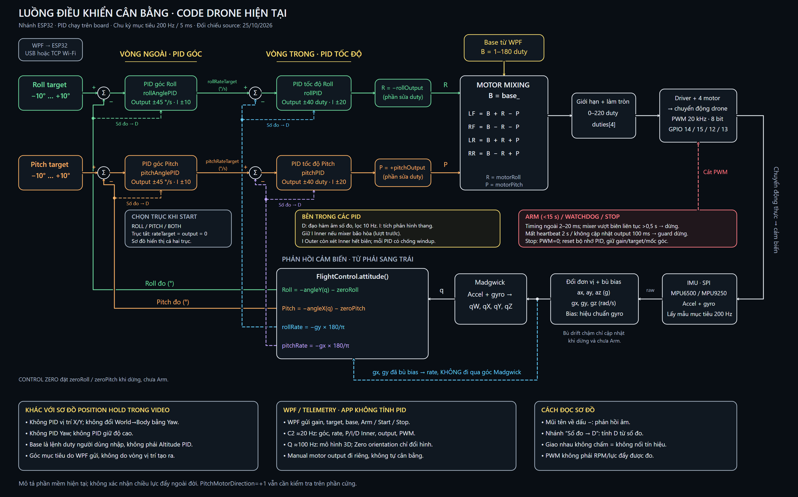

# Sơ đồ luồng điều khiển theo code Drone hiện tại

Đối chiếu ngày **25/10/2026**, nhánh **ESP32**, từ source đang có trong dự án. Sơ đồ mô tả phần mềm, không phải xác nhận phần cứng đã cân bằng hoặc các chiều lực đẩy đã được kiểm chứng.



[Mở PNG độ phân giải đầy đủ](assets/so-do-luong-code-drone.png) · [Mở SVG để phóng to hoặc chỉnh sửa](assets/so-do-luong-code-drone.svg)

## 1. Điều khác với hình trong video

Hình tham khảo là kiến trúc giữ vị trí: bộ vị trí X/Y tạo góc Roll/Pitch, rồi các bộ tư thế đưa lệnh vào mixer, phối hợp với Yaw và độ cao.

Code hiện tại là **bộ cân bằng góc hai tầng**. Đầu vào góc đến từ người dùng, không do một vòng vị trí tính ra.

| Thành phần | Hình tham khảo | Code Drone hiện tại |
|---|---|---|
| Vị trí X/Y | Có bộ điều khiển vị trí | Chưa có |
| Chuyển World → Body theo Yaw cho vị trí | Có | Chưa có khối này; không có phản hồi X/Y |
| Outer trong phạm vi đang nói | Vòng vị trí tạo góc | PID góc tạo tốc độ góc mục tiêu |
| Inner trong phạm vi đang nói | Các bộ tư thế theo sơ đồ khái niệm | PID tốc độ góc tạo phần sửa duty |
| Yaw PID | Có | Chưa có; Yaw chỉ nằm trong thông tin tư thế hiển thị, không có lệnh sửa Yaw vào mixer |
| Độ cao / Thrust | PID độ cao tạo lệnh thrust | Base duty người dùng nhập, giữ theo lần Start |
| Ước lượng trên ESP32 | Hình khái niệm sensing/estimation | MPU6500/MPU9250 qua SPI, bù bias gyro, Madgwick và ánh xạ trục |

Vì vậy, tên **outer/inner chỉ có nghĩa tương đối giữa hai tầng đang xét**. Không nên đồng nhất Outer vị trí trong video với Outer góc trong firmware này.

## 2. Theo dõi một tín hiệu từ trái sang phải

1. WPF gửi Roll/Pitch target trong khoảng −10° đến +10° khi Arm. Đây là mục tiêu, không phải góc đo.
2. Lấy `target − measured angle` để có sai số góc.
3. `rollAnglePID` / `pitchAnglePID` tạo `rollRateTarget` / `pitchRateTarget`, đơn vị °/s, giới hạn ±45°/s.
4. So rate target với `rollRate` / `pitchRate` đo từ gyro đã bù bias.
5. `rollPID` / `pitchPID` tạo `rollOutput` / `pitchOutput`, đơn vị duty, giới hạn ±40.
6. Đổi quy ước phía motor: `motorRoll = −rollOutput`, `motorPitch = +pitchOutput`.
7. Trộn base và hai phần sửa thành bốn lệnh motor, cắt về 0–220 rồi làm tròn thành duty nguyên.
8. `Motors.writeControl()` ghi PWM vào GPIO14/15/12/13 theo thứ tự LF/RF/LR/RR.
9. Chuyển động thân được IMU đo lại, khép các đường phản hồi về dấu trừ.

Trong mode ROLL chỉ hai PID Roll được cập nhật; Pitch rate target/output bằng 0. Mode PITCH làm ngược lại. Mode BOTH chạy cả hai trục. Có bốn đối tượng PID trong code, không phải bốn đối tượng luôn cùng tham gia ở mọi mode.

## 3. Hai đường phản hồi khác nhau

**Đường góc:** accel + gyro đã chuẩn hóa/bù bias → Madgwick → quaternion → `FlightControl.attitude()` → Roll/Pitch trừ mốc firmware.

**Đường rate:** gyro X/Y đã bù bias → ánh xạ trục và đổi rad/s sang °/s. Không lấy đạo hàm góc Madgwick để tạo rate feedback của Inner.

```text
rollRate  = −gy × 180/π
pitchRate = −gx × 180/π
```

Trên hình, `angleY(q)` và `angleX(q)` là ký hiệu rút gọn để đọc sơ đồ; không phải tên hàm thật trong source. Trong `attitude()`, chúng được tính bằng asin/atan2 từ quaternion rồi đảo dấu theo cách gắn bo:

```text
roll  = −angleY(q) − zeroRoll
pitch = −angleX(q) − zeroPitch
```

`CONTROL ZERO` đặt `zeroRoll`/`zeroPitch` trên board khi dừng, chưa Arm, motor idle và đủ điều kiện cảm biến/góc. `Zero orientation` trong WPF chỉ đổi mốc hiển thị mô hình 3D, không thay hai offset đó.

Hiệu chuẩn gyro tạo bias ban đầu. Bù drift chậm trong `MotionCompensation.update()` chỉ được gọi khi không active và chưa Arm, đồng thời có kiểm tra đứng yên. Không vẽ nó như một phép cập nhật bias liên tục trong lúc chạy PID.

## 4. PID thực tế không chỉ có một đường sai số

Nhánh **“Số đo → D”** được vẽ riêng vì `PID.update()` làm các việc sau:

- P dùng sai số hiện tại `target − measured`.
- I dùng tích phân hình thang giữa sai số hiện tại và trước đó; mẫu đầu dùng sai số hiện tại. Thành phần I bị giới hạn.
- D lấy **đạo hàm âm của số đo**, qua bộ lọc thấp 10 Hz, rồi nhân Kd. Không lấy trực tiếp đạo hàm error nên tránh derivative kick do đổi setpoint.
- Output là tổng P+I+D sau khi giới hạn.
- Mỗi PID có điều kiện chống windup. Ngoài ra, Inner khóa tích lũy khi mixer bão hòa ở lượt trước; Outer còn xét output của Inner đã hết biên ở lượt trước hay chưa.

Các giới hạn hiện tại:

| Vòng | Đầu ra | Giới hạn output | Giới hạn I | Gain khi reset board |
|---|---|---|---|---|
| Outer góc | Rate target, °/s | ±45 | ±10 | 2 / 0 / 0 |
| Inner tốc độ | Phần sửa duty | ±40 | ±20 | 0 / 0 / 0 |

Gain runtime có thể được Apply qua WPF, chỉ giữ trong RAM. Không thể Start trục được chọn nếu Kp của các vòng tham gia chưa dương. Các con số giới hạn trên là cấu hình code tại thời điểm rà soát, không phải gain/limit tối ưu đã đo trên phần cứng.

## 5. Mixer và cơ chế dừng

Đặt `B=base_`, `R=motorRoll`, `P=motorPitch`, mixer đúng theo source là:

```text
LF = B + R − P
RF = B − R − P
LR = B + R + P
RR = B − R + P
```

`R` đã qua hệ số −1; không thay trực tiếp `rollOutput` vào chỗ R rồi giữ nguyên dấu. Chưa có `yawOutput` trong bốn biểu thức này. Lệnh PWM không phải lực đẩy hoặc RPM đo được; hệ thống cũng chưa có phản hồi vòng tốc độ riêng của từng motor.

Base được nhận khi Start, phạm vi 1–180 duty. Sau trộn, motor có thể lớn hơn base và được giới hạn riêng ở 0–220. GPIO dùng PWM 20 kHz, 8 bit, không phải xung ESC servo tính bằng microsecond.

Arm cần được Start trong dưới 15 giây. Khi đang điều khiển, timing ngoài 2–20 ms, dữ liệu không hợp lệ, lỗi IMU/PWM hoặc mixer vượt biên liên tục hơn 0,5 giây đều có đường dừng. MotorControl có guard kiểm tra khoảng 50 ms/lần, với ngưỡng heartbeat 2 giây và output quá cũ 100 ms; đây không phải khẳng định phần cứng luôn ngắt đúng ngay một mốc tuyệt đối.

Khi dừng, firmware đưa PWM về 0 và reset bộ nhớ/đầu ra PID; gain, target và mốc góc vẫn được giữ. Timer guard thuộc MotorControl; các kiểm tra timing/IMU/mixer nằm ở luồng chính và Controller.

## 6. WPF nằm ở đâu trong hệ thống?

WPF gửi cấu hình và lệnh điều khiển phiên chạy qua USB hoặc TCP Wi-Fi. **Các phép tính PID diễn ra trên ESP32**, không nằm trong vòng render của app.

- Q khoảng 100 Hz phục vụ tư thế 3D.
- C2 khoảng 20 Hz phục vụ bốn biểu đồ, số đọc và CSV.
- Gain, limit và cấu hình board phản hồi qua PID/CONFIG.
- Manual motor output là đường thử riêng đi qua MotorControl, không sử dụng hai tầng cân bằng như sơ đồ chính.

Sơ đồ không bổ sung vòng giữ vị trí, giữ độ cao hay Yaw chỉ vì app hiển thị đủ Roll/Pitch/Yaw. Có số đo một trạng thái khác với có bộ điều khiển trạng thái đó.

## 7. Đối chiếu khối với source

| Khối / hành vi | Source và điểm cần đọc |
|---|---|
| PID chung, D trên số đo, chống windup | [FlightController.h](../../firmware/DroneMotionMpu6050/FlightController.h), `PID.update()` |
| Quaternion → góc; gyro → rate | [FlightController.h](../../firmware/DroneMotionMpu6050/FlightController.h), `Controller.attitude()` |
| Hai tầng, chọn trục, đảo dấu, mixer | [FlightController.h](../../firmware/DroneMotionMpu6050/FlightController.h), `Controller.update()` |
| SPI, bù bias, Madgwick, gọi điều khiển và telemetry | [DroneMotionMpu6050.ino](../../firmware/DroneMotionMpu6050/DroneMotionMpu6050.ino), `initializeSensor()`, `updateMadgwick()`, `loop()` |
| Nhận PID/SETPOINT/ARM/START/ZERO | [DroneMotionMpu6050.ino](../../firmware/DroneMotionMpu6050/DroneMotionMpu6050.ino), `handleCommand()` |
| PWM phần cứng và timer guard | [MotorControl.h](../../firmware/DroneMotionMpu6050/MotorControl.h), `writeControl()`, `supervise()` |
| Hiệu chuẩn và bù drift khi đứng yên | [GyroCalibration.h](../../firmware/DroneMotionMpu6050/GyroCalibration.h), [MotionCompensation.h](../../firmware/DroneMotionMpu6050/MotionCompensation.h) |
| Đặt lịch và tránh lượt chạy quá sát | [SampleTiming.h](../../firmware/DroneMotionMpu6050/SampleTiming.h) |
| App gửi lệnh và Zero 3D | [MainViewModel.cs](../../src/DroneMotion.Wpf/ViewModels/MainViewModel.cs), `ArmControlAsync()`, `StartControlAsync()`, `ZeroOrientation()` |

Đây là ảnh chụp kiến trúc source ở thời điểm rà soát. Khi thay limit, ánh xạ trục, mixer hoặc thêm vòng mới, cần cập nhật sơ đồ đi kèm.
