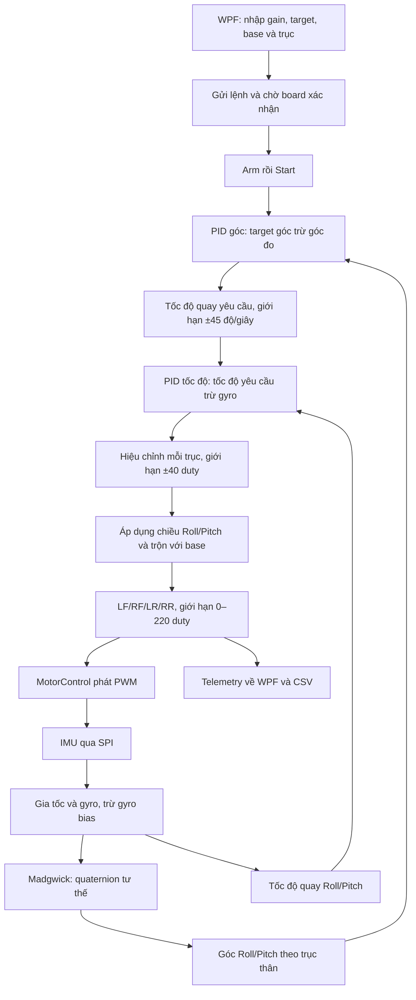

# Luồng điều khiển, các field và cách đọc giá trị PID trên WPF

Cập nhật đồ thị: app hiện có tab **Live PID plots** và bản tin C2 khoảng 20 Hz, bổ sung tốc độ mục tiêu và output giới hạn. Xem [hướng dẫn đồ thị](do-thi-pid.md). Các ví dụ ảnh bên dưới vẫn giải thích các trường chung của C/C2.

Tài liệu dành cho người mới sử dụng hệ thống Drone. Nội dung đối chiếu firmware và giao diện hiện tại, sau khi đã thêm PID góc, bỏ ngưỡng góc đo khi Start/chạy và đảo chiều motor-side Roll theo thử nghiệm của người dùng.

Nguồn code trong dự án Drone:

- [FlightController.h](../../firmware/DroneMotionMpu6050/FlightController.h): góc, gyro, hai tầng PID, bộ trộn và giới hạn.
- [DroneMotionMpu6050.ino](../../firmware/DroneMotionMpu6050/DroneMotionMpu6050.ino): đọc IMU, lệnh điều khiển và telemetry.
- [MainViewModel.cs](../../src/DroneMotion.Wpf/ViewModels/MainViewModel.cs): gửi lệnh, xác nhận gain, điều kiện mở nút và hiển thị số.
- [MainWindow.xaml](../../src/DroneMotion.Wpf/MainWindow.xaml): các field trên giao diện.

Các ví dụ chỉ giải thích phép tính. Chúng không chứng nhận bộ gain hoặc base duty phù hợp để bay hay thử có lực đẩy.

## 1. Đọc ảnh giao diện theo ba nhóm

| Nhóm | Ví dụ trong ảnh | Ý nghĩa |
|---|---|---|
| Giá trị đang nhập | Angle Roll 2/0/0; Inner rate Roll 1.7/0/0; Base 90 | Cấu hình nằm trên app, chưa chắc đã được gửi hoặc board chấp nhận |
| Trạng thái/xác nhận | Board gains not received; Requires CONTROL_V1 firmware | App đã biết gì về kết nối, firmware và gain board |
| Dữ liệu nhận về | FW angle, rate, P/I/D, PWM, saturation | Kết quả board đã gửi ở một thời điểm |

**Không coi con số trong ô nhập là gain chắc chắn đang chạy trên ESP32.** Phải đối chiếu các dòng gain được board xác nhận sau Apply PID hoặc CONTROL INFO.

Ảnh đang có đồng thời:

```text
Board gains not received
Requires CONTROL_V1 firmware
```

Đây là các trạng thái mặc định mà app cũng đặt lại khi mất kết nối/reset trạng thái điều khiển. Chúng không đủ để kết luận chắc chắn board đã nạp sai firmware.

Hàm reset hiện xóa xác nhận gain nhưng chưa xóa chuỗi `ControlData`, nên các số FW angle/PWM phía dưới có thể còn từ bản tin trước đó. **Chỉ một ảnh này không xác nhận motor đang chạy hay telemetry còn mới.** Cần xem trạng thái kết nối và sự cập nhật dữ liệu.

## 2. Hình dung toàn bộ luồng



Nếu trình đọc không hiển thị Mermaid:

```text
Target góc − góc đo
        ↓ PID góc
Tốc độ quay yêu cầu − gyro
        ↓ PID tốc độ
Hiệu chỉnh Roll/Pitch
        ↓ áp dụng chiều và trộn với base duty
PWM cho LF / RF / LR / RR
```

ESP32 tính điều khiển ở mục tiêu 200 Hz, tức khoảng 5 ms mỗi lượt, với dt đo thực tế. WPF gửi cấu hình và hiển thị; app không tính lại PID ở mỗi khung hình 3D.

## 3. Góc, tốc độ quay, gain và duty khác nhau thế nào?

| Đại lượng | Đơn vị | Ví dụ | Câu hỏi nó trả lời |
|---|---|---|---|
| Góc | độ, ° | Roll = +5° | Drone đang nghiêng bao nhiêu? |
| Tốc độ quay | độ/giây, °/s | Roll rate = −8°/s | Góc đang thay đổi nhanh bao nhiêu và theo chiều nào? |
| Gain Kp/Ki/Kd | Phụ thuộc tầng PID | Kp góc = 2/s | Bộ điều khiển phản ứng mạnh thế nào? |
| Duty | Số đếm PWM 8 bit | 90 trên 255 | Lệnh đóng/ngắt công suất motor là bao nhiêu? |

Drone có thể nghiêng 5° nhưng đang giữ yên: góc khác 0, tốc độ gần 0. Nó cũng có thể đi qua vị trí ngang rất nhanh: góc gần 0, tốc độ lớn. Đó là lý do hệ thống sử dụng cả góc và gyro.

## 4. Outer angle PID — vòng góc

### 4.1. Angle Roll Kp / Ki / Kd

Ba ô điều chỉnh vòng góc Roll. Trong ảnh là:

```text
Kp = 2     Ki = 0     Kd = 0
```

Vòng này lấy sai số góc và tạo **tốc độ quay yêu cầu**:

```text
errorAngle = targetAngle − measuredAngle
targetRate = PID_góc(errorAngle)
```

| Hệ số | Tác dụng | Khi bằng 0 |
|---|---|---|
| Kp | Sai góc càng nhiều thì yêu cầu quay sửa càng nhanh | Không có phần sửa theo sai số tức thời |
| Ki | Tích lũy sai góc kéo dài để bù | Không tích lũy phần I mới sau reset |
| Kd | Phản ứng theo sự thay đổi góc đo, hỗ trợ điều chỉnh chuyển động khi tuning phù hợp | Không đóng góp phần D |

Với 2/0/0, sau reset, vòng góc đang dùng P:

```text
target = 0°
measured = +5°
error = 0 − 5 = −5°
targetRate = 2 × (−5) = −10°/s
```

**Số 2 là hệ số, không phải yêu cầu thử nghiêng 2°.** Nó tương đương tạo khoảng 2 độ/giây tốc độ yêu cầu cho mỗi độ sai lệch, trước giới hạn.

### 4.2. Angle Pitch Kp / Ki / Kd

Ý nghĩa giống Roll nhưng áp dụng cho chúi/ngẩng đầu. Ảnh cũng là 2/0/0.

Khi chọn ROLL, vòng Pitch bị vô hiệu hóa trong tính điều khiển, dù các ô gain Pitch vẫn có giá trị.

### 4.3. Giới hạn ±45°/s có nghĩa gì?

Đó là giới hạn **tốc độ quay yêu cầu do vòng góc tạo ra**. Nó không phải giới hạn góc nghiêng và không bảo đảm tốc độ thực tế không vượt quá 45°/s.

Ví dụ target=0°, đo=−30°, Kp=2:

```text
errorAngle = +30°
P góc = +60°/s
targetRate sau giới hạn = +45°/s
```

Đóng góp I của vòng góc còn có giới hạn riêng ±10°/s.

## 5. Inner rate PID — vòng tốc độ quay

### 5.1. Inner rate Roll Kp / Ki / Kd

Trong ảnh là:

```text
Kp = 1.7     Ki = 0     Kd = 0
```

Vòng này so sánh tốc độ yêu cầu từ vòng góc với tốc độ gyro đo:

```text
errorRate = targetRate − measuredRate
correctionDuty = PID_tốc_độ(errorRate)
```

| Hệ số | Tác dụng |
|---|---|
| Kp | Đổi sai số tốc độ tức thời thành phần hiệu chỉnh duty |
| Ki | Bù sai số tốc độ tồn tại lâu bằng phần tích lũy |
| Kd | Phản ứng với thay đổi tốc độ gyro, có lọc đạo hàm 10 Hz trong code |

Với Kp=1.7, mỗi sai số 1°/s tạo 1.7 duty từ phần P, trước giới hạn.

Ví dụ độc lập để dễ tính, giả sử board đã xác nhận gain trên:

```text
target góc = 0°
góc đo = −5°
Outer Kp = 2
→ tốc độ yêu cầu = +10°/s

gyro đo = −3°/s
→ sai số tốc độ = 10 − (−3) = +13°/s

Inner Kp = 1.7
→ P tốc độ = 1.7 × 13 = +22.1 duty
```

Các số dương/âm thể hiện chiều theo quy ước cảm biến/thân, không tự biểu diễn motor nào được tăng. Việc phân bổ motor diễn ra ở bộ trộn.

### 5.2. Inner rate Pitch Kp / Ki / Kd

Ý nghĩa giống Roll nhưng cho trục Pitch. Ảnh nhập 1.7/0/0, nhưng đang chọn ROLL nên điều khiển Pitch không tham gia trong chế độ đó.

Không có cơ sở từ ảnh để khẳng định 1.7 là gain đã tuning tốt. Khi sai số tốc độ lớn, mức này có thể khiến output sớm chạm giới hạn ±40 duty.

Giới hạn nhập gain hiện tại áp dụng cho cả hai tầng:

| Ô | Phạm vi được phần mềm chấp nhận |
|---|---|
| Kp | 0–5 |
| Ki | 0–2 |
| Kd | 0–0.2 |

Dùng dấu chấm thập phân, ví dụ `1.7`. Đây là phạm vi kiểm tra đầu vào, không phải phạm vi gain đã được chứng minh ổn định. Cùng một con số ở hai tầng có ý nghĩa khác nhau vì đầu ra vòng góc là độ/giây còn đầu ra vòng tốc độ là duty.

### 5.3. Công thức PID đang dùng

```text
P = Kp × error
I_candidate = I_trước + Ki × (error + error_trước) × dt / 2
D_raw = −(giá_trị_đo − giá_trị_đo_trước) / dt
D_lọc += dt / (dt + 0.0159155) × (D_raw − D_lọc)
D = Kd × D_lọc
output = giới_hạn(P + I + D)
```

Mẫu đầu không tạo xung D và khởi tạo bước I theo sai số hiện tại. I chỉ cập nhật khi cơ chế chống tích lũy cho phép. D lấy theo giá trị đo để thay đổi target không tự tạo xung D do bước nhảy target.

Vòng tốc độ giới hạn I ở ±20 duty, tổng output ở ±40 duty. **P riêng lẻ vẫn có thể lớn hơn 40.**

## 6. Apply PID và gain đã xác nhận

### Apply PID

Nút này gửi các gain xuống ESP32. App mới và firmware cascade trao đổi bốn bộ: ROLL, PITCH, ANGLE_ROLL, ANGLE_PITCH. App chờ xác nhận phù hợp cho từng bộ trước khi tiếp tục.

Sửa ô nhập không tự cập nhật gain trên board. Chỉ Apply khi đã dừng/disarm; không sửa gain trong lúc điều khiển đang chạy.

### Board gains not received

Chưa có xác nhận gain trong trạng thái hiện tại của app. Không có nghĩa gain trên ESP32 chắc chắn bằng 0. Board có thể vẫn giữ cấu hình cũ trong RAM, hoặc app chưa lấy được thông tin sau kết nối.

### ROLL: P=... I=... D=... và ANGLE_ROLL: P=... I=... D=...

Đây là **hệ số gain board đã báo về**, không phải P/I/D tức thời. Trong dòng xác nhận này chữ P/I/D được dùng làm nhãn ngắn cho Kp/Ki/Kd.

### Board gains acknowledged (RAM; reset restores defaults)

Board đã báo gain về. Gain đang lưu RAM; reset trả về mặc định: vòng góc 2/0/0, vòng tốc độ 0/0/0. App vẫn có thể giữ các giá trị nhập trước đó, nên phải đối chiếu xác nhận mới.

## 7. Base duty

Ảnh đặt **90**, trên thang duty 0–255. Phần trăm duty tương ứng:

```text
90 / 255 × 100 ≈ 35.3%
```

Đây là ga nền cộng vào cả bốn motor, trước các phần hiệu chỉnh. **90 không phải 90%, không phải RPM và không phải lực nâng đo được.**

Field cho nhập 1–180. Motor sau bộ trộn có thể lớn hơn 180, vì giới hạn cuối là 0–220 duty. PWM phần cứng chạy ở 20 kHz, độc lập với nhịp PID 200 Hz.

Base quá thấp có thể không tạo đủ lực để thắng ma sát/khối lượng trên đế. Base cao làm lực đẩy và phản ứng thực tế lớn hơn. Code không đo lực đẩy để tự chọn base phù hợp.

## 8. Roll / pitch target °

Hai ô này là góc mong muốn, đơn vị độ. Ảnh đặt:

```text
Roll target = 0°
Pitch target = 0°
```

Tức là muốn giữ ngang theo mốc firmware. Target +5° yêu cầu giữ một góc nghiêng +5°, thay vì trở về 0°.

Target hiện được giới hạn ±10°. Đây là giới hạn **lệnh mục tiêu**, khác với góc đo: điều kiện chặn Start ±10° và ngắt khi đo vượt ±25° đã được bỏ theo yêu cầu trước đó. Đổi target không cần thiết để xử lý việc drone đang nghiêng ±20°.

## 9. ROLL / PITCH / BOTH

| Lựa chọn | Vòng đang điều khiển | Những gì vẫn chạy |
|---|---|---|
| ROLL | Hai tầng Roll | Cảm biến đo cả hai trục; cả bốn motor có base |
| PITCH | Hai tầng Pitch | Cảm biến đo cả hai trục; cả bốn motor có base |
| BOTH | Hai tầng của cả hai trục | Bộ trộn kết hợp Roll và Pitch |

Chọn ROLL không có nghĩa chỉ chạy hai motor. Nó chỉ loại bỏ hiệu chỉnh Pitch.

## 10. Mốc góc, xác nhận đế và các nút chạy

| Field/nút | Chức năng | Điều kiện hoặc lưu ý |
|---|---|---|
| Set firmware level reference | Lấy tư thế hiện tại làm mốc góc PID | Chỉ khi dừng/disarm và tư thế thô trong ±10°; đặt drone ngang trước khi dùng |
| Rig secured; motor mapping and correction direction verified | Xác nhận người dùng đã cố định đế và kiểm tra thứ tự/chiều hiệu chỉnh | App không tự đo để xác minh; bỏ tích lúc Arm/chạy yêu cầu Stop |
| Arm balance | Chuẩn bị quyền chạy điều khiển | Cần firmware hỗ trợ, sensor sẵn sàng, xác nhận đế và gain phù hợp đã nhận |
| Start balance | Bắt đầu PID và xuất PWM | Sau Arm, trong 15 giây, cùng nguồn kết nối USB/Wi-Fi |
| STOP / DISARM | Dừng motor và hủy Arm | Reset bộ nhớ cả hai tầng PID; vẫn giữ target cấu hình |

Nút `Zero orientation` của mô hình 3D đổi mốc hiển thị. Nó không thay mốc điều khiển như `Set firmware level reference`.

Một trục được chọn cần Kp góc và Kp tốc độ lớn hơn 0. Các field chỉnh gain/base/target bị khóa khi chưa có trạng thái phù hợp, đang gửi lệnh, đã Arm hoặc đang chạy. Vì vậy, màu xám không chỉ có một nguyên nhân.

Luồng nút thông thường:

```text
Kết nối → READY và nhận thông tin firmware/gain
       → nhập cấu hình → Apply PID → kiểm tra phản hồi
       → xác nhận đế → Arm → Start
       → quan sát hoặc ghi CSV → Stop
```

## 11. Cách đọc từng dòng telemetry trong ảnh

### 11.1. FW angle R −22.68° P −1.79°

- `FW` = giá trị mà firmware đang dùng cho PID.
- `R` = Roll; góc trong bản tin là −22.68°.
- `P` = Pitch; góc trong bản tin là −1.79°. Chữ P ở đây không phải thành phần P của PID.
- Góc đã trừ mốc ZERO firmware, không nhất thiết giống góc của mô hình đã Zero orientation riêng.

Theo xác nhận của người dùng, Roll dương là trái thấp/phải cao. Với cùng mốc đó, Roll âm là chiều ngược lại. Phải xét mốc đã đặt khi diễn giải tư thế thực tế.

### 11.2. rate −29.2 / −20.5 °/s

Hai số lần lượt là tốc độ quay Roll và Pitch do gyro cung cấp sau đổi trục/đơn vị. Đây không phải tốc độ motor và không phải góc nghiêng.

Ví dụ Roll rate âm nghĩa là Roll đang thay đổi về phía âm theo quy ước hiện tại. Có thể góc vẫn âm nhưng rate dương: drone đang quay về phía ngang hoặc đi qua nó. PID dùng cả hai đại lượng để quyết định hiệu chỉnh.

### 11.3. Target 0.0 / 0.0°

Góc mục tiêu Roll/Pitch mà firmware báo trong bản tin đó. Đây là trạng thái mục tiêu của board, nên hữu ích hơn việc chỉ nhìn các ô nhập khi kiểm tra board đã nhận gì.

### 11.4. Roll P/I/D 111.34 / 0.00 / 0.00

Đây là **các phần đóng góp tức thời của PID tốc độ Roll**, không phải gain:

```text
Pterm = 111.34 duty
Iterm =   0.00 duty
Dterm =   0.00 duty
Tổng trước giới hạn = 111.34 duty
Output sau giới hạn ±40 = +40 duty
```

Con số 111.34 không có nghĩa Kp=111.34, góc=111.34° hoặc motor nhận duty=111.34. Nó là một bước tính trung gian.

### 11.5. Pitch P/I/D 0.00 / 0.00 / 0.00

Chọn ROLL thì vòng Pitch không cập nhật để điều khiển, nên ngay sau Start/reset các đóng góp này bằng 0. Điều đó không chứng minh cảm biến Pitch không hoạt động; dòng FW angle và rate vẫn có dữ liệu Pitch.

### 11.6. PWM 50 / 130 / 50 / 130

Thứ tự luôn là:

| Giá trị | Motor | GPIO | Duty tương đương |
|---|---|---|---|
| 50 | LF — trái trước | 14 | Khoảng 19.6% |
| 130 | RF — phải trước | 15 | Khoảng 51.0% |
| 50 | LR — trái sau | 12 | Khoảng 19.6% |
| 130 | RR — phải sau | 13 | Khoảng 51.0% |

Các phần trăm chỉ là duty PWM, không phải % tốc độ hoặc lực đẩy thực tế. Bản tin PWM báo giá trị lệnh, không đo được motor có quay đúng hay không.

### 11.7. saturation 0

Trong code hiện tại, cờ này chỉ cho biết **lệnh motor sau bộ trộn có vượt 0–220 duty hay không**:

- `0`: không có motor vượt phạm vi này trong lượt tính đó.
- `1`: ít nhất một lệnh motor vượt và bị cắt về giới hạn.

Nó chưa báo riêng việc PID tốc độ chạm ±40 hoặc vòng góc chạm ±45. Vì vậy, **P lớn hơn 40, output PID bị giới hạn, nhưng saturation vẫn bằng 0 là hoàn toàn có thể xảy ra**.

## 12. Ghép P=111.34 và PWM=50/130 thành một ví dụ

Trong code hiện tại:

```text
RollMotorDirection = −1
PitchMotorDirection = +1

motorRoll = −rollOutput
motorPitch = pitchOutput

LF = base + motorRoll − motorPitch
RF = base − motorRoll − motorPitch
LR = base + motorRoll + motorPitch
RR = base − motorRoll + motorPitch
```

Nếu base board đang dùng là 90, tổng Roll P/I/D là +111.34 và chế độ ROLL:

```text
rollOutput  = giới_hạn(+111.34, −40, +40) = +40
pitchOutput = 0
motorRoll   = −40
motorPitch  = 0

LF = 90 − 40 = 50
RF = 90 + 40 = 130
LR = 90 − 40 = 50
RR = 90 + 40 = 130
```

Cả bốn lệnh đều trong 0–220, nên `saturation=0`. Đây là phép tính phù hợp với nhóm số P/I/D và PWM đang thấy trong ảnh, nếu board sử dụng base=90 và firmware có chiều Roll mới.

Với Roll âm và target 0°, thành phần P của vòng góc yêu cầu quay về chiều dương. Trong cấu hình đã sửa, output Roll dương tăng phía phải. Chiều này phù hợp việc sửa nghiêng phải khi mapping motor đúng như người dùng xác nhận cho Roll.

**Không thể ghép chính xác tất cả số trong ảnh thành một trạng thái đã được xác nhận.** Ví dụ, nếu giả sử board thực sự có Outer Kp=2, Inner Kp=1.7, I=D=0, dùng góc −22.68° và rate −29.2°/s của cùng một lượt tính:

```text
tốc độ yêu cầu = giới_hạn(2 × 22.68, −45, +45) = +45°/s
sai số tốc độ = 45 − (−29.2) = 74.2°/s
P tốc độ = 1.7 × 74.2 = 126.14 duty
```

Kết quả không phải 111.34. Sai khác này không thể giải thích chỉ bằng làm tròn hiển thị; cần lấy gain board đã xác nhận và log mới để kiểm tra. Ảnh đang báo chưa nhận gain, nên không được coi 1.7 trong ô nhập là gain chắc chắn tạo ra dòng telemetry đó.

## 13. Trạng thái firmware thường gặp

| Trạng thái | Cách hiểu |
|---|---|
| Requires CONTROL_V1 firmware | App chưa xác nhận khả năng điều khiển trong trạng thái hiện tại; cũng là nhãn mặc định sau reset trạng thái |
| CONTROL_V1 | Board báo hỗ trợ giao thức điều khiển nền |
| CONTROL_CASCADE_V2 | Board báo hỗ trợ chỉnh gain vòng góc riêng |
| CONTROL_ARMED | Đã Arm, chờ Start |
| CONTROL_RUNNING | Board xác nhận đã Start điều khiển |
| CONTROL_STOPPED | Đã dừng/disarm |
| CONTROL_INVALID_OR_NOT_ARMED | Lệnh điều khiển không hợp lệ trong trạng thái hiện tại, có thể chưa Arm/hết hạn/sai nguồn hoặc tham số không hợp lệ |
| CONTROL_TIMING_FAULT | dt điều khiển không hợp lệ |
| CONTROL_ATTITUDE_FAULT | Góc hoặc tốc độ quay không hợp lệ |
| CONTROL_SATURATION_LIMIT | Mixer vượt giới hạn kéo dài quá 0.5 giây |

Các dòng thông tin có thể ghi đè lên nhãn trạng thái chung. Cần đối chiếu kết nối, phản hồi lệnh và telemetry mới thay vì chỉ nhìn một dòng chữ.

## 14. Start / stop CSV log

Nút này bật/tắt ghi dữ liệu về máy tính, không phải nút Start/Stop motor. File lưu trong thư mục Documents/DroneMotionLogs của người dùng Windows.

`CSV logging off` nghĩa là hiện không ghi file. Nó không nói motor đang dừng hay đang chạy.

CSV chứa thời gian ESP32, góc, tốc độ, target, P/I/D vòng tốc độ, duty từng motor, cờ saturation/active và gain đã nhận của cả hai tầng. C2 mới bổ sung tốc độ mục tiêu và output giới hạn của hai trục, trước các cột gain. Với C cũ, bốn cột đó để trống. Chưa có P/I/D vòng góc trong telemetry.

Thời gian `micros` là số micro giây của ESP32, không phải giờ Windows; số 32 bit tràn sau khoảng 71 phút. Đọc log cần xét việc reset/tràn thời gian.

## 15. Bảng phân biệt các số hay bị nhầm

| Số/nhãn | Nó thực sự là gì? | Không suy ra được điều gì? |
|---|---|---|
| Angle Kp=2 | Gain biến sai số góc thành tốc độ yêu cầu | Không phải góc thử 2° |
| Inner Kp=1.7 | Gain biến sai số tốc độ thành hiệu chỉnh duty | Không chứng minh là gain phù hợp phần cứng |
| Base=90 | Ga nền theo duty 0–255 | Không phải 90% và không bảo đảm đủ lực cân bằng |
| Target=0° | Góc muốn giữ theo mốc firmware | Không phải yêu cầu tắt motor |
| Roll P=111.34 | Phần P tức thời của PID tốc độ | Không phải Kp hoặc duty cuối motor |
| PWM=130 | Lệnh duty cho một motor | Không phải tốc độ quay hoặc lực đẩy đo được |
| saturation=0 | Mixer không vượt 0–220 trong bản tin đó | Không chứng minh hai tầng PID chưa chạm giới hạn |
| Ô gain trên app | Giá trị người dùng đang nhập/giữ lại | Không chứng minh ESP32 đã nhận giá trị ấy |
| Telemetry còn hiển thị | Bản tin đã được app nhận trước đó | Không tự chứng minh dữ liệu còn mới hoặc motor đang chạy |

## 16. Cách đọc một lần thử cho đúng

1. Xác nhận kết nối và dữ liệu mới đang cập nhật.
2. Chờ sensor READY và thông tin firmware hỗ trợ.
3. Khi dừng, nhập cấu hình, Apply rồi đối chiếu gain board đã báo.
4. Phân biệt góc mục tiêu, góc đo và tốc độ quay trước khi giải thích chiều hiệu chỉnh.
5. Khi đọc P/I/D, nhớ đây là vòng tốc độ và tổng còn phải qua giới hạn ±40.
6. Tính tiếp chiều mixer và base để hiểu PWM LF/RF/LR/RR.
7. Dùng CSV để theo dõi cả quá trình, thay vì suy ra độ ổn định từ một ảnh.

Phần mềm chỉ tính và gửi lệnh. Đúng dấu phép tính chưa chứng minh motor đúng vị trí, lực đẩy đúng chiều hoặc drone đã ổn định. Kiểm tra đầu ra trên bàn cần tháo cánh; việc đánh giá cân bằng phải thực hiện trên đế phù hợp.
