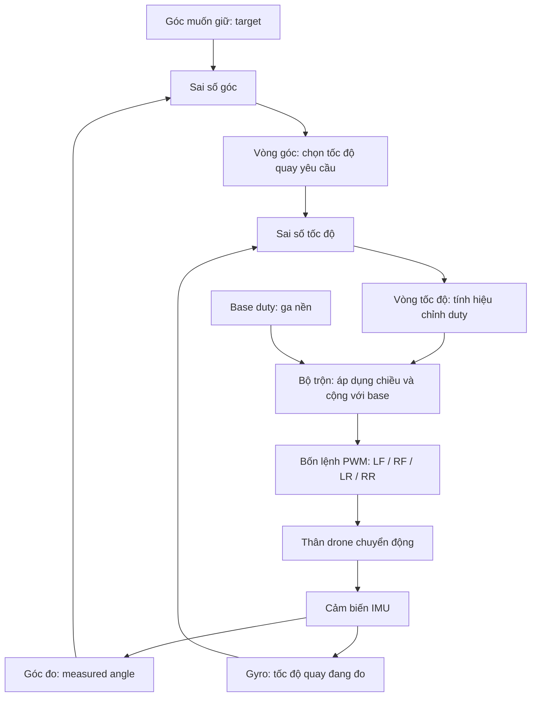

# Hiểu bộ điều khiển và các ô PID trên WPF từ đầu

Tài liệu này giúp bạn trả lời ba câu hỏi: **drone tự sửa nghiêng như thế nào, vì sao app cần nhiều ô nhập, và phải nhìn số nào để biết nó đang làm gì?** Bạn chưa cần biết lập trình hoặc công thức PID để đọc phần đầu.

Đọc tiếp theo thứ tự: tài liệu này → [cách đọc đồ thị](do-thi-pid.md) → [thực hành trên đế](pid-can-bang-tren-de.md). Khi muốn xem công thức và liên hệ code, đọc [luồng kỹ thuật](luong-dieu-khien-cascade.md).

## 1. Bắt đầu bằng một việc đơn giản: đưa drone về ngang

Giả sử bạn muốn drone nằm ngang, nhưng bên trái đang thấp hơn bên phải. Để sửa, hệ thống phải:

1. Biết bạn muốn giữ góc nào: lấy từ **target**, nghĩa là góc mục tiêu.
2. Biết drone đang nghiêng bao nhiêu: lấy từ **IMU**, tức cụm cảm biến gia tốc và tốc độ quay.
3. Tính xem cần sửa mạnh bao nhiêu: dùng **PID**, thuật toán điều khiển dựa vào sai lệch và chuyển động.
4. Tăng lực đẩy bên trái tương đối với bên phải để nâng phía đang thấp.
5. Đo lại, tính lại và tiếp tục sửa.

Việc đo lại sau mỗi lần điều chỉnh gọi là **phản hồi**. Nếu lệnh làm drone nghiêng thêm, chiều phản hồi hoặc vị trí motor có thể đang sai; tăng hệ số PID không giải quyết được lỗi chiều đó.

Trong hệ thống hiện tại, ESP32 là nơi đọc cảm biến và tính điều khiển. WPF là app máy tính để nhập cấu hình, gửi lệnh và quan sát kết quả. Đóng tab đồ thị không làm vòng PID trên ESP32 biến mất.

## 2. Những từ cần hiểu trước khi nhập số

| Từ trên app | Hiểu đơn giản | Ví dụ |
|---|---|---|
| Roll | Nghiêng trái/phải | Trái thấp, phải cao |
| Pitch | Chúi/ngẩng đầu | Đầu thấp, đuôi cao |
| Angle | Góc đang nghiêng, đơn vị độ (°) | Lệch 5° so với mốc ngang |
| Rate | Tốc độ góc đang thay đổi, đơn vị độ/giây (°/s) | Đang quay về ngang với tốc độ 10°/s |
| Target / setpoint | Giá trị muốn đạt | Góc mục tiêu 0° |
| Measured | Giá trị cảm biến đo/ước lượng | Góc hiện tại +5° |
| Error | Sai số: mục tiêu trừ giá trị đo | 0 − 5 = −5° |
| Gain | Hệ số quyết định độ mạnh của thuật toán | Kp = 2 |
| PWM / duty | Cách ra lệnh công suất motor bằng bật/tắt nhanh | Duty 90 trên thang 255 |
| Telemetry | Dữ liệu ESP32 gửi về app | Góc, tốc độ, PWM |

**Góc và tốc độ quay cần được phân biệt.** Drone nghiêng 5° và đứng yên có rate gần 0. Drone đi qua vị trí ngang có thể có angle gần 0 nhưng rate rất lớn. Trường hợp thứ hai cần điều chỉnh để giảm tốc, dù nó vừa đi qua đúng góc mục tiêu.

Theo kiểm tra của người dùng trên bo hiện tại, **FW Roll dương là trái thấp/phải cao**. Đó là quy ước riêng theo cách gắn cảm biến và mốc góc; Pitch cần được kiểm tra riêng trên phần cứng.

## 3. Vì sao cần hai vòng điều khiển?

### 3.1. Muốn về đúng góc, còn phải kiểm soát cách di chuyển

Bạn muốn drone nằm ngang ở **0°**. Cảm biến báo drone đang nghiêng **+5°**. Ta biết cần đưa nó về 0°, nhưng thông tin này còn thiếu một điều: **drone đang đứng yên, đang nghiêng thêm hay đang quay về rất nhanh?**

Hãy tưởng tượng bạn lái xe đến một điểm dừng. Biết còn cách điểm dừng 5 mét chưa đủ để quyết định nhấn ga hay phanh: xe đang đứng yên và xe đang chạy rất nhanh cần xử lý khác nhau. Với drone, góc giống như vị trí cần đạt, còn tốc độ quay cho biết thân drone đang di chuyển nhanh thế nào.

Hệ thống này chia công việc thành hai câu hỏi nối tiếp:

1. **Vòng góc:** “Đang lệch như vậy thì nên quay về với tốc độ bao nhiêu?”
2. **Vòng tốc độ:** “So với tốc độ đó, hiện tại đang quay thiếu hay thừa? Cần đổi lệnh motor bao nhiêu?”

Hai vòng không phải hai thuật toán độc lập cùng tranh nhau điều khiển motor. **Kết quả vòng góc trở thành mục tiêu của vòng tốc độ.**

### 3.2. Vòng ngoài — nhìn góc để chọn tốc độ cần quay

Tên trên app là **Outer angle PID**. “Outer” nghĩa là vòng ngoài, “angle” nghĩa là góc.

Nó nhận:

- **Góc mục tiêu:** bạn muốn giữ bao nhiêu độ, chẳng hạn 0°.
- **Góc đo:** firmware ước lượng drone đang nghiêng bao nhiêu, chẳng hạn +5°.

Sau đó tính sai số:

```text
Sai số góc = góc mục tiêu − góc đo
           = 0 − 5
           = −5°
```

Dấu âm nghĩa là cần thay đổi góc về chiều âm để tiến tới mục tiêu. Nó chưa phải lệnh giảm tất cả motor.

Giả sử vòng góc đang dùng **Kp=2, Ki=0, Kd=0**. Khi ấy:

```text
Tốc độ quay yêu cầu = Kp góc × sai số góc
                    = 2 × (−5)
                    = −10°/s
```

Có thể đọc thành câu: **“Drone đang ở +5°; tôi muốn nó quay về theo chiều âm, với tốc độ yêu cầu là 10 độ mỗi giây.”**

Vòng góc tạo ra một **yêu cầu chuyển động**, chưa tạo duty cho từng motor. Kết quả −10°/s không phải cam kết rằng drone lập tức quay đúng tốc độ đó.

### 3.3. Vòng trong — nhìn gyro để điều chỉnh motor đạt tốc độ đó

Tên trên app là **Inner rate PID**. “Inner” nghĩa là vòng trong, “rate” ở đây là tốc độ quay.

Nó nhận:

- **Tốc độ quay yêu cầu:** kết quả vòng góc, ở ví dụ là −10°/s.
- **Tốc độ quay đang đo:** lấy từ gyro, là cảm biến đo tốc độ quay.

Nếu drone đang đứng yên, gyro gần **0°/s**:

```text
Sai số tốc độ = tốc độ yêu cầu − tốc độ đo
              = −10 − 0
              = −10°/s
```

Nghĩa là drone chưa quay về đủ theo yêu cầu. Vòng tốc độ cần tạo hiệu chỉnh để nó bắt đầu quay về.

Chỉ để minh họa phép tính, giả sử vòng tốc độ dùng **Kp=0.2, Ki=0, Kd=0**:

```text
Hiệu chỉnh Roll = Kp tốc độ × sai số tốc độ
                = 0.2 × (−10)
                = −2 duty
```

Giá trị **−2 duty** được đưa sang bộ trộn motor. Bộ trộn áp dụng chiều Roll hiện tại, cộng/trừ hiệu chỉnh với **Base duty** để tạo bốn lệnh LF/RF/LR/RR. Với mapping đã chỉnh của drone này, tình huống đứng yên ở Roll +5° và target 0° sẽ tăng tương đối phía trái để sửa nghiêng.

Số 0.2 ở đây chỉ để tính dễ, không phải gain đã được xác nhận cho phần cứng.

### 3.4. Cùng nghiêng +5°, tại sao có lúc cần sửa ngược lại?

Giữ nguyên target 0° và PID góc 2/0/0, nên vòng góc vẫn yêu cầu **−10°/s**. Bây giờ xét ba chuyển động khác nhau:

| Góc đo | Tốc độ đo từ gyro | Sai số tốc độ | Vòng tốc độ đang muốn làm gì? |
|---|---|---|---|
| +5° | 0°/s | −10 − 0 = −10°/s | Tạo chuyển động quay về |
| +5° | +5°/s | −10 − 5 = −15°/s | Sửa mạnh hơn vì drone còn đang quay xa mục tiêu |
| +5° | −20°/s | −10 − (−20) = +10°/s | Giảm tốc quay về vì đang nhanh hơn yêu cầu |

Ở hàng cuối, drone đã quay về theo chiều âm rất nhanh. Tiếp tục thúc nó về mạnh thêm có thể làm nó đi quá góc 0° và nghiêng sang phía còn lại. Vì vậy, vòng tốc độ tạo phần hiệu chỉnh theo chiều dương để **giảm độ lớn tốc độ quay về**.

Điều này giải thích một hiện tượng dễ hiểu nhầm: **drone còn nghiêng nhưng lệnh hiệu chỉnh đã đổi chiều**. Nó có thể đang giảm tốc để đến mục tiêu, không nhất thiết là bộ trộn bị ngược. Muốn kết luận phải xem cả góc, gyro và kết quả PID.

Các phép tính ở bảng chỉ xét phần P. Khi Ki/Kd khác 0, bộ nhớ tích lũy và sự thay đổi giá trị đo cũng góp phần quyết định lệnh cuối.

### 3.5. Khi gần ngang, hai vòng phối hợp ra sao?

Với vòng góc 2/0/0 và target 0°, yêu cầu tốc độ giảm theo độ lệch:

| Góc đang đo | Sai số góc | Tốc độ quay yêu cầu |
|---|---|---|
| +5° | −5° | −10°/s |
| +2° | −2° | −4°/s |
| +0.5° | −0.5° | −1°/s |
| 0° | 0° | 0°/s |

Càng gần ngang, vòng góc càng yêu cầu quay chậm lại. Vòng tốc độ liên tục dùng gyro để điều chỉnh theo yêu cầu đang thay đổi đó.

Ngay khi góc vừa bằng 0° mà gyro vẫn báo đang quay, vòng tốc độ vẫn có sai số và tiếp tục yêu cầu hiệu chỉnh. **Muốn giữ ngang, cần vừa đạt góc mục tiêu vừa giảm tốc độ quay về gần 0.** Không phải cứ đi qua 0° là đã cân bằng.

### 3.6. Vì sao không chỉ nhìn góc, hoặc chỉ nhìn tốc độ?

Nếu một thuật toán chỉ dùng góc tức thời mà không xét chuyển động, hai trạng thái cùng +5° ở bảng trên sẽ trông giống nhau. Nó thiếu thông tin để phân biệt cần bắt đầu quay về hay cần giảm tốc quay về.

Nếu chỉ điều khiển tốc độ bằng gyro với mục tiêu 0°/s, drone có thể ngừng quay nhưng vẫn nằm nghiêng ở +5°. Vòng tốc độ không tự biết góc nào được coi là ngang; vòng góc cung cấp mục tiêu đó thông qua yêu cầu chuyển động.

Trong cấu trúc đang dùng:

- **Vòng góc giữ mục tiêu tư thế:** cần tiến đến góc nào và nên quay nhanh bao nhiêu.
- **Vòng tốc độ điều chỉnh chuyển động:** dùng gyro để biến yêu cầu tốc độ thành phần sửa motor.

Đây là cách tổ chức của firmware hiện tại, không phải khẳng định mọi bộ điều khiển drone đều bắt buộc có cùng cấu trúc. Một thiết kế khác có thể kết hợp góc và tốc độ theo cách khác.

### 3.7. Liên hệ với bốn hàng gain trên app

| Hàng trên app | Bạn đang chỉnh việc gì? | Đầu ra của hàng đó |
|---|---|---|
| Angle Roll Kp / Ki / Kd | Cách chọn tốc độ để sửa góc trái/phải | Tốc độ Roll yêu cầu, °/s |
| Inner rate Roll Kp / Ki / Kd | Cách sửa motor để đạt tốc độ Roll yêu cầu | Hiệu chỉnh Roll, duty |
| Angle Pitch Kp / Ki / Kd | Cách chọn tốc độ để sửa góc chúi/ngẩng | Tốc độ Pitch yêu cầu, °/s |
| Inner rate Pitch Kp / Ki / Kd | Cách sửa motor để đạt tốc độ Pitch yêu cầu | Hiệu chỉnh Pitch, duty |

Vì đầu ra khác đơn vị, **Kp góc = 2 và Kp tốc độ = 2 không có cùng ý nghĩa**. Vòng góc mặc định 2/0/0, vòng tốc độ mặc định 0/0/0; không thể coi việc đã có số 2 ở hàng Angle là đã cấu hình đủ lực hiệu chỉnh motor.

Base duty cũng có nhiệm vụ riêng: tạo mức lệnh nền chung cho bốn motor. Hai tầng PID tạo phần chênh lệch cộng/trừ vào nền đó để sửa tư thế.

### 3.8. Sơ đồ luồng và những gì cần nhìn trên đồ thị



```text
Target góc − góc đo
        ↓ vòng góc
Tốc độ quay yêu cầu − tốc độ gyro
        ↓ vòng tốc độ
Hiệu chỉnh duty
        ↓ bộ trộn và base
Bốn motor → thân drone chuyển động → cảm biến đo lại
```

Đối chiếu luồng với app:

1. **ANGLE:** đo góc có đang tiến về target không?
2. **BODY RATE:** tốc độ thực có đang theo tốc độ mà vòng góc yêu cầu không?
3. **RATE PID:** thuật toán đang tạo hiệu chỉnh mạnh bao nhiêu và có bị giới hạn không?
4. **MOTOR OUTPUT:** sau khi cộng base và áp dụng bộ trộn, bốn motor nhận lệnh gì?

Trong firmware này, mỗi lượt điều khiển chạy vòng góc trước rồi vòng tốc độ, ở nhịp mục tiêu 200 lần/giây. Không phải vòng góc và vòng tốc độ đang được cấu hình ở hai tần số khác nhau. Đồ thị nhận khoảng 20 mẫu/giây để bạn quan sát các kết quả đó.

## 4. Kp, Ki, Kd: vì sao cần ba ô trong một hàng?

Ba ô là ba cách tạo phần hiệu chỉnh khác nhau:

| Ô | Ý nghĩa | Vì sao cần? | Điều cần hiểu khi chỉnh |
|---|---|---|---|
| Kp | Sửa theo mức sai lệch hiện tại | Sai nhiều cần phản ứng khác sai ít | Quá nhỏ có thể sửa yếu; quá lớn có thể gây dao động hoặc sớm chạm giới hạn |
| Ki | Sửa theo sai lệch tích lũy qua thời gian | Có sai lệch nhỏ nhưng cứ kéo dài | Có thể bù sai lệch dai dẳng, nhưng tích lũy quá nhiều khiến hồi phục chậm hoặc vượt mục tiêu |
| Kd | Phản ứng theo thay đổi của giá trị đo | Cần xét chuyển động để điều chỉnh đáp ứng | Có thể hỗ trợ giảm dao động khi phù hợp; cũng nhạy với nhiễu và rung |

Trong code này, D lấy theo thay đổi giá trị đo và được lọc. Không nên hiểu rằng D luôn là một lực phanh cố định.

**Gain Kp/Ki/Kd là hệ số bạn nhập. P/I/D ở dòng dữ liệu phía dưới là kết quả thuật toán tính ra.** Ví dụ Kp = 1.7 nhưng P có thể = 17, −8 hoặc 111.34 tùy sai số lúc đó.

Phạm vi app chấp nhận là Kp 0–5, Ki 0–2, Kd 0–0.2. Đây là phạm vi nhập, không có nghĩa mọi bộ số trong đó đều chạy ổn. Dùng dấu chấm thập phân: `1.7`.

## 5. Giải thích từng nhóm field: dùng để làm gì và vì sao cần?

### 5.1. Angle Roll / Angle Pitch Kp, Ki, Kd

**Dùng để làm gì:** điều chỉnh cách vòng góc tạo tốc độ quay yêu cầu cho từng trục.

**Vì sao cần:** cùng lệch 5°, bạn có thể muốn sửa nhẹ hoặc nhanh hơn. Hai trục có thể phản ứng khác nhau do khối lượng, bố trí motor và đế, nên có hàng Roll/Pitch riêng.

Mặc định là **2 / 0 / 0**. Sau reset, chỉ phần P hoạt động:

```text
Muốn 0°, đang +5° → sai số −5°
Kp góc = 2 → tốc độ yêu cầu = −10°/s
```

Số **2 là hệ số**, không phải góc thử 2°. Đầu ra vòng góc bị giới hạn ±45°/s để lệnh tốc độ không tăng mãi theo sai số. Đây là giới hạn tốc độ yêu cầu; nó không chặn góc đo ở ±45°.

### 5.2. Inner rate Roll / Inner rate Pitch Kp, Ki, Kd

**Dùng để làm gì:** điều chỉnh cách vòng tốc độ biến chênh lệch tốc độ thành lệnh sửa motor.

**Vì sao cần:** yêu cầu quay −10°/s chưa nói được motor phải tăng/giảm bao nhiêu. Cần nhìn gyro để biết hiện đang quay quá chậm, quá nhanh hay sai chiều.

Ví dụ tốc độ yêu cầu −10°/s nhưng gyro gần 0:

```text
Sai số tốc độ = −10 − 0 = −10°/s
Nếu Kp tốc độ = 1.7 → phần P = −17 duty
```

Vòng tốc độ mặc định **0 / 0 / 0** sau reset board, nên chưa thể Start trục đó. Số 1.7 ở ví dụ chỉ để dễ tính, không phải bộ gain khuyến nghị cho phần cứng.

Khi mới tìm hiểu hệ thống, giữ vòng góc 2/0/0 giúp giảm số biến phải thay đổi cùng lúc. Các hàng Inner rate là nơi quan sát và chỉnh đáp ứng tốc độ trước; xem quy trình ở [hướng dẫn trên đế](pid-can-bang-tren-de.md).

### 5.3. Base duty

**Dùng để làm gì:** ga nền chung cho cả bốn motor trước khi cộng/trừ hiệu chỉnh.

**Vì sao cần:** PID tạo chênh lệch giữa các motor để sửa góc. Drone còn cần một mức công suất chung để motor tạo lực; phần này được tách khỏi các gain điều khiển.

Ảnh đặt base = 90. Trên thang 0–255, nó tương đương khoảng `90/255 × 100 = 35.3%` duty. Đó không phải 90%, RPM hay % lực nâng. Quan hệ giữa duty và lực đẩy thực tế không được đo trong chương trình này.

Base cho nhập **1–180**. Lệnh cuối từng motor có thể lớn hơn 180 vì còn cộng phần sửa; giới hạn motor cuối là **0–220**. Không có một số base chung đúng cho mọi pin, motor và đế.

### 5.4. Roll / pitch target °

**Dùng để làm gì:** nhập góc muốn giữ. `0 / 0` yêu cầu nằm ngang theo mốc firmware.

**Vì sao cần:** bộ điều khiển phải biết mục tiêu để tính sai số. Nó không thể tự suy ra rằng mọi thử nghiệm đều muốn 0°.

Target +5° nghĩa là muốn giữ +5°, không phải thông báo rằng drone hiện đang nghiêng +5°. Góc đang đo nằm ở dòng **FW angle** phía dưới.

Target giới hạn **−10° đến +10°**. Góc đo được thì không còn bị từ chối Start chỉ vì vượt ±10°, cũng không tự dừng do vượt ±25°. Cho phép chạy ở góc lớn không chứng minh bộ điều khiển hồi phục được từ mọi tư thế.

### 5.5. ROLL / PITCH / BOTH

**Dùng để làm gì:** chọn trục được tham gia điều khiển.

**Vì sao cần:** thử riêng một trục giúp bạn biết thay đổi nào đang tạo ra phản ứng, trước khi ghép cả hai.

| Chọn | Điều khiển | Điểm dễ nhầm |
|---|---|---|
| ROLL | Chỉ sửa nghiêng trái/phải | Cả bốn motor vẫn có base; cảm biến Pitch vẫn đo |
| PITCH | Chỉ sửa chúi/ngẩng | Không phải chỉ chạy motor trước/sau |
| BOTH | Sửa cả hai trục | Lệnh Roll/Pitch cùng đi vào bộ trộn |

Ô **Plot axis** ở tab đồ thị chỉ chọn dữ liệu để nhìn. Nó độc lập với ô chọn trục điều khiển này.

## 6. Các nút: vì sao tách thành nhiều bước?

| Nút/ô | Việc nó làm | Vì sao cần bước riêng? |
|---|---|---|
| Apply PID | Gửi các gain xuống ESP32, chờ phản hồi | Tránh việc đang gõ số mà gain trên board thay đổi từng ký tự |
| Set firmware level reference | Lấy tư thế hiện tại làm mốc 0° cho PID | Xác định thế nào là ngang cho phép tính điều khiển |
| Rig secured; motor mapping and correction direction verified | Bạn xác nhận đế, thứ tự motor và chiều phản hồi đã được kiểm tra | App không tự biết các điều kiện lắp ráp này |
| Arm balance | Chuẩn bị quyền chạy, chưa bắt đầu PID ra motor | Tách bước xác nhận sẵn sàng khỏi bước chạy |
| Start balance | Bắt đầu điều khiển và xuất PWM | Đây là lúc motor nhận lệnh theo PID |
| STOP / DISARM | Dừng motor, hủy Arm, xóa bộ nhớ PID | Không giữ lượng I và lịch sử điều khiển của lượt chạy trước |

Mốc ngang chỉ đặt khi dừng/disarm và tư thế thô trong ±10°. Hãy đặt drone ngang trước khi dùng. Nút **Zero orientation** của mô hình 3D chỉ đổi mốc hiển thị; nó không đặt mốc PID.

Sau Arm, cần Start trong **15 giây** từ cùng nguồn kết nối USB/Wi-Fi. Một trục được chọn cần Kp vòng góc và Kp vòng tốc độ lớn hơn 0. Sau khi đã Arm/chạy, các field cấu hình được khóa; hãy Stop trước khi đổi và Apply lại.

Sửa ô target chưa gửi ngay xuống board; app gửi target trong quy trình Arm. Base được gửi khi Start. Vì vậy, việc thấy số trong ô nhập chưa xác nhận board đã dùng số đó.

## 7. Đi hết luồng bằng một ví dụ duy nhất

Giả sử **board đã xác nhận** cấu hình dưới đây và dữ liệu cảm biến hợp lệ. Đây là ví dụ toán học, không phải cấu hình đã thử ổn định:

| Đại lượng | Giá trị |
|---|---|
| Trục điều khiển | ROLL |
| Target | 0° |
| Góc Roll đo | +5°: trái đang thấp |
| Tốc độ Roll đo | 0°/s: đang giữ yên |
| PID góc | 2 / 0 / 0 |
| PID tốc độ | 1.7 / 0 / 0 |
| Base | 90 |

**Bước 1 — cần sửa bao nhiêu góc?** `0 − 5 = −5°`.

**Bước 2 — nên quay nhanh bao nhiêu?** Vòng góc yêu cầu `2 × (−5) = −10°/s`.

**Bước 3 — đang quay thiếu bao nhiêu?** Gyro đang 0, nên sai số tốc độ là `−10 − 0 = −10°/s`.

**Bước 4 — tạo phần sửa motor.** Vòng tốc độ tạo `1.7 × (−10) = −17 duty`. I và D bằng 0; −17 vẫn nằm trong giới hạn ±40.

**Bước 5 — phân bổ cho các motor.** Code hiện đảo chiều đóng góp Roll ở bộ trộn bằng `RollMotorDirection = −1`, nên phần dùng để trộn là `−1 × (−17) = +17`:

```text
LF, trái trước = 90 + 17 = 107
RF, phải trước = 90 − 17 = 73
LR, trái sau   = 90 + 17 = 107
RR, phải sau   = 90 − 17 = 73
```

Phía trái đang thấp nhận lệnh lớn hơn phía phải để tạo mô-men sửa nghiêng, với điều kiện motor đúng vị trí và lực đẩy đúng. Sau đó IMU đo lại, và lượt tính tiếp theo sử dụng trạng thái mới.

**Vì sao không luôn tăng phía thấp trong mọi thời điểm?** Nếu góc vẫn +5° nhưng drone đang quay về ngang quá nhanh, chẳng hạn rate −20°/s, vòng góc vẫn chỉ yêu cầu −10°/s. Khi ấy sai số tốc độ là `−10 − (−20) = +10°/s`: bộ điều khiển đổi chiều phần sửa để giảm tốc quay về, hạn chế vượt qua mục tiêu. Muốn hiểu phản ứng phải xem cả angle và rate.

## 8. Phân biệt ba nơi có thể thấy một con số

| Nơi hiển thị | Bạn biết được gì? | Bạn chưa biết được gì? |
|---|---|---|
| Ô nhập Inner Kp = 1.7 | App đang giữ giá trị bạn nhập | Board đã nhận 1.7 hay chưa |
| Dòng xác nhận ROLL: P=1.7 I=0 D=0 | Board đã báo gain 1.7/0/0 | Phản ứng thực tế đã ổn định hay chưa |
| Dòng Roll P/I/D = 111.34/0/0 | Kết quả tính tức thời vòng tốc độ | Lệnh cuối motor, vì còn giới hạn và bộ trộn |

**Board gains not received** nghĩa là app chưa có xác nhận gain trong trạng thái hiện tại. **Board gains acknowledged** nghĩa là đã nhận phản hồi. Gain chỉ lưu RAM: reset board trả vòng góc về 2/0/0, vòng tốc độ về 0/0/0.

## 9. Đọc các dòng dữ liệu phía dưới

| Field | Cách hiểu | Vì sao cần xem? |
|---|---|---|
| FW angle R / P | Góc Roll/Pitch firmware đang dùng, đơn vị ° | Xác định sai góc và chiều nghiêng thực tế theo mốc PID |
| rate R / P | Tốc độ quay Roll/Pitch đo bởi gyro, đơn vị °/s | Phân biệt đang đứng yên, quay về hay quay xa mục tiêu |
| Target R / P | Mục tiêu mà board báo về | Kiểm tra mục tiêu thực trên board |
| Roll P/I/D | Ba đóng góp tức thời vòng tốc độ Roll | Nhìn phần nào đang chi phối hiệu chỉnh |
| Pitch P/I/D | Tương tự cho Pitch | Chọn ROLL thì Pitch không được cập nhật điều khiển; sau reset các phần này bằng 0 |
| PWM LF/RF/LR/RR | Lệnh cuối bốn motor theo đúng thứ tự trái trước/phải trước/trái sau/phải sau | Kiểm tra bộ trộn đã yêu cầu motor nào tăng/giảm |
| saturation | Có lệnh motor vượt 0–220 trước khi bị cắt hay không | Phát hiện bộ trộn không còn đáp ứng đủ phần hiệu chỉnh |

FW là viết tắt của firmware. Chữ **P trong “FW angle ... P ...” là Pitch**; chữ P trong “Roll P/I/D” là phần tỷ lệ của PID.

Giá trị PWM là lệnh đã tính, không có cảm biến xác nhận motor thực sự quay đúng tốc độ. Các góc, rate và PWM trên app cũng cần là dữ liệu mới thì mới dùng để đánh giá hiện trạng.

## 10. Tại sao P = 111.34 mà PWM chỉ là 50/130/50/130?

Giả sử base trên board là 90 và đang chọn ROLL. Vòng tốc độ có tổng P+I+D = +111.34, nhưng output được giới hạn ở **+40**:

```text
P + I + D = 111.34 + 0 + 0
Output sau giới hạn = +40
Phần Roll dùng trộn = −40, do RollMotorDirection = −1

LF/LR = 90 − 40 = 50
RF/RR = 90 + 40 = 130
```

`saturation=0` vẫn đúng: 50 và 130 chưa vượt phạm vi motor 0–220. Cờ này chỉ nói về bộ trộn, chưa nói PID có chạm ±40 hay vòng góc có chạm ±45°/s không. Xem đường **Output limited** trên [đồ thị PID](do-thi-pid.md) để quan sát giới hạn vòng tốc độ.

**Vì sao cần nhiều giới hạn?** Mỗi tầng có đầu ra khác nhau: vòng góc giới hạn tốc độ yêu cầu, vòng tốc độ giới hạn phần sửa duty, và bộ trộn giới hạn lệnh cuối từng motor.

| Giới hạn hiện tại | Ý nghĩa |
|---|---|
| Target góc ±10° | Giới hạn mục tiêu người dùng nhập |
| Vòng góc output ±45°/s; I ±10°/s | Giới hạn lệnh tốc độ và phần tích lũy góc |
| Vòng tốc độ output ±40 duty; I ±20 duty | Giới hạn phần sửa trước bộ trộn |
| Base nhập 1–180 | Phạm vi ga nền |
| Motor cuối 0–220 | Phạm vi xuất lệnh từng motor |

## 11. Vì sao số cũ có thể vẫn hiện khi nút bị khóa?

**Requires CONTROL_V1 firmware** là nhãn khi app chưa xác nhận khả năng điều khiển, và cũng được đặt lại khi reset trạng thái kết nối. Nó không tự chứng minh board đã nạp sai firmware.

Code hiện xóa xác nhận gain khi reset kết nối nhưng chưa xóa chuỗi telemetry phía dưới. Vì vậy, app có thể đồng thời hiện “Board gains not received” và các số góc/PWM từ lần nhận trước. Không dùng riêng các số đó để khẳng định motor đang chạy.

Với ảnh đã trao đổi, nếu giả sử Outer Kp=2, Inner Kp=1.7, I=D=0 thật sự đã được áp dụng, góc −22.68° và rate −29.2°/s cùng một lượt tính sẽ cho P khoảng `1.7 × [45 − (−29.2)] = 126.14`, không phải 111.34. Cần gain đã xác nhận và CSV mới để đối chiếu; không ghép ô nhập chưa xác nhận với telemetry cũ thành một phép tính chắc chắn.

## 12. Bắt đầu quan sát theo đúng thứ tự

1. Kết nối và chờ sensor READY; xác nhận số liệu đang cập nhật.
2. Khi dừng, chọn trục, nhập cấu hình và Apply PID; đối chiếu gain board phản hồi.
3. Xác định mốc ngang đúng. Xác minh thứ tự motor và chiều phản hồi với cánh đã tháo trước khi thử có lực đẩy trên đế.
4. Xác nhận đế, Arm rồi Start trong 15 giây. Chỉ Start sau khi hiểu base và phản ứng motor của phần cứng.
5. Xem **ANGLE** trước để biết có về mục tiêu không; sau đó xem **BODY RATE**, **RATE PID**, **MOTOR OUTPUT** để giải thích vì sao.
6. **Start / stop CSV log** ghi dữ liệu ra file trong Documents/DroneMotionLogs. Nút này và Pause/Clear đồ thị không dừng motor. Dùng **STOP / DISARM** để dừng.
7. Sau Stop, đổi một nhóm thông số mỗi lần và ghi lại kết quả để có thể so sánh.

Phần mềm hiện chưa giữ độ cao, vị trí hoặc hướng Yaw tuyệt đối. Gain trên đế chưa chứng minh dùng được khi bay tự do, và chiều Pitch vẫn cần được xác minh riêng.

## 13. Muốn tìm các phép tính trong code ở đâu?

| File | Nội dung cần đọc |
|---|---|
| [FlightController.h](../../firmware/DroneMotionMpu6050/FlightController.h) | `attitude()` đổi góc/gyro; `PID.update()` tính P/I/D; `Controller.update()` nối hai tầng và trộn motor |
| [DroneMotionMpu6050.ino](../../firmware/DroneMotionMpu6050/DroneMotionMpu6050.ino) | Đọc IMU, nhận lệnh, gửi C2 và quaternion |
| [MainViewModel.cs](../../src/DroneMotion.Wpf/ViewModels/MainViewModel.cs) | Apply, chờ xác nhận, Arm/Start/Stop, CSV và trạng thái nút |
| [MainWindow.xaml](../../src/DroneMotion.Wpf/MainWindow.xaml) | Vị trí và nhãn các ô nhập/nút |

Chi tiết tích phân, đạo hàm, watchdog và bản tin nằm ở [luồng kỹ thuật](luong-dieu-khien-cascade.md). Bạn có thể để phần đó đọc sau khi đã hiểu ví dụ ở mục 7.
