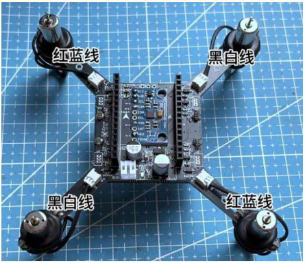
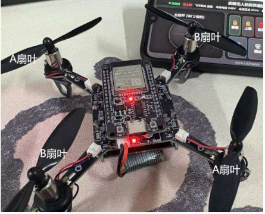
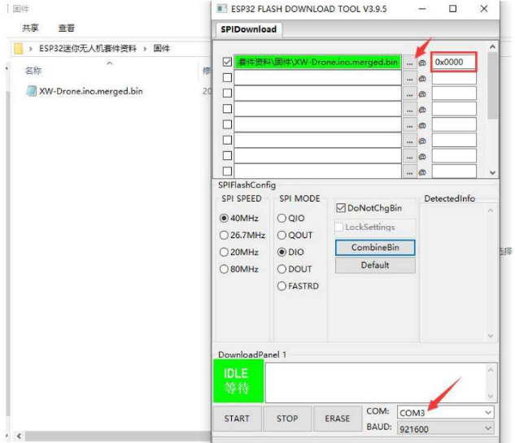

# Hướng dẫn lắp ráp và sử dụng bộ drone

**Thương hiệu:** Zave / 欣薇.  
**Bản dịch tiếng Việt từ:** `../Drone Kit Assembly and Usage Instructions.pdf`.  
**Đối chiếu trang:** Nội dung hướng dẫn nằm ở trang 2 và 4 của PDF gốc. Trang 1, 3 và 5 chỉ có đầu/chân trang khi in, không có nội dung hướng dẫn; bản dịch bỏ các trang trắng đó. Hình minh họa được giữ từ tài liệu gốc, nhãn tiếng Trung được giải thích bên dưới.

## 1. Lắp động cơ và cánh quạt

### 1.1. Vị trí lắp động cơ

Khi lắp động cơ, cần chú ý đúng vị trí. Nếu mua bộ đã lắp sẵn của cửa hàng, có thể bố trí động cơ theo hình dưới đây; chú ý phân biệt màu dây động cơ. Nếu mua bộ linh kiện rời, lắp theo thứ tự dây đã hàn của bộ đó và tham khảo video hướng dẫn.

Nhãn trong hình: **红蓝线 = dây đỏ–xanh dương**; **黑白线 = dây đen–trắng**.

| Vị trí theo đúng chiều ảnh minh họa | Màu dây |
| --- | --- |
| Góc trên bên trái | Đỏ–xanh dương |
| Góc trên bên phải | Đen–trắng |
| Góc dưới bên trái | Đen–trắng |
| Góc dưới bên phải | Đỏ–xanh dương |

### 1.2. Lắp cánh quạt

Chú ý ký hiệu trên cánh quạt và lắp đúng vị trí. Lắp nhầm vị trí sẽ ảnh hưởng đến khả năng bay.

Nhãn trong hình: **A扇叶 = cánh quạt A**; **B扇叶 = cánh quạt B**.

| Vị trí theo đúng chiều ảnh minh họa | Ký hiệu cánh |
| --- | --- |
| Góc trên bên trái | A |
| Góc trên bên phải | B |
| Góc dưới bên trái | B |
| Góc dưới bên phải | A |

## 2. Lắp bo phát triển và nạp firmware

### 2.1. Lắp bo phát triển

Khi lắp bo phát triển, hướng đầu nối của bo phải cùng hướng với đầu nối pin. Chú ý không cắm ngược.

### 2.2. Cài driver cổng nối tiếp

Trước khi nạp firmware, phải cài driver cổng nối tiếp. File driver có trong bộ tài liệu; cách cài có thể tham khảo video hướng dẫn.

Nếu trình cài báo thất bại, có thể máy đã cài driver này trước đó. Chỉ cần Device Manager nhận được cổng nối tiếp dùng driver **CH340** là có thể tiếp tục.

Nếu cài driver thất bại và máy cũng không nhận cổng nối tiếp, tài liệu gốc khuyến nghị thử trên máy tính khác vì có thể vấn đề nằm ở máy tính.

Các thư mục xuất hiện trong ảnh minh họa của tài liệu gốc:

| Tên trong ảnh | Nghĩa tiếng Việt |
| --- | --- |
| CH340驱动 | Driver CH340 |
| 参考教程 | Hướng dẫn tham khảo |
| 固件 | Firmware |
| 烧录工具 | Công cụ nạp firmware |
| 原理图 | Sơ đồ nguyên lý |
| 源代码 | Mã nguồn |

### 2.3. Chọn file và nạp firmware

Trong công cụ nạp, bấm nút **`…`** để chọn firmware cần nạp. Điền địa chỉ **`0x0000`** và chọn đúng **cổng COM**.

Ảnh gốc minh họa **ESP32 FLASH DOWNLOAD TOOL V3.9.5** với file **`XW-Drone.ino.merged.bin`**. Các chữ trên giao diện có nghĩa:

| Nhãn giao diện | Nghĩa tiếng Việt |
| --- | --- |
| COM | Cổng nối tiếp của board |
| BAUD | Tốc độ truyền khi nạp |
| START | Bắt đầu |
| STOP | Dừng |
| ERASE | Xóa flash |
| IDLE / 等待 | Đang chờ |

> **Ghi chú đối chiếu của người dịch:** Địa chỉ `0x0000` trong mục này áp dụng cho file firmware gộp `.merged.bin` được minh họa. Đây là quy trình nạp firmware bay của nhà cung cấp, khác với nạp sketch bằng Arduino IDE. Các giá trị COM3 và 921600 trong ảnh là giá trị minh họa, không phải cổng/tốc độ bắt buộc trên mọi máy.

### 2.4. Máy chưa nhận cổng COM

Nếu đã cài driver nhưng máy vẫn không nhận được cổng COM, có thể cáp USB-C không hỗ trợ truyền dữ liệu. Hãy đổi sang cáp có truyền dữ liệu rồi thử lại.

## 3. Hiệu chỉnh và vận hành

### 3.1. Kết nối Wi-Fi và mở giao diện

Sau khi nạp firmware, cấp nguồn cho drone. Dùng điện thoại tìm và kết nối Wi-Fi:

| Mục | Giá trị |
| --- | --- |
| Tên Wi-Fi | `XW_Drone_WiFi` |
| Mật khẩu | `12345678` |
| Địa chỉ mở bằng trình duyệt điện thoại | `http://192.168.4.1:8080` |

Sau khi kết nối thành công, mở địa chỉ trên bằng trình duyệt điện thoại. Dấu hai chấm **`:`** phải là ký tự thông thường ở chế độ nhập tiếng Anh, không dùng dấu hai chấm toàn chiều rộng **`：`**.

### 3.2. Hiệu chỉnh trước khi sử dụng

Trước khi sử dụng cần thực hiện hiệu chỉnh. Bấm nút **调试** (hiệu chỉnh/debug) trên giao diện, nhập **`ca`**, rồi làm theo thông báo hướng dẫn. Các bước chi tiết được trình bày trong video của bộ tài liệu.

### 3.3. Điều khiển thử

Sau khi hiệu chỉnh có thể thử bay:

1. Bấm **解锁** (mở khóa); cánh quạt bắt đầu quay.
2. Đẩy cần điều khiển bên trái lên để tăng ga; drone sẽ từ từ cất cánh.
3. Di chuyển cần trái sang trái/phải để điều chỉnh hướng quay quanh trục đứng (yaw).
4. Cần bên phải điều khiển góc chúi/ngẩng (pitch) và góc nghiêng ngang (roll).

### 3.4. Hạ cánh và khóa động cơ

Khi hạ cánh, giảm ga từ từ; nếu giảm đột ngột, drone có thể rơi. Bấm **上锁** (khóa) để dừng động cơ. Tài liệu khuyến nghị lúc thử bay không lên quá cao và nên làm quen với thao tác điều khiển trước.

**Hướng dẫn hàn và vận hành đầy đủ nằm trong các video đi kèm bộ tài liệu.**

## 4. Phạm vi áp dụng với dự án hiện tại

Phần này là ghi chú của người dịch, không phải nội dung hướng dẫn gốc:

- Các bước Wi-Fi và điều khiển bay bên trên chỉ áp dụng khi ESP32 chạy firmware bay phù hợp của nhà cung cấp.
- Sketch `firmware/DroneMotionMpu6050/DroneMotionMpu6050.ino` của dự án là chương trình đọc cảm biến/gửi quaternion qua USB serial; không cung cấp giao diện bay hoặc Wi-Fi như tài liệu này.
- Sơ đồ trong `sodo.pdf` ghi module **MPU6500**, sử dụng **SPI**. Xem [bản dịch chú giải sơ đồ](so-do-nguyen-ly.md) để đối chiếu chân; chưa thể xác nhận loại chip lắp thực tế chỉ từ tên trong sơ đồ.
