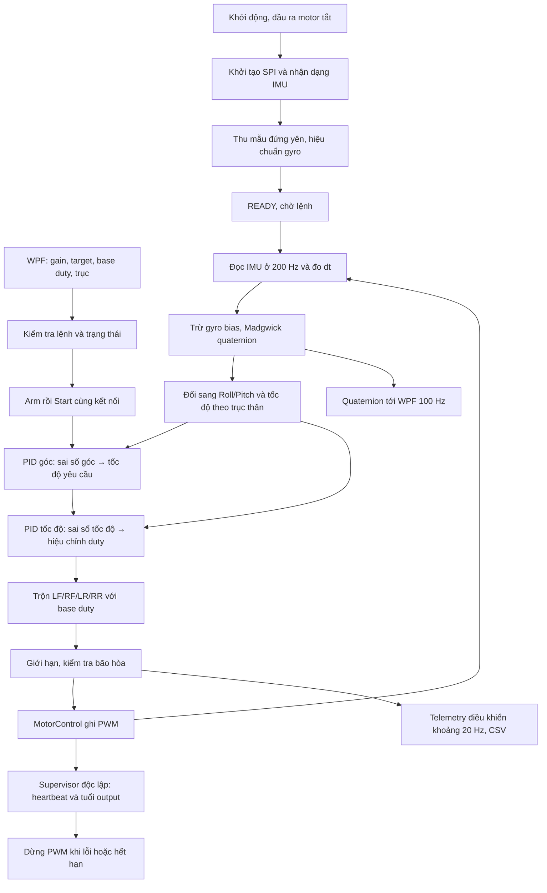

# Áp dụng luồng điều khiển Angle Mode vào hệ thống Drone

Tài liệu này là phần đọc sâu để đối chiếu thuật toán với code. Nếu mới bắt đầu, hãy đọc [luồng và các field](huong-dan-field-pid-wpf.md), [đồ thị](do-thi-pid.md) rồi [thực hành trên đế](pid-can-bang-tren-de.md) trước. Không cần nhớ các thanh ghi hoặc công thức ở đây để hiểu cách dùng app.

## Từ giao diện đến code: mỗi khối giải quyết một việc

| Khối trong luồng | Việc cần giải quyết | Giá trị chính |
|---|---|---|
| Cấu hình trên WPF | Người dùng muốn giữ tư thế nào và phản ứng mạnh thế nào? | Target, gain, base và trục |
| Đọc IMU, ước lượng tư thế | Drone đang ở đâu và chuyển động thế nào? | Góc và tốc độ quay |
| PID góc | Cần quay với tốc độ bao nhiêu để tới góc mục tiêu? | Tốc độ yêu cầu |
| PID tốc độ | Đổi lệnh motor bao nhiêu để đạt tốc độ đó? | Hiệu chỉnh duty |
| Bộ trộn motor | Phân bổ hiệu chỉnh và ga nền cho từng vị trí ra sao? | LF/RF/LR/RR |
| Telemetry và đồ thị | Người dùng có thể quan sát nguyên nhân và kết quả thế nào? | Dữ liệu đo và các bước tính |

IMU là cụm cảm biến gia tốc và tốc độ quay. SPI là giao tiếp giữa ESP32 và IMU. Madgwick là thuật toán kết hợp hai nhóm dữ liệu cảm biến; quaternion là cách lưu tư thế trong tính toán. App hiển thị góc Roll/Pitch dễ đọc sau khi firmware đổi từ tư thế đó sang góc theo trục thân. Telemetry là dữ liệu board gửi về máy tính.

## 1. Kết quả thay đổi

Hệ thống dùng luồng **ước lượng tư thế → PID góc → PID tốc độ → trộn lệnh → PWM động cơ**. Cấu trúc hai tầng lấy ý tưởng từ `ESP32-Flight-controller--main`, nhưng giữ giao tiếp, đơn vị và mapping phù hợp bo XW_Z1_V2.0 của dự án Drone.

Trước thay đổi, Drone đã có Madgwick, P góc cố định 2/s, PID tốc độ và watchdog. Thay đổi này mở rộng vòng góc thành PID chỉnh được độc lập trên WPF, bổ sung tích phân hình thang và kiểm tra mục tiêu trong bộ điều khiển. Mặc định vòng góc vẫn là 2/0/0 để không tự bật I/D mới khi nạp lại firmware. Gain vòng tốc độ mặc định bằng 0, phải cấu hình trước khi Start.

Đây là chế độ cân bằng trên đế của hệ thống hiện tại, chưa phải bổ sung một chế độ bay tự do hoặc tự lái hoàn chỉnh.

## 2. Vì sao không chép nguyên firmware tham khảo?

| Thành phần | Dự án tham khảo | Hệ thống Drone được áp dụng |
|---|---|---|
| IMU | MPU6050, I²C | ESP32 dùng MPU6500/MPU9250 qua SPI |
| Nguồn lệnh | Receiver, đo xung GPIO | WPF qua USB hoặc TCP/Wi-Fi |
| Ước lượng tư thế | Complementary filter góc Euler | Madgwick quaternion hiện có |
| Chu kỳ mục tiêu | 4 ms, dùng dt cố định | 5 ms, dùng dt đo thực tế |
| Vòng góc | PID Roll/Pitch | PID Roll/Pitch, mặc định P=2, I=D=0 |
| Vòng tốc độ | PID ba trục | PID Roll/Pitch, chưa thêm Yaw |
| Đầu ra | Xung ESC khoảng 1000–2000 µs | PWM duty 8 bit ở 20 kHz |
| Thứ tự động cơ | Trước phải, sau phải, sau trái, trước trái | LF, RF, LR, RR theo GPIO14/15/12/13 |
| Dừng | Theo ngưỡng ga | Stop/Disarm, kiểm tra IMU, timing và watchdog |

Gain đầu ra theo micro giây ESC không thể coi như gain đầu ra theo duty 0–255. Tương tự, dấu của bộ trộn phải khớp với cách gắn cảm biến và động cơ của Drone.

## 3. Luồng mới từ khởi động đến động cơ



Nếu chưa Start, bộ ước lượng tư thế và hiển thị vẫn chạy, nhưng nhánh PID không điều khiển motor. Chế độ manual motor và chế độ PID loại trừ nhau.

### 3.1. Đọc IMU và thời gian

Firmware giữ SPI SCK18/MISO19/MOSI23/CS5, đọc cả gia tốc và gyro. Dữ liệu thô được quy đổi với hệ số cấu hình của Drone; không đổi sang hệ số accelerometer của dự án tham khảo.

`dt` lấy từ chênh lệch thời gian micro giây. Khi PID đang chạy, `Controller.update()` chỉ chấp nhận dt từ 2 đến 20 ms. Chu kỳ danh định là 5 ms; nếu trễ vượt phạm vi cho phép, bộ điều khiển dừng thay vì tiếp tục giả định thời gian vẫn đúng.

### 3.2. Ước lượng và mapping trục

Madgwick tạo quaternion biểu diễn tư thế. Hàm `attitude()` đổi quaternion sang góc theo quy ước board đã có trong WPF:

- Roll thân = âm góc Pitch của cảm biến, trừ mốc `zeroRoll`.
- Pitch thân = âm góc Roll của cảm biến, trừ mốc `zeroPitch`.
- Tốc độ Roll thân = `-gyroY`, đổi rad/s sang độ/s.
- Tốc độ Pitch thân = `-gyroX`, đổi rad/s sang độ/s.

Không thay bộ ước lượng bằng cách sao chép Euler filter từ dự án tham khảo. Không ép góc đo vào ±20°. Theo yêu cầu cho phép góc đo tự do, đã bỏ điều kiện ±10° lúc Start và ngắt ±25° lúc chạy; mọi góc đo hữu hạn đều không bị từ chối chỉ vì độ nghiêng. Các kiểm tra dữ liệu IMU, thời gian và đầu ra vẫn hoạt động. Đây không phải bảo đảm tự hồi phục ở mọi tư thế: phép đổi Euler có điểm kỳ dị và ranh giới góc, nên góc lớn hoặc tư thế lật cần một thiết kế điều khiển được đánh giá riêng.

`CONTROL ZERO` đổi mốc góc của PID. `Zero orientation` của mô hình 3D chỉ đổi mốc hiển thị; hai chức năng này có mục đích khác nhau.

### 3.3. Vòng ngoài: từ góc đến tốc độ

```text
errorAngle = targetAngle − measuredAngle
targetRate = PID_góc(errorAngle, dt)
```

Vòng góc có P/I/D riêng cho Roll và Pitch. Đầu ra là tốc độ mục tiêu, giới hạn ±45 độ/giây. Đóng góp I giới hạn ±10 độ/giây.

Ví dụ chỉ xét P: target 0°, góc +5°, Kp góc 2/s → tốc độ mục tiêu −10°/s. Vòng ngoài yêu cầu quay về ngang với tốc độ phù hợp thay vì trực tiếp ra lệnh motor.

### 3.4. Vòng trong: từ tốc độ đến duty

```text
errorRate = targetRate − gyroRate
correctionDuty = PID_tốc_độ(errorRate, dt)
```

Ví dụ tốc độ mục tiêu −10°/s, gyro đang −3°/s → sai số tốc độ −7°/s. Nếu chỉ xét Kp tốc độ 0.2 thì hiệu chỉnh là −1.4 duty. I và D làm thay đổi kết quả thực tế.

Đầu ra mỗi trục giới hạn ±40 duty, đóng góp I giới hạn ±20 duty. Chế độ ROLL vô hiệu hóa cả hai tầng của Pitch; chế độ PITCH tương tự cho Roll. Cả bốn motor vẫn có ga nền.

### 3.5. PID rời rạc dùng trong cả hai tầng

```text
P = Kp × error
I_candidate = I_previous + Ki × (error + error_previous) × dt / 2
D_raw = −(measurement − measurement_previous) / dt
D_filtered += dt / (dt + 0.0159155) × (D_raw − D_filtered)
output = giới_hạn(P + I + Kd × D_filtered)
```

Ở mẫu đầu tiên, không tạo xung D và dùng sai số hiện tại để khởi tạo bước tích phân. D lấy trên giá trị đo để thay đổi setpoint không tự tạo một xung vi phân. Đây là điều chỉnh có chủ đích so với đạo hàm sai số trong dự án tham khảo.

I chỉ được cập nhật khi cho phép tích phân và không đẩy đầu ra tiếp vào bão hòa của tầng đó. Khi mixer bão hòa ở lượt trước, hai tầng ngừng tích lũy I; vòng góc còn ngừng I khi đầu ra vòng tốc độ ở lượt trước chạm giới hạn. Cách này giảm tích lũy khi motor không còn khả năng đáp ứng, nhưng không loại bỏ mọi tình huống windup trên phần cứng.

### 3.6. Trộn động cơ theo đúng thứ tự Drone

```text
motorRoll  = RollMotorDirection  × rollCorrection   // mặc định −1
motorPitch = PitchMotorDirection × pitchCorrection // mặc định +1
LF = base + motorRoll − motorPitch
RF = base − motorRoll − motorPitch
LR = base + motorRoll + motorPitch
RR = base − motorRoll + motorPitch
```

Người dùng xác nhận trái thấp/phải cao cho FW Roll dương, trong khi mixer cũ làm drone nghiêng trái thêm. Vì vậy đã đảo riêng chiều Roll tại motor bằng `RollMotorDirection=-1`. Giữ nguyên dấu góc và gyro, giữ Pitch ở `+1` vì chưa có xác nhận thực tế Pitch bị ngược.

Ví dụ base=80, rollCorrection=−3, pitchCorrection=0 → motorRoll=+3 → LF/LR=83, RF/RR=77. Với target 0°, góc đo Roll dương ở trạng thái đứng yên tạo sai số góc âm và output PID âm khi chỉ có P, nên phía trái đang thấp được tăng lực đẩy. Khi drone đang quay hoặc I/D khác 0, dấu hiệu chỉnh còn phụ thuộc các thành phần đó. Cần xác nhận trên board và đế rằng đầu ra LF/LR/RF/RR đúng vị trí và tạo lực đẩy đúng. Phép tính đúng không chứng minh chiều lực đẩy thực tế đúng.

Kiểm tra không gắn cánh: chọn ROLL, target 0°, I/D bằng 0, nghiêng trái giữ yên rồi đối chiếu PWM LF/LR lớn hơn RF/RR; nghiêng phải thì ngược lại. Nếu góc quá nhỏ, lệnh có thể bị lượng tử hóa về cùng duty. Kiểm tra Pitch riêng; chưa được xem là đã sửa hoặc xác minh chiều Pitch.

Giữ giới hạn motor 0–220 duty và base nhập 1–180. Khi bão hòa mixer liên tục quá 0.5 giây, dừng toàn bộ. Không sử dụng idle 1170 hoặc cutoff 1000 từ bản ESC vì đây là đơn vị khác.

## 4. Cách sử dụng trên WPF

1. Nạp firmware mới, build WPF mới và kết nối. Chờ hiệu chuẩn hoàn tất và board báo READY.
2. Firmware báo `CONTROL_V1` để tương thích giao thức cũ, đồng thời báo `CONTROL_CASCADE_V2` để mở phần chỉnh PID góc.
3. Giữ **Outer angle PID** là 2/0/0 khi bắt đầu. Các ô **Inner rate** là gain vòng tốc độ như trước.
4. Chọn từng trục, nhập gain vòng tốc độ phù hợp quá trình thử trên đế. Bấm **Apply PID**. WPF gửi lần lượt gain tốc độ Roll/Pitch và gain góc Roll/Pitch, chờ từng phản hồi có cùng trục và giá trị.
5. Đối chiếu **Applied PID** với gain board đã nhận. Chỉnh ô nhập chưa tự đổi gain trên ESP32. Nếu bấm Stop khi đang Apply, các lệnh còn lại của lượt Apply bị hủy.
6. Đặt target trong ±10°, xác nhận đế và mapping, Arm rồi Start. Một trục được chọn cần Kp vòng góc và Kp vòng tốc độ lớn hơn 0.
7. Sau khi vòng tốc độ đã được chỉnh phù hợp, có thể chỉnh P/I/D vòng góc khi đã Stop. Không sao chép bộ gain của khung khác chỉ vì nó có cùng cấu trúc thuật toán.

Các ô gain góc chỉ mở khi firmware báo hỗ trợ cascade. App mới kết nối firmware V1 cũ vẫn chỉ gửi hai lệnh gain tốc độ, không gửi lệnh mới mà firmware cũ không hiểu.

## 5. Giao thức mở rộng

```text
PID SET ANGLE_ROLL 2 0 0
PID SET ANGLE_PITCH 2 0 0
CONTROL INFO
```

Ví dụ phản hồi:

```text
STATUS,CONTROL_V1
STATUS,CONTROL_CASCADE_V2
PID,ROLL,0.200000,0.000000,0.000000
PID,PITCH,0.200000,0.000000,0.000000
PID,ANGLE_ROLL,2.000000,0.000000,0.000000
PID,ANGLE_PITCH,2.000000,0.000000,0.000000
```

Các giá trị vòng tốc độ trong ví dụ chỉ minh họa định dạng, không phải khuyến nghị tuning. Giới hạn nhập cả hai tầng: Kp 0–5, Ki 0–2, Kd 0–0.2. Đơn vị gain khác nhau giữa hai tầng do đầu vào/đầu ra khác nhau. Gain chỉ lưu RAM.

Telemetry hiện gửi `C2` khoảng 20 Hz, giữ các trường của `C` và thêm tốc độ mục tiêu cùng output giới hạn của hai trục để vẽ [đồ thị PID](do-thi-pid.md). App mới vẫn đọc `C` cũ. Các P/I/D trong telemetry và phần ControlData là vòng tốc độ. CSV giữ sáu cột gain góc và thêm bốn cột telemetry mới; với `C` cũ bốn cột mới để trống. Chưa ghi P/I/D từng mẫu của vòng góc. Nếu firmware không báo gain góc thì các ô gain góc trong CSV trống.

## 6. Những cơ chế dừng được giữ lại

- Stop, Disarm hoặc yêu cầu hiệu chuẩn dừng đầu ra.
- Không chạy lại motor tự động sau reset hoặc khôi phục IMU.
- Dừng khi dữ liệu tư thế, dt hoặc setpoint không hợp lệ.
- Giới hạn duty và thời gian bão hòa; không còn ngắt theo góc thân đo được.
- ARM hết hạn sau 15 giây; START phải đến từ cùng nguồn USB/Wi-Fi.
- Heartbeat đúng nguồn chạy, timeout 2 giây.
- Watchdog output 100 ms, supervisor kiểm tra mỗi 50 ms độc lập với vòng IMU.

Cả hai tầng PID reset khi Stop và trước mỗi lần Start, gồm I, bộ nhớ D và tốc độ mục tiêu. Target góc cấu hình vẫn được giữ qua Stop.

## 7. Kiểm tra trước khi coi thay đổi đạt yêu cầu

Kiểm thử máy tính tập trung vào gain hai tầng, giới hạn tốc độ, chiều mixer, reset, đóng băng I, đạo hàm không giật theo setpoint, dữ liệu lỗi và giao thức WPF. Kiểm thử TCP mô phỏng cả firmware cũ và mới, xác nhận trình tự Apply → Arm → Start → Stop.

Kết quả mô phỏng hoặc build thành công không xác nhận độ ổn định thật. Phần cứng còn cần kiểm tra mapping, dấu phản hồi, rung, chu kỳ thực tế, nguồn và khả năng Stop trên đế. Quan sát motor trên bàn phải tháo cánh; thử cân bằng cần đế và quy trình phù hợp phần cứng. Thay đổi này không thêm yaw control, receiver vô tuyến, giữ độ cao hay GPS.
