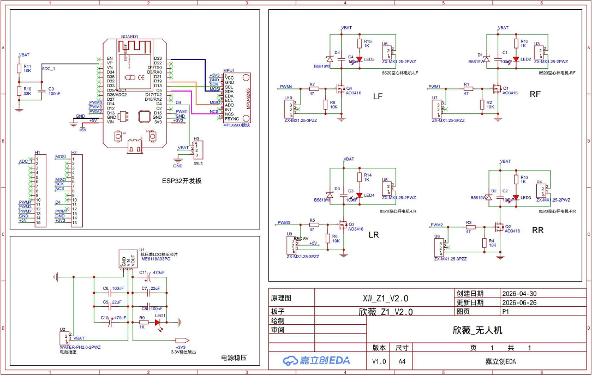
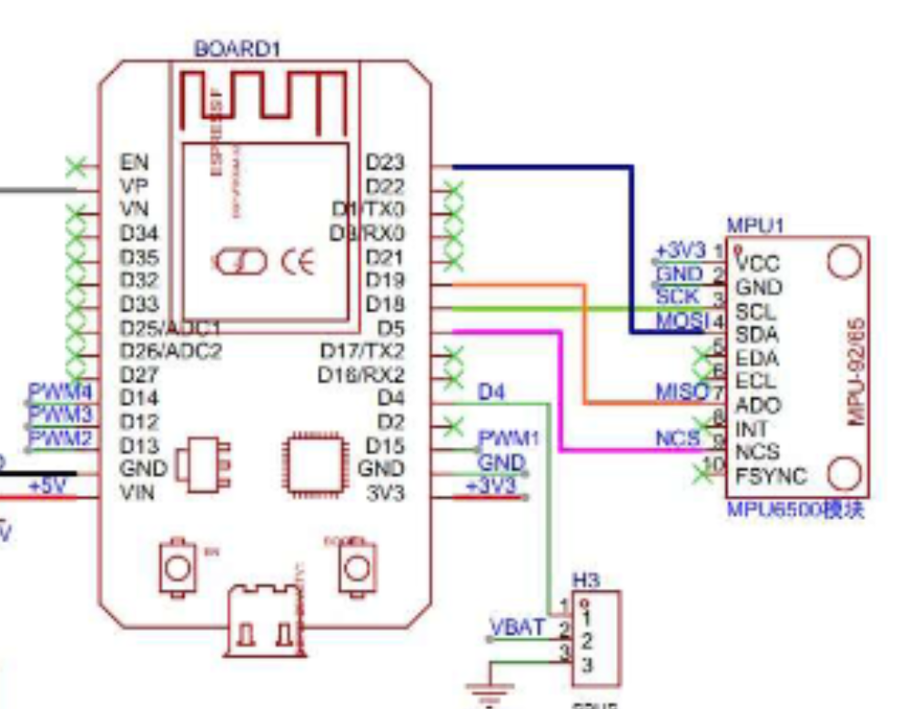

# Sơ đồ nguyên lý bo drone XW_Z1_V2.0 — chú giải tiếng Việt

**Nguồn:** `../sodo.pdf`, 1 trang.  
**Cách dịch:** Giữ nguyên hình mạch, tên net, số chân, mã linh kiện và giá trị; dịch các nhãn tiếng Trung thành bảng chú giải bên dưới. Những diễn giải về chức năng mạch được ghi riêng để phân biệt với chữ in trên bản gốc.

## 1. Thông tin bản vẽ

| Nhãn gốc | Bản dịch / giá trị trên bản vẽ |
| --- | --- |
| 原理图 | Sơ đồ nguyên lý: `XW_Z1_V2.0` |
| 板子 | Bo mạch: `欣薇 Z1 V2.0` |
| 创建日期 | Ngày tạo: 2026-04-30 |
| 更新日期 | Ngày cập nhật: 2026-06-26 |
| 图页 | Mã trang: P1 |
| 绘制 | Người vẽ: để trống |
| 审阅 | Người duyệt: để trống |
| 欣薇_无人机 | Drone Xinwei / Zave |
| 版本 | Phiên bản: V1.0 |
| 尺寸 | Khổ giấy: A4 |
| 页 1 共 1 | Trang 1 / tổng 1 trang |
| 嘉立创EDA | Công cụ thiết kế JLC EDA |

## 2. Bo ESP32 và module cảm biến

**ESP32开发板** nghĩa là **bo phát triển ESP32**. **MPU6500模块** nghĩa là **module MPU6500**.

### 2.1. Các đường nối thể hiện trên bản vẽ

| Tín hiệu trên sơ đồ | Chân ESP32 | Chân module MPU1 | Ý nghĩa |
| --- | --- | --- | --- |
| `+3V3` | Nguồn 3,3 V | 1 — VCC | Nguồn module |
| `GND` | GND | 2 — GND | Mass chung |
| `SCK` | D18 / GPIO18 | 3 — SCL | Xung clock SPI |
| `MOSI` | D23 / GPIO23 | 4 — SDA | Dữ liệu từ ESP32 đến cảm biến |
| `MISO` | D19 / GPIO19 | 7 — AD0 | Dữ liệu từ cảm biến về ESP32 |
| `NCS` | D5 / GPIO5 | 9 — NCS | Chọn cảm biến SPI, mức tích cực thấp |

Chân 5 — EDA, 6 — ECL, 8 — INT và 10 — FSYNC có dấu không kết nối trên sơ đồ. **D4 không nối vào MPU1**; đường này đi đến đầu H3 (SBUS).

> **Ghi chú đối chiếu:** Mặc dù chân trên module có tên SCL/SDA/AD0, trong bản vẽ chúng được dùng làm SCK/MOSI/MISO và có thêm NCS. Kết nối được vẽ là **SPI**, không phải I²C SDA21/SCL22 đang cấu hình trong firmware ban đầu của dự án.
>
> Chú thích dưới module ghi **MPU6500**. Chữ tên linh kiện dọc bên trong ký hiệu MPU1 có độ nét thấp và có vẻ thuộc họ MPU-92xx; không dùng chữ đó để kết luận model chip thực tế. Cần đối chiếu chữ trên chip hoặc đọc thanh ghi nhận dạng bằng đúng giao tiếp trước khi chọn driver. Thông tin “MPU6050” trước đây chưa được xác nhận bằng sơ đồ này.

### 2.2. Các đầu nối mở rộng

Bảng sau chép các chân có nhãn tín hiệu trên bản vẽ; các chân còn lại có dấu không kết nối.

| Đầu nối | Chân | Nhãn |
| --- | --- | --- |
| H1 | 2 | ADC_1 |
| H1 | 10 | PWM4 |
| H1 | 11 | PWM3 |
| H1 | 12 | PWM2 |
| H1 | 14 | GND |
| H1 | 15 | +5V |
| H2 | 1 | MOSI |
| H2 | 5 | MISO |
| H2 | 6 | SCK |
| H2 | 7 | NCS |
| H2 | 10 | D4 |
| H2 | 12 | PWM1 |
| H2 | 14 | GND |
| H2 | 15 | +3V3 |
| H3 — SBUS | 1 | D4 / GPIO4 |
| H3 — SBUS | 2 | VBAT |
| H3 — SBUS | 3 | GND |

### 2.3. Nhánh đo điện áp pin

Trên sơ đồ, nhãn `ADC_1` nối với chân D25/ADC1 của ký hiệu board. Mạch gồm:

- R11: 10 kΩ, từ VBAT đến nút ADC_1.
- R10: 33 kΩ, từ nút ADC_1 xuống GND.
- C9: 100 nF, từ nút ADC_1 xuống GND.

**Diễn giải:** R11/R10 tạo mạch chia áp và C9 lọc nhiễu. Tên `ADC_1` là tên net trên bản vẽ; không dùng riêng tên này để suy ra số khối ADC bên trong ESP32.

## 3. Bốn nhánh công suất động cơ

Chữ **8520空心杯电机** nghĩa là **động cơ không lõi loại 8520**. Hậu tố vị trí trên bản vẽ:

| Ký hiệu | Vị trí |
| --- | --- |
| LF | Trái trước |
| RF | Phải trước |
| LR | Trái sau |
| RR | Phải sau |

Các vị trí trên được dịch theo tên LF/RF/LR/RR; chiều đầu drone phải đối chiếu với bố trí thực tế, không chỉ dựa vào hướng xoay hình.

| Nhánh | Net điều khiển | GPIO ESP32 | MOSFET | Đầu nối động cơ | Điện trở cổng / kéo xuống |
| --- | --- | --- | --- | --- | --- |
| LF | PWM4 | GPIO14 | Q4 — AO3416 | U6 | R7: 47 Ω / R8: 10 kΩ |
| RF | PWM1 | GPIO15 | Q1 — AO3416 | U3 | R1: 47 Ω / R2: 10 kΩ |
| LR | PWM3 | GPIO12 | Q3 — AO3416 | U5 | R5: 47 Ω / R6: 10 kΩ |
| RR | PWM2 | GPIO13 | Q2 — AO3416 | U4 | R3: 47 Ω / R4: 10 kΩ |

Các linh kiện phụ của từng nhánh:

| Nhánh | Diode | Tụ | LED và điện trở nối tiếp |
| --- | --- | --- | --- |
| LF | D4 — B5819W | C4 — 100 nF | LED5, R15 — 1 kΩ |
| RF | D1 — B5819W | C1 — 100 nF | LED2, R12 — 1 kΩ |
| LR | D3 — B5819W | C3 — 100 nF | LED4, R14 — 1 kΩ |
| RR | D2 — B5819W | C2 — 100 nF | LED3, R13 — 1 kΩ |

Các đầu nối U7, U8, U9, U10 cũng được vẽ ở vùng mạch động cơ. Nhãn **BEC 5V** xuất hiện tại U9; khi sử dụng các đầu nối này cần đối chiếu nguyên bản và chiều đánh số chân trên bo, không suy ra chúng giống đầu nối động cơ hai chân.

**Diễn giải:** Mỗi nhánh dùng MOSFET đóng/ngắt phía mass, điều khiển qua PWM. Điện trở 47 Ω nằm trên đường cổng; điện trở 10 kΩ kéo cổng về mass. Diode nằm song song nhánh tải để hạn chế điện áp ngược do tải cảm.

## 4. Mạch ổn áp nguồn

| Nhãn gốc | Bản dịch |
| --- | --- |
| 电源稳压 | Ổn áp nguồn |
| 电池座 | Đầu nối pin |
| 低压差LDO稳压芯片 | IC ổn áp LDO, điện áp rơi thấp |
| 3.3V稳压输出 | Đầu ra ổn áp 3,3 V |

Các nhãn/giá trị trong vùng nguồn:

| Linh kiện / net | Giá trị hoặc chức năng thể hiện |
| --- | --- |
| U2 | Đầu nối pin; chân 1 VBAT, chân 2 GND |
| U1 | IC LDO, mã in trên bản vẽ: ME6118A33PG |
| U1 — chân 1 | GND |
| U1 — chân 2 | VOUT |
| U1 — chân 3 | VIN |
| C5 | 22 µF |
| C6 | 100 nF |
| C7 | 22 µF |
| C8 | 100 nF |
| C10 | 470 µF |
| C11 | 470 µF |
| R9 | 1 kΩ |
| LED1 | LED chỉ thị trong nhánh đầu ra |
| VBAT | Đường nguồn pin |
| +3V3 | Đường ra ổn áp 3,3 V |

**Diễn giải:** VIN nhận VBAT, VOUT tạo nguồn +3V3. Trên ký hiệu board ESP32, chân VIN được nối với net +5V; nguồn +3V3 cũng xuất hiện ở đầu nối board. Không mặc định VBAT, +5V và +3V3 là cùng một đường nguồn.

## 5. Kết luận phục vụ đối chiếu firmware

Phần này là ghi chú kỹ thuật của người dịch:

1. Sơ đồ cung cấp bộ chân SPI: **SCK=18, MOSI=23, MISO=19, CS=5**.
2. Nhãn module là **MPU6500**; cần xác nhận chip thực tế trước khi chọn driver.
3. Firmware ban đầu dùng I²C để tìm MPU6050, vì vậy chưa tương ứng với kết nối trên sơ đồ. Sau khi đối chiếu, nhánh ESP32 đã được cập nhật dùng SPI; xem [hướng dẫn firmware hiện tại](../../firmware/ESP32.md).
4. Bản dịch này không sửa firmware hoặc xác nhận phần cứng đã hoạt động. Những chữ nhỏ trong bản gốc cần đối chiếu file thiết kế có độ phân giải cao nếu dùng để sửa/chế tạo mạch.
