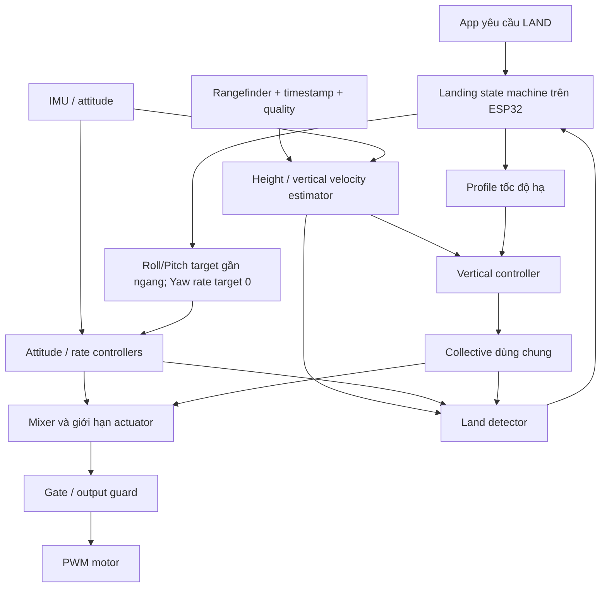

# Hướng triển khai hạ cánh có điều khiển cho DroneRebuild

> **Cập nhật triển khai:** giai đoạn không thêm sensor đã có hạ bán tự động, xem [STABILIZED_DESCENT.md](STABILIZED_DESCENT.md). Các mô tả SOFT_STOP dưới đây ghi lại cơ chế cũ dùng làm cơ sở phân tích; ramp đó đã được bỏ khỏi firmware mới. Auto-land có feedback độ cao vẫn là đề xuất.

Đối chiếu source và tài liệu trực tuyến ngày 09/11/2026. Phần LAND có feedback độ cao vẫn là **đề xuất thiết kế**. Bản hạ bán tự động không thêm sensor đã được triển khai ở software nhưng chưa được xác nhận bằng thử bay. Dự án vẫn giữ đơn vị góc độ và °/s sau rollback.

## 1. Mục tiêu cần thực hiện

Khi người dùng yêu cầu hạ cánh, drone cần tiếp tục giữ tư thế, điều khiển tốc độ đi xuống, giảm tốc gần mặt đất, xác nhận đã chạm đất rồi mới dừng motor.

Đó là một **flight mode LAND**, có vòng điều khiển hoạt động trong suốt quá trình. Thời gian giảm PWM không thể tự thay thế cho quá trình này. Giữ cân bằng cũng không đồng nghĩa giữ nguyên vị trí ngang: nếu không đo vận tốc/vị trí XY, drone vẫn có thể trôi sang bên.

## 2. SOFT_STOP hiện tại đang làm gì?

Source liên quan: [DroneRebuild.ino](../../firmware/DroneRebuild/DroneRebuild.ino), [RollCore.h](../../firmware/DroneRebuild/RollCore.h), [MainWindow.xaml.cs](../../app/MainWindow.xaml.cs).

1. App gửi `SOFT_STOP 3000` và ngừng coi phiên là Running.
2. `beginSoftStop()` lưu bốn duty hiện tại vào `rampDuty[]`.
3. Nhánh xử lý command chuyển session sang Disarmed, xóa owner và reset các controller.
4. `guard()` nhân từng duty đã lưu với phần thời gian còn lại, rồi làm tròn và ghi PWM.
5. Hết thời gian thì gọi `emergency("SOFT_STOP_DONE")`.

Công thức hiện tại tương đương:

```text
duty_i(t) = duty_i_lúc_bắt_đầu × thời_gian_còn_lại / tổng_thời_gian
```

Các duty không được tính lại từ sai số tư thế. Nếu có nhiễu mới, PID không sửa được. Chênh lệch duty cũ cũng giảm dần theo cùng hệ số, không phản ánh mô-men cần thiết tại thời điểm mới. Hơn nữa, duty không tuyến tính với lực đẩy nên cách giảm này không quy định được tốc độ hạ.

Một điểm cần sửa trong thiết kế mới: nhánh `guard()` chỉ kiểm tra stale-control/heartbeat thông thường khi `!ramping`. Không được kế thừa việc bỏ kiểm tra độ mới của dữ liệu cho một quá trình LAND cần PID hoạt động.

## 3. Các hệ thống khác cung cấp dẫn chứng gì?

Các nguồn dưới đây được tham khảo để hiểu nguyên lý, không đề xuất chuyển dự án sang firmware khác hoặc lấy code bộ kit.

| Nguồn chính thức | Kết luận liên quan |
| --- | --- |
| [PX4 Controller Diagrams](https://docs.px4.io/main/en/flight_stack/controller_diagrams) | Vòng velocity tạo acceleration setpoint, rồi chuyển thành thrust/attitude; cần xử lý saturation và anti-windup. |
| [PX4 Land Mode](https://docs.px4.io/main/en/flight_modes_mc/land) | LAND là chế độ tự động có yêu cầu estimator, điều khiển tốc độ hạ và disarm sau khi đáp. Yêu cầu cụ thể của PX4 không phải cấu hình tối thiểu của dự án này. |
| [PX4 Land Detector](https://docs.px4.io/main/en/advanced_config/land_detector) | Xác nhận đáp gồm nhiều state với điều kiện chuyển động/lực đẩy/thời gian; không chỉ một ngưỡng độ cao. |
| [ArduPilot Land Mode](https://ardupilot.org/copter/docs/land-mode.html) | Hạ bằng controller độ cao; phân biệt có/không giữ vị trí ngang. Tài liệu cũng nêu ảnh hưởng prop-wash lên barometer gần đất. |
| [PX4 Rangefinders](https://docs.px4.io/main/en/sensor/rangefinders) | Distance sensor có thể hỗ trợ hạ cánh; cấu hình cần xét vị trí lắp, hướng và delay. |

**Suy luận thiết kế cho DroneRebuild:** giữ các vòng điều khiển tư thế hiện có, bổ sung vòng thẳng đứng và state machine LAND. Không sao chép gain, tốc độ hạ hoặc ngưỡng phát hiện đáp từ các autopilot lớn sang drone nhỏ.

## 4. Giới hạn của ESP32 + IMU hiện tại

Code hiện có góc/rate Roll/Pitch và góc Yaw tương đối; chưa thấy đường đo độ cao, estimator vận tốc thẳng đứng hay controller Yaw trong mixer.

Chỉ với IMU, có thể giữ tư thế và điều chỉnh collective theo một lịch giảm thử nghiệm. Nhưng không có feedback độc lập để xác nhận drone đang hạ nhanh hay chậm, còn cách đất bao nhiêu, hoặc đã đáp chắc chắn chưa.

Tích phân accelerometer hai lần không phải giải pháp đủ tin cậy duy nhất cho độ cao. Ví dụ toán học minh họa: nếu gia tốc sau xử lý còn lệch cố định 0.02 m/s², sai số vị trí sau 10 s là `0.5 × 0.02 × 10² = 1 m`. Đây là ví dụ về tích lũy sai số, không phải thông số đo của IMU đang dùng. Sai số góc khi loại trọng lực và rung còn làm bài toán khó hơn.

| Mức thực hiện | Có thể cam kết gì trong phạm vi đã kiểm chứng? |
| --- | --- |
| Chỉ sửa software với IMU hiện tại | Giữ PID cân bằng trong lúc thay đổi collective; không bảo đảm tốc độ hạ hay tự biết chạm đất |
| Thêm cảm biến khoảng cách hướng xuống | Có cơ sở đo độ cao gần đất, ước lượng tốc độ hạ và xây dựng LAND có feedback |
| Thêm estimator vận tốc/vị trí XY | Có cơ sở giữ vị trí ngang khi hạ; ToF hướng xuống một mình không cung cấp khả năng này |

## 5. Phần cứng đề xuất cho mục tiêu bay thấp trong nhà

Ưu tiên khảo sát **ToF/rangefinder hướng xuống**, bởi bài toán đang quan tâm là khoảng cách tới sàn ở độ cao thấp. Một ứng viên để đánh giá là VL53L1X: [ST công bố](https://www.st.com/en/imaging-and-photonics-solutions/vl53l1x.html) khoảng đo tối đa tới 4 m và tần số đo tối đa tới 50 Hz. Hai con số tối đa không phải bảo đảm mọi cấu hình/môi trường đều đạt đồng thời.

Trước khi chốt module, cần kiểm tra thực tế trên sàn sử dụng: khoảng cách nhỏ nhất vẫn đo được, nhiễu khi motor chạy, bề mặt phản xạ, ánh sáng, FOV, độ trễ và vị trí chân đáp. Nếu sensor mất khả năng đo trước lúc chân chạm đất thì phải xử lý vùng mù, không được coi mất số đo là đã đáp.

Vị trí lắp phải nhìn được sàn, không bị pin/chân đáp che. Cần hiệu chuẩn khoảng cách khi chân drone chạm sàn và bù độ nghiêng. Chọn GPIO/bus, điện áp và pull-up theo schematic/module thật; chưa chỉ định chân đấu dây khi chưa đối chiếu board.

Barometer có thể hữu ích cho mở rộng độ cao hoạt động, nhưng không ưu tiên dùng một mình để nhận biết những centimet cuối gần đất của cấu hình này. Lựa chọn đó là đề xuất kỹ thuật dựa trên bài toán, không khẳng định mọi barometer đều không dùng được.

Nguồn nuôi ESP32 cũng phải ổn định dưới tải. Sự cố trước đây chỉ chạy duty cao khi có USB cần được giải quyết: controller LAND không thể tiếp tục điều khiển khi MCU reset hoặc mất nguồn.

## 6. Kiến trúc đề xuất



Đây là kiến trúc đề xuất cho source hiện tại. Thêm nhánh height/vertical control không cần đổi các góc firmware sang radian; chỉ đổi sang radian khi gọi lượng giác như hiện nay.

### 6.1. Giữ PID tư thế hoạt động

- LAND không đặt session Disarmed ngay và không reset toàn bộ PID khi vừa nhận command.
- Dùng cả Roll và Pitch ở Angle mode; Rate target 0 chỉ hãm quay, không tự kéo thân về ngang.
- Chuyển target góc hiện tại về gần 0 bằng profile có giới hạn tốc độ thay đổi, tránh giật.
- Giữ state I thích hợp và khởi tạo controller mới theo kiểu bumpless transfer, tức output không nhảy mạnh chỉ vì đổi mode. Không giữ mọi state một cách mù quáng nếu có lỗi sensor hoặc config.
- Nếu đang chạy thử một trục, DryRun hoặc BENCH thì không tự coi đó là điều kiện bay hợp lệ để LAND. Thiếu gain/điều kiện cho cả Roll và Pitch phải báo rõ trước khi ARM bay tự do.

Yaw rate controller nên được bổ sung để hãm chuyển động xoay quanh trục Z. Chưa cần magnetometer chỉ để đặt Yaw rate mục tiêu bằng 0. Nó không giữ heading tuyệt đối lâu dài và không cung cấp position hold.

### 6.2. Collective không phải bốn duty đóng băng

Đặt correction có dấu của Roll/Pitch/Yaw lần lượt là `r`, `p`, `y`. Dạng mixer cần hướng tới:

```text
motor_i = collective(t) + roll_i(t) + pitch_i(t) + yaw_i(t)
```

Các correction được tính lại mỗi vòng từ số đo mới. Dấu Yaw cụ thể phải theo mapping chiều quay motor/cánh thực tế, không suy ra từ tên LF/RF/LR/RR.

Giảm **collective** không đồng nghĩa nhân toàn bộ correction PID với cùng hệ số giảm. Cần giữ khoảng điều khiển motor đủ để tạo mô-men cân bằng. Khi gần giới hạn motor, mixer nên có chính sách ưu tiên Roll/Pitch, giảm yêu cầu Yaw hoặc điều chỉnh collective khi có thể, và phản hồi saturation về các integrator. Phải ghi nhận trường hợp yêu cầu không thể thỏa mãn; software không tạo được lực vượt khả năng motor.

`DualController` hiện yêu cầu hai config có cùng Base. Khi triển khai, nên truyền collective động như một input dùng chung của mixer thay vì chỉnh hai config độc lập trong những đoạn code khác nhau. Điều này cũng giữ gain PID tách khỏi trạng thái lực nâng.

## 7. Vòng điều khiển đi xuống: công thức và ví dụ

Chọn quy ước đơn giản: `h` là độ cao so với tư thế chân chạm đất, chiều lên dương; `v = dh/dt`, nên khi hạ thì `v < 0`. Các đại lượng thẳng đứng dùng m, m/s, m/s², còn Roll/Pitch vẫn là độ.

### 7.1. Ước lượng h và v

Với sensor hướng theo body Z, sàn phẳng và góc nghiêng nhỏ, hình học đơn giản cho:

```text
h ≈ distance × cos(roll) × cos(pitch) − ground_offset
```

Trong công thức này phải đổi các góc độ sang radian trước khi gọi cos. Mô hình triển khai đầy đủ còn cần xét vị trí sensor so với thân và hướng lắp; gần góc nghiêng lớn thì loại số đo không phù hợp thay vì tin phép chiếu đơn giản.

Đọc range theo data-ready/timestamp và kiểm tra quality, không đọc blocking trong vòng PID 200 Hz. Dùng estimator nhỏ như alpha-beta hoặc bộ quan sát height/velocity; không lấy đạo hàm khoảng cách nhiễu rồi đưa thẳng vào PID. IMU có thể hỗ trợ dự đoán gia tốc thẳng đứng nếu đổi hệ trục và loại trọng lực đúng. Một estimator đơn giản đã kiểm chứng phù hợp hơn một EKF phức tạp chưa được kiểm tra.

### 7.2. Tạo tốc độ hạ mục tiêu

Không nhảy từ tốc độ hiện tại sang một tốc độ âm lớn. Profile cần giới hạn acceleration, và nếu cần giới hạn jerk. Khi gần sàn, giảm độ lớn tốc độ mục tiêu.

Ví dụ để hiểu hành vi, không phải thông số sẵn sàng bay:

```text
Từ khoảng 1 m: mục tiêu dần tiến tới −0.20 m/s
Vào vùng khoảng 0.25 m: chuyển dần về −0.08 m/s
Chân chạm đất được xác nhận: chuyển sang touchdown/disarm
```

Các mức trên phải được chọn lại từ khoảng đo, độ trễ sensor, khả năng hãm, kích thước chân và thử nghiệm. Không lấy khoảng cách tức thời nhỏ hơn một ngưỡng làm điều kiện dừng motor duy nhất.

### 7.3. PI vận tốc thẳng đứng

Một prototype có thể dùng:

```text
error_v = v_target − v_measured
I_v mới = I_v cũ + Ki_v × error_v × dt
collective = hover_feedforward + Kp_v × error_v + I_v
```

Ở đây `Kp_v` và `Ki_v` có đơn vị tương ứng để output là duty. Cần clamp, anti-windup, giới hạn tốc độ thay đổi và khởi tạo I để collective chuyển tiếp liên tục. Đây là đề xuất PI trực tiếp theo duty cho kiến trúc hiện tại, không phải công thức sao chép từ PX4.

Ví dụ `v_target = −0.20 m/s`:

- Nếu đo `−0.50 m/s`, error là `+0.30`: controller tăng collective để hãm rơi.
- Nếu đo `+0.10 m/s`, error là `−0.30`: controller giảm collective để bắt đầu hạ.

Vì vậy, **trong lúc hạ, đôi khi cần tăng duty để hạ chậm lại**. Một ramp PWM chỉ giảm theo thời gian không làm được việc đó.

Giai đoạn sau có thể điều khiển acceleration/thrust rồi quy đổi sang motor command bằng mô hình đã hiệu chuẩn. Không chia duty trực tiếp cho `cos(roll)cos(pitch)` rồi coi đó là bù lực chính xác, vì duty và thrust không tuyến tính. Giá trị hover feedforward cũng phải được đo/ước lượng, không mặc định duty 110 là hover trong mọi trạng thái pin.

## 8. State machine và xác nhận đã đáp

```text
RUNNING
   → LANDING_APPROACH
   → LANDING_FINAL
   → TOUCHDOWN_CANDIDATE
   → LANDED
   → DISARMED

STOP / emergency có thể ngắt tại bất kỳ state nào.
```

| State | Hành vi cần có |
| --- | --- |
| LANDING_APPROACH | Giữ tư thế, bám profile tốc độ hạ, giám sát estimator |
| LANDING_FINAL | Hạ chậm hơn khi height đủ thấp và số đo còn hợp lệ |
| TOUCHDOWN_CANDIDATE | Kết hợp height gần offset chân, vertical speed nhỏ, rate nhỏ, ít rung/gia tốc động và collective thấp phù hợp |
| LANDED | Chỉ xác nhận khi các điều kiện đáp duy trì đủ thời gian; latch kết quả để tránh nảy state |
| DISARMED | Duty về 0 và xóa state điều khiển phù hợp |

“Vertical speed gần 0” cũng xảy ra khi đang hover, nên không đủ để xác nhận touchdown. Tương tự, gia tốc gần 1 g hoặc motor duty thấp một mình cũng không chứng minh đã chạm đất.

Trong touchdown candidate cần xử lý integrator để không tiếp tục tăng correction, bật lại hoặc lật drone khi chân đã chịu tải. Tuy nhiên, không được cắt trước khi có bằng chứng phù hợp. Cần thử cả tình huống chạm một chân, sàn nghiêng, nảy và sensor thấy vật thể nổi cao hơn sàn.

## 9. LAND, STOP và failsafe phải có chính sách riêng

| Tình huống | Chính sách đề xuất |
| --- | --- |
| Người dùng yêu cầu LAND, estimator hợp lệ | Chuyển vào LAND trên board, tiếp tục PID |
| Người dùng yêu cầu STOP | Cắt output theo cơ chế emergency hiện tại; không tự đổi thành hạ chậm |
| Mất app/heartbeat, IMU và height vẫn tốt | Có thể chuyển/tiếp tục autonomous LAND nếu đã thiết kế và kiểm chứng chính sách này |
| Height hỏng nhưng IMU tốt | Chuyển fallback được công bố rõ; không giả vờ vẫn biết tốc độ hạ/chạm đất |
| IMU hỏng hoặc task điều khiển stale | Không còn cơ sở giữ cân bằng; xử lý fault theo chính sách emergency đã xác định |
| MCU reset hoặc nguồn mất | LAND không thể tiếp tục; cần xử lý vấn đề phần cứng nguồn |

Autonomous LAND phải chạy trên ESP32, không phụ thuộc app gửi Base từng bước. Hiện `loop()` cắt vì TCP disconnect, `Session` cắt vì heartbeat và app chỉ đợi 3.2 giây sau SOFT_STOP. Nếu chọn tiếp tục LAND khi mất liên lạc, phải sửa chính sách của **cả ba nơi** một cách nhất quán, đồng thời giữ watchdog độ mới dữ liệu IMU/control. Không bỏ heartbeat/stale-control toàn hệ thống.

Timeout landing là phát hiện quá trình bất thường, không phải bằng chứng đã đáp. Không đặt quy tắc “hết 3 giây thì tắt” rồi gọi đó là auto-land. Cách xử lý timeout phụ thuộc sensor còn hoạt động, nguồn và môi trường; không có một fallback bảo đảm an toàn trong mọi lỗi.

## 10. Phân chia thay đổi vào source

Các file mới dưới đây là gợi ý tổ chức, chưa được tạo:

| Thành phần | Trách nhiệm đề xuất |
| --- | --- |
| `RangeSensor.h` | Đọc non-blocking; cung cấp distance, timestamp, quality, valid |
| `VerticalEstimator.h` | Height, velocity, độ mới và độ tin cậy; hiệu chỉnh geometry |
| `LandingController.h` | State LAND, profile descent, PI và land detector |
| `RollCore.h` | Collective động, mixer ba trục nếu thêm Yaw; feedback saturation |
| `DroneRebuild.ino` | Command LAND, Session/Gate, gọi các controller theo nhịp; guard vẫn là nơi ghi PWM |
| App WPF | Nút Hạ cánh riêng với Dừng khẩn; hiển thị state, height, tốc độ mục tiêu/thực tế và lỗi |

Landing controller có thể cập nhật vertical loop theo nhịp chậm hơn attitude loop, dựa vào timestamp và chất lượng estimator. Việc sensor chỉ có dữ liệu vài chục Hz không phải lý do để giảm vòng rate PID xuống cùng nhịp đó.

## 11. Lộ trình triển khai và điều kiện nghiệm thu

### Giai đoạn A — cải thiện chức năng hiện có, chưa tuyên bố auto-land

Tách rõ STOP khẩn với chế độ giảm collective có giữ Angle PID Roll/Pitch. Không dùng ramp bốn duty đóng băng. Giữ sensor/control freshness watchdog. Nếu chưa có height feedback, chỉ gọi là **stabilized descent thử nghiệm**, không tự disarm dựa trên một timer như bằng chứng đã đáp.

### Giai đoạn B — đo height đáng tin cậy

Tích hợp ToF/rangefinder, log distance/quality/timestamp và bù geometry. Kiểm tra motor tắt/chạy, các góc nghiêng, khoảng sát đất, mặt sàn và mất mẫu. Chưa đóng vòng vertical cho đến khi biết số đo có đủ chất lượng cho vùng sử dụng.

### Giai đoạn C — đóng vòng thẳng đứng và LAND

Đánh giá hover feedforward, PI vận tốc, profile final approach, land detector và chính sách dropout. Bổ sung Yaw rate control theo yêu cầu vận hành. Dùng transition không giật và giữ đủ khả năng sửa Roll/Pitch khi collective thấp.

### Giai đoạn D — kiểm chứng

- Simulation: pin/khả năng thrust thay đổi, motor lệch, trễ sensor, dropout, bias, sàn thay đổi, touchdown/nảy và saturation. Mô hình chỉ một trục hiện tại chưa đủ xác nhận landing.
- Native tests: chuyển state, không disarm khi còn hover, stale sensor, STOP ưu tiên, owner/epoch và mất TCP/heartbeat theo chính sách mới.
- Bench: output và guard, kiểm tra data-ready/timing, không để driver sensor chặn vòng điều khiển.
- Thử có kiểm soát với vùng thử phù hợp: theo dõi tốc độ chạm đất, sai số Roll/Pitch, drift XY/Yaw và khả năng dừng khẩn.

Tiêu chí nghiệm thu phải có số đo: bám tốc độ hạ trong giới hạn đã chọn, không mất cân bằng khi chuyển LAND, không disarm trên không, xác nhận touchdown ổn định, không bật motor lại sau đáp, xử lý đúng các lỗi đã định nghĩa. Không nghiệm thu chỉ dựa vào việc “thấy motor giảm từ từ”.

## 12. Hướng ưu tiên cho drone này

Giữ lại kiến trúc PID và guard hiện tại, nhưng thay khái niệm SOFT_STOP bằng hai chức năng có tên rõ: **LAND có feedback** và **STOP khẩn**. Đối với mục tiêu đáp nhẹ từ độ cao thấp trong nhà, bước đầu là chọn/kiểm chứng cảm biến khoảng cách hướng xuống, song song thiết kế state LAND để PID tiếp tục chạy. Không có cảm biến mới thì vẫn cải thiện được việc giữ cân bằng khi giảm collective, nhưng chưa đáp ứng đầy đủ yêu cầu tự hạ chậm và tự biết đã đáp.
