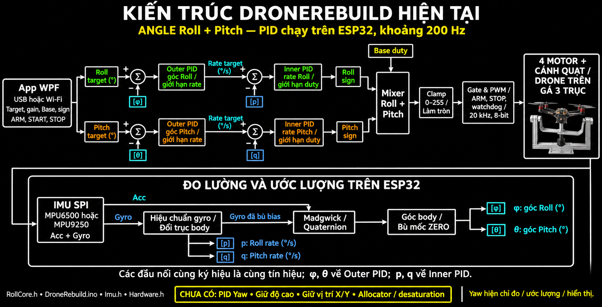

# Sơ đồ kiến trúc DroneRebuild hiện tại

Ảnh minh họa kiến trúc đang triển khai, đối chiếu source ngày 07/11/2026. Hình mô tả chế độ **ANGLE Roll + Pitch**, không phải kiến trúc ba trục được đề xuất.

[Mở ảnh gốc](assets/drone-rebuild-current-architecture.png).

## Cách đọc

- App WPF gửi góc mục tiêu, cấu hình và lệnh qua USB/TCP. Vòng PID chạy trên ESP32, gần 200 Hz.
- Outer PID góc tạo target rate. Inner PID rate tạo correction duty. Mỗi trục có Motor sign riêng.
- Base đi vào mixer, không được tạo bởi một PID độ cao.
- Mixer Roll/Pitch tạo bốn duty; sau giới hạn và làm tròn, Gate/PWM giám sát việc xuất motor độc lập với tác vụ tính PID.
- Drone/gá chuyển động tạo số đo IMU, từ đó sinh tín hiệu phản hồi.

Các đầu nối mang cùng ký hiệu trong hai phần của hình là cùng tín hiệu, không cần vẽ dây dài nối xuyên qua toàn sơ đồ:

| Ký hiệu | Đại lượng | Đưa về đâu? |
| --- | --- | --- |
| φ | Góc Roll sau bù mốc, ° | Đầu trừ của sai số Outer Roll |
| θ | Góc Pitch sau bù mốc, ° | Đầu trừ của sai số Outer Pitch |
| p | Roll body rate đã bù bias, °/s | Đầu trừ của sai số Inner Roll |
| q | Pitch body rate đã bù bias, °/s | Đầu trừ của sai số Inner Pitch |

`q` trong chú giải này là ký hiệu tốc độ Pitch, không phải toàn bộ quaternion.

Hình biểu diễn **khối chức năng**, không thay cho thứ tự từng phép toán trong source. Cụ thể, `Imu.h` tích phân Madgwick trong hệ sensor bằng gyro đã trừ bias và accelerometer; quaternion được đổi sang hệ body khi lấy góc. Nhánh gyro rate đổi trục trực tiếp theo `Hardware.h`: `p=−(gy−biasY)`, `q=gx−biasX`. Không dùng đạo hàm góc ước lượng để thay nhánh đo rate.

Trong RATE, command rate đi trực tiếp vào vòng Inner và không dùng Outer; nhánh này không được vẽ trong hình ANGLE. Yaw hiện được đo/ước lượng/hiển thị, chưa có PID Yaw trong mixer. Giữ độ cao, giữ X/Y và allocator/desaturation cũng chưa được triển khai.

## Nguồn và cách tạo ảnh

Đối chiếu [RollCore.h](../../firmware/DroneRebuild/RollCore.h), [DroneRebuild.ino](../../firmware/DroneRebuild/DroneRebuild.ino), [Imu.h](../../firmware/DroneRebuild/Imu.h) và [Hardware.h](../../firmware/DroneRebuild/Hardware.h).

Ảnh tạo bằng công cụ **image_gen tích hợp**, theo phong cách sơ đồ bảng đen mà người dùng cung cấp. [Prompt của ảnh được chọn](assets/drone-rebuild-current-architecture.prompt.txt) được lưu để tái tạo hoặc chỉnh sửa. Không thay đổi code firmware/app.

Đọc thêm: [công thức và ví dụ PID](PID_FORMULAS_AND_WORKED_EXAMPLES.md), [đánh giá kiến trúc mục tiêu cho gá ba trục](../references/three-axis/THREE_AXIS_RIG_EVIDENCE_AND_VALIDATION.md).
