# Giải thích chi tiết các sơ đồ điều khiển PX4

Tài liệu học và đối chiếu với DroneRebuild, soạn ngày **04/11/2026**.

Đọc cùng [bản dịch Controller Diagrams](px4-so-do-bo-dieu-khien.md). Đây là phần giải thích bổ sung, không phải bản dịch chính thức hoặc hướng dẫn lấy gain PX4 nạp vào DroneRebuild. Các ví dụ số chỉ minh họa phép tính, không phải bộ thông số đã kiểm chứng bay.

**Nguồn hình:** PX4 và các cộng tác viên PX4 User Guide, giấy phép [CC BY 4.0](https://creativecommons.org/licenses/by/4.0/). Giữ nguyên 13 hình gốc; phần diễn giải, bảng và ví dụ tiếng Việt được bổ sung. Nguồn: [Controller Diagrams](https://docs.px4.io/main/en/flight_stack/controller_diagrams), bản trang được lưu khi dịch ngày 04/11/2026. Nhãn trong hình giữ tiếng Anh.

## Mục lục

1. [Cân bằng nghĩa là gì?](#can-bang)
2. [Cách đọc sơ đồ](#doc-so-do)
3. [Toàn bộ chuỗi điều khiển](#tong-the)
4. [IMU và ước lượng trạng thái](#imu)
5. [Vòng tốc độ góc RATE](#rate)
6. [Vòng tư thế ANGLE](#angle)
7. [Vì sao Roll âm tạo rate target dương?](#vi-du)
8. [Mixer và lực motor](#mixer)
9. [Giới hạn và chống windup](#gioi-han)
10. [Vị trí, vận tốc và gia tốc](#vi-tri)
11. [Hệ tọa độ, quaternion và Yaw](#he-toa-do)
12. [Gá một trục, ba trục và bay tự do](#ga)
13. [Máy bay cánh cố định và TECS](#tecs)
14. [Tư thế cánh cố định](#fixed-wing)
15. [VTOL và airspeed scaling](#vtol)
16. [Đối chiếu với DroneRebuild](#drone-rebuild)
17. [Cách đọc log để tìm nguyên nhân](#doc-log)
18. [Những hiểu nhầm cần tránh](#hieu-nham)
19. [Thứ tự hoàn thiện hệ thống](#thu-tu)

<a id="can-bang"></a>

## 1. “Drone cân bằng” có nhiều mức khác nhau

Khi nói drone “ổn”, cần chỉ rõ đại lượng đang được giữ. Năm yêu cầu dưới đây khác nhau:

| Yêu cầu | Đại lượng cần phản hồi | Ví dụ đã đạt nhưng chưa đủ cho yêu cầu tiếp theo |
|---|---|---|
| Ngừng quay | Tốc độ góc Roll/Pitch/Yaw | Thân dừng ở góc nghiêng 5° |
| Giữ ngang | Tư thế và tốc độ góc | Thân ngang nhưng vẫn trôi sang bên |
| Không quay hướng liên tục | Ít nhất tốc độ Yaw | Không tự xoay nhưng hướng tuyệt đối vẫn có thể trôi chậm |
| Giữ độ cao | Độ cao/vận tốc thẳng đứng và lực đẩy | Không lên xuống nhưng vẫn trôi ngang |
| Giữ một điểm | Vị trí/vận tốc ngang, độ cao, tư thế | Đây mới gần với yêu cầu hover tự động tại chỗ |

Vòng RATE phục vụ yêu cầu ngừng hoặc điều chỉnh tốc độ quay. Vòng ANGLE phục vụ tư thế. Muốn tự giữ điểm phải có thêm phép đo và các vòng ngoài phù hợp.

Không phải mọi drone đều cần vòng vị trí để bay: người lái có thể điều khiển tư thế và ga. Nhưng nếu hệ chỉ nhận góc mục tiêu 0° và Base cố định, đừng kỳ vọng nó tự loại bỏ mọi vận tốc ngang hoặc tự giữ độ cao.

<a id="doc-so-do"></a>

## 2. Cách đọc một sơ đồ khối

### 2.1. Điểm đặt, giá trị đo và sai số

`Setpoint`, thường có hậu tố `sp`, là điều hệ thống muốn đạt. `Estimate` là trạng thái được ước lượng từ cảm biến.

Tại nút cộng/trừ:

$$
e=\text{setpoint}-\text{measurement}
$$

Ví dụ, tốc độ yêu cầu +5°/s nhưng đo được −2°/s thì sai số là +7°/s. Bộ điều khiển phải tác động theo chiều làm tốc độ tăng lên.

Một mũi tên đi ra từ bộ điều khiển là **lệnh**. Mũi tên phản hồi từ cảm biến là **kết quả**. Lệnh +20°/s không phải bằng chứng thân đã quay +20°/s.

### 2.2. Ý nghĩa các khối thường gặp

| Khối/nhãn | Đọc như thế nào |
|---|---|
| P | Sai số hiện tại nhân một gain |
| I hoặc ký hiệu tích phân | Cộng dồn sai số theo thời gian |
| D hoặc đạo hàm | Phản ứng với tốc độ thay đổi của tín hiệu |
| LPF | Giữ biến thiên chậm, giảm thành phần cao tần |
| Limiter/saturation | Chặn đầu ra trong biên cho phép |
| Feedforward, FF | Tính trước một phần tác động từ lệnh/mô hình, không đợi sai số xuất hiện |
| Mixer/control allocation | Chuyển yêu cầu lực/mô-men thành lệnh tới từng cơ cấu |
| Frame | Hệ tọa độ mà các thành phần vector đang được biểu diễn |
| Mũ trên biến | Giá trị ước lượng |
| Chấm trên biến | Đạo hàm theo thời gian |

Một bộ điều khiển có gain giống nhau về số chưa chắc tương đương nếu đơn vị, chuẩn hóa, cách tính D và thời gian lấy mẫu khác nhau.

<a id="tong-the"></a>

## 3. Toàn bộ chuỗi điều khiển multicopter

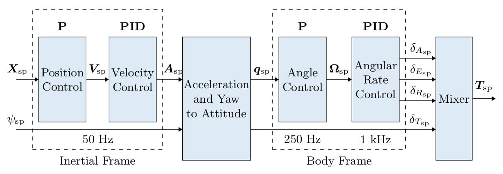

Đọc từ trái sang phải:

```text
Vị trí muốn tới
    ↓ vòng vị trí
Vận tốc cần có
    ↓ vòng vận tốc
Gia tốc cần tạo
    ↓ chuyển gia tốc + yaw thành tư thế và lực đẩy
Tư thế cần đạt
    ↓ vòng tư thế
Tốc độ góc cần có
    ↓ vòng tốc độ góc
Yêu cầu mô-men
    ↓ mixer/phân bổ điều khiển, cùng lệnh lực đẩy tổng
Lệnh từng motor
    ↓ motor/cánh + động lực học
Chuyển động thực
    ↓ cảm biến và bộ ước lượng
Phản hồi về các vòng tương ứng
```

Mỗi vòng giải một bài toán nhỏ hơn. Nếu bỏ vòng vị trí, người lái hoặc bộ tạo lệnh có thể đưa vận tốc/tư thế trực tiếp vào. Nếu chọn RATE, tín hiệu đi thẳng vào vòng tốc độ góc.

Đường lực đẩy tổng đi cùng chuỗi tư thế, không phải là kết quả của riêng PID Roll. Bốn motor cần vừa tạo lực đẩy tổng, vừa phân phối chênh lực để tạo mô-men.

Các tần số in trong hình là đặc điểm của sơ đồ nguồn, không phải bằng chứng mọi phiên bản PX4 hoặc mọi phần cứng đều chạy đúng các tần số ấy. Không sao chép tần số hoặc gain mà chưa kiểm tra hệ thực.

<a id="imu"></a>

## 4. IMU đo gì và vì sao phải lọc?

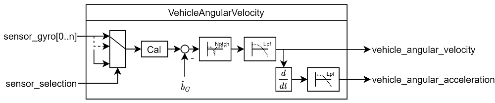

### 4.1. Gyro không trực tiếp đo góc nghiêng

Gyro đo tốc độ góc. Nếu một trục quay +10°/s trong 0,2 s thì phần biến thiên góc do tốc độ đó, với điều kiện quay đơn giản, khoảng +2°.

Sai lệch gyro nhỏ cũng tích lũy thành sai góc. Bias 0,5°/s nếu không được bù có thể tích lũy 5° trong 10 s.

Accelerometer đo gia tốc riêng, bao gồm ảnh hưởng của trọng lực theo tư thế và chuyển động. Khi đứng yên, nó giúp tìm hướng trọng lực. Khi tăng tốc hoặc rung, không thể mặc định mọi thành phần đo được đều là do nghiêng.

Bộ ước lượng kết hợp hai loại tín hiệu để tìm tư thế. PX4 trong tài liệu dùng EKF2; DroneRebuild hiện dùng Madgwick. Cả hai không tự bảo đảm đúng nếu mounting, scale, timing hoặc dữ liệu đầu vào sai.

### 4.2. Tại sao có hai nhánh lọc?

P và I dùng tốc độ góc đã lọc. D dùng gia tốc góc, là đạo hàm của tốc độ góc, nên nhạy với nhiễu hơn.

Ví dụ, nếu rate đo nhảy 1°/s trong 5 ms:

$$
\frac{\Delta\omega}{\Delta t}=\frac{1}{0.005}=200\;{}^\circ/s^2.
$$

Một nhiễu tưởng nhỏ có thể thành D lớn. Lọc giúp giảm nhiễu nhưng cũng tạo trễ; lọc quá mạnh có thể làm phản ứng hãm chậm. Tăng D trong khi đường đo rung chưa sạch có thể làm motor giật hơn.

Notch tập trung loại một dải tần hẹp, thường liên quan rung; LPF giảm phổ cao tần nói chung. Không phải cứ thêm nhiều bộ lọc là tốt.

<a id="rate"></a>

## 5. Vòng RATE: làm thân quay theo tốc độ yêu cầu

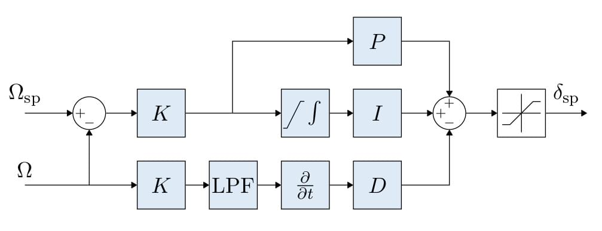

### 5.1. Đầu vào và đầu ra

Vòng này nhận:

- Tốc độ góc yêu cầu $\omega_{sp}$.
- Tốc độ góc đo được $\omega$ trong cùng hệ tọa độ và đơn vị.

Sai số:

$$
e_\omega=\omega_{sp}-\omega.
$$

Đầu ra là mức tác động để tạo mô-men. Tùy firmware, đó có thể là torque chuẩn hóa, gia tốc góc yêu cầu hoặc phần sửa duty PWM. DroneRebuild hiện dùng **duty**; không được đọc trực tiếp như N·m.

### 5.2. P — phản ứng tức thời

$$
P=K_p e_\omega.
$$

Với target 0, rate −10°/s và Kp=0,2, ta có P=+2 duty trong quy ước DroneRebuild.

P không hiểu “đang nghiêng −10°”. Nó chỉ biết sai số tốc độ. Khi thân đứng yên ở −10°, RATE target 0 không tự yêu cầu hồi ngang.

### 5.3. I — bù tác động kéo dài

Ở dạng liên tục:

$$
I=K_i\int e_\omega\,dt.
$$

Nếu motor hai bên không hoàn toàn tương đương hoặc có mô-men ngoài, hệ có thể cần một mức sửa liên tục. I học dần mức bù từ sai số tốc độ.

Trong RATE target 0 và gần quay một trục, lượng tích phân rate có liên hệ với góc đã quay. Vì vậy I có thể cần một lượng trôi góc để hình thành bù nếu khởi động từ I=0. Đây không phải lý do giữ tùy tiện I cũ hoặc nâng trần I; phải xét trạng thái cất cánh, lực và điều kiện ban đầu.

### 5.4. D — giảm thay đổi tốc độ quá nhanh

Trong kiểu D theo số đo:

$$
D=-K_d\frac{d\omega}{dt},
$$

sau đó có lọc. Nếu tốc độ đang tăng dương quá nhanh, D có xu hướng tạo tác động âm.

Không nên hiểu D là thành phần luôn chống dấu rate: D chống **sự thay đổi** rate. Rate dương nhưng đang giảm có thể tạo D dương. D theo số đo cũng tránh cú giật đạo hàm khi chỉ đổi target.

### 5.5. Gain phụ thuộc đơn vị

Với rate tính bằng °/s và output bằng duty, các đơn vị tương ứng là:

| Gain | Đơn vị |
|---|---|
| Rate Kp | duty·s/° |
| Rate Ki | duty/° |
| Rate Kd | duty·s²/° |
| Angle Kp khi tạo rate target | 1/s |

PX4 còn có dạng K-PID và chuẩn hóa riêng. Bộ gain 0,2/0,15/0,001 của DroneRebuild không thể so trực tiếp bằng số với gain PX4.

<a id="angle"></a>

## 6. Vòng ANGLE: quyết định nên quay hướng nào để đạt tư thế

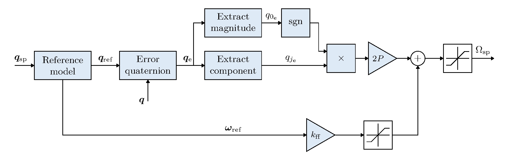

### 6.1. Vì sao cần hai vòng?

Vòng góc biết còn lệch mục tiêu bao nhiêu, nên yêu cầu tốc độ quay phù hợp. Vòng rate biết tốc độ quay thực và điều khiển motor để thực hiện.

Ở dạng P góc đơn giản:

$$
\omega_{sp}=\operatorname{clamp}\left(K_{p,angle}(\theta_{sp}-\theta),-\omega_{max},+\omega_{max}\right).
$$

Nếu gần mục tiêu, tốc độ yêu cầu nhỏ dần. Điều này giúp hãm trước khi vượt ngang, với điều kiện vòng rate theo được lệnh.

PX4 trong trang nguồn còn dùng quaternion và mô hình tham chiếu làm trơn cùng feedforward. Công thức Euler một trục trên là ví dụ học và mô tả đường điều khiển đơn giản của DroneRebuild, không phải toàn bộ thuật toán PX4.

### 6.2. Ý nghĩa của Angle Kp=1

Khi chưa chạm rate limit, lệch 3° tạo tốc độ yêu cầu 3°/s, lệch 10° tạo 10°/s. Đây là tốc độ **yêu cầu**, không phải tốc độ thực đã bảo đảm.

Trong mô hình lý tưởng vòng rate bám tức thời, góc sẽ giảm theo hàm mũ. Phần cứng thật còn quán tính, trễ motor/lọc và giới hạn lực. Tăng Angle Kp có thể tạo đòi hỏi vượt khả năng rate rồi gây overshoot; không thể tune vòng ngoài độc lập hoàn toàn với vòng trong.

### 6.3. Feedforward trong sơ đồ mới có tác dụng gì?

Chỉ dùng P thì thường phải xuất hiện sai số mới có lệnh rate. Mô hình tham chiếu tạo một chuyển động tư thế có kiểm soát; tốc độ của tham chiếu được đưa thẳng vào rate target, giúp bám chuyển động tốt hơn mà không phải tăng P quá mức.

Feedforward cần đúng mô hình/đơn vị và vẫn cần feedback. Nó không tự chữa sai chiều motor hoặc dữ liệu cảm biến sai.

<a id="vi-du"></a>

## 7. Ví dụ đầy đủ: Roll âm nhưng target dương

Giả sử quy ước đã xác minh trên chính drone:

- Roll âm là phía phải hạ xuống.
- Nâng phải/hạ trái tạo Roll rate dương.
- Mixer Roll dùng motor sign=−1.

Đặt:

```text
Roll hiện tại = −3°
Roll mục tiêu = 0°
Angle Kp = 1
Rate Kp = 0.2
Rate đo = −5°/s
Base = 110
```

Bước tính:

| Bước | Kết quả |
|---|---|
| Sai số góc | 0 − (−3) = +3° |
| Rate target | +3°/s |
| Sai số rate | +3 − (−5) = +8°/s |
| P rate | 0,2 × 8 = +1,6 duty |
| Giả sử chỉ xét P, chưa cộng I/D | Output = +1,6 |
| Motor trái với sign=−1 | 110 − 1,6 = 108,4 → 108 |
| Motor phải với sign=−1 | 110 + 1,6 = 111,6 → 112 |

Motor phải được tăng để nâng phía phải. Đây là hướng lệnh phù hợp quy ước trên, nhưng vẫn phải kiểm chứng lực thực và chuyển động.

Nếu rate vẫn âm thì thân vẫn đang tiếp tục đổ. Điều đó có thể là một đoạn hãm đang giảm tốc, hoặc thật sự chưa đủ mô-men, sai lực thực, bị ngoại lực/gá tác động. Phải nhìn diễn biến theo thời gian; một mẫu rate âm không tự chứng minh sai sign.

Nếu Roll=−60° và rateLimit=20°/s, Angle Kp=1 yêu cầu +60°/s nhưng bị chặn thành +20°/s. Tăng góc lệch thêm không làm target tăng nữa. Muốn hồi phục phải có mô-men thực đủ để đổi tốc độ, không chỉ có target mang dấu đúng.

<a id="mixer"></a>

## 8. Mixer: kết hợp nhiều yêu cầu trên cùng bốn motor

### 8.1. Giữ ngang và nâng thân là hai tác động khác nhau

Nếu cùng tăng bốn motor, lực đẩy tổng thường tăng. Nếu tăng một nhóm và giảm nhóm đối diện, tạo chênh lực gây mô-men.

Với DroneRebuild hai trục:

$$
\begin{aligned}
LF&=B+r+p,\\
RF&=B-r+p,\\
LR&=B+r-p,\\
RR&=B-r-p.
\end{aligned}
$$

Ở đây $r=sign_{roll}u_{roll}$, $p=sign_{pitch}u_{pitch}$. Trong công thức mixer này, chữ $p$ là phần sửa Pitch, khác tốc độ Roll body $p$ trong các công thức động học. $B$ là Base.

Ví dụ B=110, r=−5, p=+3:

```text
LF=108, RF=118, LR=102, RR=112
```

Không trộn hai bộ motor hoàn chỉnh bằng cách cộng cả hai Base: như vậy sẽ cộng ga nền hai lần.

### 8.2. Còn Yaw ở đâu?

Yaw dựa trên chênh mô-men phản lực của các motor quay CW và CCW. Cần thành phần Yaw trong mixer, với dấu theo chiều quay thực, đồng thời có vòng yaw rate feedback.

Biết nhãn LF/RF/LR/RR chưa đủ suy hệ số Yaw nếu chưa biết motor nào CW/CCW. Không đưa một bảng sign Yaw tùy ý rồi giả định đúng.

Nếu chỉ có Roll/Pitch, drone có thể giữ ngang trong khi tự xoay Yaw. Hiển thị yaw trên app chỉ là quan sát, chưa phải điều khiển.

### 8.3. PWM không phải lực đẩy

Lực phụ thuộc motor, cánh, điện áp, tải và tốc độ thực. Lệnh PWM chênh 20 không có nghĩa chênh 20% lực. Nếu có deadband hoặc một motor yếu, cùng thay duty có thể tạo lực rất khác nhau.

Điều này cũng giải thích tại sao gain trên gá, ở pin và Base nhất định, chưa tự bảo đảm đáp ứng tương đương trong mọi điều kiện.

<a id="gioi-han"></a>

## 9. Ba giới hạn khác nhau và windup

| Giới hạn DroneRebuild | Chặn đại lượng | Khi chạm có ý nghĩa gì? |
|---|---|---|
| `rateLimit`, mặc định 20°/s | Rate target từ vòng góc | Vòng ngoài không được yêu cầu quay nhanh hơn |
| `iLimit`, mặc định 10 duty | Riêng I của vòng rate | Mức bù I đã hết biên cho phép |
| `outputLimit`, mặc định 20 duty | Tổng P+I+D | PID không được xuất phần sửa lớn hơn |
| Clamp motor 0–220 | PWM sau mixer | Một hoặc nhiều motor không thực hiện được lệnh chưa giới hạn |

`pidLimited=0` không chứng minh I chưa chạm 10. `mixerLimited=0` không chứng minh motor tạo được lực yêu cầu.

### 9.1. Windup xảy ra thế nào?

Ví dụ người giữ thân ở góc −5° khi target góc=0°. Vòng góc yêu cầu rate dương nhưng thân không quay, nên sai số rate kéo dài và I tích lũy. Khi thả tay, mức bù đã tích lũy có thể làm thân quay mạnh. Đây là lý do log có giữ/đẩy phải được đánh dấu.

Trên mặt đất, thân cũng có thể bị hạn chế chuyển động bởi chân đáp. Flight controller cần xử lý integrator theo trạng thái motor/throttle/trên đất, thay vì tích lũy không phân biệt điều kiện.

### 9.2. Hai chiều có thể có biên hồi phục khác nhau dù gain giống nhau

Giả sử output cần +8 duty chỉ để giữ trạng thái hiện tại và bị giới hạn ±20. Phần sửa tăng thêm tương đối quanh điểm đó chỉ còn +12 duty theo chiều dương, trong khi chiều âm còn 28 duty đến −20.

Đây là minh họa biên lệnh quanh điểm làm việc, chưa phải đo biên mô-men thực. Nó cho thấy sự bất đối xứng không nhất thiết bắt nguồn từ gain hai chiều khác nhau.

### 9.3. Tăng giới hạn không thay thế xác minh lực

Nếu output thực chỉ 13 và limit=20, tăng limit=40 không làm output tự tăng lên 40. Nếu I đã chạm 10, tăng outputLimit cũng không tự tăng iLimit.

Anti-windup tốt cần xét đầu ra thực sự đạt được và cho tích phân giảm theo hướng thoát bão hòa. Với nhiều trục, một cờ clipping chung không mô tả hết trục nào thiếu mô-men và theo chiều nào.

<a id="vi-tri"></a>

## 10. Vị trí, vận tốc, gia tốc và lực đẩy

### 10.1. Vòng vị trí: còn xa mục tiêu thì nên di chuyển bao nhanh?

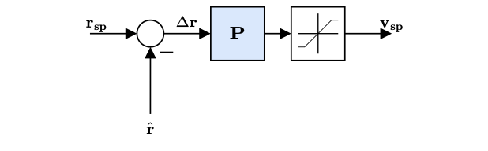

Ví dụ minh họa một trục ngang:

```text
Muốn x=2 m, hiện tại x=0 m
→ sai số +2 m
→ vòng P vị trí yêu cầu vận tốc +1 m/s, chẳng hạn
```

Tốc độ đặt phải được giới hạn để không đòi hỏi quá mạnh. Gain và giá trị ví dụ không phải tham số đề xuất cho drone.

### 10.2. Vòng vận tốc: cần gia tốc bao nhiêu để đạt vận tốc?

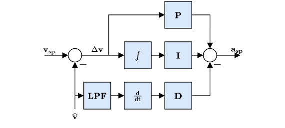

Nếu muốn +1 m/s mà hiện chỉ +0,2 m/s, vòng vận tốc tính gia tốc cần tăng. Khi đã tiến gần điểm đến, vòng vị trí giảm vận tốc yêu cầu; vòng vận tốc sẽ yêu cầu gia tốc ngược để hãm.

Đó là lý do chỉ đưa góc về 0° không tự hãm được hết chuyển động ngang: thân ngang làm lực ngang gần 0, nhưng vận tốc đang có vẫn tồn tại nếu không có lực đủ để giảm nó.

### 10.3. Chuyển gia tốc thành hướng lực đẩy

Quadcopter thông thường muốn tăng tốc ngang phải nghiêng hướng lực đẩy. Đồng thời phải tạo đủ thành phần lực thẳng đứng để đỡ trọng lượng.

Trong mô hình lý tưởng chỉ xét một góc nghiêng $\alpha$:

$$
T_{vertical}=T\cos\alpha.
$$

Ở 30°, để giữ cùng lực thẳng đứng cần tổng lực lớn hơn khoảng $1/\cos30^\circ\approx1.155$ lần. Đây là lực lý tưởng, không thể lấy Base nhân 1,155 rồi coi đã bù đúng lực.

### 10.4. Sơ đồ tổng hợp

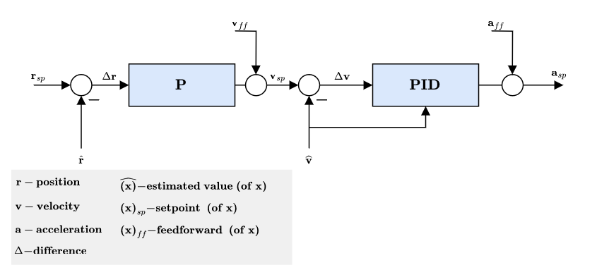

Nhánh feedforward gia tốc có thể đến từ bộ tạo quỹ đạo, giúp bộ điều khiển biết trước cần tăng/giảm tốc thế nào. Vòng feedback vẫn sửa sai lệch do nhiễu và mô hình không chính xác.

Muốn tự giữ độ cao cần đo/ước lượng độ cao và vận tốc đứng đủ tốt. Muốn giữ XY cần nguồn vị trí/vận tốc phù hợp như GNSS, optical flow kết hợp độ cao, hoặc hệ định vị khác. Không thể chỉ tích phân accelerometer đơn giản rồi mặc định có vị trí chính xác lâu dài.

<a id="he-toa-do"></a>

## 11. Hệ tọa độ và vì sao quay nhiều trục phức tạp hơn

### 11.1. Hệ thế giới và hệ thân

Hệ thế giới mô tả vị trí/vận tốc so với môi trường. Hệ thân gắn vào drone và quay cùng drone. Gyro đo các thành phần tốc độ góc theo hệ cảm biến; phải đổi về hệ thân đúng mounting trước khi điều khiển.

Nếu chỉ thử một trục gần ngang, nhiều phép xấp xỉ có vẻ đúng. Khi Yaw quay và thân đang nghiêng, các thành phần bắt đầu liên hệ rõ với nhau.

Với quy ước Euler ZYX thông dụng:

$$
\dot\phi=p+\sin\phi\tan\theta\,q+\cos\phi\tan\theta\,r,
$$

$$
\dot\theta=\cos\phi\,q-\sin\phi\,r.
$$

$p,q,r$ là tốc độ góc body; $\phi,\theta$ là Roll và Pitch. Vì vậy ngoài vùng góc nhỏ, gyro Roll không đơn giản bằng đạo hàm của số góc Roll trên màn hình. Cần dùng cùng quy ước hệ trục khi áp dụng các công thức này.

### 11.2. Quaternion giải quyết phần nào?

Quaternion biểu diễn phép quay 3D và tránh suy biến biểu diễn Euler trong phần tính toán phù hợp. Controller có thể dùng sai số quaternion để tạo body-rate target nhất quán.

DroneRebuild dùng quaternion trong estimator, nhưng vòng góc hiện vẫn lấy từng sai số Euler Roll/Pitch. Do đó không thể chỉ thấy Madgwick/quaternion rồi kết luận controller đã hỗ trợ hồi phục mọi tư thế.

### 11.3. Yaw rate và giữ hướng tuyệt đối

Hãm yaw rate về 0 có thể dùng gyro đã bù bias. Giữ hướng tuyệt đối lâu dài còn cần xử lý trôi và nguồn tham chiếu hướng phù hợp. Không có magnetometer không đồng nghĩa không thể làm vòng hãm yaw rate.

<a id="ga"></a>

## 12. Vì sao gá một trục ổn nhưng ba trục tự do lại gục?

Trên gá Roll, cơ khí giữ Pitch/Yaw và tịnh tiến. PID chỉ phải giải chuyển động còn lại; ma sát, trọng tâm so với trục gá và lực hồi của gá có thể hỗ trợ hoặc cản điều khiển.

Khi chuyển sang gá tự do ba trục:

- Các ràng buộc hỗ trợ trước đó không còn.
- Roll/Pitch cùng sử dụng bốn motor, có thể tranh biên đầu ra.
- Yaw tự do làm lộ thiếu hụt vòng hãm Yaw.
- Mô-men do trọng tâm lệch trục gimbal có thể khác xa động lực bay tự do.
- Gá vẫn tác động lên hệ: gimbal ba trục không tự tương đương drone bay trong không khí.

Khi cất cánh từ đất, lại có thêm tiếp xúc chân đáp, quá trình tăng lực và trạng thái tích phân trước khi rời đất. “Đạt trên gá” là một mốc kiểm chứng, không phải chứng chỉ bay.

Không thể xác định duy nhất nguyên nhân gục từ mô tả. Cần phân biệt lỗi hệ trục/dấu, thiếu lực, bão hòa, điều kiện cất cánh và PID chưa phù hợp bằng dữ liệu đồng bộ.

<a id="tecs"></a>

## 13. Máy bay cánh cố định: vì sao cần TECS?

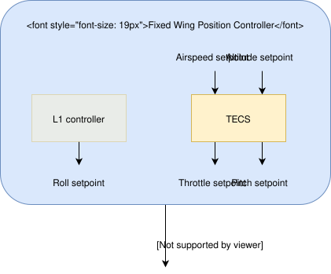

Cánh cố định có sự đánh đổi giữa tốc độ và độ cao. Kéo mũi lên có thể tăng độ cao nhưng mất tốc; thêm ga có thể tăng cả tốc độ lẫn độ cao.

Nếu làm hai PID độc lập, một PID tốc độ và một PID độ cao không xét liên hệ, chúng có thể tác động ngược nhau. TECS đổi bài toán sang năng lượng:

$$
E_T=\underbrace{\frac12mV_T^2}_{\text{động năng}}
+\underbrace{mgh}_{\text{thế năng}}.
$$

Hai nhiệm vụ:

- **Ga:** điều chỉnh tổng năng lượng.
- **Pitch:** điều chỉnh sự phân chia năng lượng giữa tốc độ và độ cao.

### 13.1. Vòng ga

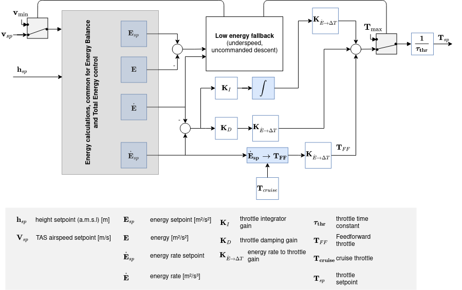

Nếu tổng năng lượng thấp hơn yêu cầu, cần bổ sung năng lượng bằng lực đẩy. Ví dụ máy bay vừa thấp vừa chậm sẽ cần thêm năng lượng, không chỉ ngẩng mũi.

### 13.2. Vòng Pitch

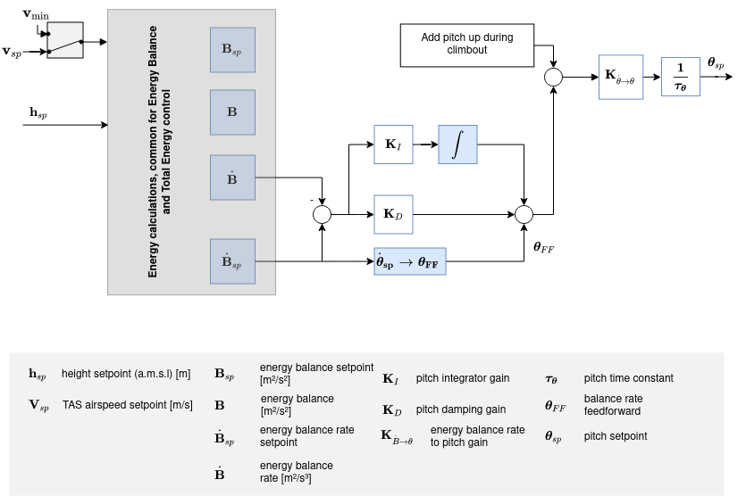

Nếu tốc độ quá cao trong khi thiếu độ cao, có thể ngẩng lên để chuyển bớt động năng thành thế năng. Ngược lại, thiếu tốc có thể cần hạ mũi để đổi độ cao lấy tốc độ, trong giới hạn chế độ bay.

Đại lượng thay đổi năng lượng riêng:

$$
\dot E_s=V_T\dot V_T+g\dot h,
\qquad
\dot B_s=g\dot h-V_T\dot V_T.
$$

Phép cộng cho biết tổng cần tăng/giảm; phép trừ cho biết năng lượng đang phân chia ra sao.

### 13.3. Trọng số tốc độ/độ cao

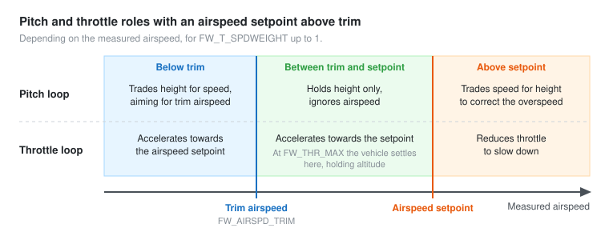

`FW_T_SPDWEIGHT` quy định vòng Pitch ưu tiên sai số tốc độ hay độ cao. Với tàu lượn không có ga để tự tăng tốc, giữ tốc bằng Pitch quan trọng đặc biệt. Với máy bay có động cơ, Pitch và ga chia việc theo điều kiện tốc độ so với trim và setpoint.

Hình cho thấy giữa tốc độ trim và tốc độ yêu cầu cao hơn trim, Pitch có thể chỉ giữ độ cao còn ga đảm nhiệm tăng tốc. Đây là logic máy bay cánh cố định, không phải cách chọn Ki/Kd của quadcopter.

<a id="fixed-wing"></a>

## 14. Tư thế cánh cố định: giống và khác multicopter

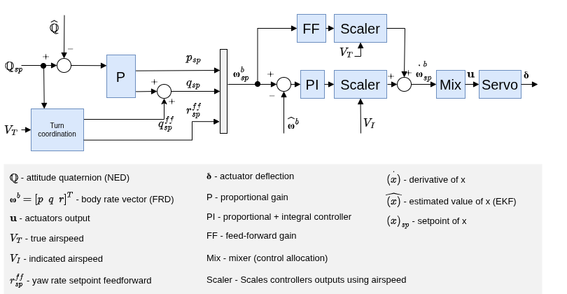

Điểm giống là tư thế → tốc độ góc → tác động điều khiển. Khác biệt nằm ở cơ cấu tạo mô-men: cánh liệng, cánh lái độ cao và cánh lái hướng phụ thuộc luồng khí.

Một độ lệch servo tạo lực rất khác ở tốc độ không khí thấp và cao. Do đó có các khối scaler và feedforward theo airspeed.

Với máy bay thông thường, Yaw không được điều khiển giống quadcopter chỉ bằng cách yêu cầu quay hướng tại chỗ. Bộ điều khiển cần loại thành phần Yaw không phù hợp khỏi sai số tư thế và dùng quy tắc rẽ phối hợp để giảm trượt ngang.

Phối hợp vòng rẽ còn tạo chuyển động Pitch/Yaw liên quan hình học. Feedforward bù phần chuyển động có thể tính trước để giảm gánh nặng của feedback.

Không lấy logic cánh lái hướng cánh cố định để thay trực tiếp vòng yaw rate của quadcopter.

<a id="vtol"></a>

## 15. VTOL và hiệu chỉnh theo airspeed

### 15.1. VTOL không chỉ là bật hai controller cùng lúc


VTOL có thể bay như multicopter, như cánh cố định và trong trạng thái chuyển tiếp. Khối VTOL quyết định controller nào cung cấp tham chiếu, đầu ra nào được dùng và chuyển đổi mức tác động theo loại khung.

Điểm học được cho DroneRebuild là **trạng thái vận hành phải rõ**: bench, thử trên gá, idle, cất cánh, bay và dừng có mục tiêu khác nhau. Không nên tự suy `START_BOTH` tương đương chế độ bay đầy đủ.

### 15.2. Vì sao PI và FF có scaling khác nhau?

Với cánh điều khiển, mô-men trực tiếp có hệ số áp suất động:

$$
\bar q=\frac12\rho V_T^2.
$$

Khi tăng airspeed, cùng một độ lệch cánh có thể tạo mô-men lớn hơn nhiều. Để giữ mức tác động tương đương, đầu ra PI được hiệu chỉnh gần theo nghịch đảo bình phương IAS.

Thành phần FF dùng để bù giảm chấn rate có quan hệ khác; trong công thức kết luận của nguồn nó tỷ lệ theo nghịch đảo TAS:

$$
\delta_a=
\frac{V_{I_0}^2}{V_I^2}\delta_{a_{PI}}
+\frac{V_{T_0}}{V_T}\delta_{a_{FF}}.
$$

Ví dụ về hệ số, nếu IAS tăng gấp đôi mốc trim thì nhánh PI nhân 1/4; nếu TAS cũng tăng gấp đôi thì nhánh FF nhân 1/2. Đây là mô tả công thức scaling, không phải lệnh chỉnh PWM quadcopter.

Bản dịch đã ghi chú chỗ công thức rút góc cánh trong nguồn có điểm không nhất quán đại số. Không dùng biểu thức đó để thiết kế phần cứng mà bỏ qua kiểm tra thứ nguyên.

<a id="drone-rebuild"></a>

## 16. Đối chiếu cụ thể với DroneRebuild hiện tại

Đối chiếu source trong workspace tại thời điểm soạn; `BuildInfo.h` ghi `D0F2AE3ECE7A50D8`, nhưng chuỗi đó không tự xác nhận mọi file chưa được sửa sau build.

| Khối trong sơ đồ PX4 | DroneRebuild hiện có gì? | Điều còn cần làm rõ/hoàn thiện |
|---|---|---|
| Ước lượng tư thế | Madgwick, gyro bias, đổi hệ sensor/body | Kiểm chứng động, rung, clip cảm biến và mounting 3D |
| Attitude → rate | PID góc Euler riêng Roll/Pitch | Quan hệ body rate khi phối hợp nhiều góc/Yaw; vùng hoạt động |
| Rate → tác động | PID với D lọc, I/output giới hạn | Tracking thực, integrator khi trên đất, bão hòa theo hướng |
| Mixer | B±Roll±Pitch, clamp 0–220 | Yaw, phân bổ khi bão hòa, mô hình lực đầu ra |
| Yaw feedback | Có số góc Yaw hiển thị | Chưa có yaw rate controller/mixer Yaw |
| Collective thrust | Base cố định | Đường ga, tăng ga, trạng thái cất cánh và lực hover |
| Velocity/position | Chưa có | Cần cảm biến/ước lượng tương ứng nếu muốn tự giữ điểm |
| Giám sát | Gate PWM, STOP, owner/epoch, heartbeat, stale control | Quy trình thử/bay, phản ứng khi mất điều khiển phù hợp từng trạng thái |
| Telemetry đa trục | Có góc/rate Roll/Pitch và PWM | PID chi tiết Pitch chưa được ghi đầy đủ khi chạy cả hai |

### 16.1. Một điểm cụ thể trong chống windup

`Controller::step` chỉ cập nhật I khi `!previousMixerLimited_` và thỏa điều kiện biên output. Nếu mixer đã clip, nhánh hiện tại chặn cả cập nhật có thể làm I giảm để thoát clip. Đây là điểm cần kiểm thử/sửa có chủ đích, nhưng **không giải thích được mọi log**: khi `mixerLimited=0`, không thể viện riêng nhánh này làm nguyên nhân.

### 16.2. Một điểm cụ thể ở Apply hai trục

Trong `ApplyPid`, đường scope=2 chép Base chung rồi đặt cả hai `gainsEdited=true`. Phần sau chỉ nhận cấu hình chưa chỉnh từ board khi `!gainsEdited[axis]`, nên đường giữ gain chưa chỉnh không còn được thực hiện trong trường hợp đó.

Đây là rủi ro dùng cache thay vì cấu hình board nếu cache cũ. Không đủ để kết luận một lượt thất bại cụ thể do lỗi này; cần đối chiếu CONFIG và telemetry/readback của cả hai trục.

### 16.3. Những thứ không cần sao chép nguyên từ PX4

- Không bắt buộc dùng EKF2 thay Madgwick chỉ vì tài liệu vẽ EKF2; phải xét mục tiêu và chất lượng ước lượng cần có.
- Không bắt buộc tăng loop từ 200 Hz lên 1 kHz mới có thể cân bằng; cần đo latency/jitter và động lực motor thực.
- Không bắt buộc thêm vị trí/độ cao để làm riêng bài giữ tư thế; chúng phục vụ yêu cầu điều khiển khác.
- Không lấy gain PX4 áp vào output duty của DroneRebuild.

<a id="doc-log"></a>

## 17. Cách đọc log để tìm đúng tầng gây vấn đề

### 17.1. Xác nhận điều kiện trước khi kết luận

Đọc INFO/source, mode, trục/phạm vi chạy, gain, sign, Base, target và outputLimit board thực nhận. Xác định thời gian nào khung bị người giữ/đẩy, chạm vật hoặc gá chặn.

Phân tích hồi phục chỉ ở đoạn đã nhả. Góc/rate khi bị ép không đại diện đầy đủ phản ứng vòng kín tự do. Không tạo tác động bằng tay cạnh cánh quay.

### 17.2. Đọc theo chuỗi nguyên nhân

| Quan sát | Kiểm tra tiếp | Chưa được kết luận ngay |
|---|---|---|
| Góc sai nhưng rate target đúng chiều | So rate thực với target | Chưa chắc thiếu Angle Kp |
| Rate thực cùng chiều nhưng chậm | Output, biên I, lực và trễ | Chưa chắc cứ tăng Ki |
| Rate đi ngược target ngay sau tác động | Dấu sensor/mixer, lực thực, ngoại lực | Một mẫu không đủ khẳng định sai sign |
| Output tăng mà rate không đổi | Thân có bị giữ, lực thực, nguồn, clipping | PWM không chứng minh torque thực |
| I ghì 10 nhưng output chưa chạm 20 | Sai số kéo dài và biên I riêng | Không được nói mọi giới hạn đều còn dư |
| Góc qua 0 nhiều lần | Biên và thời gian giảm dao động | Chưa phải giữ cân bằng |
| Rate trung bình gần 0 | MAE/RMS, cực trị, phổ/tần số | Dao động dương/âm có thể tự triệt tiêu trung bình |
| Góc ổn nhưng Yaw quay | Có vòng Yaw và mixer đúng chưa? | Roll/Pitch gain không tự hãm Yaw |

### 17.3. Chỉ số nên ghi

- Sai số góc trung bình, tuyệt đối trung bình và cực trị.
- Sai số rate so với **rate target đang thay đổi**, không chỉ so với 0 khi đang ANGLE.
- Thời gian hồi về vùng mục tiêu và thời gian liên tục nằm trong vùng đó.
- Tỷ lệ tổng PID, mixer và từng I chạm biên.
- Điện áp pin, cấu hình gá, tác động ngoài, góc/rate ban đầu.
- Đầy đủ P/I/D và target của cả Roll/Pitch/Yaw nếu các trục cùng được điều khiển.

Để so gain, giữ cửa sổ thời gian và điều kiện đầu tương đương. Không so một lượt 2 s với lượt 60 s bằng góc cuối rồi kết luận bộ nào tốt hơn.

### 17.4. Ví dụ so trung bình với dao động

```text
Rate: +10, −10, +10, −10 °/s
Trung bình = 0°/s
Sai số tuyệt đối trung bình với target 0 = 10°/s
```

Vì vậy “rate trung bình bằng 0” có thể cùng tồn tại với lắc mạnh. Với góc cũng tương tự: lắc ±20° không được coi là giữ 0° chỉ vì trung bình góc gần 0.

<a id="hieu-nham"></a>

## 18. Những hiểu nhầm cần tránh

| Hiểu nhầm | Cách hiểu đúng |
|---|---|
| Target +20 thì motor phải tạo ngay rate +20 | Đây là yêu cầu; hiệu quả tùy vòng rate và phần cứng |
| Drone nghiêng mà không tự ngang nghĩa là RATE sai | RATE giữ tốc độ quay; ANGLE mới tạo yêu cầu hồi tư thế |
| Nghiêng âm thì gain phải âm | Dấu nằm ở quy ước cảm biến/mixer; gain không tự đổi theo dấu góc |
| Thêm I ANGLE sẽ chữa mọi lệch góc | Nếu Inner không bám hoặc hết biên, Outer I có thể làm yêu cầu tích lũy thêm |
| Tăng Output limit làm lực mạnh hơn ngay | Chỉ mở biên; output thực có thể chưa chạm biên cũ |
| Motor phải tăng PWM mà khung vẫn đổ là code P sai | Phải kiểm tra lực thực, đà quay, ngoại lực và trễ |
| Đứng yên trên gá nghĩa là PID tốt | Có thể do ma sát hoặc bị gá giữ |
| Gá Roll và Pitch đều đạt thì thả ba trục sẽ đạt | Điều kiện động lực và khả năng điều khiển Yaw đã khác |
| Giữ ngang thì sẽ dừng trôi ngang | Vận tốc ngang cần lực hãm và vòng/điều khiển tương ứng |
| Có quaternion trong IMU là controller đã 3D đầy đủ | Estimator và luật điều khiển là hai phần khác nhau |

<a id="thu-tu"></a>

## 19. Thứ tự hoàn thiện có ý nghĩa đối với DroneRebuild

1. **Đo/ước lượng đúng:** hệ trục, bias, scale, timing, mounting, góc/rate khi có rung và gia tốc.
2. **Lệnh tới motor đúng:** mapping, chiều lực, sign, chiều quay CW/CCW, nguồn và biên điều khiển.
3. **Vòng rate ba trục:** Roll/Pitch/Yaw có phép thử riêng và dữ liệu quan sát đầy đủ; xác định vùng hoạt động có thể kiểm chứng.
4. **Vòng attitude:** tạo body-rate target phù hợp, đánh giá hồi phục từ hai phía nhỏ với điều kiện tương đương; xử lý phối hợp góc lớn nếu đó là mục tiêu.
5. **Ga và trạng thái vận hành:** idle, tăng ga, tích phân khi trên đất, chuyển sang bay và dừng/hạ được định nghĩa rõ.
6. **Phối hợp mixer và bão hòa:** phân bổ đầu ra, giữ biên cần thiết và anti-windup theo tác động đạt được.
7. **Độ cao/vị trí nếu cần:** bổ sung phép đo và các vòng ngoài; không kỳ vọng chỉ đổi PID góc để giữ hover tại chỗ.

Mỗi bước phải có tiêu chí và log tương ứng. Mục tiêu của sơ đồ PX4 là giúp xác định khối nào giải quyết bài toán nào; nó không cung cấp một bộ gain duy nhất cho mọi drone.

## Nguồn để đối chiếu

- [Bản dịch đầy đủ Controller Diagrams](px4-so-do-bo-dieu-khien.md), kèm nguồn ảnh, công thức và ghi chú khác biệt.
- [Controller Diagrams — PX4](https://docs.px4.io/main/en/flight_stack/controller_diagrams).
- [RollCore.h](../../../firmware/DroneRebuild/RollCore.h): PID và mixer trong DroneRebuild.
- [DroneRebuild.ino](../../../firmware/DroneRebuild/DroneRebuild.ino): đọc IMU, START/START_BOTH, gate và telemetry.
- [Imu.h](../../../firmware/DroneRebuild/Imu.h): estimator và đổi hệ trục.
- [MainWindow.xaml.cs](../../../app/MainWindow.xaml.cs): cấu hình, Apply và thao tác app.

Tài liệu này không sửa code và không chứng nhận bộ PID hiện tại đã đủ điều kiện bay tự do.
