# Sơ đồ các bộ điều khiển PX4

> **Bản dịch tiếng Việt của “Controller Diagrams” — PX4 Guide, nhánh `main`.**
>
> Nguồn: https://docs.px4.io/main/en/flight_stack/controller_diagrams  
> Ngày truy cập và dịch: **04/11/2026**. Tác giả nguồn: **PX4 và các cộng tác viên của PX4 User Guide**.  
> Giấy phép tài liệu nguồn: [Creative Commons Attribution 4.0 — CC BY 4.0](https://creativecommons.org/licenses/by/4.0/), xem [LICENSE của kho tài liệu](https://github.com/PX4/PX4-user_guide/blob/main/LICENSE). Bản dịch này được chia sẻ theo cùng giấy phép; đây là bản chuyển ngữ không chính thức, không hàm ý được PX4 chứng thực.
>
> Toàn bộ nội dung chính của trang được dịch, gồm multicopter, fixed-wing và VTOL. **13 hình/sơ đồ gốc** được lưu cục bộ và chèn theo thứ tự xuất hiện. Chữ bên trong hình được giữ nguyên bản tiếng Anh; chú thích hình và bảng thuật ngữ cuối tài liệu hỗ trợ đọc bằng tiếng Việt. Không tự vẽ lại hoặc thay đổi sơ đồ nguồn. Công thức, ký hiệu và tên tham số được giữ để đối chiếu. Thanh điều hướng, sidebar và footer website không thuộc nội dung dịch.
>
> Trang `main` có thể thay đổi. Bản này theo **nội dung trang web đã tải**, không dùng bản Markdown trên nhánh kho nguồn nếu nội dung khác nhau. [Bản HTML đối chiếu](assets/px4-controller-diagrams/source.html) và [danh mục nguồn ảnh](assets/px4-controller-diagrams/sources.json) được lưu cùng tài liệu. HTML chỉ là bản lưu nguồn, không phải website ngoại tuyến hoàn chỉnh.

**Thuật ngữ song ngữ:** Các từ chuyên môn được ghi tiếng Việt kèm tiếng Anh trong ngoặc khi xuất hiện lần đầu trong mỗi mục lớn. Ví dụ: ga (throttle), lực đẩy (thrust), mô-men (torque), tư thế (attitude), tốc độ góc (angular rate). Ga là lệnh điều khiển, còn lực đẩy là lực tạo ra; hai đại lượng không đồng nghĩa.

## Mục lục

1. [Kiến trúc điều khiển multicopter](#kien-truc-multicopter)
2. [Bộ điều khiển vị trí máy bay cánh cố định — TECS](#vi-tri-fixed-wing)
3. [Bộ điều khiển tư thế máy bay cánh cố định](#tu-the-fixed-wing)
4. [Bộ điều khiển bay VTOL](#dieu-khien-vtol)
5. [Hiệu chỉnh theo tốc độ không khí](#hieu-chinh-airspeed)
6. [Thuật ngữ để đọc sơ đồ](#thuat-ngu)
7. [Ghi chú đối chiếu công thức và nguồn](#ghi-chu)

Phần này trình bày các sơ đồ của những bộ điều khiển (controller) chính trong PX4.

Các sơ đồ sử dụng [quy ước ký hiệu chuẩn của PX4](https://docs.px4.io/main/en/contribute/notation); mỗi sơ đồ đều có phần giải thích ký hiệu.

## 1. Kiến trúc điều khiển multicopter

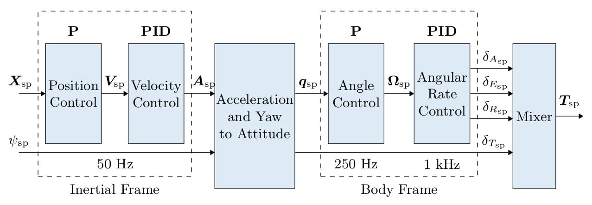

*Hình 1. Kiến trúc điều khiển multicopter; sơ đồ gốc của PX4.*

- Đây là kiến trúc điều khiển nối tầng (cascaded control) tiêu chuẩn.
- Các bộ điều khiển (controller) kết hợp điều khiển P và PID.
- Các giá trị ước lượng (estimate) được cung cấp bởi [EKF2](https://docs.px4.io/main/en/advanced_config/tuning_the_ecl_ekf).
- Tùy chế độ, vòng ngoài (outer loop) điều khiển vị trí có thể được bỏ qua; điều này được biểu diễn bằng bộ chọn tín hiệu (signal selector) sau vòng ngoài. Vòng vị trí (position control loop) chỉ được sử dụng khi giữ vị trí (position hold) hoặc khi vận tốc yêu cầu trên một trục bằng 0.

### 1.1. Bộ điều khiển tốc độ góc (angular-rate controller) multicopter

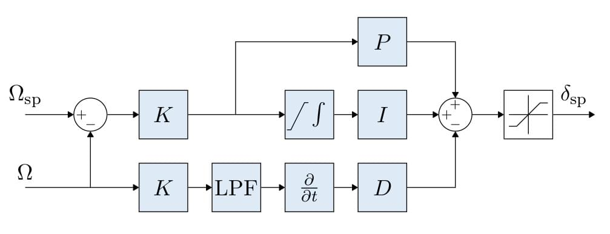

*Hình 2. Vòng điều khiển tốc độ góc (angular-rate control loop) — angular rate.*

- Sử dụng bộ điều khiển K-PID. Xem [Rate Controller](https://docs.px4.io/main/en/config_mc/pid_tuning_guide_multicopter#rate-controller) để biết thêm chi tiết.
- Mức tác động của thành phần tích phân (integral term) được giới hạn để tránh tích lũy quá mức, hay *windup*.
- Đầu ra được giới hạn trong mô-đun phân bổ điều khiển (control allocation), thông thường trong khoảng −1 đến +1.
- Bộ lọc thông thấp (low-pass filter, LPF) được dùng trên nhánh đạo hàm (derivative) để giảm nhiễu. Driver gyro cung cấp tín hiệu đạo hàm đã lọc cho bộ điều khiển.

> **Thông tin — Chuỗi xử lý IMU**
>
> Dữ liệu gyro → áp dụng các tham số hiệu chuẩn (calibration) → loại bỏ bias ước lượng → bộ lọc notch (`IMU_GYRO_NF0_BW` và `IMU_GYRO_NF0_FRQ`) → bộ lọc thông thấp (`IMU_GYRO_CUTOFF`) → `vehicle_angular_velocity` (**tốc độ góc đã lọc, dùng cho P và I**) → lấy đạo hàm → bộ lọc thông thấp (`IMU_DGYRO_CUTOFF`) → `vehicle_angular_acceleration` (**gia tốc góc (angular acceleration) đã lọc, dùng cho D**).

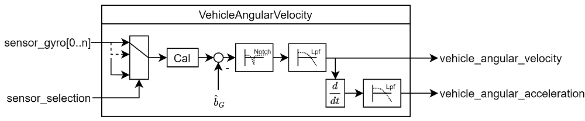

*Hình 3. Các bước hiệu chuẩn, bù bias và lọc trước khi đưa tín hiệu vào P/I/D.*

### 1.2. Bộ điều khiển tư thế (attitude controller) multicopter

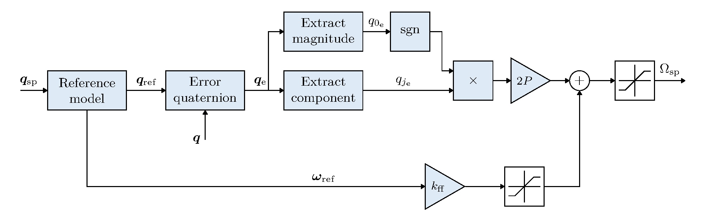

*Hình 4. Vòng điều khiển tư thế (attitude control loop) — attitude — tạo lệnh tốc độ góc.*

- Bộ điều khiển tư thế (attitude controller) sử dụng [quaternion](https://en.wikipedia.org/wiki/Quaternion).
- Bộ điều khiển được triển khai dựa trên [bài báo được PX4 dẫn chiếu](https://www.research-collection.ethz.ch/bitstream/handle/20.500.11850/154099/eth-7387-01.pdf).
- Tư thế đặt trước tiên được làm trơn bằng mô hình tham chiếu (reference model) bậc hai có tắt dần tới hạn (critical damping), với tham số `MC_REF_W_N`. Luật điều khiển P bám tư thế tham chiếu đó; tốc độ góc trong hệ thân (body frame) do mô hình tạo ra được đưa thẳng vào lệnh rate theo nhánh feedforward, loại bỏ độ trễ (delay) bám ở trạng thái xác lập (steady state) của luật P thuần túy.
- Feedforward được nhân với `MC_REF_FF`; đặt bằng `0` để tắt. Nó được giới hạn theo từng trục bằng `MC_REF_FF_MAX` và bị vô hiệu hóa trong quá trình autotuning.
- Tăng `MC_REF_W_N` hoặc `MC_REF_FF` làm đáp ứng bám (tracking response) mạnh hơn nhưng cũng yêu cầu tốc độ góc đỉnh lớn hơn. Gain P vẫn là tham số chỉnh chính.
- Lệnh tốc độ góc được giới hạn biên.

### 1.3. Chuyển lệnh gia tốc thành lực đẩy và tư thế đặt

- Các lệnh gia tốc do bộ điều khiển vận tốc (velocity controller) tạo ra được chuyển thành lệnh lực đẩy (thrust) và lệnh tư thế.
- Các giá trị lực đẩy sau chuyển đổi được giới hạn và phân bổ ưu tiên giữa phương thẳng đứng và phương ngang.
- Giới hạn lực đẩy được thực hiện sau khi tính các thành phần tương ứng:

  1. Tính lực đẩy thẳng đứng cần thiết: `thrust_z`.
  2. Giới hạn `thrust_z` bằng `MPC_THR_MAX`.
  3. Giới hạn `thrust_xy` bằng:

     $$
     \sqrt{\mathrm{MPC\_THR\_MAX}^{2}-\mathrm{thrust\_z}^{2}}
     $$

Chi tiết triển khai nằm trong `PositionControl.cpp` và `ControlMath.cpp`.

### 1.4. Bộ điều khiển vận tốc (velocity controller) multicopter

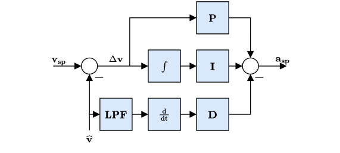

*Hình 5. Vòng vận tốc (velocity control loop) tạo lệnh gia tốc.*

- Sử dụng PID để ổn định vận tốc; đầu ra là gia tốc yêu cầu.
- Bộ tích phân (integrator) có cơ chế chống windup ARW bằng phương pháp chặn tích phân (integration), hay *clamping*.
- Gia tốc yêu cầu **không được giới hạn trực tiếp tại đây**. Việc giới hạn được áp dụng lên lực đẩy sau chuyển đổi, kết hợp với giới hạn góc nghiêng lớn nhất.
- Gain theo phương ngang được đặt bằng `MPC_XY_VEL_P_ACC`, `MPC_XY_VEL_I_ACC` và `MPC_XY_VEL_D_ACC`.
- Gain theo phương thẳng đứng được đặt bằng `MPC_Z_VEL_P_ACC`, `MPC_Z_VEL_I_ACC` và `MPC_Z_VEL_D_ACC`.

### 1.5. Bộ điều khiển vị trí (position controller) multicopter

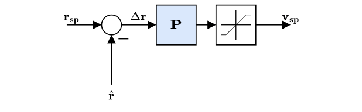

*Hình 6. Vòng vị trí (position control loop) dùng P để tạo lệnh vận tốc.*

- Đây là bộ điều khiển P đơn giản, tạo lệnh vận tốc.
- Vận tốc yêu cầu được giới hạn trong một khoảng nhất định. Tham số `MPC_XY_VEL_MAX` quy định vận tốc ngang tối đa được phép. Nó khác với tốc độ **mong muốn** tối đa `MPC_XY_CRUISE` trong chế độ tự động và `MPC_VEL_MANUAL` trong chế độ điều khiển vị trí bằng tay.
- Gain P phương ngang được đặt bằng `MPC_XY_P`.
- Gain P phương thẳng đứng được đặt bằng `MPC_Z_P`.

#### Sơ đồ kết hợp bộ điều khiển vị trí (position controller) và vận tốc

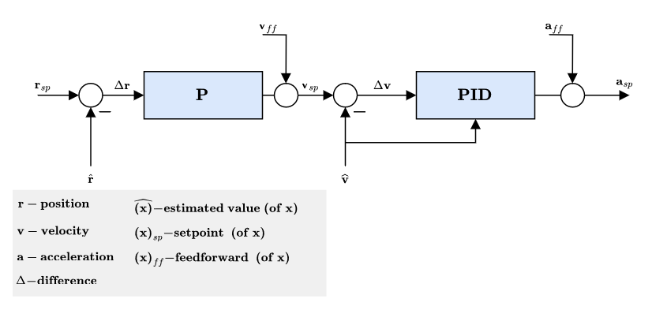

*Hình 7. Vị trí/vận tốc kết hợp với các nhánh feedforward.*

- Các nhánh feedforward, ký hiệu `ff`, phụ thuộc chế độ. Ví dụ, bộ tạo quỹ đạo (trajectory generator) trong Mission mode có giới hạn jerk sẽ tính các giá trị đặt (setpoint) vị trí, vận tốc và gia tốc.
- Lệnh gia tốc trong hệ quán tính (inertial frame) được chuyển đổi, cùng với yaw đặt, thành tư thế đặt dạng quaternion và lực đẩy tổng (collective thrust) đặt.

## 2. Bộ điều khiển vị trí (position controller) máy bay cánh cố định

### 2.1. Hệ thống điều khiển năng lượng toàn phần — TECS

TECS trong PX4 cho phép điều khiển đồng thời tốc độ không khí thực (true airspeed, TAS) và độ cao (altitude) của máy bay cánh cố định (fixed-wing). Code được tổ chức thành một thư viện, sử dụng trong mô-đun điều khiển vị trí cánh cố định.

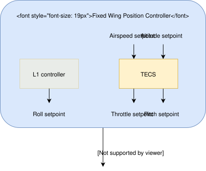

*Hình 8. Quan hệ giữa TECS, lệnh ga (throttle), lệnh Pitch và bộ điều khiển tư thế (attitude controller).*

Như sơ đồ cho thấy, TECS nhận giá trị đặt (setpoint) tốc độ không khí (airspeed) và độ cao, sau đó tạo giá trị đặt ga và góc Pitch. Các đầu ra này được chuyển tới bộ điều khiển tư thế (attitude controller) cánh cố định để thực hiện điều khiển. Tuy nhiên, lệnh ga được truyền thẳng nếu giá trị hữu hạn và không phát hiện hỏng động cơ.

Vì vậy, hiệu quả TECS phụ thuộc trực tiếp vào chất lượng vòng điều khiển Pitch. Bám tốc độ không khí hoặc độ cao kém thường có thể bắt nguồn từ việc bám góc Pitch kém.

> **Thông tin:** Hãy hiệu chỉnh bộ điều khiển tư thế (attitude controller) trước khi hiệu chỉnh TECS.

Điều khiển đồng thời tốc độ không khí và độ cao là một bài toán không đơn giản:

- Tăng góc Pitch làm tăng độ cao nhưng đồng thời làm giảm tốc độ không khí.
- Tăng ga làm tăng tốc độ không khí, đồng thời có thể tăng độ cao do lực nâng (lift) tăng.

Như vậy, cả hai đầu vào — Pitch và ga — đều tác động lên cả hai đầu ra — tốc độ không khí và độ cao.

TECS giải quyết bằng cách biểu diễn bài toán theo năng lượng thay vì trực tiếp theo các giá trị đặt ban đầu. Năng lượng toàn phần (total energy) của máy bay là tổng động năng (kinetic energy) và thế năng (potential energy). Lực đẩy (thrust), thông qua điều khiển ga, làm tăng năng lượng toàn phần. Cùng một mức năng lượng toàn phần có thể được tạo thành từ nhiều tổ hợp động năng và thế năng.

Nói cách khác, xét về tổng năng lượng, bay cao với tốc độ chậm có thể tương đương bay thấp với tốc độ nhanh. Sự phân chia này được gọi là cân bằng năng lượng riêng (specific energy) và được tính từ độ cao hiện tại cùng tốc độ không khí thực đặt. Góc Pitch điều khiển sự phân chia năng lượng: tăng Pitch chuyển động năng thành thế năng; Pitch âm thực hiện chuyển đổi ngược lại.

Do đó, bài toán được tách thành những đại lượng năng lượng có thể điều khiển độc lập: dùng lực đẩy điều chỉnh tổng năng lượng riêng, dùng Pitch duy trì cân bằng giữa thế năng — độ cao — và động năng — tốc độ.

#### Vòng điều khiển năng lượng toàn phần (total-energy control loop)

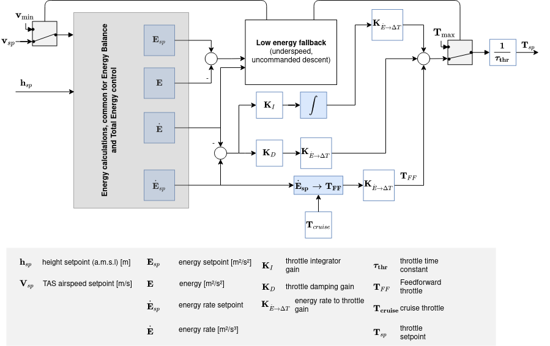

*Hình 9. Vòng điều khiển tổng năng lượng.*

#### Vòng điều khiển cân bằng năng lượng toàn phần (energy-balance control loop)

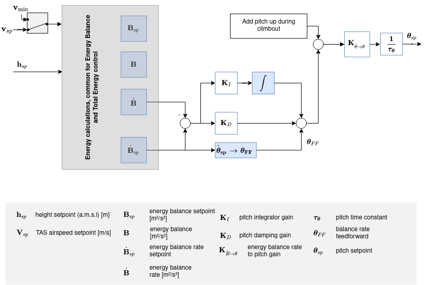

*Hình 10. Vòng điều khiển sự phân chia giữa thế năng và động năng.*

Năng lượng toàn phần của máy bay:

$$
E_T=\frac{1}{2}mV_T^2+mgh
$$

Lấy đạo hàm (derivative) theo thời gian, ta có tốc độ thay đổi năng lượng toàn phần:

$$
\dot{E}_T=mV_T\dot{V}_T+mg\dot{h}
$$

Chia cho khối lượng, ta được tốc độ thay đổi năng lượng toàn phần riêng — trên một đơn vị khối lượng — có đơn vị m²/s³:

$$
\dot{E}_s=\frac{\dot{E}_T}{m}=V_T\dot{V}_T+g\dot{h}
$$

Chia tiếp cho $gV_T$, ta được tốc độ thay đổi năng lượng chuẩn hóa (normalization), không có thứ nguyên (dimensionless):

$$
\dot{E}=\frac{\dot{E}_s}{gV_T}
=\frac{\dot{V}_T}{g}+\frac{\dot{h}}{V_T}
=\frac{\dot{V}_T}{g}+\sin(\gamma)
$$

Trong đó $\gamma$ là góc đường bay (flight-path angle). Khi $\gamma$ nhỏ:

$$
\dot{E}\approx\frac{\dot{V}_T}{g}+\gamma
$$

Từ phương trình động lực học (dynamics) máy bay:

$$
T-D=mg\left(\frac{\dot{V}_T}{g}+\sin(\gamma)\right)
\approx mg\left(\frac{\dot{V}_T}{g}+\gamma\right)
$$

Trong đó $T$ là lực đẩy và $D$ là lực cản (drag). Khi bay ngang, lực đẩy ban đầu được cân chỉnh để cân bằng lực cản; sự thay đổi lực đẩy dẫn đến:

$$
\Delta T=mg\left(\frac{\dot{V}_T}{g}+\gamma\right)
$$

Ta thấy $\Delta T$ tỷ lệ với $\dot{E}$, vì vậy lệnh lực đẩy được dùng để điều khiển tổng năng lượng.

Ngược lại, tác động của cánh lái độ cao (elevator) bảo toàn năng lượng và được dùng để trao đổi thế năng với động năng. Tốc độ thay đổi cân bằng năng lượng riêng được định nghĩa:

$$
\dot{B}_s=g\dot{h}-V_T\dot{V}_T
$$

Dạng chuẩn hóa:

$$
\dot{B}=\frac{\dot{B}_s}{gV_T}
\approx\gamma-\frac{\dot{V}_T}{g}
$$

TECS tính các tốc độ thay đổi năng lượng ở dạng riêng, đơn vị m²/s³. Chỉ khi tạo góc Pitch đặt, tốc độ thay đổi cân bằng năng lượng mới được đổi sang dạng chuẩn hóa, tương đương một góc đường bay.

#### Trọng số giữa tốc độ và độ cao

`FW_T_SPDWEIGHT` xác định trọng số của sai số tốc độ so với sai số (error) độ cao trong vòng Pitch:

- `0`: chỉ điều khiển độ cao; cũng được dùng khi bay không có cảm biến tốc độ không khí.
- `2`: chỉ điều khiển tốc độ; dành cho tàu lượn.
- Mặc định `1`: coi hai loại sai số có trọng số bằng nhau.

Pitch chỉ dùng việc đổi độ cao lấy tốc độ đến tốc độ không khí cân chỉnh — trim airspeed, `FW_AIRSPD_TRIM`. Tăng tốc vượt mức trim thuộc nhiệm vụ của ga. Khi tốc độ đặt cao hơn trim, hành vi vòng Pitch phụ thuộc tốc độ đo được:

- **Dưới trim:** Pitch đổi độ cao lấy tốc độ, nhưng chỉ nhắm tới tốc độ trim.
- **Giữa trim và tốc độ đặt:** Pitch bỏ qua sai số tốc độ và chỉ giữ độ cao (altitude hold). Nó không hạ độ cao để tăng tốc, cũng không ngẩng lên để biến phần tăng tốc do ga thành tăng độ cao. Nếu ga chạm `FW_THR_MAX`, máy bay giữ độ cao và ổn định ở tốc độ thấp hơn giá trị yêu cầu (setpoint).
- **Trên tốc độ đặt:** Pitch đổi tốc độ lấy độ cao để sửa tình trạng quá tốc (overspeed).

Khi tốc độ đặt bằng hoặc thấp hơn trim, không có vùng giữa. Pitch và ga cùng tham gia điều khiển tốc độ theo trọng số `FW_T_SPDWEIGHT`.

Các vùng trên áp dụng tới trọng số tốc độ bằng 1, rồi được giảm tác dụng dần khi trọng số tăng từ 1 lên 2. Với trọng số 2, riêng Pitch sẽ bám toàn bộ tốc độ đặt. Vì tàu lượn không có ga để tăng tốc nên dùng `FW_T_SPDWEIGHT=2`. Trọng số cũng tự tăng về gần 2 trong phục hồi thiếu tốc (underspeed) và hạ nhanh, để Pitch tiếp tục được dùng đạt tốc độ đặt.

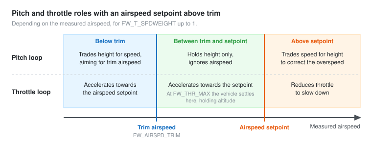

*Hình 11. Dưới trim: Pitch đổi độ cao lấy tốc độ; giữa trim và tốc độ đặt: Pitch giữ độ cao, ga tăng tốc; trên tốc độ đặt: Pitch đổi tốc độ lấy độ cao và ga giảm. Hình này được nhúng trực tiếp trong HTML nguồn và đã được lưu thành SVG cục bộ.*

## 3. Bộ điều khiển tư thế (attitude controller) máy bay cánh cố định

### 3.1. Điều chỉnh giá trị đặt

Phần lớn máy bay cánh cố định (fixed-wing) không thể duy trì tốc độ Yaw chỉ bằng cánh lái hướng (rudder). Vì vậy, cần loại thành phần Yaw khỏi sai số tư thế (attitude error) quaternion trước khi tính tác động điều khiển.

Điều này được thực hiện bằng cách nhân bên trái quaternion đặt với một phép quay quanh trục hướng xuống của hệ toàn cục. Phép quay bổ sung triệt tiêu thành phần Yaw của sai số tư thế trong khi bảo toàn Roll và Pitch.

Độ lệch Yaw:

$$
\psi=-2\frac{
\hat{q}_0q_3-\hat{q}_1q_2+\hat{q}_2q_1-\hat{q}_3q_0
}{
\hat{q}_0q_0-\hat{q}_1q_1-\hat{q}_2q_2+\hat{q}_3q_3
}
$$

Quaternion biểu diễn độ lệch Yaw:

$$
\mathbb{Q}_{\mathrm{yaw}}
=\operatorname{normalize}\left(
\begin{bmatrix}1&0&0&\frac{\psi}{2}\end{bmatrix}
\right)
$$

Quaternion đặt sau hiệu chỉnh:

$$
\mathbb{Q}_{\mathrm{sp,corrected}}
=\mathbb{Q}_{\mathrm{yaw}}\otimes\mathbb{Q}_{\mathrm{sp}}
$$

### 3.2. Bộ điều khiển tư thế (attitude controller) dựa trên quaternion

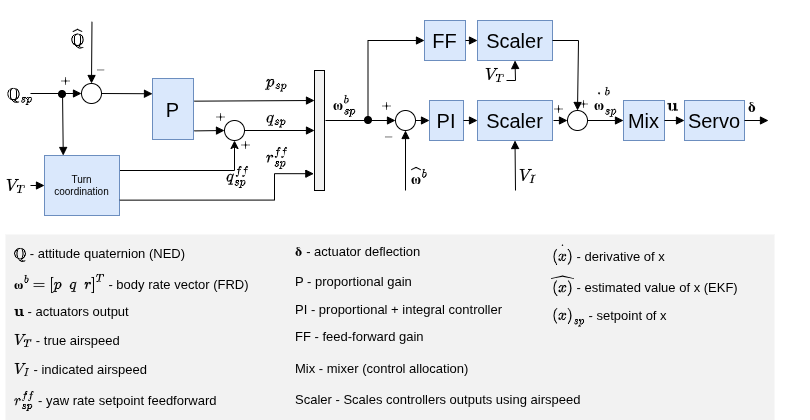

*Hình 12. bộ điều khiển tư thế (attitude controller) và tốc độ góc (angular rate) máy bay cánh cố định.*

Bộ điều khiển tư thế (attitude controller) dùng phương pháp nối tầng:

- Vòng ngoài (outer loop) tính sai số (error) giữa tư thế đặt và tư thế ước lượng. Sai số nhân với gain P tạo tốc độ góc đặt.
- Vòng trong (inner loop) tính sai số tốc độ góc và dùng PI — tỷ lệ và tích phân (integration) — để tạo gia tốc góc (angular acceleration) yêu cầu.

Góc lệch của các cơ cấu điều khiển như cánh liệng (aileron), cánh lái độ cao (elevator), cánh lái hướng được tính từ gia tốc góc yêu cầu và kiến thức sẵn có về hệ, thông qua phân bổ điều khiển (control allocation), còn gọi là mixing.

Vì bề mặt điều khiển (control surface) hiệu quả hơn ở tốc độ cao và kém hiệu quả hơn ở tốc độ thấp, bộ điều khiển được tune tại tốc độ hành trình (cruise airspeed) sẽ được hiệu chỉnh theo tốc độ không khí (airspeed) đo được, nếu có cảm biến đó.

> **Thông tin:** Nếu không dùng cảm biến tốc độ không khí, việc thay đổi gain theo tốc độ của bộ điều khiển tư thế (attitude controller) cánh cố định bị tắt, tức làm việc vòng hở (open loop) đối với ảnh hưởng tốc độ không khí. TECS cũng không có phản hồi (feedback) tốc độ không khí để hiệu chỉnh theo phép đo đó.

Gain feedforward được dùng bù giảm chấn (damping) khí động. Về cơ bản, hai thành phần mô-men (torque) quanh các trục thân là:

- Mô-men do bề mặt điều khiển tạo ra, gây chuyển động quay.
- Mô-men giảm chấn khí động, tỷ lệ với tốc độ góc thân và chống lại chuyển động quay.

Để duy trì tốc độ góc không đổi, có thể bù phần giảm chấn bằng feedforward trong vòng rate (angular-rate control loop).

### 3.3. Phối hợp vòng rẽ

Tốc độ Yaw đặt được tính theo ràng buộc vòng rẽ phối hợp (coordinated turn) để giảm gia tốc ngang khi máy bay bị trượt ngang:

$$
r_{sp}=\frac{2g}{V_T}(q_0q_1+q_2q_3)
$$

Điều này cũng giúp chống [Yaw ngược do cánh liệng — adverse yaw](https://youtu.be/sNV_SDDxuWk) và giảm [dao động Dutch roll](https://en.wikipedia.org/wiki/Dutch_roll) bằng cách bổ sung giảm chấn theo hướng.

Để bù tốc độ Pitch khác 0 xuất hiện tự nhiên trong vòng rẽ phối hợp, một thành phần feedforward dựa trên hình học được cộng vào lệnh tốc độ Pitch. Thành phần này xét tư thế và tốc độ không khí hiện tại để bộ điều khiển không phải tự tạo toàn bộ chuyển động cần thiết chỉ bằng phản hồi:

$$
q_{sp}^{ff}
=\frac{4g(q_0q_1+q_2q_3)^2}
{V(1-2q_1^2-2q_2^2)}
$$

## 4. Bộ điều khiển bay VTOL

*Hình 13. Chuyển đổi và phối hợp điều khiển multicopter/cánh cố định (fixed-wing) trong VTOL.*

Phần này trình bày khái quát cấu trúc điều khiển máy bay cất/hạ cánh thẳng đứng — VTOL.

Bộ điều khiển (controller) VTOL bao gồm cả bộ điều khiển multicopter và cánh cố định. Hai nhóm chạy riêng trong chế độ tương ứng hoặc cùng hoạt động khi chuyển tiếp (transition). Hình trên là sơ đồ giản lược.

Khối điều khiển tư thế (attitude) VTOL chủ yếu thực hiện logic chuyển đổi và phối hợp giữa các chế độ, cùng những tác động điều khiển riêng của từng loại VTOL trong chuyển tiếp. Ví dụ: tăng dần motor đẩy của VTOL tiêu chuẩn khi chuyển sang bay tiến. Các đầu vào của khối được gọi là “ảo” vì tùy chế độ, một số đầu vào sẽ không được sử dụng.

Đối với VTOL tiêu chuẩn và loại xoay rotor — tilt-rotor — trong giai đoạn chuyển tiếp, bộ điều khiển tư thế (attitude controller) cánh cố định tạo các tốc độ góc (angular rate) đặt. Chúng được đưa tới các bộ điều khiển rate (angular-rate controller) riêng để tạo lệnh mô-men (torque) cho cơ cấu chấp hành (actuator) multicopter và cánh cố định. Với tailsitter, bộ điều khiển tư thế (attitude controller) multicopter hoạt động trong giai đoạn chuyển tiếp.

Đầu ra của khối tư thế VTOL là các lệnh mô-men và lực riêng cho hai nhóm cơ cấu chấp hành, tương ứng hai instance của `vehicle_torque_setpoint` và `vehicle_thrust_setpoint`. Chúng được xử lý bởi lớp phân bổ điều khiển (control allocation) phù hợp từng cấu hình máy bay.

Xem [VTOL Configuration](https://docs.px4.io/main/en/config_vtol/) để biết thêm về hiệu chỉnh logic chuyển tiếp.

## 5. Hiệu chỉnh theo tốc độ không khí — Airspeed Scaling

Phần này giải thích bằng phương trình vì sao và bằng cách nào đầu ra bộ điều khiển rate (angular-rate controller) PI và feedforward FF được hiệu chỉnh theo tốc độ không khí (airspeed) để cải thiện chất lượng điều khiển.

Trước tiên xét phương trình mô-men (torque) có thứ nguyên (dimensional) giản lược quanh trục Roll, sau đó xem ảnh hưởng tốc độ không khí lên việc tạo mô-men trực tiếp và lên chuyển động Roll có tốc độ không đổi.

Như sơ đồ tư thế (attitude) cánh cố định (fixed-wing) thể hiện, các bộ điều khiển rate (angular-rate controller) tạo gia tốc góc (angular acceleration) đặt cho bộ phân bổ điều khiển (control allocator), tại đây gọi là mixer. Để tạo gia tốc góc đó, mixer tạo mô-men bằng những bề mặt khí động hiện có. Ví dụ, máy bay thông thường có hai cánh liệng (aileron), hai cánh lái độ cao (elevator) và một cánh lái hướng (rudder).

Mô-men do các bề mặt điều khiển (control surface) tạo ra phụ thuộc mạnh vào tốc độ không khí tương đối và mật độ không khí (air density), chính xác hơn là áp suất động (dynamic pressure). Nếu không hiệu chỉnh theo tốc độ, bộ điều khiển tune sát tại một tốc độ hành trình (cruise airspeed) có thể làm máy bay dao động khi nhanh hơn hoặc bám kém khi chậm hơn.

Cần phân biệt [tốc độ không khí thực — TAS](https://en.wikipedia.org/wiki/True_airspeed) với [tốc độ không khí chỉ thị — IAS](https://en.wikipedia.org/wiki/Indicated_airspeed), vì chúng có thể khác nhau đáng kể khi không bay gần mực nước biển.

Áp suất động được định nghĩa:

$$
\bar{q}=\frac{1}{2}\rho V_T^2
$$

Trong đó $\rho$ là mật độ không khí và $V_T$ là tốc độ không khí thực (true airspeed, TAS).

Lấy trục Roll làm ví dụ cho phần còn lại, mô-men Roll có thứ nguyên:

$$
\ell=\frac{1}{2}\rho V_T^2SbC_\ell=\bar{q}SbC_\ell
$$

Trong đó $\ell$ là mô-men Roll, $b$ là sải cánh, $S$ là diện tích tham chiếu.

Hệ số mô-men Roll không thứ nguyên (dimensionless) $C_\ell$ được mô hình hóa bằng hệ số hiệu quả cánh liệng $C_{\ell_{\delta_a}}$, hệ số giảm chấn (damping) Roll $C_{\ell_p}$ và hệ số ảnh hưởng góc chữ V $C_{\ell_\beta}$:

$$
C_\ell=C_{\ell_0}+C_{\ell_\beta}\beta
+C_{\ell_p}\frac{b}{2V_T}p
+C_{\ell_{\delta_a}}\delta_a
$$

Trong đó $\beta$ là góc trượt ngang (sideslip angle), $p$ là tốc độ góc (angular rate) Roll trong hệ thân (body frame), $\delta_a$ là góc lệch cánh liệng.

Giả sử máy bay đối xứng, $C_{\ell_0}=0$, và bay phối hợp (coordinated flight), $\beta=0$, ta chỉ còn giảm chấn Roll và mô-men do cánh liệng:

$$
\ell=\frac{1}{2}\rho V_T^2Sb
\left[C_{\ell_{\delta_a}}\delta_a
+C_{\ell_p}\frac{b}{2V_T}p\right]
$$

Phương trình này làm cơ sở cho hai phần tiếp theo để xác định cách hiệu chỉnh bộ PI và FF theo tốc độ không khí.

### 5.1. Hiệu chỉnh mô-men tĩnh — PI

Khi tốc độ góc bằng 0, $p=0$, thành phần giảm chấn biến mất. Một mô-men không đổi tại thời điểm xét được tạo bằng:

$$
\ell=\frac{1}{2}\rho V_T^2SbC_{\ell_{\delta_a}}\delta_a
=\bar{q}SbC_{\ell_{\delta_a}}\delta_a
$$

Rút $\delta_a$ theo biểu thức trên trang nguồn:

$$
\delta_a=\frac{2bS}{C_{\ell_{\delta_a}}}
\frac{1}{\rho V_T^2}\ell
=\frac{bS}{C_{\ell_{\delta_a}}}\frac{1}{\bar{q}}\ell
$$

Phân số thứ nhất là hằng số, còn phân số thứ hai phụ thuộc mật độ không khí và bình phương tốc độ không khí thực. **Ghi chú đối chiếu đại số của người dịch được đặt ở cuối tài liệu; công thức trên giữ theo trang nguồn.**

Thay vì dùng riêng mật độ và TAS, có thể dùng IAS, ký hiệu $V_I$, vốn đã có tính đến ảnh hưởng mật độ trong quan hệ quy đổi. Ở độ cao (altitude) và tốc độ thấp, TAS được tính gần đúng:

$$
V_T=V_I\sqrt{\frac{\rho_0}{\rho}}
$$

Trong đó $\rho_0$ là mật độ không khí ở mực nước biển, nhiệt độ 15°C.

Bình phương, sắp xếp lại và nhân hai vế với $1/2$:

$$
\bar{q}=\frac{1}{2}\rho V_T^2
=\frac{1}{2}V_I^2\rho_0
$$

Vì vậy, áp suất động tỷ lệ với bình phương IAS:

$$
\bar{q}\propto V_I^2
$$

Hệ số hiệu chỉnh trước đó chứa TAS và mật độ không khí được viết chỉ theo IAS, theo trang nguồn:

$$
\delta_a=\frac{2bS}{C_{\ell_{\delta_a}}\rho_0}
\frac{1}{V_I^2}\ell
$$

### 5.2. Hiệu chỉnh nhánh tốc độ góc — FF

Tác dụng chính của feedforward trong vòng rate (angular-rate control loop) là bù giảm chấn tự nhiên của tốc độ góc. Trở lại phương trình mô-men cơ sở, nhưng lần này xét Roll với tốc độ không đổi: mô-men do cánh liệng phải cân bằng chính xác giảm chấn:

$$
-C_{\ell_{\delta_a}}\delta_a
=C_{\ell_p}\frac{b}{2V_T}p
$$

Sắp xếp để tìm góc lệch cánh liệng lý tưởng:

$$
\delta_a=-\frac{bC_{\ell_p}}{2C_{\ell_{\delta_a}}}
\frac{1}{V_T}p
$$

Phân số đầu cho giá trị feedforward lý tưởng. Biểu thức cho thấy phần hiệu chỉnh đầu ra tỷ lệ nghịch với TAS. Dấu âm được gộp vào hệ số giảm chấn Roll, vốn cũng mang dấu âm.

### 5.3. Kết luận

Đầu ra PI của vòng rate (angular-rate control loop) được hiệu chỉnh theo bình phương IAS; đầu ra FF được hiệu chỉnh theo TAS. Cụ thể:

$$
\delta_a=
\frac{V_{I_0}^{2}}{V_I^{2}}\delta_{a_{PI}}
+\frac{V_{T_0}}{V_T}\delta_{a_{FF}}
$$

Trong đó $V_{I_0}$ và $V_{T_0}$ là IAS và TAS tại điều kiện trim.

Vì đầu ra cơ cấu chấp hành (actuator) được chuẩn hóa (normalization) và giả sử mixer cùng servo tuyến tính (linear), có thể viết lại:

$$
\dot{\boldsymbol{\omega}}_{sp}^{b}
=\frac{V_{I_0}^{2}}{V_I^{2}}\dot{\boldsymbol{\omega}}_{sp_{PI}}^{b}
+\frac{V_{T_0}}{V_T}\dot{\boldsymbol{\omega}}_{sp_{FF}}^{b}
$$

Biểu thức này được triển khai trực tiếp trong các bộ điều khiển tốc độ Roll, Pitch và Yaw.

Đối với cấu hình có hiệu quả điều khiển không phụ thuộc trực tiếp tốc độ không khí, ví dụ [autogyro](https://docs.px4.io/main/en/frames_autogyro/), có thể tắt tính năng hiệu chỉnh này bằng `FW_ARSP_SCALE_EN`.

### 5.4. Khuyến nghị hiệu chỉnh

Ưu điểm của thuật toán hiệu chỉnh theo tốc độ không khí là nó không đòi hỏi bước tune riêng. Tuy nhiên, chất lượng phép đo tốc độ không khí ảnh hưởng trực tiếp đến hiệu quả của thuật toán.

Để có miền bay ổn định rộng nhất, nên tune bộ điều khiển tư thế (attitude controller) tại tốc độ nằm giữa tốc độ thất tốc (stall speed) và tốc độ lớn nhất. Ví dụ, máy bay bay được trong khoảng 15–25 m/s thì nên tune ở 20 m/s. Đặt tốc độ dùng để tune này qua `FW_AIRSPD_TRIM`.

## 6. Thuật ngữ để đọc sơ đồ

*Phần hỗ trợ do người dịch bổ sung; không phải một mục của trang nguồn.*

### 6.1. Tên các vòng và bộ điều khiển

“Vòng” (loop) là chuỗi điều khiển có đường phản hồi; “bộ điều khiển” (controller) là khối tính lệnh nằm trong chuỗi đó. Vì vậy vòng vị trí (position control loop) và bộ điều khiển vị trí (position controller) có liên hệ nhưng không phải hai tên hoàn toàn đồng nghĩa.

| Thuật ngữ tiếng Việt | Tiếng Anh tương đương | Cách hiểu trong chuỗi điều khiển đang giải thích |
| --- | --- | --- |
| Vòng vị trí | Position control loop | Dùng sai số vị trí để điều chỉnh chuyển động; trong sơ đồ PX4, controller tạo vận tốc đặt |
| Vòng vận tốc | Velocity control loop | Bám vận tốc tịnh tiến; trong sơ đồ PX4, controller tạo gia tốc đặt |
| Vòng tư thế | Attitude control loop | Bám hướng thân trong không gian; tạo yêu cầu tốc độ góc |
| Vòng góc | Angle control loop | Cách gọi vòng dùng sai số góc; trong ví dụ một trục tương ứng phần Outer |
| Vòng tốc độ góc / vòng rate | Angular-rate control loop / rate loop | Bám tốc độ quay đo từ gyro, tạo yêu cầu mô-men hoặc tác động điều khiển |
| Vòng độ cao | Altitude control loop | Giữ hoặc thay đổi độ cao; không đồng nghĩa vòng tư thế |
| Vòng ga | Throttle control loop | Vòng sử dụng lệnh ga để thực hiện mục tiêu, chẳng hạn năng lượng toàn phần trong TECS |
| Vòng ngoài / vòng trong | Outer loop / inner loop | Quan hệ nối tầng: vòng ngoài tạo mục tiêu cho vòng trong |
| Vòng kín / vòng hở | Closed loop / open loop | Có / không sử dụng phản hồi đầu ra cho tác động điều khiển đang xét |
| Bộ điều khiển vị trí | Position controller | Khối tính lệnh từ sai số vị trí |
| Bộ điều khiển vận tốc | Velocity controller | Khối tính lệnh từ sai số vận tốc tịnh tiến |
| Bộ điều khiển tư thế | Attitude controller | Khối tính lệnh từ sai số hướng hoặc góc thân |
| Bộ điều khiển tốc độ góc | Angular-rate controller / rate controller | Khối xử lý sai số tốc độ quay |
| Vòng năng lượng toàn phần | Total-energy control loop | Vòng điều chỉnh tổng năng lượng trong TECS |
| Vòng cân bằng năng lượng | Energy-balance control loop | Vòng điều chỉnh sự phân chia giữa thế năng và động năng |
| Sơ đồ khối | Block diagram | Biểu diễn các khối xử lý và hướng truyền tín hiệu |
| Sai số | Error | Chênh lệch giữa giá trị yêu cầu và giá trị phản hồi theo quy ước dấu |
| Giá trị đo / giá trị ước lượng | Measurement / estimate | Kết quả đo trực tiếp / kết quả tính từ cảm biến và mô hình |
| Bộ chọn tín hiệu | Signal selector | Chọn nhánh tín hiệu được sử dụng theo chế độ |
| Bộ tạo quỹ đạo | Trajectory generator | Sinh tham chiếu chuyển động theo thời gian |
| Thành phần tích phân / bộ tích phân | Integral term / integrator | Phần đóng góp I / khối tích lũy tín hiệu theo thời gian |
| Đạo hàm | Derivative | Tốc độ thay đổi của một đại lượng |
| Chu kỳ điều khiển / thời gian lấy mẫu | Control period / sampling interval | Khoảng thời gian giữa các lần tính hoặc các mẫu |
| Tần số điều khiển / tần số lấy mẫu | Control frequency / sampling frequency | Số lần tính hoặc lấy mẫu trong một giây |
| Chuẩn hóa / không thứ nguyên | Normalization / dimensionless | Đổi về thang quy ước / không mang đơn vị vật lý |
| Gia tốc riêng | Specific force | Đại lượng trên một đơn vị khối lượng mà accelerometer cảm nhận |
| Giữ vị trí / giữ độ cao | Position hold / altitude hold | Hai mục tiêu điều khiển khác nhau |
| Quá tốc / thiếu tốc | Overspeed / underspeed | Tốc độ cao / thấp hơn vùng yêu cầu trong bối cảnh đang xét |
| Trọng tâm / mô-men quán tính | Center of gravity / moment of inertia | Vị trí tác dụng trọng lượng / đặc trưng chống thay đổi chuyển động quay |
| Đáp ứng bám | Tracking response | Cách đầu ra thực đi theo giá trị yêu cầu theo thời gian |

**Dễ nhầm:** vòng vận tốc (velocity control loop) xét chuyển động tịnh tiến, thường có đơn vị m/s. Vòng tốc độ góc (angular-rate control loop) xét chuyển động quay, thường có đơn vị °/s hoặc rad/s. Cả hai đều có thể dùng PID nhưng điều khiển hai đại lượng khác nhau.

### 6.2. Các thuật ngữ, ký hiệu còn lại

| Từ/ký hiệu trong hình | Nghĩa tiếng Việt |
|---|---|
| Setpoint, `sp` | Giá trị đặt hoặc giá trị yêu cầu |
| Position | Vị trí |
| Velocity | Vận tốc tịnh tiến; khác tốc độ quay |
| Acceleration | Gia tốc tịnh tiến |
| Attitude | Tư thế/hướng của thân máy bay trong không gian |
| Angular rate, body rate | Tốc độ góc, đo trong hệ thân |
| Angular acceleration | Gia tốc góc |
| Roll / Pitch / Yaw | Lăn / chúc-ngẩng / quay hướng |
| Thrust / collective thrust | Lực đẩy / lực đẩy tổng |
| Torque, moment | Mô-men |
| Throttle | Lệnh ga; không tự đồng nghĩa với lực đẩy đo được |
| Control allocation, mixer | Phân bổ lệnh lực/mô-men tới cơ cấu chấp hành |
| Actuator, servo | Cơ cấu chấp hành, servo |
| Feedback | Phản hồi từ tín hiệu đo hoặc ước lượng |
| Feedforward, `ff` | Nhánh tác động tính trước từ tham chiếu/mô hình |
| P / I / D | Tỷ lệ / tích phân / vi phân |
| Saturation | Giới hạn biên, bão hòa |
| Windup / anti-windup | Tích lũy I quá mức / cơ chế chống tích lũy quá mức |
| LPF / notch filter | Bộ lọc thông thấp / bộ lọc khía loại dải hẹp |
| Bias | Sai lệch nền của cảm biến |
| Quaternion | Bộ bốn số biểu diễn phép quay 3D |
| Inertial frame / body frame | Hệ quán tính / hệ tọa độ thân |
| Trim | Điều kiện cân chỉnh xác lập làm mốc |
| TAS / IAS | Tốc độ không khí thực / tốc độ không khí chỉ thị |
| Airspeed scaling | Hiệu chỉnh mức tác động theo tốc độ không khí |
| TECS | Hệ thống điều khiển năng lượng toàn phần |
| VTOL / tailsitter | Máy bay cất/hạ cánh thẳng đứng / loại cất-hạ cánh bằng tư thế dựng đuôi |
| $p,q,r$ | Các tốc độ góc Roll, Pitch, Yaw trong hệ thân |
| Gain | Hệ số điều khiển; ví dụ Kp, Ki, Kd |
| Lift / drag | Lực nâng / lực cản; khác với lệnh ga (throttle) |
| Tracking | Khả năng bám giá trị đặt |
| Overshoot | Vượt quá giá trị mục tiêu |
| Reference model | Mô hình tham chiếu |
| Critical damping | Tắt dần tới hạn |
| Damping | Giảm chấn |
| Calibration | Hiệu chuẩn |
| Control authority | Khả năng/quyền tạo tác động điều khiển trong giới hạn phần cứng |
| Delay / latency | Độ trễ; latency thường nói đến thời gian xử lý hoặc truyền tín hiệu |
| Jitter | Dao động của thời điểm hoặc khoảng thời gian thực hiện |
| Aileron / elevator / rudder | Cánh liệng / cánh lái độ cao / cánh lái hướng |
| Dynamic pressure | Áp suất động |
| Flight-path angle | Góc đường bay |
| Kinetic / potential energy | Động năng / thế năng |
| Specific energy | Năng lượng riêng, tức năng lượng trên một đơn vị khối lượng |
| Coordinated turn / sideslip angle | Vòng rẽ phối hợp / góc trượt ngang |
| Transition | Giai đoạn chuyển tiếp giữa các chế độ bay |
| $q_0,q_1,q_2,q_3$ | Các thành phần quaternion; khác ký hiệu tốc độ Pitch $q$ |
| $\bar q$ | Áp suất động; khác quaternion và tốc độ Pitch |
| $\otimes$ | Phép nhân quaternion |

## 7. Ghi chú đối chiếu công thức và nguồn

*Các ghi chú dưới đây do người dịch bổ sung, tách khỏi nội dung PX4.*

1. **Phần airspeed scaling chủ yếu nói về bề mặt khí động của cánh cố định (fixed-wing).** Không lấy trực tiếp các công thức này để chỉnh duty motor của quadcopter chỉ vì cùng xuất hiện trong trang Controller Diagrams.
2. **Công thức PI trong nguồn có điểm không nhất quán về đại số.** Từ $\ell=\bar qSbC_{\ell_{\delta_a}}\delta_a$, giải trực tiếp cho $\delta_a$ cho kết quả:

   $$
   \delta_a=\frac{\ell}{\bar qSbC_{\ell_{\delta_a}}}
   =\frac{2\ell}{\rho V_T^2SbC_{\ell_{\delta_a}}}.
   $$

   Trong khi trang nguồn đặt $bS$ trên tử ở bước rút $\delta_a$. Bản dịch giữ biểu thức của nguồn trong mục 5.1 và ghi chú sai khác tại đây, không âm thầm sửa nội dung PX4. Quan hệ tỷ lệ theo $1/V_I^2$ vẫn được thể hiện trong công thức scaling chuẩn hóa (normalization) ở mục 5.3.
3. **Nhánh FF:** công thức nguồn có hệ số $1/V_T$; phần lời gốc gọi quan hệ này là tuyến tính (linear) theo TAS. Bản dịch diễn đạt rõ quan hệ tỷ lệ nghịch theo đúng biểu thức và công thức kết luận.
4. **Ký hiệu $V$ trong công thức $q_{sp}^{ff}$** được giữ như trang nguồn; các đoạn khác dùng $V_T$. Không tự đồng nhất các ký hiệu ngoài ngữ cảnh mà nguồn cung cấp.
5. **Nhãn hình vẫn là tiếng Anh** để bảo toàn sơ đồ gốc, kể cả các chú giải bên trong. Mọi hình đều có bản cục bộ; có thể bấm liên kết ảnh trong trình xem Markdown để mở nguyên kích thước.

Nguồn chính: [Controller Diagrams — PX4 Guide](https://docs.px4.io/main/en/flight_stack/controller_diagrams). Giấy phép: [CC BY 4.0](https://creativecommons.org/licenses/by/4.0/). Thay đổi so với nguồn: dịch văn bản/chú thích sang tiếng Việt, đổi liên kết ảnh thành đường dẫn cục bộ, chuẩn hóa cách trình bày LaTeX, bổ sung mục lục/thuật ngữ/ghi chú được đánh dấu rõ.
