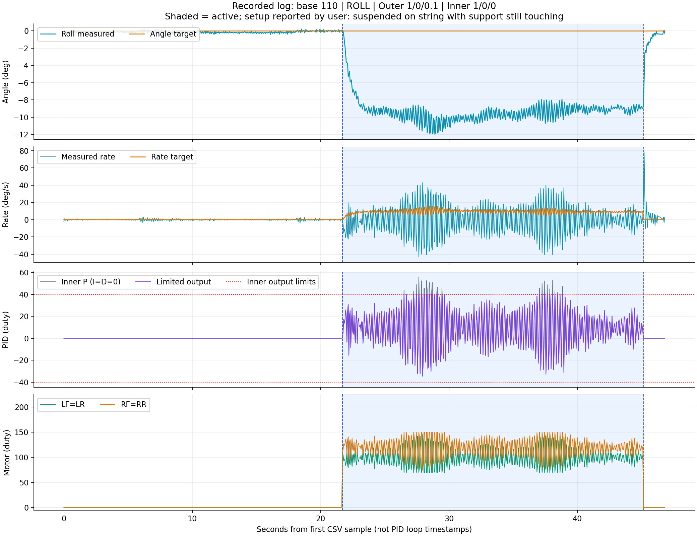

# Phân tích log PID — 24/10/2026, file 170648-270

Nguồn: [pid-20261024-170648-270.csv](pid-20261024-170648-270.csv). Phân tích dựa trên 929 dòng dữ liệu, 48 cột, dài 46.804 giây theo đồng hồ ESP32. File nguồn được giữ nguyên.

**Kết luận:** lượt này chưa chứng minh cân bằng thành công hoặc base=110 phù hợp. Trước Start, Roll gần 0°; khi chạy, góc chuyển sang khoảng −9° và rate dao động mạnh. Người dùng xác nhận drone treo trên dây nhưng phần kê vẫn chạm hoặc giữ góc. Đây là điều kiện bị ràng buộc cơ khí, chưa phải phép thử Roll được tự do quay về mục tiêu.



## 1. Cấu hình thực được ghi trong CSV

| Mục | Giá trị |
|---|---|
| Trục điều khiển | ROLL |
| Base lần Start đã được board chấp nhận | 110 duty |
| Target Roll / Pitch | 0° / 0° |
| Outer Roll Kp / Ki / Kd | 1 / 0 / 0.1 |
| Inner Roll Kp / Ki / Kd | 1 / 0 / 0 |
| Gain Pitch | Outer 1/0/0.1, Inner 1/0/0; không tham gia điều khiển trong ROLL |
| Outer output / I limit | ±45 / ±10 °/s |
| Inner output / I limit | ±40 / ±20 duty |
| Biên motor | 0–220 duty |
| Firmware build board báo | Oct 24 2026 15:36:24 |

Cấu hình này không đổi trong toàn bộ file. Các giá trị gain/base trong CSV khớp các ô nhập của ảnh. Dòng “Board gains not received” trong ảnh không chứng minh toàn bộ lượt log thiếu xác nhận: CSV có gain đã nhận ở phiên ghi dữ liệu. Không thể suy ra chính xác thời điểm ảnh chụp chỉ từ file.

`acceptedBase=110` vẫn có ở mẫu dừng vì đây là thông tin lần Start gần nhất, không có nghĩa motor đang chạy. Trạng thái chạy phải đối chiếu `active` và bốn PWM.

## 2. Ba giai đoạn của lượt thử

Thời gian dưới đây tính từ dòng dữ liệu đầu tiên, không phải giờ trên Windows:

| Giai đoạn | Khoảng thời gian | Số mẫu | Nhận xét |
|---|---|---:|---|
| Chưa chạy | 0–21.650 s | 434 | PWM=0; Roll trung bình −0.112°, độ lệch chuẩn 0.112° |
| Đang chạy | 21.700–45.100 s | 469 | Base=110; góc lệch và rate dao động; mẫu đầu đến cuối cách nhau 23.400 s |
| Đã dừng | 45.150–46.804 s | 26 | PWM=0; góc đo tiến về gần 0° khi motor đã dừng |

Mẫu đầu đang chạy: Roll=0.055°. Khoảng một giây sau Start đã tới vùng khoảng −7 đến −9°. Sau giây đầu, Roll trung bình **−9.530°**, không trở về target=0 trong phần chạy còn lại.

Mẫu cuối đang chạy: Roll=-8.938°. Mẫu cuối file sau Stop: Roll=-0.268°. Việc góc trở về gần 0 sau khi PWM=0 **không phải bằng chứng PID đã đưa drone về cân bằng**; lúc đó PID không còn điều khiển. Dây/kê, thao tác người thử hoặc thay đổi sai số đo theo trạng thái motor đều cần đối chiếu thực tế.

## 3. Các số quan trọng khi active=1

| Đại lượng | Kết quả | Cách hiểu |
|---|---:|---|
| Roll trung bình | −9.305° | Còn lệch nhiều so với target=0° |
| Roll nhỏ nhất / lớn nhất | −11.975° / +0.055° | Giá trị gần 0 chủ yếu nằm ngay lúc bắt đầu, không phải kết quả giữ cân bằng |
| Rate target trung bình | +9.343°/s | Outer chủ yếu yêu cầu quay theo chiều dương để sửa góc âm |
| Rate đo trung bình | −0.429°/s | Gần 0 khi lấy trung bình, nhưng che khuất dao động hai chiều |
| Rate đo nhỏ nhất / lớn nhất | −43.227 / +42.941 °/s | Rate biến động mạnh trong lúc motor hoạt động |
| Độ lệch chuẩn rate đo | 16.955 °/s | So với 0.747 °/s trước Start, lớn khoảng 22.7 lần; đây là độ biến động tín hiệu, chưa phân biệt rung và chuyển động thật |
| Trung bình độ lớn sai số rate | 16.736 °/s | Measured chưa theo Target tốt trong mẫu ghi được |
| Inner Output nhỏ nhất / lớn nhất | −34.622 / +40.000 duty | Có chạm biên dương của vòng tốc độ |
| Số mẫu Inner chạm biên | 27/469 = 5.76% | Tỷ lệ mẫu ghi, không phải tỷ lệ thời gian chính xác của toàn bộ vòng 200 Hz |
| Outer chạm biên ±45 | 0/469 mẫu | Giới hạn tốc độ yêu cầu chưa phải nút thắt trong dữ liệu này |
| Mixer bị cắt lệnh | 0/469 mẫu | Không ghi nhận motor yêu cầu ngoài 0–220 tại các mẫu được gửi |
| PWM nhỏ nhất / lớn nhất, cả 4 motor | 70 / 150 duty | Motor còn khoảng dự phòng lệnh điện; không chứng minh đủ lực đẩy |

LF luôn bằng LR; RF luôn bằng RR, phù hợp sửa riêng Roll. Nhóm trái trung bình 100.629 duty; nhóm phải 119.371 duty. Bộ trộn đang cố tạo chênh lệch, không phải cả bốn motor chỉ đứng ở 110.

Không nên kết luận Kp=1 tốt/xấu chỉ bằng so sánh trung bình rate với target: rate đang biến động, dây/kê tác động lên chuyển động, và Outer cũng liên tục thay đổi target. Cũng không dùng tương quan âm giữa target và rate làm bằng chứng đảo chiều vì hệ có phản hồi và Outer D.

## 4. Phép tính PID và bộ trộn có nhất quán không?

Có, trong phạm vi đối chiếu được từ file:

- `rollP = rollKp × (rollRateTarget − rollRate)` khớp trong sai số làm tròn khoảng 0.001 duty.
- `rollI=0`, `rollD=0` trong mọi mẫu đang chạy, phù hợp Inner Ki=Kd=0.
- `rollOutput = clamp(rollP, −40, +40)` khớp toàn bộ 469 mẫu.
- PWM hai phía phù hợp `110 − rollOutput` và `110 + rollOutput` với lượng tử hóa duty nguyên: sai khác so với giá trị trước làm tròn không quá 0.500 duty. Tính lại từ CSV đã làm tròn 3 chữ số có thể chênh 1 duty ở mốc nửa đơn vị; không thấy sai lệch bộ trộn có hệ thống.

Ví dụ thực trong CSV tại t=40.050 s:

```text
Roll measured = -9.445°
Rate target   = 10.029°/s
Measured rate = 0.010°/s
Inner Kp      = 1
P             = 10.019 duty
Output        = 10.019 duty
LF/LR         = 100
RF/RR         = 120
```

**Outer D đang bật, dù cột `rollD` luôn bằng 0.** Cột `rollD` là D của Inner. Với Outer Kp=1, Ki=0 và không chạm limit, có thể suy ra phần D của Outer từ `rollRateTarget + roll`; trong lượt này khoảng −4.044 đến +3.888 °/s. Vì thế rate target không chỉ đơn giản bằng `−roll` từng mẫu. Đây là suy ra từ tổng đầu ra, không phải cột Outer D được board gửi riêng.

Các kiểm tra này xác nhận số tính trong log nhất quán với code; **không xác nhận dấu lực đẩy ngoài đời hoặc vị trí motor thực tế đã đúng**.

## 5. Vì sao chưa thể dùng lượt này để chọn base và gain?

Người dùng xác nhận: **treo dây nhưng kê vẫn chạm hoặc giữ góc**. Khi đó:

1. Lực motor có thể làm đổi lực tì lên phần kê và lực căng dây.
2. Phần kê/dây có thể cản đường quay về mà PID yêu cầu.
3. Tín hiệu rate tăng mạnh có thể chứa chuyển động bị ràng buộc hoặc rung; CSV này không có gia tốc thô/ảnh chuyển động để phân biệt.
4. Nếu thân thực tế vẫn gần ngang nhưng firmware báo −9 đến −12° khi motor chạy, cần kiểm tra rung, gá IMU, nguồn và ảnh hưởng chuyển động lên ước lượng góc. Không tự coi số đo là sai, cũng không tự coi mọi biến động là chuyển động thật.

Do đó, đây là dữ liệu hữu ích để thấy **hệ phản ứng khác hẳn khi motor chạy**, nhưng chưa phải phép thử đáp ứng tự do để tìm bộ PID cân bằng tốt nhất.

Base=110 là khoảng 43.1% của thang duty 255. Motor còn biên lệnh không có nghĩa base này tối ưu; không có đo lực đẩy hoặc vòng/phút trong log. Không nên tăng base, tăng output limit, thêm I hay tăng D chỉ để cố ép góc về 0 trong khi kê đang giữ thân.

## 6. Lượt thử tiếp theo nên thay đổi gì?

### Ưu tiên điều kiện thử trước khi tăng hệ số

- Stop/disarm trước khi điều chỉnh cơ khí. Chuẩn bị đế/trục quay Roll có phạm vi giới hạn và cơ cấu giữ phù hợp, tránh kê tiếp tục khóa chuyển động cần đo. Không rút/chỉnh phần kê bằng tay gần cánh đang quay.
- Khi motor tắt, kiểm tra ngang thực tế và mốc firmware. Không dùng ZERO lúc motor đang rung để che sai lệch.
- Kiểm tra mapping và chiều sửa với cánh đã tháo. Log đúng phép tính không thay thế xác minh chiều lực đẩy.
- Khi có thể thử lực đẩy trên đế phù hợp, quan sát đồng thời góc thật và góc firmware. Nếu không tương ứng, xử lý đo/rung/cơ khí trước khi tuning.

### Tách các biến để so sánh

Lượt này vừa có base=110, Inner Kp=1 và Outer D=0.1; không có lượt đối chứng cùng điều kiện trong file để chọn biến nào là nguyên nhân.

1. Khi điều kiện thử đã phù hợp, giữ một base ứng viên đã kiểm tra, không tăng base cùng gain.
2. Để đánh giá riêng tác động Outer D, có thể so Outer 1/0/0.1 với **1/0/0**, giữ các yếu tố khác tương đương; đây là phép thử loại một thành phần, không bảo đảm tốt hơn.
3. Nếu sau đó rate/motor vẫn dao động, thử giảm riêng Inner Kp từ 1 về một mức thấp hơn có cơ sở. Không chốt ngay một con số tối ưu từ file này; giữ Ki=0, Kd=0 trong lượt đánh giá P.
4. Chỉ giữ thay đổi khi cùng bài thử cho sai số rate nhỏ hơn, góc về mục tiêu tốt hơn và dao động giảm. Log ngắn từng cấu hình riêng, ghi rõ có cánh, trạng thái dây/kê và góc bắt đầu.

Mỗi lần chỉ đổi **một yếu tố**. Nếu sửa cả cơ khí thì coi đó là điều kiện thử mới, chưa đem số đo trước/sau để quy hoàn toàn cho gain.

## 7. File này có xác nhận hết lỗi timing không?

Không. File chỉ có telemetry C2 và metadata gain/CONFIG; không chứa bản tin `TIMING` hoặc lý do Stop. Mẫu thường cách nhau 50 ms, phù hợp telemetry khoảng 20 Hz, không phải chu kỳ PID 5 ms.

Có hai khoảng cách giữa mẫu lớn hơn 100 ms:

- Từ 45.550 đến 45.650 s: 100.0 ms; active 0 → 0.
- Từ 46.254 đến 46.654 s: 399.9 ms; active 0 → 0.

Khoảng trống telemetry không tự chứng minh CPU bỏ PID hoặc gặp lỗi timing. Cũng không suy ngược rằng PID không trễ chỉ vì phần active có mẫu đều. Muốn biết vì sao dừng cần dòng trạng thái trên app và chẩn đoán timing nếu có.

## 8. Cách đọc lại biểu đồ đi kèm

- Vùng xanh nhạt là các mẫu đang chạy, không phải một mô phỏng.
- Khung đầu cho thấy góc từ gần 0 chuyển sang lệch khi motor hoạt động.
- Khung rate cho thấy lệnh chủ yếu dương nhưng measured dao động cả hai chiều.
- Khung PID phân biệt P chưa giới hạn và Output sau giới hạn ±40.
- Khung motor cho thấy hai nhóm thay đổi quanh base=110; sau Stop, cả bốn nhận lệnh 0.

**Kết luận thực hành:** chưa tăng thêm thông số từ lượt này. Hãy giải quyết ảnh hưởng của kê/dây và xác minh góc thật so với góc đo, rồi ghi lượt đối chứng thay đúng một tham số. Cấu hình trong file chưa đạt mục tiêu giữ Roll=0° theo số đo đã ghi.
