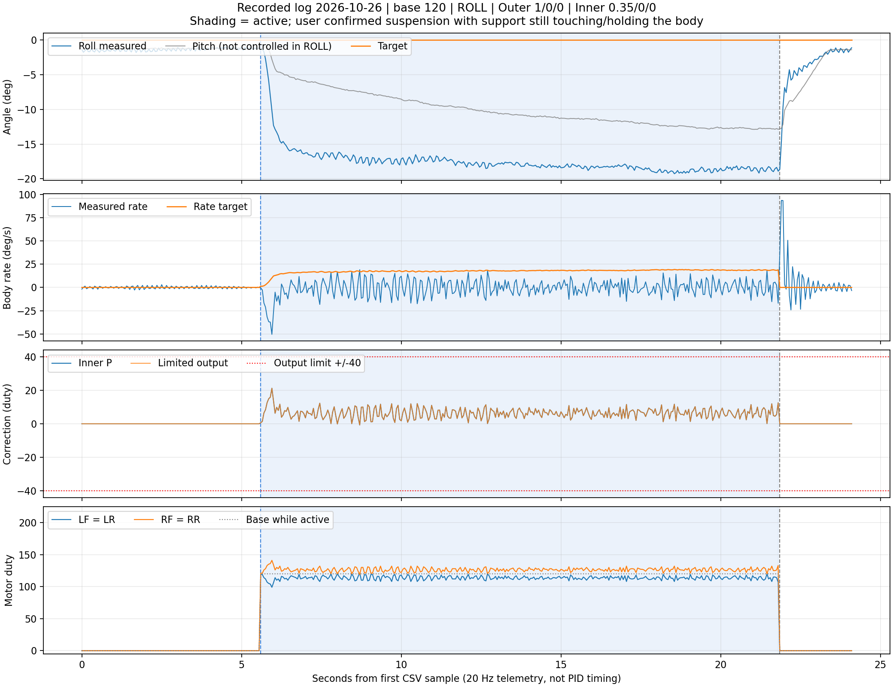

# Phân tích log PID ngày 26/10/2026 – lượt 12:25:09

Nguồn: [pid-20261026-122509-933.csv](pid-20261026-122509-933.csv). Có **483 mẫu, 48 cột, dài 24,100 s** theo timestamp ESP32. Phân tích và đồ thị dùng dữ liệu ghi được, không phải mô phỏng. CSV nguồn được giữ nguyên.

**Kết luận chính:** rate bớt dao động so với log 24/10, nhưng **chưa bám rate target và chưa giữ được Roll = 0°**. Sau giây đầu chạy, Roll trung bình −17,910°, rate yêu cầu +17,910°/s, trong khi rate đo trung bình chỉ +0,076°/s. Pitch cũng lệch đáng kể khi đang ở chế độ ROLL. Không ghi nhận chạm giới hạn PID hoặc cắt lệnh mixer trong các mẫu telemetry.

**Người dùng đã xác nhận lượt mới: treo dây nhưng vẫn có kê/chạm giữ thân.** Đây là điều kiện có ràng buộc cơ khí, chưa phải thử Roll được tự do quay về mục tiêu. CSV không ghi góc quan sát ngoài đời, nên các góc dưới đây là góc firmware báo; xác nhận thân nghiêng thật ở lượt trước không tự xác nhận chính xác góc vật lý của lượt mới.



## 1. Cấu hình thực được ghi trong file

| Mục | Giá trị |
|---|---|
| Chế độ | ROLL |
| Base lần Start đã được chấp nhận | 120 duty |
| Roll/Pitch target | 0° / 0° |
| Outer Roll/Pitch Kp / Ki / Kd | 1 / 0 / 0 |
| Inner Roll/Pitch Kp / Ki / Kd | 0,35 / 0 / 0 |
| Outer output / I limit | ±45 / ±10 °/s |
| Inner output / I limit | ±40 / ±20 duty |
| Biên motor | 0–220 duty |
| Firmware build board báo | Oct 24 2026 15:36:24 |

Cấu hình không đổi trong toàn file. Gain Pitch được ghi nhưng trục Pitch không tham gia sửa trong chế độ ROLL: `pitchRateTarget`, `pitchOutput` và P/I/D Pitch đều bằng 0 ở lượt chạy.

`acceptedBase=120` có cả ở mẫu dừng vì lưu lần Start đã chấp nhận, không có nghĩa motor đang chạy. Phải xem `active` và các cột motor.

**Giới hạn đối chiếu source:** tại thời điểm phân tích, hai file `DroneMotionMpu6050.ino` và `FlightController.h` trong working tree đã có nội dung khác bản điều khiển trước đó, đang chứa sketch đọc RAW cảm biến Nano/Uno. Metadata CSV vẫn báo firmware build nêu trên. Báo cáo dựa trên CSV và kiểm tra nhất quán phép tính trong dữ liệu; không mặc định source đang mở chính là firmware đã tạo log, không sửa hoặc khôi phục các file code đó.

## 2. Ba giai đoạn và diễn biến sau Start

Thời gian tính từ dòng đầu CSV, không phải giờ trên máy tính:

| Giai đoạn | Thời gian | Mẫu | Nhận xét |
|---|---|---:|---|
| Trước chạy | 0–5,550 s | 112 | Motor 0; Roll trung bình −1,398°, Pitch −1,272° |
| Đang chạy | 5,600–21,800 s | 325 | Roll nghiêng âm, không trở về 0° |
| Sau dừng | 21,850–24,100 s | 46 | Motor 0; góc đo quay về gần mức trước chạy |

Thời gian giữa mẫu đầu và cuối đang chạy là 16,200 s. Đây không phải phép đo chính xác thời điểm Start/Stop giữa hai mẫu.

### Chi tiết chuyển động đầu lượt chạy

| Sau mẫu đầu chạy | Roll | Rate đo | Rate target | Output | Trái LF/LR | Phải RF/RR |
|---|---:|---:|---:|---:|---:|---:|
| 0 s | −1,238° | −0,568°/s | +1,238°/s | +0,632 | 119 | 121 |
| 0,10 s | −1,736° | −16,767°/s | +1,736°/s | +6,476 | 114 | 126 |
| 0,25 s | −5,927° | −36,858°/s | +5,927°/s | +14,975 | 105 | 135 |
| 0,50 s | −13,304° | −14,843°/s | +13,304°/s | +9,852 | 110 | 130 |
| 1,00 s | −15,743° | +3,539°/s | +15,743°/s | +4,271 | 116 | 124 |
| 5,00 s | −17,366° | +7,936°/s | +17,366°/s | +3,301 | 117 | 123 |
| 10,00 s | −18,194° | −4,217°/s | +18,194°/s | +7,844 | 112 | 128 |
| 15,00 s | −18,605° | +10,592°/s | +18,605°/s | +2,804 | 117 | 123 |

Ngay mẫu đầu output còn nhỏ; trong khoảng 0,1–0,5 s, gyro báo quay theo chiều âm và Roll lệch âm mạnh hơn trong lúc controller tăng yêu cầu sửa dương. Dữ liệu có ghi phản ứng sửa, nhưng chưa chứng minh chiều lực/mapping motor thực tế đúng.

Lúc cuối đang chạy: Roll −18,896°, Pitch −12,876°. Lúc cuối file sau Stop: Roll −1,155°, Pitch −1,421°. Việc góc quay về gần mức đầu khi motor đã tắt không phải kết quả giữ cân bằng của PID; cần đối chiếu dây/đế, thao tác và số đo.

## 3. BODY RATE: bớt rung nhưng không đi theo yêu cầu

| Đại lượng | Toàn bộ 325 mẫu chạy | Sau giây đầu, 305 mẫu |
|---|---:|---:|
| Roll trung bình | −17,453° | −17,910° |
| Rate target trung bình | +17,453°/s | +17,910°/s |
| Rate đo trung bình | −0,815°/s | +0,076°/s |
| Độ lệch chuẩn rate đo | 9,270°/s | 7,968°/s |
| Trung bình độ lớn sai số rate, MAE | 18,282°/s | 17,849°/s |
| RMS sai số rate | 20,249°/s | 19,562°/s |

Toàn đoạn chạy, rate đo từ −50,476 đến +19,035°/s. Sau giây đầu, nó vẫn dao động từ −18,293 đến +19,035°/s trong khi target chủ yếu dương khoảng 16–19°/s.

**Cách hiểu dễ hình dung:** controller yêu cầu quay dương để đưa góc âm về 0°, nhưng thân/số đo chủ yếu dao động hai chiều và không tạo được chuyển động quay dương duy trì như yêu cầu. Góc còn nằm xa 0°. Không thể coi đây là bám rate chỉ vì dao động nhỏ hơn lượt trước.

Sau 3 s, Roll trung bình −18,118°, rate trung bình +0,089°/s. Hệ ở gần một tư thế lệch và có dao động, chưa tự sửa về mục tiêu theo log. CSV không đủ để chia mọi thành phần dao động thành rung cảm biến hay chuyển động thật.

## 4. PID và motor có chạm giới hạn không?

Không thấy chạm giới hạn trong 325 mẫu đang chạy:

| Kiểm tra | Kết quả |
|---|---|
| Outer chạm ±45°/s | 0/325 mẫu |
| Inner chạm ±40 duty | 0/325 mẫu |
| Mixer báo cắt lệnh | 0/325 mẫu |
| Inner output | −0,702 đến +21,248 duty |
| Duty nhỏ/lớn nhất trong cả bốn motor | 99 / 141 |
| LF = LR, RF = RR | Đúng ở mọi mẫu chạy |

Do đó, **không có bằng chứng giới hạn ±40 đang cản lượt này**. Tăng limit chưa giải quyết được vấn đề đang thấy. Còn biên lệnh điện cũng không chứng minh motor tạo đủ lực sửa ngoài đời.

Hai nhóm trung bình khoảng:

```text
Trái:  LF/LR = 113,631 duty
Phải:  RF/RR = 126,369 duty
```

Đây là chênh lệch lệnh quanh base=120, không phải phản hồi vòng/phút hoặc lực đẩy. Cùng duty không bảo đảm các motor tạo cùng lực.

## 5. Phép tính trong CSV có nhất quán không?

Có, trong phạm vi số liệu ghi được:

```text
Outer Kp=1, Ki=Kd=0:
    Rate target = 0 − Roll

Inner Kp=0,35, Ki=Kd=0:
    Output = 0,35 × (Rate target − Rate đo)

Motor hai nhóm:
    Trái ≈ round(120 − Output)
    Phải ≈ round(120 + Output)
```

- Công thức outer khớp toàn bộ mẫu chạy ở độ chính xác CSV.
- Công thức inner P sai khác tối đa khoảng 0,00075 duty do các cột làm tròn.
- `Output = P` vì I/D bằng 0 và chưa chạm biên, khớp toàn bộ mẫu.
- Motor lệch không quá 0,5 duty so với giá trị trước làm tròn.

Ví dụ tại khoảng 10 s sau Start:

```text
Roll = −18,194°
Rate target = +18,194°/s
Rate đo = −4,217°/s

Sai lệch rate = 18,194 − (−4,217) = 22,411°/s
Output ≈ 0,35 × 22,411 = 7,844 duty

LF/LR = 112
RF/RR = 128
```

Điều này xác nhận lệnh được tính nhất quán trong dữ liệu. Không xác nhận vị trí dây motor, chiều lực đẩy hoặc đặc tính cơ khí thật.

### Vì sao sai lệch kéo dài mà output không cứ tăng lên?

Vòng rate lượt này chỉ dùng P. Nếu rate target khoảng 18°/s nhưng measured gần 0°/s:

```text
Output ≈ 0,35 × 18 = 6,3 duty
```

Nếu sai lệch vẫn như vậy, output vẫn khoảng 6,3, không tự tích lũy thành 10, 20 hoặc 40. Ki đang bằng 0. Đó là đặc tính của P, không phải lỗi output không tăng.

Chưa vì thế mà thêm I ngay: nếu thân đang bị kê/dây cản hoặc chiều tác động sai, tích lũy thêm chỉ làm tăng lệnh mà chưa sửa nguyên nhân.

## 6. Pitch cũng thay đổi dù đang chọn ROLL

Pitch đo được:

- Trước chạy trung bình −1,272°.
- Trong chạy trung bình −9,942°, nhỏ nhất −12,887°.
- Cuối chạy −12,876°.

Trong chế độ ROLL, không có phần sửa Pitch. Vì vậy bộ điều khiển lượt này không chủ động giữ Pitch=0 dù cột Pitch target vẫn là 0.

Đây là lý do phải kiểm tra điều kiện thử: đã biết có kê/chạm giữ thân, nhưng chưa biết điểm tì/dây đang cản Roll và tác động Pitch cụ thể thế nào. Nếu muốn kiểm chứng riêng Roll thì cần biết Pitch được giữ/đỡ ra sao. Không chuyển BOTH để che vấn đề trước khi xác minh từng chiều sửa và chất lượng từng vòng.

Pitch thay đổi cũng làm tư thế ba chiều khác lượt thử một trục lý tưởng. Các tốc độ theo trục thân không đồng nhất với đạo hàm góc Euler trong mọi tư thế; không lấy tích phân đơn giản một cột rate để khẳng định estimator sai.

## 7. So với log 24/10: điều gì tốt hơn và điều gì chưa đạt?

So sánh các mẫu active của hai file:

| Mục | 24/10 | 26/10 |
|---|---:|---:|
| Base | 110 | 120 |
| Outer Roll | 1 / 0 / 0,1 | 1 / 0 / 0 |
| Inner Roll | 1 / 0 / 0 | 0,35 / 0 / 0 |
| Roll trung bình sau giây đầu | −9,530° | −17,910° |
| Độ lệch chuẩn rate toàn đoạn chạy | 16,955°/s | 9,270°/s |
| MAE rate toàn đoạn chạy | 16,736°/s | 18,282°/s |
| RMS rate error | 20,731°/s | 20,249°/s |
| Inner chạm biên | 27/469 | 0/325 |
| Mixer cắt lệnh | 0/469 | 0/325 |
| Biên duty ghi nhận | 70–150 | 99–141 |

Dao động rate giảm và output không còn chạm biên là thay đổi đáng chú ý. Nhưng sai lệch góc tăng nhiều, MAE rate tăng; RMS rate error giảm nhẹ không đủ để kết luận đã bám tốt. Tiêu chí cân bằng vẫn chưa đạt.

Đã thay đồng thời base, Inner Kp và Outer D; cả hai lượt đều có kê/chạm giữ thân theo xác nhận người dùng, nhưng chưa chứng minh điểm tì và lực căng dây giống hệt nhau. Không quy toàn bộ thay đổi cho riêng giảm Kp hoặc riêng bỏ D. Hai file chưa phải một cặp thử đối chứng chỉ đổi một yếu tố.

## 8. Bước tiếp theo: xác minh nguyên nhân trước khi chọn gain mới

### Điều kiện đã xác nhận và những phần còn cần kiểm tra

Lượt này treo dây nhưng vẫn có kê/chạm giữ thân. Khi motor tạo lực, điểm tì và lực căng có thể đổi; kê có thể cản đường quay mà PID yêu cầu. Vì vậy chưa thể xem sai lệch rate là bằng chứng chỉ riêng gain chưa đúng.

1. Trong đoạn chạy, thân thực tế có nghiêng Roll khoảng −18° và Pitch khoảng −13° không?
2. Dây/kê đang hạn chế đường quay về ở điểm nào? Pitch được giữ thế nào khi thử ROLL?
3. Nhãn LF/RF/LR/RR có đúng motor vật lý và phía tăng lực có tạo chiều sửa mong muốn không?

Không điều chỉnh kê/dây bằng tay cạnh cánh đang chạy. Kiểm tra mapping khi đã tháo cánh; kiểm chứng lực trên đế phù hợp khi cơ khí đã được chuẩn bị.

### Nếu còn bị giữ/cản hoặc chiều sửa chưa đúng

Giải quyết điều kiện thử/đường lực trước. Không dùng tăng base, thêm I hoặc tăng limit để ép một trục không được tự do quay theo yêu cầu.

### Nếu đã xác nhận đúng chiều, Roll được phép xoay và phép đo phù hợp

Cấu hình hiện tại tạo phần sửa trung bình chỉ khoảng 6,4 duty. Nếu cùng điều kiện đó vẫn thiếu tác động hồi phục, có thể nghiên cứu tăng nhỏ riêng Inner Kp từ 0,35 trong một lượt đối chứng, giữ base/Outer/cơ khí tương đương. Tuy nhiên, CSV chưa đủ để chốt một giá trị gain tối ưu hoặc bảo đảm tăng sẽ tốt hơn.

Quan sát đồng thời: rate có tiến gần target, góc có thực sự về 0 và dao động có tăng không. Dừng lượt thử nếu phản ứng lệch thêm hoặc dao động tăng rõ. Chỉ giữ thay đổi khi nó cải thiện mục tiêu điều khiển, không chỉ làm đường output lớn hơn.

Với điều kiện đang được kê/chạm giữ thân, ưu tiên là chuẩn bị phép thử Roll có chuyển động được kiểm soát mà không bị chặn ở một góc, rồi xác minh đường lực. Hiện chưa có căn cứ từ log này để thêm Ki/Kd, tăng base hoặc sửa bộ lọc. Những thay đổi đó cần bài thử và giả thuyết riêng, mỗi lượt đổi một yếu tố.

## 9. Timing và thời điểm dừng: CSV cho biết tới đâu?

Các mẫu cách nhau trung bình 50,000 ms; nhỏ nhất 49,762 ms, lớn nhất 50,273 ms. Không thấy khoảng trống telemetry bất thường, timestamp trùng hoặc giảm trong file này.

Đây là khoảng cách telemetry khoảng 20 Hz, không phải chu kỳ PID. CSV không chứa bản tin STATUS/TIMING hoặc nguyên nhân Stop, nên không thể kết luận dừng bằng tay, watchdog hay lỗi nào khác; cũng không dùng dữ liệu này để chứng minh hết lỗi timing.

Sau khi active về 0, có một đỉnh rate lớn khi góc quay về. Không gán đỉnh đó thành dao động đang được PID điều khiển, vì lúc này motor đã nhận 0 và PID không còn active.

## 10. Dữ liệu và khả năng tái kiểm tra

- File nguồn có SHA256 `a35867ec54b21ddf4cc330abb2b30a225527d31f078de719027d9a9f71b2f0f9`.
- Đồ thị gồm đủ trước chạy, đang chạy và sau dừng; vùng tô là active.
- Các tỷ lệ chạm giới hạn chỉ nói về mẫu telemetry được ghi, không bảo đảm không có sự kiện ngắn giữa hai mẫu.
- Báo cáo chưa xác nhận lực đẩy/RPM, góc vật lý lượt mới, mức ràng buộc chi tiết của dây/đế hoặc nguyên nhân Stop. Điều kiện treo dây có kê/chạm giữ thân do người dùng cung cấp ngoài CSV.

**Ưu tiên hiện tại:** xác nhận điều kiện cơ khí và chiều lực sửa. Log mới cho thấy hệ bớt dao động nhưng chưa tạo được chuyển động quay về mục tiêu; không thể gọi là đã tune thành công.
