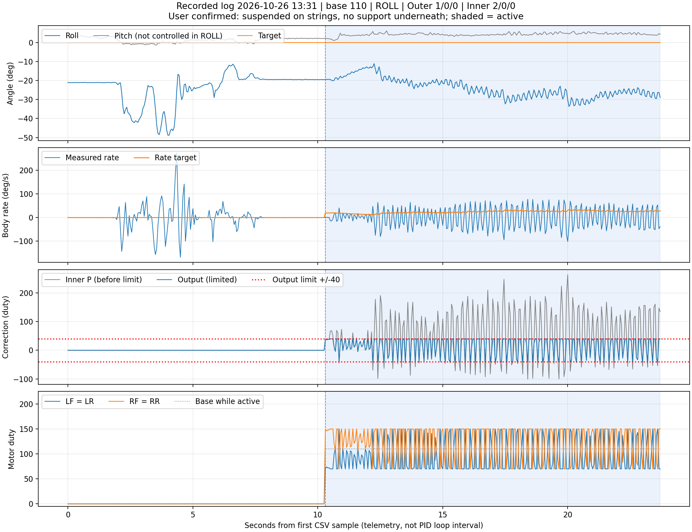

# Phân tích log PID 26/10/2026 – lượt 13:31:08

Nguồn: [pid-20261026-133108-743.csv](pid-20261026-133108-743.csv). Có **475 mẫu, 48 cột, dài 23,703 s** theo timestamp ESP32. CSV nguồn được giữ nguyên.

**Điều kiện người dùng xác nhận:** drone treo dây, **không có đế đỡ**. Đây là thay đổi quan trọng so với lượt trước còn có kê/chạm giữ thân. Tuy nhiên, dây vẫn có thể tạo mô-men, lực căng, giới hạn hoặc liên kết chuyển động; không mặc định treo dây tương đương bay tự do hay một đế chỉ xoay Roll lý tưởng.

**Kết luận:** cấu hình mới **chưa giữ được Roll=0 và đang dao động mạnh, kèm chạm giới hạn vòng rate thường xuyên**. Inner Kp=2, base=110; output chạm ±40 ở **190/269 mẫu chạy ≈70,6%**. Roll lúc Start đã khoảng −19,45°, có tiến gần 0 một đoạn nhưng không tới 0, sau đó lệch và dao động quanh vùng âm lớn hơn. Không nên tăng thêm Kp hoặc output limit từ lượt này.



## 1. Cấu hình thực trong CSV

| Mục | Giá trị |
|---|---|
| Trục | ROLL |
| Base lần Start được chấp nhận | 110 duty |
| Roll/Pitch target | 0° / 0° |
| Outer Roll/Pitch Kp / Ki / Kd | 1 / 0 / 0 |
| Inner Roll/Pitch Kp / Ki / Kd | 2 / 0 / 0 |
| Giới hạn outer output / I | ±45 / ±10 °/s |
| Giới hạn inner output / I | ±40 / ±20 duty |
| Biên motor sau trộn | 0–220 duty |
| Firmware build board báo | Oct 24 2026 15:36:24 |

Cấu hình không thay đổi trong file. Gain Pitch có lưu nhưng `pitchRateTarget`, `pitchOutput` và P/I/D Pitch bằng 0 trong đoạn chạy, phù hợp chế độ ROLL.

So với log 12:25, đã đổi cả **điều kiện cơ khí**, **Inner Kp 0,35 → 2** và **base 120 → 110**. Kp tăng khoảng 5,71 lần. Không coi hai file là một phép thử chỉ đổi riêng Kp hoặc chỉ bỏ phần kê.

## 2. Lượt này không bắt đầu từ thân gần ngang

| Giai đoạn | Thời gian từ đầu file | Số mẫu |
|---|---|---:|
| Chưa chạy | 0–10,253 s | 206 |
| Đang chạy | 10,303–23,703 s | 269 |

File **kết thúc khi active vẫn bằng 1**. Không có đoạn sau Stop để kết luận drone trở về đâu hoặc vì sao dừng. Giữa mẫu đầu và cuối đang chạy cách nhau khoảng 13,400 s; thời điểm Start thực nằm giữa các mẫu telemetry.

Trước Start, motor đều 0 nhưng Roll đã thay đổi từ vùng −21° đến gần −49° rồi quay về khoảng −19°. Có các tốc độ quay lớn trong giai đoạn này. CSV không cho biết do thao tác tay, dao động dây hoặc nguyên nhân nào khác; không gán những chuyển động trước Start cho PID/motor.

Ở mẫu đầu active:

```text
Roll = −19,449°
Pitch = +2,253°
Rate đo = +0,015°/s
Rate target = +19,449°/s
Output = +38,868 duty
LF/LR = 71; RF/RR = 149
```

**Ngay khi bắt đầu, lệnh sửa đã gần giới hạn +40.** Đây khác đáng kể lượt trước bắt đầu khoảng −1,24°.

Không đặt ZERO ở tư thế nghiêng chỉ để app báo 0: làm vậy thay mục tiêu/mốc chứ không chứng minh đã giữ được thân ngang thật.

## 3. Diễn biến sau Start

| Sau mẫu đầu chạy | Roll | Rate đo | Rate target | Output | Trái / phải |
|---|---:|---:|---:|---:|---:|
| 0 s | −19,449° | +0,015°/s | +19,449°/s | +38,868 | 71 / 149 |
| 0,25 s | −19,898° | −14,428°/s | +19,898°/s | +40 | 70 / 150 |
| 0,50 s | −19,539° | −11,053°/s | +19,539°/s | +40 | 70 / 150 |
| Khoảng 1 s | −16,378° | +14,534°/s | +16,378°/s | +3,688 | 106 / 114 |
| Khoảng 2 s | −13,845° | −75,252°/s | +13,845°/s | +40 | 70 / 150 |
| Khoảng 3 s | −21,530° | −19,954°/s | +21,530°/s | +40 | 70 / 150 |
| Khoảng 5 s | −19,574° | +41,359°/s | +19,574°/s | −40 | 150 / 70 |
| Khoảng 10 s | −32,864° | +43,908°/s | +32,864°/s | −22,089 | 132 / 88 |
| Cuối file, 13,40 s | −28,899° | −38,595°/s | +28,899°/s | +40 | 70 / 150 |

Góc gần target nhất trong đoạn chạy là **−11,087°**, vẫn chưa gần 0°. Ban đầu có một đoạn góc tiến về 0, nhưng không duy trì; sau đó lệch âm và dao động lớn hơn.

Không nên gọi mọi chuyển động ban đầu là sửa ngược: có giai đoạn góc tiến đúng hướng. Nhưng cũng chưa từ đó xác nhận hoàn toàn dấu motor, mapping hoặc mô-men dây; cần kiểm chứng lực/mapping thực tế khi chưa chắc.

## 4. BODY RATE nói gì?

| Đại lượng trong 269 mẫu chạy | Kết quả |
|---|---:|
| Roll trung bình | −23,992° |
| Roll nhỏ nhất / lớn nhất | −33,647° / −11,087° |
| Rate target trung bình | +23,992°/s |
| Rate đo trung bình | −0,788°/s |
| Rate đo nhỏ nhất / lớn nhất | −101,557 / +77,527 °/s |
| Độ lệch chuẩn rate đo | 41,860°/s |
| MAE rate: trung bình độ lớn sai lệch | 40,191°/s |
| RMS sai lệch rate | 48,981°/s |

Đường target luôn dương trong đoạn chạy, từ +11,087 đến +33,647°/s. Trong khi đó measured đảo hai chiều mạnh và không duy trì tốc độ quay về mục tiêu.

Sau giây đầu, Roll trung bình −24,454°, rate target trung bình +24,454°/s nhưng measured trung bình −1,095°/s. Đây không phải bám rate tốt.

Hình dung: yêu cầu quay dương, nhưng hệ liên tục quay/lắc hai chiều; chuyển động hồi phục không đủ để đưa góc về 0. Thành phần rate có thể chứa cả chuyển động thân và rung cảm biến. CSV này không có gia tốc thô hoặc hình chuyển động đồng bộ để tách chúng.

Telemetry khoảng 20 Hz cũng không đủ để khẳng định một tần số dao động cơ học chính xác hoặc loại trừ rung nhanh hơn giữa các mẫu.

## 5. Phân biệt chạm giới hạn PID với mixer cắt lệnh

### 5.1. Inner đang chạm biên rất thường xuyên

```text
Raw P:  −100,800 đến +263,501 duty
Output: −40 đến +40 duty

Output = +40: 138 mẫu
Output = −40: 52 mẫu
Tổng:        190/269 mẫu ≈70,6%
```

Vòng rate yêu cầu phần sửa vượt khả năng cho phép nên output bị chặn. Tỷ lệ trên là tỷ lệ mẫu telemetry ghi được, không phải tỷ lệ thời gian chính xác của toàn bộ vòng PID.

Với Kp=2, Ki=Kd=0:

```text
P = 2 × sai lệch rate
```

Chỉ cần độ lớn sai lệch rate đạt 20°/s là P đạt 40 duty. Ngay lúc Start, sai lệch đã gần 19,434°/s nên output gần chạm biên, chưa cần có dao động lớn.

Khi rate đổi chiều mạnh, output đảo từ +40 sang −40. Bộ trộn vì thế có thể liên tục đảo hai nhóm motor:

```text
Output +40 → trái 70,  phải 150
Output −40 → trái 150, phải 70
```

Đây là biểu hiện điều khiển mạnh, đổi chiều nhiều và bị giới hạn, chưa tạo chuyển động mong muốn. Nó phù hợp với một vòng đang hoạt động quá gắt/thiếu giảm chấn trong điều kiện thử này, nhưng không đủ để chứng minh chỉ Kp là nguyên nhân; còn tương tác dây, cơ cấu chấp hành, đo và độ trễ.

### 5.2. Mixer không bị cắt

`saturated=0` ở mọi mẫu chạy, motor đều trong 70–150, còn nằm trong biên 0–220. Cờ này nói về bộ trộn motor, không phải inner output.

Do đó có thể đồng thời xảy ra:

```text
Inner chạm ±40 thường xuyên: CÓ
Mixer vượt 0–220:            KHÔNG
```

Không thấy tín hiệu outer chạm ±45°/s. Không có căn cứ nói vòng góc bị giới hạn tốc độ là nguyên nhân chính của lượt này.

## 6. Phép tính PID và motor có nhất quán không?

Có, ở độ chính xác của CSV:

```text
Rate target = 0 − Roll
P = 2 × (Rate target − Rate đo)
Output = clamp(P, −40, +40)
Trái ≈ round(110 − Output)
Phải ≈ round(110 + Output)
```

- Outer khớp ở mọi mẫu chạy.
- P sai khác tối đa khoảng 0,002 duty do số liệu làm tròn.
- Output khớp đúng giới hạn P trong dữ liệu ghi được.
- Duty sai khác không quá 0,48 so với giá trị trước làm tròn.
- LF=LR, RF=RR trong mọi mẫu active.

Tại khoảng 5 s sau Start:

```text
Roll = −19,574° → Rate target = +19,574°/s
Rate đo = +41,359°/s

Sai lệch ≈ 19,574 − 41,359 = −21,785°/s
P ≈ 2 × (−21,785) = −43,570 duty
Output sau giới hạn = −40 duty

Trái 150, phải 70
```

Vì tốc độ đo đã vượt tốc độ yêu cầu, controller đảo tác động để hãm. Việc đảo output không tự là lỗi; vấn đề là trong lượt này sự đảo chiều và giới hạn diễn ra quá thường xuyên trong khi góc không trở về mục tiêu.

Log nhất quán công thức không chứng minh duty đã tạo lực đúng hoặc bộ ước lượng góc hoàn toàn chính xác.

## 7. So với lượt 12:25 còn có kê giữ thân

| Mục | Lượt 12:25 | Lượt 13:31 |
|---|---:|---:|
| Điều kiện | Treo dây, có kê/chạm giữ | Treo dây, không đế đỡ |
| Base | 120 | 110 |
| Inner Kp | 0,35 | 2 |
| Outer | 1 / 0 / 0 | 1 / 0 / 0 |
| Roll tại mẫu đầu active | −1,238° | −19,449° |
| Rate std toàn đoạn chạy | 9,270°/s | 41,860°/s |
| MAE rate | 18,282°/s | 40,191°/s |
| Inner chạm biên | 0/325 | 190/269 |
| Mixer cắt lệnh | 0/325 | 0/269 |
| Motor min/max | 99–141 | 70–150 |

Lượt mới bỏ được phần đế nhưng không phải “cùng bài thử, chỉ bỏ đế”: gain, base và góc bắt đầu cũng thay đổi. Không quy toàn bộ khác biệt cho một yếu tố duy nhất.

Với cấu hình hiện tại, dữ liệu cho thấy dao động rate và tỷ lệ giới hạn lớn hơn, góc chưa được giữ. Không có bằng chứng Kp=2 là bước cải thiện bám rate trong điều kiện này.

Pitch trong đoạn chạy khoảng +1,123 đến +6,175°, trung bình +4,334°. Nó nhỏ hơn độ lệch Pitch lượt trước nhưng vẫn không được điều khiển trong ROLL; không kết luận đã tune Pitch thành công.

## 8. Bước tiếp theo có cơ sở từ lượt này

### Ưu tiên 1: giảm mức tác động đang quá gắt, không tăng limit

Không tiếp tục tăng Inner Kp từ 2, tăng base hoặc nâng giới hạn output để cố đạt target. Lượt này đã dùng phần sửa tối đa rất nhiều và vẫn dao động mạnh.

Nếu mapping/chiều lực đã được xác minh và bố trí dây cho phép thử Roll phù hợp, lượt đối chứng tiếp theo có thể **giảm riêng Inner Kp từ 2 xuống 1**, giữ Outer=1/0/0, Inner Ki=Kd=0 và giữ các yếu tố khác tương đương. Đây là bước giảm thử, không bảo đảm 1 đã phù hợp hoặc an toàn ở mọi điều kiện.

Không dùng lượt 12:25 có kê để khẳng định Kp thấp hơn sẽ hoặc sẽ không hoạt động khi đã bỏ kê; đó là hai điều kiện cơ khí khác nhau.

### Ưu tiên 2: đưa điều kiện đầu về gần mục tiêu bằng cơ khí, không che bằng ZERO

Lượt này Start ở khoảng −19,45°, nên yêu cầu sửa gần biên ngay từ đầu. Bài thử nhỏ quanh gần ngang giúp phân biệt phản ứng ban đầu trước khi hệ rơi vào giới hạn kéo dài.

Chỉnh bố trí dây/điểm treo khi đã Stop/disarm để thân có thể ở gần ngang và xoay Roll trong phạm vi kiểm soát. Không dùng tay giữ sát cánh đang chạy. Không đặt ZERO ở một thân nghiêng thật chỉ để tạo số 0 trên app.

Nếu đã thay đổi cơ khí hoặc góc bắt đầu, ghi đó là một điều kiện mới và tạo lại lượt cơ sở; đừng quy toàn bộ cải thiện cho gain. Mỗi lượt so gain nên giữ bài thử và điều kiện ban đầu tương đương.

### Ưu tiên 3: đánh giá bằng cả rate và góc

Một thay đổi tốt cần:

- Measured tiến gần target hơn, không liên tục đảo biên lớn.
- Tỷ lệ chạm output giảm mà vẫn có tác động hồi phục.
- Góc thực sự tiến về gần 0 và không dao động tăng dần.
- Lệnh motor không đổi cực liên tục như lượt hiện tại.

Nếu góc không có xu hướng hồi phục đúng chiều, hoặc dao động tăng rõ, dừng lượt thử và kiểm tra mapping/lực/dây trước khi tune tiếp. Không thêm I để tích lũy khi đang bão hòa và dao động. D có thể là phần cần nghiên cứu sau, nhưng CSV chưa đủ để chọn gain D hay tách dao động thật khỏi nhiễu để hiệu chỉnh nó.

## 9. Giới hạn dữ liệu và những điều không được suy ra

- Timestamp tăng liên tục; khoảng mẫu trung bình 50,007 ms, nhỏ nhất 49,187 ms và lớn nhất 52,000 ms. Không thấy khoảng trống >75 ms trong file.
- Đây là telemetry khoảng 20 Hz, không phải thời gian cập nhật PID. CSV không chứa lý do Stop hoặc bản tin TIMING.
- File kết thúc khi active=1; không thể kết luận board đã dừng hoặc tự trở lại cân bằng sau đó.
- Trước Start có chuyển động lớn dù motor đang 0; không dùng toàn bộ rate std trước chạy để đánh giá riêng nhiễu đứng yên.
- Treo dây không đế được người dùng xác nhận; độ tự do, lực căng và mô-men dây cụ thể chưa được đo.
- Chưa có số đo lực đẩy/RPM, gia tốc thô hoặc góc thật đồng bộ để phân biệt mọi nguồn dao động.
- Board báo firmware build Oct 24 2026 15:36:24. Phân tích theo CSV; không coi source đang mở trong IDE mặc nhiên trùng firmware đã tạo file.
- SHA256 CSV nguồn: `d250d710950ba1275665bd1fc63f536b07c93625c66724067af3d9a29a4aefe5`.

**Tóm tắt hành động:** lượt này đã bỏ đế nhưng bắt đầu lệch nhiều và dùng Kp cao hơn rõ rệt. Chưa tăng thêm lực sửa. Chuẩn bị điều kiện thử nhỏ, có kiểm soát, giảm riêng mức P trong lượt so sánh phù hợp và giữ bằng chứng từ cả góc/rate/output.
